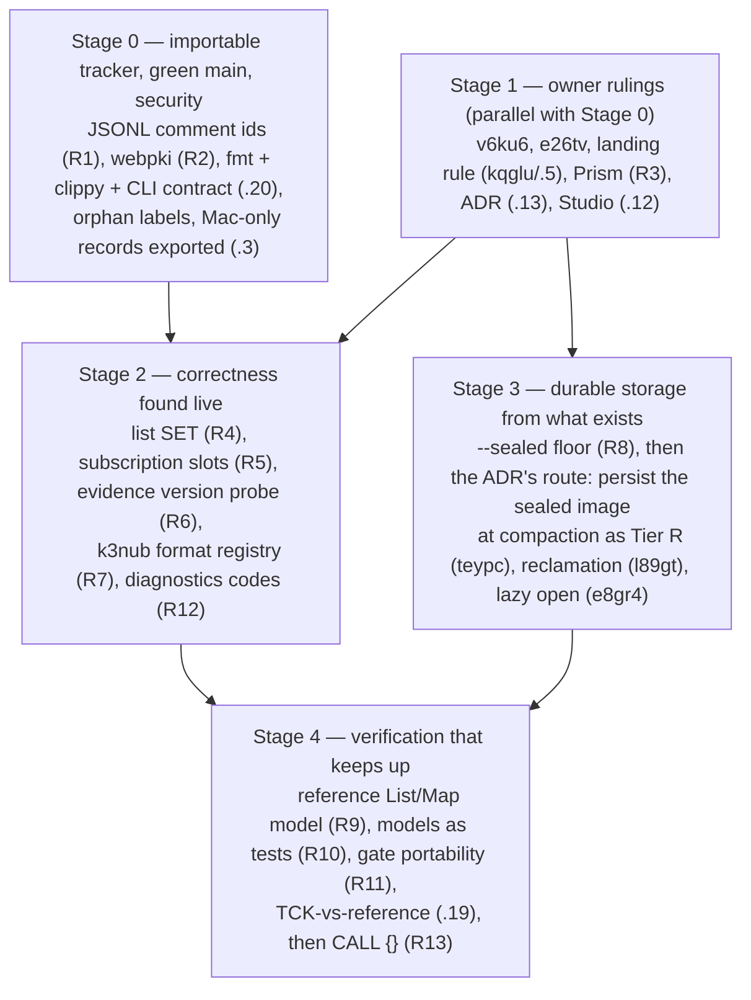
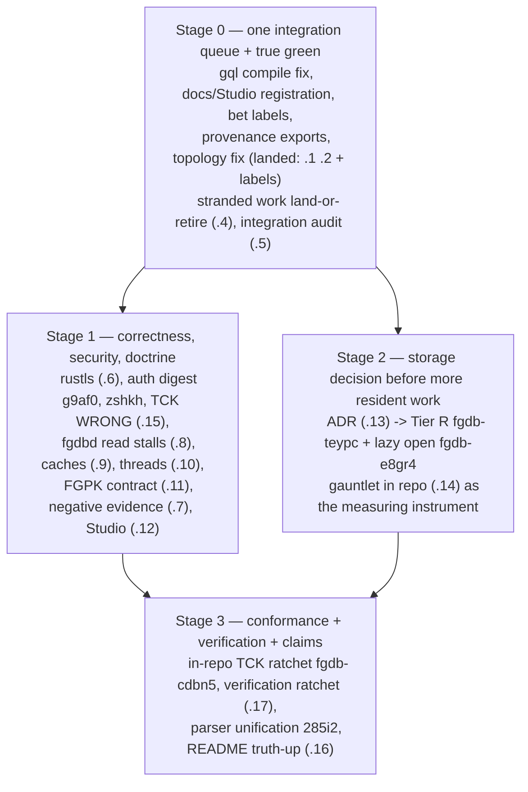
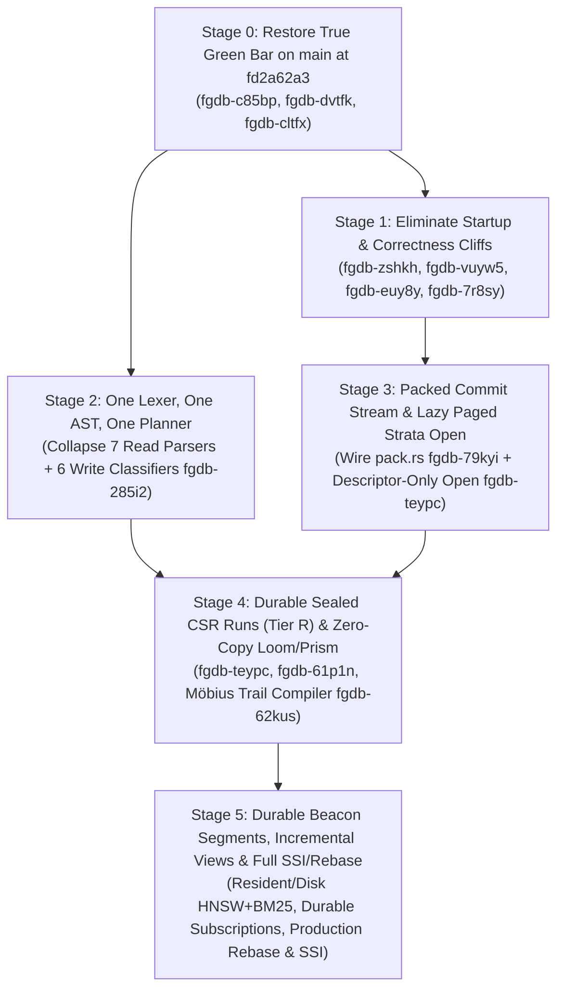

# Reality Check and Bridge Plan

**Latest audit: 2026-10-25**, frozen source
`2a21a935e36c478efba4654a39f7028b0a6bb1ec` (tree
`acf635dfc08d46170c2114a6332b9fd7da91a7ed`). See
[Current delta — 2026-10-25](#current-delta--2026-10-25). This refresh distinguishes
newly landed inline CALL and buffered/cooperative analytics from the still
missing durable composition. The twelve previously isolated task records now
exist in the shared Beads database; they remain absent from tracked JSONL.
The audit refines existing tasks rather than creating a duplicate bridge.
No G1–G4 or release qualification is asserted.

**Previous audit: 2026-10-23**, frozen source
`20c5d09115569f14649247162a82c5ccc7c87d32` (tree
`9bd4be80d15ba83010b22dd979c0129e6d40ff91`). See
[Current delta — 2026-10-23](#current-delta--2026-10-23) for the refreshed
20-goal assessment, current source and tracker evidence, dependency-ordered
bridge, and twelve concrete draft tasks. The shared graph remains divergent;
the draft is retained outside temporary storage and is **not published**.
No G1–G4 or release qualification is asserted.

**Previous audit: 2026-10-22**, local tree
`77cad971163f2636e6c35003eb8441b291c58615`, with the fetched remote delta through
`f0c40dc1cb371e1cc63f2d332fa4ebce537efb6d` examined separately.
The [previous section](#previous-delta--2026-10-22) records the 20-goal assessment,
fresh checks, three ambition passes, five refinement passes, and ten concrete
Beads drafts created through `br`. **The drafts are isolated, not published to
the shared work graph.** Disk admission and attributable tracker publication
remain explicit limits; this is not a current engine-suite or release verdict.

**Latest full runtime measurement: 2026-10-20**, at `df93ba15` (`origin/main` tip at
16:00 −0400, 204 commits after the 2026-10-17 check at `1563ee5b`). Nine more
uncompiled commits reached origin during the measurement; the tip re-check at
`92e83e49` is recorded in that section. It covers:
- the 20-row Vision Checklist, from four parallel read-only audits;
- fmt, check, clippy and the per-package test suites on Linux;
- all 14 runnable registered gates;
- live CLI and `fgdbd` runs;
- the openCypher TCK;
- a road-ny footprint probe;
- the work-graph state;
- the dependency-ordered bridge, with ambition and refinement rounds applied.

The finding that changes the ordering: the steering landed this time, but the
stream that writes half of `main` does not follow it. See
[Previous delta — 2026-10-20](#previous-delta--2026-10-20).

**Evening follow-up, same day:**
- the new advisory is fixed;
- all-targets compile and workspace clippy are restored at the then-tip;
- a new unregistered doc is registered;
- the bead specs are committed to this document, so the single writer can land them.

See [Evening follow-up (2026-10-20)](#evening-follow-up-2026-10-20).

**Previous measurement: 2026-10-17**, at `1563ee5b` (`origin/main` tip, 274
commits after the 2026-10-13 check at `fd2a62a3`). The section covers:
- the 20-row Vision Checklist;
- live CLI and `fgdbd` execution;
- the 900k-edge scale probe re-run against 2026-10-04;
- a full openCypher TCK run;
- 14 registered gates and the per-package test suites;
- the stranded-work census;
- the dependency-ordered Bridge Plan with in-place ambition and refinement
  rounds.

The finding that changes the ordering: the 2026-10-13 steering never left this
host. See
[Historical delta — 2026-10-17](#historical-delta--2026-10-17-superseded-by-2026-10-20). Bead epic:
`fgdb-rc1017-bridge-wvze5`.

**Previous measurement: 2026-10-13**, at `fd2a62a3` (`main` tip, 771 commits after
the 2026-10-04 full reality check at `08be545e` and 178 commits after the
2026-10-12 gauntlet anchor `53ea2eef`). Covers the full 20-row Vision Checklist,
live CLI and `fgdbd` server execution, workspace crate reachability census,
verification registry state, and the dependency-ordered Bridge Plan with three
in-place Ambition Rounds. It was committed only to the shared worktree's local
`main` on 2026-10-16 and landed on origin by the 2026-10-17 pass. See
[Historical delta — 2026-10-13](#historical-delta--2026-10-13-superseded-by-2026-10-17).
The 2026-10-12 and 2026-10-04 sections that follow are kept intact as history.

**Previous measurement: 2026-10-12/13**, the first end-to-end run on real
datasets against other engines. It covers `8d3ace1d` through `13023505`, plus
the landings `7392832d`, `2420931a`, `fb18c95d` and `53ea2eef`, on an Apple M5
Ultra. See
[Historical delta — 2026-10-12](#historical-delta--2026-10-12-superseded-by-2026-10-13). The 2026-10-04 summary
that follows is kept as history.

**Previous measurement: 2026-10-04**, at `5df67f66`. `main` was red from
2026-09-30 17:20 −0400 on five gates: fmt, clippy, tests (8 never-run laws for
UNWIND … MERGE, a feature that had never worked), the UBS ratchet, and commit
provenance. The landing on top of it is another session's unpushed `e062a907`
and `a54336f6`, plus this pass's `633df985` and `43b82bdc`. Its proof
(`08be545e`, tree_stable, 47 PASS) clears the first four, with
`cargo test --workspace` at 8,310 passed and 0 failed. Two gates stayed red,
and neither is a code finding:
- The UBS ratchet. The upgraded UBS truncates its Rust scan (`fgdb-zww2g`).
- The determinism e2e. The host's disk reaper deleted the proof's target dir
  mid-run, which is an environment failure.

See [Historical delta — 2026-10-04](#historical-delta--2026-10-04-superseded-by-2026-10-12).

**After the landing (same evening).** The toolchain-less stream resumed with 5
uncompiled commits (`f6cca5e5`..`5c21f28c`). This pass checked them at
`5c21f28c`:
- Clippy is clean. `fgdb-gql` lib passes 1,103/0, the new library UNWIND
  tests 8/8, and the CLI robot and UNWIND suites 23/23 and 6/6.
- fmt was red again on 5 of their files, so the next commit runs rustfmt over
  them.
- They add library entry points for atomic UNWIND writes (`fgdb-bapr6`) and
  exact Int/Float comparison (`fgdb-qnqrj` b). That comparison is now right
  after `WITH` and inside an expansion, but still silently empty for the
  README's single-vertex shape `MATCH (p:Person) WHERE p.born > 1800.0`. The
  same predicate now answers differently by query shape.

**Latest verified green: 2026-09-25**, at `0b952cb2`: `scripts/local_proof.sh`
verdict=pass (49 PASS, tree_stable). It is an ancestor of `main`, the first
verified green on `main`'s history. (The earlier `9adf484d` of 2026-09-08 is
not an ancestor; NE-0046.) The next proof of `main` ran on 2026-10-04 at
`5df67f66`. It was stopped before finishing, with 5 gates already red.

## Current delta — 2026-10-25

### Answer, source cut and review boundary

**There is a real, useful development database here. It is not the finished
B1–B6 system, a production-qualified release, or a demonstrated performance
leader.** Its strongest delivered composition is durable embedded graph
mutation and recovery, a substantial bounded native query engine, capability
sessions, a real CLI/server subset, local maintained queries and hybrid
retrieval. The central remaining gaps are persistent compressed storage,
the complete root/catalog/transaction/retention lifecycle, and the durable
derived-state/result/security/replication integration built on that lifecycle.

This investigation began on 2026-10-24 local time and continued after midnight.
All runtime work initiated here is attributed to the frozen commit above,
not to a moving `main`. Its clean detached checkout is
`/Users/jemanuel/projects/.worktrees/frankengraphdb-rc1024-2a21a935`; raw receipts
are retained outside temporary storage at
`/Users/jemanuel/Documents/Codex/2026-10-24/frankengraphdb-reality-check-2a21a935`.

The entire project `AGENTS.md` and `README.md` were read. Their SHA-256 values
are respectively
`cb773724f870f38f424fe2d3d575219941507901b7c7d8ea2fc6a5dad7661cf5` and
`d34abf692ca9c640f6c4a238ed1dca693a847002771690c8a9e34334e45464d6`.
Available machine/workspace parent instructions and the reality-check skill
were also read. `/data/projects/AGENTS.md` is absent on this host; the project
file's explicit summaries of its work-graph and reward-hacking rules were
retained. No missing suite file was invented or silently treated as read.

The normative plan, current profile documents, previous bridge, invariant and
checker registries, implementing entry points, regression sources and live
tracker were investigated against the twenty goals below. The plan's
full-strength targets remain the measuring stick. This is not a claim to have
line-read every byte of its 1.74 MB, all archived alternative designs, or all
2,297 Rust files. Historical reports and peer receipts are attributed to their
own cuts; they are not fresh execution of this cut.

### Twenty testable vision goals

`PARTIAL` means real implementation with the listed remaining scope, not fresh
qualification of every path. `UNWIRED` means implemented components are outside
the product path. Ownership means a nonclosed task exists; it is not acceptance
evidence. Broad target groups are deliberately not assigned a percentage.

| # | Finished-system acceptance target | Current implementation and decisive gap | Existing work owner |
|---:|---|---|---|
| 1 | Embedded open/session/prepare/typed streaming with the final ownership contract | PARTIAL. Real async `Database`, prepared/native and pinned reads, transactions and buffered reads. The synchronous README session API, durable catalog and final independently retained result/session lifecycle remain. Owners: `fgdb/src/lib.rs`, `query_explain.rs`, `buffered_read.rs`. | `fgdb-w10-embedded-54r`, `fgdb-7r8sy` |
| 2 | Capability-authorized serving over every promised transport | PARTIAL. FGP, HTTP/1.1 JSON, Bolt subset, TLS, recovery and host-owned maintenance exist. `fgdb-server/src/lib.rs` explicitly excludes durable result ACK/release/resume, explicit served write transactions, HTTP/2, gRPC and WebSocket. | `fgdb-w10-server-rte`, W10 |
| 3 | Stable robot CLI plus installable Rust/Python distribution | PARTIAL. Real CLI commands/schema and remote operations. Fresh remote tag query returned zero tags and the GitHub releases query returned `[]`; source builds are not signed installation or Python distribution. | `fgdb-epic-w10-mhq.1`, bridge `.16` |
| 4 | Frozen GQL/openCypher/FQL/Datalog and Unicode contract | PARTIAL, advanced. Inline read CALL now lowers through typed Apply, including explicit/legacy imports, nested bodies and typed graph identities. Stored collections, computed aggregates and carried-element reads advanced too. `construct.rs` still refuses graph/branch DDL; full frozen language closure is unqualified. | `fgdb-g0-language-contracts-54g`, W5, bridge `.15`/`.19`/`.23`/`.24`/`.30` |
| 5 | B1 complete command/root/recovery/retention universe | PARTIAL. Real Chronicle D1 capsule then D2 marker, authenticated checkpoints and recovery. `commit.rs` still uses the current append-only `commits.log` profile; that does not establish the final complete logical-command/root/checkpoint/retention lifecycle. | W2, `fgdb-w2-retention-checkpoints-cn1l` |
| 6 | B2 persistent compressed tiers and larger-than-memory operation throughout | PARTIAL. Bounded source readers and substantial external stages exist. `fgdb-strata/src/tiered/sealed/mod.rs` explicitly retains Tier-D manifest authority: derived sealed images are not registered persistent Tier R. General spill, complete resource coverage and cross-process retention remain. | `fgdb-w3-tier-r-0tj`, `fgdb-teypc`, bridge `.13` |
| 7 | B3 costed factorized/WCO execution over lawful physical orders | PARTIAL. Real covered-group FreeJoin and owned Flat/Product/Union factorization. `free_join.rs` separates logical work from byte/I/O accounting; `factor.rs` does not supply RunSlice leases or spill by naming factorization. General planning, alternate orders and parallel composition remain. | W5, `fgdb-w5-executor-olp` |
| 8 | B4 durable views, recursion, subscriptions and incremental analytics | PARTIAL. Commit-fed local registrations and served changefeeds exist. `standing_query.rs` explicitly says registrations do not survive reopen. Durable definitions/watermarks/cursors/resume and capability-masked maintenance remain. | W6, `fgdb-w6-views-2wz`, `fgdb-w6-subscriptions-evl` |
| 9 | Full SSI/strictness, sound phantoms, constraints and semantic merge | PARTIAL. Conservative read/scan FCW validation and specialized rebase are real. `write_txn_parts/finish.rs` explicitly excludes full SSI and durable session ownership. Neither an overlap abort nor a passed FCW law proves the full certifier. | W4, `fgdb-w4-strict-serializability-trw` |
| 10 | Strict replay of the complete retained execution/authority closure | PARTIAL. Native read certificates and replay bind supported plans/results/cuts. Complete executable, authority, index/policy epochs, archive leases and all statement classes remain outside that proof. | W5 replay, verification epic, bridge `.17`/`.28` |
| 11 | Every adaptive consumer emits an epoch-bound card with lawful fallback | PARTIAL/UNWIRED. Calibration/card mechanisms exist, but `fgdb-calibrate` is absent from all three product manifest closures. Fixed operator maintenance intervals are configuration, not a calibrated adaptive controller. | `fgdb-consumer-census-law-5pjdc`, calibration owners |
| 12 | Broad authorized FNX analytics with honest resource/copy boundaries | PARTIAL, advanced. Sixteen registered signatures; compressed and buffered/cooperative execution are real. Buffered calls can avoid a resident Snapshot, but still stage selected IDs/build derived images and have separately bounded image/kernel/output work. This is not universal zero-copy or external-memory execution. | W8, `fgdb-w8-projection-sd7`, bridge `.29` |
| 13 | Durable transactional, historical and branch-scoped search indexes | PARTIAL. Real BM25/HNSW/hybrid and synchronously maintained resident registrations. `query_beacon/resident/maintained.rs` scopes registrations to an opened database; durable catalog, branch scope and general planner reuse remain. Graph-only demand access is a separate useful improvement. | W7, `fgdb-t38fv`, `fgdb-5jyok` |
| 14 | Mandatory governance plus final key/audit/revocation/time/privacy lifecycle | PARTIAL. Real capability validation and pre-source masking. Warden retirement is local/cooperative; server output guards explicitly do not claim durable audit release, time-authority evidence or final revocation barriers. | W9, `fgdb-w4-secure-view-v87`, protected-output/audit owners |
| 15 | B6 agents fork/write/merge with provenance and retained retrieval replay | PARTIAL. Useful governed retrieval and host-resolved branch reads exist. `query_branch.rs` explicitly grants no persistent catalog, fork, merge or branch write. | W2 branch owners, W7/W9 |
| 16 | Served replication/HA, exact backup and independent restore | UNWIRED IN PRODUCT. Real Raft/catch-up/publication mechanisms in `fgdb-order`/`fgdb-repl`. The latter still requires real transport/pins/fences/Chronicle publication adapters and is absent from the product closures. | W11 and backup/restore owners |
| 17 | Query runtime operations as an authorized temporal system graph | NOT STARTED as the promised composed surface. Studio and fixed server maintenance are real, but neither exposes sessions, obligations, plans, result owners and maintenance history as the specified temporal GQL graph. | `fgdb-obs-system-graph-tki`, operations epic |
| 18 | Closed dependency paths and fully qualified unsafe/crypto/filesystem boundaries | PARTIAL. Structural forbidden-unsafe and ledgers exist; the retained lockfile uses ctutils 0.4.5. The previous advisory's affected-lock result is historical. Full accepted-platform, unsafe and protected-crypto acceptance still needs its actual gates. | W1/unsafe lanes, bridge `.33`/`.34` |
| 19 | Independent semantics plus full product lab/fault/formal/invariant closure | PARTIAL. Real reference state and bounded simulation campaigns. All twenty `.core` clauses remain stub; eight narrower clauses live; 74/120 checker rows live; one of ten formal lanes checked. A passing registry schema/activation check cannot promote those clauses. | Verification epic, bridge `.17`/`.19`/`.25`/`.26`/`.30` |
| 20 | Activated §17 manifests meet all rates and comparison laws | UNPROVEN. `fgdb-bench/src/main.rs` still emits `empirical_gate_activated=false`. No current complete pinned-manifest/competitor qualification establishes the advertised rates. | Performance epic, bridge `.14` |

The manifest census contains 31 first-party crates plus registry tooling.
The library, CLI and server transitively reach respectively 12, 14 and 15
first-party crates through product dependencies. Replication and calibration
are outside all three closures. The reference being outside those closures
is intentional: it is a test oracle, not a shipping engine dependency.

The front-page checklist does not discard the rest of the plan. Nonclosed
work also covers valid-time slices, escrow, TTL, schema constraints, Datalog,
Unicode, deterministic UDFs, legacy/columnar formats, archives, follower-read
authority, protected outputs/audit/privacy, format activation and post-1.0
sharding. W12 remains explicitly post-1.0. These are ownership findings,
not assertions that those capabilities execute today.

### Changes that must not be lost in another stale audit

The source difference from the previous frozen audit spans 233 files, with
26,939 insertions and 1,863 deletions. That includes real product work:

- `b46a09f59`/`0fab2b7e5`: typed correlated Apply and text inline read CALL.
  `multipart_reads.rs` covers duplicate/null outers, explicit and legacy
  imports, empty inner bags, nested bodies, local pagination, graph identities,
  scope errors and late failures. Read bodies are bounded to eight nested
  CALLs and refuse writes. Existing public/prepared-server tests are source
  evidence; full current-cut execution has its own verdict below.
- Buffered/compressed Prism and cooperative projection/kernel entry points
  now exist in `query_prism/buffered.rs` and `buffered_cooperative.rs`. Their
  comments explicitly retain synchronous source-admission/compaction/encoding
  stages, separate memory limits and a non-Send cooperative future. They do
  not implement persistent Tier-R publication or a spillable analytics kernel.
- Native collection/composite operands, aggregate ordering, carried-element
  reads and the vertex-history source cursor advanced. Old TCK wrong-answer
  counts cannot describe this cut without a new corpus run.
- Served subscription retirement has a 129-cycle source test; fixed
  maintenance/recovery and gate FD/include-discovery repairs also landed.
  A test's presence or an older passing cut is not a fresh complete verdict.
- ctutils 0.4.5 is retained on the existing dependency path. The affected
  0.4.2 security result from the prior audit is not a fresh red on this lock.

Some current-tense documentation is now stale in the opposite direction.
README's buffered section first admits intermediate grouping and leading
UNWIND/MATCH, then lists them among refusals; the following profile also needs
its relational-aggregate distinction. `TRANSACTION_GQL.md`'s final limitations
still name savepoints, typed parameters and authorization as absent without
distinguishing its old low-level API from current native/authorized surfaces.
The library introduction still lists CLI/server as absent. Bridge `.16` now
names these exact contradictions and requires profile-specific executable
witnesses; the target design was not weakened to make the prose agree.

### Would implementing every open task finish the vision?

**Not as an unconditional completion claim.** All twenty broad groups have
existing nonclosed owners, so this audit found no newly orphaned whole
subsystem requiring another epic. The most useful new work is to refine and
execute those owners. But broad descriptions are not complete executable
acceptance, closed records do not establish current integration, and the two
tracker sources disagree. Product closure requires the implemented cross-layer
contracts and their actual gates, not merely changing each remaining status.

The initial live DB snapshot held 1,326 issues: 390 open, 51 in progress,
876 closed, three blocked and six deferred. Tracked JSONL held 1,319:
382 open, 37 in progress, 891 closed, three blocked and six deferred.
There were 27 DB-only IDs, 20 JSONL-only IDs and 35 dirty records.
The twelve `.23`–`.34` tasks from the previous isolated draft are now in the
shared DB, including active `.23`, `.25` and `.27`; they are still absent
from tracked JSONL. Calling them wholly unpublished drafts is now inaccurate;
calling them git-published would also be inaccurate.

Native additive reconciliation preview exited 6 with 104 relation conflicts
and one newer-database scalar conflict. It proposed 20 source-only creates
and one update while preserving 27 DB-only records. No preview was applied,
no conflict was force-resolved and no database/WAL was replaced. The old
duplicate-comment-ID diagnosis alone no longer describes this blocker.

### Dependency-ordered bridge and concrete acceptance

1. **Make adoption and exact-source proof dependable** (all goals;
   `.21`, `.25`, `.26`, `.33`, `.34`, `.20`). Resolve only reviewed tracker
   scalar/relation differences under one writer, preserving every history;
   use the exact-ID export helper. Retain the patched dependency path.
   Reproduce current failing gates, distinguish assertions from environment
   refusals, and prove the committed tree with the original whole-tree gate.
   Missing tools, a partial UBS scan, absent corpus or timed-out remote work
   are UNRUN, never passes. This publication dependency does not prohibit
   independent semantic/storage implementation while proof runs.
2. **Publish and reuse one durable compressed generation** (5–7, 12–13;
   W2/W3, `.13`, `.29`). Implement registered run references, descriptor/root
   publication and retained generations in the existing Strata/Chronicle
   abstractions. Seal once, reopen without rebuilding, and route existing
   readers/Prism through that generation. Require D/R/reference equality at
   retained cuts, stable origin and parallel-edge identity, exact properties,
   authorization, crash/cancel tests and total memory/RSS/disk accounting.
   A derived image or an ADR is not this acceptance.
3. **Complete the shared catalog/root/retention/transaction spine** (1, 4–6,
   9, 14–16; W2/W4/W9). Persist graph/schema/branch and complete command state;
   implement the specified FCW/SSI/strictness/witness/constraint and semantic
   rebase laws without a substitute global-lock engine. Fork/write/merge must
   survive restart. Gate reclamation on every root/result/backup/cross-process
   owner and forced-crash stale-writer tests; floor-zero consolidation is not
   proof of safe space reclamation.
4. **Finish one execution family and independent cross-mode corpus** (1, 4,
   7, 9–10, 12, 19; W5/W8, `.23`, `.24`, `.29`, `.30`). Keep actual typed
   Apply, FreeJoin and native stages; provide missing lawful orders, costed
   planning, leases/spill and cooperative parallel composition. Use simple
   independent environment/bag/value models for exact types, order, effects,
   errors and observations across prepared/historical/authorized/staged and
   admitted source/spill/maintained paths. Preserve unsupported-profile
   refusals, negative controls, original fuzzer scope and minimized seeds.
   Test compaction/seal/reopen invariance and meaningful complexity bounds.
5. **Give derived state and delivery their final durable owners** (2, 8,
   10, 13–15; W6/W7/W10). Persist definitions/generations/watermarks and attach
   index/view/subscription/result owners to the same root, authority and
   retention contracts. Exercise loss of ACK, disconnect, revocation,
   reopen/rebuild, gap/reset, partial send and exact cursor release/resume.
   An in-process handle or ephemeral successful stream is not durable resume.
6. **Connect governance, replication and independent recovery** (2, 5, 9,
   14–16; W9/W11). Supply real ReplCx transport, retention pins, writer fences
   and atomic Chronicle publication to the existing Aegis machines; complete
   the full security binding/audit/time/key/privacy lifecycle where enabled.
   Require real multi-process partition/donor-loss/leader-loss/stale-writer
   histories and independent archive/target restore. A helper state-machine
   test cannot qualify HA or rollback prevention.
7. **Activate complete invariant, lab and policy consumers** (10–11, 14,
   18–19; verification/W1/calibration). A `.core` clause changes to live only
   after its full reachable checker and independent negative test exist.
   Extend product lab/fault schedules through server/replication, retain
   formal-model boundaries, and audit raw OS-thread paths. Enumerate actual
   adaptive consumers, classify answer-preserving/affecting/state changes,
   pin epochs/cards and prove deterministic fallback. Registry validity and
   statistical evidence remain distinct from safety or whole-product proof.
8. **Finish breadth, operations and measured shipment** (1–4, 12, 16–18,
   20; W8/W10/operations/performance). Preserve the complete language/catalog,
   FNX, transport, typed synchronous embedding, Python, system-graph, format,
   install/upgrade and backup targets. Test signed clean-machine consumers
   and the exact robot contract. Activate §17 manifests on actual durable
   production paths with result consumption, live incumbents in the same
   invocation, distributions, compaction, memory, policy epochs and variance
   controls. Neither self-speedups nor source builds establish the claim.

The next high-value composed witness remains an **authorized public query
over a persistent compressed generation**, under a real memory bound, whose
identity/order/authority survive update, retained history, crash and reopen.
It links B1/B2/B3/B5/B6 without substituting a resident-only demonstration.
Independent query correctness and current gate repair can progress alongside
that storage work; more isolated scalar features do not remove the storage
integration dependency.

### Bead refinement, ambition and graph validation

The skill's frozen generation/refinement requirements were applied to the
existing granular tasks. No duplicate task or completion-count padding was
needed. Through `br` only, this audit appended current source, rationale,
implementation boundaries and executable acceptance to `.16`, `.21`, `.24`,
`.29` and `.30`. No task status or structural dependency was changed, and no
issue was closed. Peer-assigned `.23`, `.25` and `.27` work was preserved.

Three ambition passes strengthened the existing bridge in place:
(1) reusable persistent generations rather than repeated resident derivatives;
(2) one catalog/root/authority/retention lifecycle shared by features;
(3) independent semantic/complexity/resource evidence across modes rather
than broader labels on narrow mechanisms.

Five refinement passes checked current-source omissions and stale diagnoses;
duplicate ownership and real blocking edges; complete positive/error/fault/
cancellation and quota tests; source/platform/proof-class boundaries; and
whole-plan consistency without deleting features. The final examined-scope
read-back found no further task-scope change. This does not assert that every
historical issue is optimal or independently accepted.

`br dep cycles` exited 0 with zero active cycles. The current native
`bv --robot-triage`, `--robot-insights` and `--robot-plan` each exited 0 on
tracked JSONL; insight configuration confirms cycle computation ran and
`Cycles=[]`. This version's graph contains all 1,319 tracked records, including
the six deferred records; it does not include the 27 DB-only records. Its first
recommendation is the historically stale
seven-crate topology issue despite current registry validity: robot ranking
is navigation, not evidence that a feature is broken or finished.

### Executed evidence and remaining qualification

| Probe | Result and honest scope |
|---|---|
| Disk preflight | `sbh check --need 20G` exits 1: 224.2 GB available but 5.61% below the configured 8.06% threshold. No local heavy build or threshold override was used. |
| Registry consistency on the frozen root | Exit 0, zero failures. Reused native executable from the separately recorded `a2bf1ec7` build; checker sources, registries, workspace manifest and toolchain are unchanged between that cut and this one. This is a fresh input check with reused code, not a fresh compile. Sample activation closure has zero reachable clauses. |
| Tracked shell lint | 39 files, zero `bash -n` or warning-level shellcheck failures; exit 0. Syntax/static assertions only. |
| Studio tests | Four actual test files, 49 passed, zero failed/skipped/cancelled; exit 0. UI/model/flow/Wasm tests, not browser/server acceptance. An initial wrong-path invocation executed zero tests and is not counted. |
| AST stub scans | `todo!` and `unimplemented!`: each returns exit 1 with `[]`, the scanner's no-match result. No matching macros is not implemented-feature coverage. |
| Remote tags and releases | Both queries succeed; zero tags, releases `[]`. No release/installability qualification follows from source binaries. |
| Tracker reconciliation | Read-only preview exits 6 with the 105 conflicts above; no apply. |
| Native/robot work-graph validation | Active native cycles and three tracked-JSONL `bv` commands exit 0, with the distinct scopes/denominators above. |
| Frozen Linux workspace engine tests | Dispatched with all features, locked dependencies, no-fail-fast and explicit Linux target; registry-check intentionally excluded from this remote-only probe because its corpus must be checked locally. Final verdict is recorded below when terminal evidence is available. This is not the complete mandatory gate. |
| Frozen runnable embedded example | Separate exact-base `open_a_database` invocation dispatched; final terminal evidence is recorded below. |
| Frozen canonical local proof | Original `scripts/local_proof.sh` / `scripts/check.sh` dispatched on the clean exact tree with strict remote offloading for heavy Cargo work. Final manifest/verifier verdict is recorded below. |
| Current full TCK, §17 comparisons, external-authority/HA, installer/Python acceptance | Not rerun by the local static checks above. Historical results are not current results. |

Pending terminal evidence is not a passing gate. The audit changes only this
existing report and append-only notes on the five existing tasks; it changes
no engine, test expectation, gate, baseline, registry activation or normative
requirement.

## Current delta — 2026-10-23

### Verdict and the subject being assessed

**FrankenGraphDB is a substantial, useful development engine. It does not yet
deliver its composed B1–B6 product, qualify for G1, or establish the advertised
performance leadership.** Durable writes/recovery, native queries and writes,
authorized network execution, search, maintained local queries and native read
replay are real mechanisms. The most consequential remaining work connects
them to persistent compressed storage and the final shared catalog, retention,
transaction, authority, result-owner and verification contracts.

The complete `AGENTS.md` (414 lines) and `README.md` (746 lines) were read in
this invocation. Their SHA-256 values are respectively
`cb773724f870f38f424fe2d3d575219941507901b7c7d8ea2fc6a5dad7661cf5` and
`c75e6445442ceb9221877dc19263a9d32787fdc631b1b3d51ea75d7c883a28c0`.
The reality-check skill and gap/bridge/vision references were applied. Available
parent guidance was read. `/data/projects/AGENTS.md` is absent; neither the
workspace parent nor the alternate mounted suite copy supplies the two named
sections verbatim. The project file's explicit summaries remain binding.

Review also covered the normative plan's subsystem, durability, transaction,
security, verification, performance and convergence contracts; current status,
protocol/evidence/resource documents; invariant/checker/formal registries;
the existing bridge and task descriptions; implementing entry points and
targeted regressions. **This is not a claim to have line-read all 1.74 MB of the
normative plan, every historical alternative plan, or the entire source tree.**
The old alternative plans are historical context, not competing specifications.

The primary source cut is `20c5d0911`. During verification a peer landed
`d879a0711`, adding four changed paths for compressed CDLP and reverse
projections. Those changes were preserved and inspected separately; this
audit's frozen-cut runtime evidence does not qualify them. The first shared
`check.sh` correctly invalidated its earlier child verdicts after that tree
movement. A detached, clean checkout at
`/Users/jemanuel/projects/.worktrees/frankengraphdb-rc1023-20c5d091` was created
for stable verification. No engine, gate, registry or normative plan was edited
by this audit.

While the frozen suite compiled, concurrent work advanced `main` through
`dd4f5d9b9` and committed the report as `8ba900ff4`. The later source includes
read-cache ownership/budgeting, point-effect selection, computed CREATE output,
additional compressed analytics and numeric parameter work. Those later changes
are outside this cut's runtime qualification. Neither the original findings nor
their old line numbers should be projected onto the moving tip without review.

**Frozen-cut P0 security finding, patched on later `main`:** the executed
dependency gate rejects `20c5d0911`'s locked `ctutils 0.4.2` for
[RUSTSEC-2026-0385](https://rustsec.org/advisories/RUSTSEC-2026-0385.html),
issued on 2026-10-23. It reaches the product through the pinned asupersync
crypto dependency chain. The advisory's patched floor is `>=0.4.4`;
[the upstream fix](https://github.com/RustCrypto/utils/pull/1569) was also
checked. This is an affected dependency and a real gate failure, not evidence
that a database secret was recovered.

Concurrent commit `baaec02be` subsequently updates only that locked package
and its checksum to **0.4.5**, retaining the existing dependency path and
policy. This audit independently reran `scripts/dependency_policy_e2e.sh` at
`232962dcc`: **exit 0, six assertions passed, zero failed/unrun**, including
all four planted negative controls. HEAD and recorded lock/root-manifest/
policy/script hashes were unchanged before/after. This clears the advisory
gate on the later lock; it does not retroactively change the frozen proof or
qualify the patched product's full runtime/crypto behavior. Draft `.33`/`.34`
now retain that repair and track remaining acceptance, rather than recreating
it. No advisory ignore, gate weakening or new dependency path was needed.

### Twenty concrete vision goals and their next acceptance witnesses

`PARTIAL` means a real implementation exists with the stated remaining scope;
it does not imply fresh end-to-end qualification of every path. The source
references below are the measuring points. Broad architectural owners already
cover all twenty groups; narrow draft-only scopes are identified afterwards.
The table describes the frozen cut; the later patched-lock policy pass above
is separate evidence.

| # | Testable target | Current code and decisive gap | Existing owner and required acceptance |
|---:|---|---|---|
| 1 | Embedded open/session/prepare/typed streaming, including bounded memory | PARTIAL. Real async `Database`, pinned/prepared reads and write overlays. The synchronous `db.session().prepare()` example and durable multi-graph catalog remain target APIs. `fgdb/src/lib.rs`, `query.rs`, `buffered_read.rs`. | W10, `fgdb-7r8sy`: public create/write/prepare/stream/reopen workflows, typed values, backpressure, cancellation and exact quotas. |
| 2 | Capability-authorized server with every promised transport | PARTIAL. `fgdb-server/src/lib.rs` names real FGP, HTTP/1.1 JSON, Bolt subset, TLS and supervised recovery. It explicitly excludes HTTP/2, gRPC, WS, durable result ACK/release/resume, prepared writes and explicit served write transactions. | `fgdb-w10-server-rte`, W10: real client/transport parity plus disconnect, revocation, recovery and uncertain-outcome tests. |
| 3 | Robot CLI and installable Rust/Python distribution | PARTIAL. Real command dispatch and schema, including remote operations and chain CSV import. GitHub release query returned `[]`; remote tag query returned no tags. No signed installation/Python distribution was established. | `fgdb-epic-w10-mhq.1`, bridge `.16`: clean-machine install, signed artifact/upgrade/consumer tests and exact robot contract. |
| 4 | Frozen ISO GQL/openCypher/FQL/Datalog language closure | PARTIAL. Real compiler/operator execution and expanding semantics. `construct.rs` explicitly refuses graph/branch DDL and inline CALL subqueries. This invocation has no fresh full TCK result. | `fgdb-g0-language-contracts-54g`, W5, bridge `.15`/`.19`, draft `.23`/`.24`: independent typed/order/bag/effects/error differential and published feature/refusal matrix. |
| 5 | B1 final published-root, logical-command, retention and branch universe | PARTIAL. `fgdb-chronicle/src/commit.rs` implements real capsule D1 then marker D2 and the current append-only `commits.log` profile. Checkpoint-chain binding is real. This does not implement the final complete command/root lifecycle or durable branch catalog/fork/merge/write. | W2 and `fgdb-w2-retention-checkpoints-cn1l`: generated-complete recovery closure, retained cuts, fork/merge and crash/fence proofs. |
| 6 | B2 persistent compressed tiers and larger-than-memory operation everywhere | PARTIAL. Charged buffered reads and admitted external stages are real. `tiered/sealed/mod.rs` explicitly says the manifest still roots Tier D; a derived sealed image is not registered persistent Tier R. `buffered_read.rs` excludes general arbitrary-size admission and cross-process GC leases. | `fgdb-w3-tier-r-0tj`, `fgdb-teypc`, bridge `.13`: seal once, persist/root/reopen without resealing; D/R/reference equivalence, cold bytes, pool usage and complete RSS/disk footprint. |
| 7 | B3 unified factorized/WCO optimizer and morsel-parallel execution over runs | PARTIAL. `fgdb-gql/src/free_join.rs` and `free_join/factor.rs` implement real covered-group joins and factorized outputs. Their documented work units are not byte/I/O accounting, and grouped FreeJoin does not inherit a WCO bound by name. General costed planning, spillable alternate tries and full parallel composition remain. | W5, `fgdb-w5-executor-olp`: public queries select the lawful physical family; independent flat/factor equality, bound instrumentation and no-materialization/resource tests. |
| 8 | B4 one durable incremental runtime for views, recursion and subscriptions | PARTIAL. `standing_query.rs` implements a commit-fed owned registry with many operators; its header explicitly excludes durability across reopen. FGP changefeeds are real but not durable resume or capability-masked maintenance. | W6, `fgdb-w6-views-2wz`, `fgdb-w6-subscriptions-evl`: derivative=batch laws plus crash/reopen, cursor ACK/replay and watermark/authority lifecycle. |
| 9 | Full SSI, phantom protection, constraints and semantic merge | PARTIAL. `write_txn_parts/finish.rs` explicitly names conservative embedded read/scan validation rather than full SSI. Specialized append/disjoint-field/mixed rebase exists; the full graph-SSI and general semantic ladder/session ownership do not follow from it. | W4, `fgdb-w4-strict-serializability-trw`: independent trace-derived rw-graph/phantom/constraint histories, forced rebase, cancel and crash matrices. |
| 10 | Retained strict replay of the full executable and authority closure | PARTIAL. `query_explain.rs::replay` checks native plan/values/snapshot identity and reexecutes at the certified cut. It explicitly claims no archive leases or nondeterministic seeds. Full retained executable/policy/authority/index/epoch closure is incomplete. | Verification epic, bridge `.17`, draft `.28`: supported producer/consumer artifacts, wrong-history/plan/authority controls and full statement-scoped invariant apparatus. |
| 11 | Every adaptive decision carries an epoch, card and deterministic fallback | PARTIAL/UNWIRED. Calibration code exists; no product manifest closure includes `fgdb-calibrate`. Local strategy/card machinery is not universal consumer integration. | `fgdb-consumer-census-law-5pjdc`: enumerate real consumers; card/feature/action/epoch/fallback replay and failed-estimator equivalence tests. |
| 12 | Broad authorized FNX analytics with honest copy and memory boundaries | PARTIAL. `fgdb-prism/src/call.rs` registers 16 signatures. Recent compressed closeness/harmonic kernels are real. `projection.rs` distinguishes decoded cache from compressed cursors. This is neither the broad promised catalog nor universal external-memory/zero-copy analytics. | W8, `fgdb-w8-projection-sd7`, draft `.29`: per-signature routing, pinned parity, masking/history, budget/cancel and total memory evidence. |
| 13 | Durable, branch/transaction-scoped text/vector/graph indexes | PARTIAL. BM25/HNSW/hybrid and commit-maintained resident registrations are real. `query_beacon/resident/maintained.rs` explicitly scopes them to one opened database; there is no durable branch-scoped index catalog. | W7, `fgdb-t38fv`, `fgdb-5jyok`: atomic watermark/tail-correct activation, reopen/rebuild and historical/authority-safe indexed answers. |
| 14 | Mandatory governance plus complete key/audit/revocation/time/privacy lifecycle | PARTIAL. Capability sessions and source masking are real. Server docs explicitly distinguish host-clock/issuer checks from durable audit release, time evidence and revocation barriers. Full core enforcement remains absent. | W9, `fgdb-w4-secure-view-v87`: denied graph observations before expansion, protected physical output, external-authority failures and durable lifecycle oracles. |
| 15 | B6 branch-per-agent memory with provenance and retrieval replay | PARTIAL. Useful scoped hybrid/native reads exist. `query_branch.rs` explicitly resolves host-supplied immutable read views; it grants no fork/merge/write/catalog authority. | W2 branch owners, W7/W9: independently authorized agents fork/write/merge, retain/replay reads and preserve provenance/conflict semantics through restart. |
| 16 | Served replication/HA, exact backup and independent restore | UNWIRED IN PRODUCT. `fgdb-repl` has real Raft/catch-up/publication machines and explicitly requires transport, pins, writer fence and Chronicle publisher adapters. It is absent from all three product dependency closures. | W11: real multi-process cluster, partitions/donor loss/stale writers and independent backup/reopen/restore/continuity proof. |
| 17 | Authorized temporal system graph and full operations plane | NOT STARTED as the promised integrated query surface. Studio has real UI/model code; 49 passing local JS tests do not expose sessions, obligations, plans and maintenance as a temporal property graph. | `fgdb-obs-system-graph-tki`, observability epic: actual authorized GQL queries, history, bounded event admission, degraded-mode and redaction tests. |
| 18 | Closed dependencies and ledgered unsafe boundaries | STRUCTURALLY CHECKED within the local registry suite's scope. `Cargo.toml` forbids unsafe in ordinary crates; named islands and ledgers exist. The dependency-security gate is RED for affected `ctutils`; broad Miri/cross-target/filesystem proof is UNRUN. | W1, unsafe lanes and draft `.33`/`.34`: patched existing dependency path, original policy controls, every unsafe site, scalar/SIMD parity and accepted-platform conformance. |
| 19 | Independent reference, full product lab/fault/formal and invariant closure | PARTIAL. `fgdb-reference` stores canonical List/Map state; `fgdb-sim` has real bounded campaigns. All 20 `.core` clauses remain stub, eight narrower clauses live; 74/120 checker rows live; 1/10 formal lanes checked. | Verification epic, bridge `.17`/`.19`, draft `.30`: independent query/trace models, real product seams and each complete reachable clause plus negative test before activation. |
| 20 | Every activated §17 performance manifest meets its target | UNPROVEN. `fgdb-bench/src/main.rs` labels output `empirical_gate_activated=false`. No current full §17 qualification or competitor leadership is established. | Performance epic, bridge `.14`: reproducible manifests, full result consumption, matched production semantics, incumbent in the same invocation, distributions, memory, compaction and variance controls. |

Production manifest closure counts are 12 first-party crates for `fgdb`, 14 for
the CLI and 15 for the server. Both replication and calibration are outside
those closures. The reference is also outside them **as intended for a test
oracle**; that exclusion is not a product defect.

The performance gap is quantitative, not just missing marketing polish. The
provisional §17 targets include 40M edges/s bulk loading, 2M transactional edge
inserts/s, 8M point lookups/s, 500M sealed-scan edges/s per core, and competitive
LDBC SF-100/Graphalytics runs on a pinned reference class. They are targets,
not current measurements. Their activation must include complete durable
operation costs, result consumption, retained versions, memory and background
maintenance, with an incumbent in the same comparison invocation. No fresh
measurement in this audit establishes those target rates.

The plan contains important scope beyond the front-page six bets. Existing
nonclosed owners were also found for valid-time slices (`fgdb-w4-valid-time-h8i`),
escrow (`fgdb-w4-escrow-transitions-z00`), TTL (`fgdb-w4-ttl-expiry-ur3`), Unicode
contracts (`fgdb-g0-language-contracts-54g`), schema constraints
(`fgdb-w4-constraints-80s`), Datalog (W5), deterministic UDFs
(`fgdb-w10-udf-vm-3kv`), legacy/Arrow/Parquet formats (`fgdb-w10-formats-diq`),
single-file archive open (`fgdb-w10-archive-open-uqr`), follower read authority
(`fgdb-w11-read-contracts-g2u`), audit/DP/protected-output owners
(`fgdb-w2-local-audit-visibility-core-l09k`,
`fgdb-w2-local-protected-output-owners-by8v`), format activation
(`fgdb-w11-format-activation-vau`) and post-1.0 sharding (W12). These features
were not dropped from the plan to make the implemented slice appear complete.
This is ownership coverage, not implementation or acceptance proof.

### What changed since the previous assessment

The diff from `77cad9711` to the frozen cut spans 246 files, including substantial
query/write work. It is inaccurate to say nothing useful advanced. Sources add
frozen/authorized element reads through mutation chains, chain CSV ingestion,
computed/list/aggregate and OPTIONAL handling, affected-identity accounting and
compressed centrality. At `d879a0711`, compressed CDLP is a further source delta.
These improvements do not introduce durable branches, persistent Tier-R roots,
the full SSI engine, replication consumers or a live `.core` invariant.

Several old descriptions would now cause duplicate or misguided work:

- `fgdb-reference` already stores collection-valued graph state; independent
  query semantics remain the gap.
- Subscription retirement/cleanup already exists in
  `fgdb-server/src/recovery/subscriptions.rs`; repeated slot-reuse and fault
  proof is still needed.
- `identity.rs:2257` now asserts that `.beads/issues.jsonl` exists. The historical
  silent early return quoted in guidance has already been repaired.
- Standing-query counter propagation has new implementation commits. The old
  approximately eleven-red result is not a current measured result.
- Native `br` additive import now handles duplicate local comment IDs without
  losing logical comments. The live blocker is divergent relations/scalars.
- The README describes grouping and leading UNWIND/MATCH as supported, then
  still lists them among buffered refusals. The status document's final missing
  list still names TLS/subscriptions after describing them as present earlier.
  The complete Fabric document also retains all-writes-refused Bolt prose and
  until-reopen subscription lifetime prose after their implementations changed.
  Truth-up must name the exact profile and preserve the target features.

### Bridge: close the composition gaps in a testable order

1. **Retain the security repair and restore adoption/proof.** Keep the later
   `ctutils 0.4.5` patch and its fresh six-assertion policy pass, then complete
   the remaining patched-source crypto/application acceptance. Resolve the live tracker's
   exact relation/scalar differences without discarding either history or any
   DB-only record; publish only the attributable ID set. Prove a clean frozen
   subject with `.beads` present for tracker-dependent assertions. This gates
   publication, not independent read-only investigation or semantic work.
2. **Publish one reusable durable compressed generation.** Finish the registered
   root/run/descriptor boundary and move consumers behind it. Seal once; reopen
   authenticated run references without rebuilding the projection. Require
   D/R/reference equality at retained cuts, stable origin order, parallel-edge
   identity, properties, authority, cancellation/crash cases and complete
   pool/RSS/disk accounting. The ADR alone is not this implementation.
3. **Finish the shared recovery/retention/transaction spine.** Complete the
   logical-command/root/checkpoint lifecycle, branch/schema/constraint state,
   SSI and ownership/fencing. Prove all root/retention owners and cross-process
   pins before reclamation. Current `compact` explicitly consolidates at floor
   zero; consolidation does not establish safe disk reclamation.
4. **Keep one independent semantic corpus across modes.** In parallel with
   storage, compare resident, prepared, historical, authorized, staged,
   buffered/spill and maintained paths against simple retained models. Compare
   types/order/bags/effects/errors/observations, not only successful row sets.
   Preserve failures, original fuzzer scope and negative controls.
5. **Share durable derived/result/security lifecycles.** Bind index/view
   generations, subscriptions and retained outputs to the same root, authority,
   watermark and retention contracts. Exercise reopen, loss of acknowledgments,
   recovery, revocation and partial physical output; then connect real Aegis
   transport/publication and prove independent backup/restore.
6. **Activate complete product proofs and policy consumers.** Every reachable
   invariant clause needs its full checker and independent negative control.
   Native subset replay cannot promote the broader replay core clause. Real
   decision consumers must emit epoch-bound cards and replay deterministic
   fallback. Raw OS thread scopes still present in CLI load and Prism require
   an honest whole-product lab/cancellation disposition.
7. **Complete breadth and publish measured shipment.** Finish language/catalog,
   FNX, transport, synchronous/typed embedding, Python, system operations,
   install/upgrade and remaining registered formats. Activate §17 manifests on
   the actual production paths with live incumbents and all six performance
   laws. Historical self-speedups are maintenance evidence, not current wins.

The smallest useful next composed acceptance is an authorized public query
against a persistent compressed generation, under a real memory limit, whose
identity/order/authority survives commit, historical pin, crash and reopen.
It must use the final registered interfaces and live required invariant
clauses. An in-memory substitute or an untested registry promotion does not
discharge it. Broader language, branching and replication remain explicit
targets after that slice.

### Beads, ambition and refinement actually performed

At the initial source cut the tracked graph contained **1,310 records**:
885 closed, 380 open, 36 in progress, six deferred and three blocked.
These counts are not a percentage of
vision delivery. The shared DB contains 1,314 exportable records and 31 pending
dirty records. Its native read-only reconciliation preview exited **6** with
101 `shared_relation_drift` conflicts and one
`database_newer_shared_scalar_drift`; it preserves 15 DB-only records and
proposes 11 source-only creates and one scalar update. No application occurred.
The DB-only records were inspected separately, including in-progress named
subscript work (`fgdb-kvh76`), one-hop maintenance (`fgdb-vbc4h`) and the pinned
foundation reactor-liveness investigation (`fgdb-yrf5o`). Their histories are
not represented by the tracked-only draft and must be preserved in adoption.
That liveness record has retained historical hangs and no final acceptance;
this audit does not present it as a freshly reproduced causal interleaving.
None of draft `.23`–`.34` collides with an observed live-DB ID, and neither
the live DB nor tracked JSONL had a task naming the new ctutils advisory.

A later read-only refresh at `dd4f5d9b9` found 1,314 tracked records (889 closed)
and still 31 dirty DB records. Additive reconciliation again exited 6, now with
102 relation conflicts and one scalar conflict, preserving 15 DB-only records
and proposing 15 source-only creates. Its reviewed plan token is
`c46155241f702fd49b64c99324b037744414847fbef72c09b3faaca23fe195f4`;
The conflicted preview was not applied. The draft remains
bound to the original 1,310-record source rather than replacing newer history.

A separate durable workspace is retained at
`/Users/jemanuel/Documents/Codex/2026-10-23/frankengraphdb-reality-check-20c5d091`.
Native `br` exact-ID additive import succeeded there. Independent read-only
SQLite comparison verified the complete 1,310-ID set and all **3,202** comment
author/text/time-instant/multiplicity tuples. The fresh source SHA-256 is
`fb09e2180a4e5fb6364aa3ebbd813016db1889a1854ee20bd8c52e624fb0a484`.
Neither live source was replaced by this draft.

Twelve tasks were created only through `br`, as children of the existing bridge:

| Draft child | Self-contained implementation/proof scope | Real prerequisite |
|---|---|---|
| `.23` | Typed correlated inline CALL lowering, scope/bag/transaction/authority laws | Related W5 parser owner; no fabricated global blocker |
| `.24` | Independent subquery oracle and public cross-surface acceptance | Blocks on `.23` |
| `.25` | Qualify Linux/macOS development gates; repair only reproduced invocation defects | Missing tooling stays UNRUN; no presumed product defect |
| `.26` | Cross-host assertion/negative-control matrix and retained exact-subject receipts | Blocks on `.25` |
| `.27` | At least 129 served subscribe/cancel/disconnect cycles, setup faults and generation retirement | Related subscription owner; cleanup implementation already exists |
| `.28` | Retained supported producer/current consumer Prism certificate probe | Related witness owner; regression is a hypothesis until reproduced |
| `.29` | All 16 Prism signatures: actual routing/copy/parity/memory/strategy and breadth disposition | Related projection owner |
| `.30` | Retain independent query models and a shared execution-mode differential corpus | Related existing reference/TCK task `.19` |
| `.31` | Current delta V3/vertex V4/property V3 field/version registry and decoder-floor crosswalk | Related existing FGPK task `.11` |
| `.32` | Preserved-byte, hostile-reader, crash/rebuild/compaction compatibility proof | Blocks on `.31` |
| `.33` | P0: retain and qualify the landed ctutils 0.4.5 repair on its existing path | Policy now passes; remaining full acceptance, no new edge or exemption |
| `.34` | P0: independently verify all-feature dependency and protected crypto-consumer acceptance | Related to `.33`; landed patch makes remaining verification actionable now |

The existing parent and `.13`, `.16`, `.17`, `.19`, `.20`, `.21`, `.22` were refined
with current evidence and corrected acceptance boundaries. No issue was closed.
Every new task includes unit/public integration or e2e acceptance, negative/fault
controls, resource/cancellation requirements and structured diagnostic evidence;
implementation tasks have explicit companion proof tasks. The skill's frozen
generation/refinement templates guided these revisions.

Three ambition passes strengthened persistent reusable generations, shared
root/authority/retention ownership, and independent retained cross-mode
semantics. Refinement checked (1) current source and duplicate work,
(2) true blocking versus related edges, (3) tests/faults/negative controls,
(4) full proof and platform scope, and (5) stale claims, evidence provenance and
whole-plan consistency. Final read-back found no further task-scope edit in
the initial reviewed set. Later executed gates added the P0 security pair and
concrete subject-lock/UBS findings; those received the same scope, test and
dependency review. This does not assert that every historical issue is optimal.

The draft now has **1,322 records** and retains every tracked-source issue. Native
`br dep cycles`, `bv --robot-triage`, `bv --robot-insights` and
`bv --robot-plan --db <draft-db>` all exited **0**. Cycle analysis actually ran
and returned `[]`. Default `bv` on tracked JSONL used 1,304 records because it
omits six deferred records; its denominator is not the full draft denominator.
Robot priority suggestions include stale open tasks, so they are navigation,
not completion evidence.

The database-directed refresh used `/Users/jemanuel/.local/bin/bv` v0.25.2.
The older Homebrew v0.12.0 earlier on `PATH` rejects `--db` with exit 2;
those rejected refresh attempts are not counted as graph validation.

The required shared `scripts/br_sync.sh` was attempted with exactly these
**20** intended records (twelve new plus eight refined). It exited **65** before
export: 31 dirty shared DB records cannot fit 20 declared IDs. The tracked
JSONL stayed byte-identical. The new tasks and refinements are **draft-only**;
they were not smuggled into the live graph or silently co-landed with peers.
Adoption must re-read current IDs/relations, preserve both histories, replay
the reviewed mutations through `br` under one writer and use exact-ID export.

### Execution evidence and explicit limits

| Probe | Fresh outcome | Scope |
|---|---|---|
| `sbh check --need 20G` | Exit 0 | Disk admission, unlike the preceding audit; no storage cleanup or threshold override. |
| Local `cargo test -p registry-check --locked --no-fail-fast` with shim bypass solely for the mandated local corpus suite | Exit 0; **808 passed, zero failed, zero ignored**, 21 target summaries; repeated on the clean frozen checkout with the same result | Registry/checker laws with `.beads` present; no full engine or invariant-core pass. |
| Freshly compiled native `registry-check all` on the frozen checkout | Exit 0; zero reported failures | Registry consistency and declared activation closure; the sample manifest has zero reachable active clauses, not a verified product manifest. |
| Tracked shell syntax and warning-level shellcheck | Exit 0 / 0; 39 shell files | Syntax/static lint; no execution of every script body. |
| Four Studio Node test files | Exit 0; **49 passed**, zero failed/skipped | Model/flow/layout/Wasm assertions, not live native server/browser integration. |
| Rust AST `todo!` / `unimplemented!` scans | Exit 1 / 1, empty arrays | No matching macros in `crates`; implemented feature coverage cannot be inferred from that. |
| First shared `bash scripts/check.sh` | Exit 1; **VOID/UNRUN after tracked movement** | Initially four non-Rust passes, formatting red on five files, all-target check exit 0; all six child verdicts invalidated after peer CDLP changes. Clippy/tests/UBS/registered gates did not run in that invocation. |
| Isolated clean `scripts/local_proof.sh` at `20c5d0911` | Exit **1**, `tree_stable=true`, `verdict=red`; independent `local_proof_verify.sh` exits **0** and verifies that red receipt | Core: 4 passed / 3 red / 2 unrun out of 9. Registered: 3 passed / 4 red / 33 unrun out of 40. Verification authenticates attribution and consistency, not a green product verdict. |
| Later patched-lock dependency-policy gate at `232962dcc` | Exit **0**, **6 passed / 0 failed / 0 unrun**; same observed HEAD and recorded policy inputs before/after | Fresh audit/all-feature-dev policy acceptance plus four negative controls for ctutils 0.4.5. Separate source from the affected frozen product run; no full patched-tree qualification. |
| `bash scripts/check.sh` after the report rewrite, on `d879a0711` plus that report overlay | Exit **1**; core 5 passed / 3 red / 1 unrun; registered 3 passed / 4 red / 33 unrun | All-target check passed; formatting, Clippy and UBS remained red; Cargo testing was offloader-refused. This is a dirty report-tree run, not a clean landing proof or a runtime qualification of CDLP. |
| Frozen `open_a_database`, explicit Linux target and clean no-overlay source | Exit **0**, complete RCH terminal/source receipt for exact commit/tree | Three vertices, two edges: commit, GQL, compaction, full handle drop and reopen agree. An earlier implicit-target attempt executed successfully but wrapper retrieval failed (`RCH-E327`); that failed invocation is retained separately. |
| Frozen Linux `cargo test --workspace --all-features --locked --no-fail-fast --exclude registry-check` | Wrapper exit **1** after **7,230-second SSH timeout**; `RCH_SCOPED_COMPLETION_UNCONFIRMED`; **zero observed test summaries** | Normal configured test limit remained 7,200 seconds. RCH verified the remote process group dead, retained ownership and refused fallback/replay. Runtime qualification is incomplete; this is neither a passing suite nor an observed engine assertion failure. |
| Separate GQL library/original-fuzzer retry | UNRUN; cancelled while waiting for the same source/target pair, local wrapper exit **130** | Zero tests observed before local cancellation; remote retirement remains unconfirmed. Retained lease disposition is explicit below. No fuzzer limits or concurrency were altered. |
| Report claims-marker lint and `git diff --check` | Exit 0 / 0 | Marker resolution and whitespace only; narrative accuracy remains the source/evidence review's responsibility. |
| Live Beads additive reconciliation / exact-ID export | Exit 6 / 65 | Existing source divergence and attribution refusal; neither authorizes forced mutation or staging. |
| Native draft cycles and three `bv` robot commands | All exit 0; cycles computed and empty | Draft graph only; not live publication. |
| Current full TCK, all §17 manifests, Python/installer/HA acceptance | UNRUN | Historical measurements and helper tests were not relabeled as current product acceptance. |

Detailed receipts/logs and the complete draft database are retained in the
durable workspace named above. The red proof is in `proof/manifest.txt` with
its independently verified checksums; registered-gate details and the real
dependency audit are retained outside temporary storage. No current release or
feature landing is established by this narrative.

The full product wrapper is `rchw-79d88d10-dc78-4d6b-b34b-0e3f088c3b03`,
daemon build `30078269650894925`. Same-ID recovery exited 1 because no durable
completion exists; it did not replay the command. The cancelled duplicate is
`rchw-cdf3daeb-9430-486a-aca3-ff2cc3f6748e`, build `30078269650895030`;
its local owner is absent but terminal acknowledgment remains unconfirmed.
These two ownership records remain a concrete RCH recovery handoff. No shared
daemon restart, lock removal, forced ownership bypass or automatic replay was
performed. The original fuzzer and full engine suite remain unqualified in
this invocation despite the successful embedded example and registry suite.

The observed Clippy diagnostic is `collapsible_match` at
`crates/fgdb/src/write_txn_parts/authorized/selection.rs:184`; it is not a claim
that fixing that one diagnostic makes Clippy green. Formatting is red on five
GQL implementation/test files. UBS reports ratchet drift (panic class 901 to
212, comparison class 16 to 26) and two newly unadjudicated classes. Inspected
examples include property-key comparisons, FGP frame-header assertions and
test-directory nonces, so raw scanner counts are not confirmed vulnerability
counts. Each changed finding needs disposition and meaningful negative controls;
merely repinning the gate is forbidden.

Among registered scripts, the actual dependency audit rejected the affected
crate. Claims/spine scripts aborted at private-subject liveness-lock handoff
before semantic assertions; tree-stability fixtures/control mutations also
failed. Their wrapper verdicts remain red, but those failures are not evidence
of incorrect graph query answers. The draft portability/proof tasks retain
their original ownership checks and require the real assertions to execute.
A separate macOS probe demonstrates that an FD open through `/dev/fd` is
rejected by `reapable_lock_fd_is_open`, which checks only Linux `/proc`.
This reproduces a portability defect; it does not qualify a replacement check
or discharge the complete gate and its ownership controls.

### Direct answers and remaining handoff

1. **What works?** Substantial durable and query mechanisms, real authorized
   server/CLI subsets and retrieval/maintenance code, with the fresh scoped
   execution listed above and the earlier historical measurements retained
   below. Universal feature qualification is not established.
2. **What is missing?** The twenty-row checklist names the specific boundaries.
   Persistent tiers, full transaction/retention/branch/catalog ownership,
   durable derived/results state, real served HA and full proof closure are
   central product gaps, alongside the remaining language/transport/packaging.
3. **What blocks it?** Cross-layer integration and independent acceptance,
   live work-graph divergence, and unstable shared-tree verification. Raw task
   volume or more isolated kernels cannot discharge those contracts.
4. **Would completing all existing beads finish it?** Their broad intent covers
   the vision. Their present descriptions/statuses do not guarantee completion:
   several are stale, twelve narrow implementation/acceptance scopes remain unpublished, and
   composed G1–G4/§17 acceptance must actually execute. Closing narrower tasks
   without those witnesses would leave the product gap.
5. **What lacked concrete actionable coverage?** Inline CALL and its oracle;
   development gate-profile proof; repeated subscription-slot proof; retained
   certificate compatibility; per-signature routing/parity/memory evidence;
   retained independent cross-mode models; and exact patch-version governance
   and preserved-byte fault proof. Draft `.23`–`.32` cover these seven clusters;
   the newly issued affected-dependency repair/acceptance is `.33`/`.34`.

Outstanding adoption work is explicit: resolve the shared relation/scalar
conflicts without loss, publish the 20 reviewed records through the helper,
then select implementation from the bridge with current evidence. No shared
database rebuild, forced export, peer rollback, repository file deletion or gate weakening
was performed. This audit is not a claim that the live Beads publication or
the finished B1–B6 product is complete.

## Previous delta — 2026-10-22

### Verdict, subject, and evidence boundary

**FrankenGraphDB has a substantial real engine, but the composed B1–B6 product
is unfinished. Neither G1 nor the later gates is established by this audit.**
The useful delivered mechanisms are durable commits/recovery, native bounded
queries and writes, authorized network surfaces, retrieval, maintained local
queries/indexes, and scoped read replay. The largest remaining work is making
these mechanisms share the final durable root, ownership, security, retention,
resource, and verification contracts. More scalar functions or faster isolated
analytics kernels cannot substitute for that integration.

The complete project `AGENTS.md` (414 lines) and `README.md` (746 lines), the
reality-check skill and its gap/bridge references, and both available parent
instruction files were read. `/data/projects/AGENTS.md` is absent locally;
`/Users/jemanuel/projects/AGENTS.md` is the available suite instruction file.
Its text does not contain the two named sections that the project file
references; those rules were not claimed to have been read from a nonexistent
file. The project file's explicit summaries still apply. The normative plan's
storage, transaction, performance, workspace and convergence contracts,
current protocol/resource/status documents, invariant/checker/formal
registries, and implementing code were inspected. **This was not a complete
line-by-line reread of the 1.74 MB normative plan, its million-byte Appendix A,
every historical alternative plan, or every source file.**

Local HEAD stayed at `77cad9711`. Existing edits to four Rust files and the
previous audit were preserved. Fetching remote `main` did not update the
checkout. At the observation, remote `f0c40dc1c` was 11 commits ahead, changing
18 files. Its delta adds frozen chained-MERGE/CREATE handling and chain CSV
import, repairs visitor-unwind cleanup for aggregate difference, updates
integration laws, and changes the directed-clustering kernel. These are
source findings, not newly executed native behavior. The clustering commit
explicitly scopes its exhaustive/paired harness evidence and leaves native
Cargo integration/full gates UNRUN. It also reports a road-grid slowdown;
this audit makes no universal speedup or competitor-win claim.

No normative plan, registry, checker source, toolchain, or shared engine code
was changed by this audit. The fresh remote delta changes none of those
contract/checker files. No feature was declared complete from a crate name,
absence of TODOs, model-only result, or passing G0 registry check.

### Vision checklist and existing architectural owners

These statuses describe inspected implementations. Except for the explicitly
executed checks below, they do not assert current runtime qualification.
Every broad goal has existing nonclosed architectural coverage; several
narrow acceptance scopes needed concrete tasks.

| # | Testable vision goal | Actual implementation and remaining gap | Existing owner |
|---:|---|---|---|
| 1 | Embedded open/session/prepare/typed streaming API | PARTIAL. Real async database, prepared reads, pinned sessions and transaction overlays. The advertised synchronous session API and durable catalog are absent. | `fgdb-7r8sy`, W10 |
| 2 | Authorized server with all promised transports | PARTIAL. FGP, HTTP/1.1 JSON, Bolt subset and TLS have real owners. HTTP/2, gRPC, WS, durable result ACK/release/resume and explicit served write transactions remain excluded in `fgdb-server/src/lib.rs`. | `fgdb-w10-server-rte`, `fgdb-t79am` |
| 3 | Agent CLI and installable distribution | PARTIAL. Real command handlers and robot contract; remote source extends chain import. Remote tag query returned none and GitHub releases API returned zero. No installer/Python release was established. | `fgdb-epic-w10-mhq.1`, bridge `.16` |
| 4 | Frozen GQL/openCypher contract with conformance | PARTIAL. Native preparation lowers supported queries into operators. Graph/branch catalogs and inline `CALL { ... }` remain absent; diagnostics do not implement them. No fresh TCK run. | `fgdb-g0-language-contracts-54g`, bridge `.15`, draft `.23`–`.24` |
| 5 | B1 final recovery/retention/branch universe | PARTIAL. Real capsule-first/marker-last durability and checkpoint-chain binding. Current Chronicle uses its append-only `commits.log` profile; final logical-command/root lifecycle, retention, BETWEEN and durable branch fork/merge are incomplete. | W2, `fgdb-w2-retention-checkpoints-cn1l`, branch owners |
| 6 | B2 persistent compressed tiers and universal bounded memory | PARTIAL. Charged buffered Tier-D reads and admitted external stages exist. `tiered/sealed/mod.rs` explicitly says the manifest still roots Tier D; derived sealed images are not persistent registered Tier R. General operator spill and cross-process retention/GC remain. | `fgdb-w3-tier-r-0tj`, `fgdb-teypc`, bridge `.13` |
| 7 | B3 factorized/WCO optimizer and parallel execution | PARTIAL. FreeJoin/trie/factorized machinery is real. It does not establish the complete cost optimizer, missing-order spillable tries or morsel-parallel execution over durable runs. | W5, `fgdb-w5-executor-olp` |
| 8 | B4 one durable incremental runtime | PARTIAL. Commit-fed local query registrations, recursive/aggregate operators and served changefeeds exist. `standing_query.rs` explicitly excludes persistence across reopen; durable view DDL, cursor resume and complete circuit lifecycle remain. | W6, `fgdb-w6-subscriptions-evl` |
| 9 | SSI, phantom protection and semantic rebase | PARTIAL. `write_txn_parts/finish.rs` validates recorded reads/scans/writes against intervening effects and explicitly excludes full SSI/durable session protocol. Conservative backward validation is not evidence of the planned SSI engine. | W4, `fgdb-w4-strict-serializability-trw` |
| 10 | Retained strict replay of complete evidence closure | PARTIAL. Native certificates bind plans/parameters/snapshots/ordered results. This is neither every statement nor the complete retained executable/authority/index/policy closure. | bridge `.17`, verification epic, draft `.28` |
| 11 | Every adaptive choice emits a replayable epoch-bound card | PARTIAL/UNWIRED. Calibration/card machinery exists; `fgdb-calibrate` is absent from all three product manifest dependency closures. Local Prism decisions do not establish universal integration. | `fgdb-consumer-census-law-5pjdc`, verification epic |
| 12 | Broad authorized fnx analytics catalog | PARTIAL. Sixteen callable signatures, explicit decoded-cache/sealed boundaries, real kernels and upstream trait reuse. This does not deliver the promised broad catalog or universal zero-copy/external-memory analytics. | W8, `fgdb-w8-projection-sd7`, draft `.29` |
| 13 | Durable transaction/branch-scoped search indexes | PARTIAL. Real BM25/HNSW/hybrid search and commit-maintained resident generations. Registrations fence failures but remain opened-database-local, without a durable branch-scoped catalog. | W7, `fgdb-t38fv`, `fgdb-5jyok` |
| 14 | Mandatory governance and full key/audit/revocation/privacy lifecycle | PARTIAL. Real capability checks and source masking. Complete durable authority/audit/time/revocation/DP lifecycle and FG-INV-20.core enforcement remain unestablished. | W9, `fgdb-w4-secure-view-v87` |
| 15 | B6 branch-per-agent memory, provenance and retrieval replay | PARTIAL. Useful hybrid and scoped reads. `query_branch.rs` explicitly resolves host-supplied read views only; it cannot create/fork/merge/write a branch. | W2 branch owners, W7, W9 |
| 16 | Served replication/HA and exact backup/restore | UNWIRED IN PRODUCT. Aegis has real catch-up/publication state machines; `fgdb-repl` is absent from embedded/CLI/server production manifest closures. Real transport, fencing, pins and publisher adapters remain required. | W11 |
| 17 | Authorized temporal system graph and operations | NOT STARTED as the promised integrated query surface. Studio model/Wasm tests pass; that does not expose sessions, obligations, plans and maintenance as a temporal property graph. | `fgdb-obs-system-graph-tki`, observability epic |
| 18 | Closed dependencies and controlled unsafe islands | STRUCTURALLY CHECKED within the named checker scope. Product closures exclude the verification reference; unsafe-ledger/topology checks pass on the archived subject. No fresh Miri, cross-target, advisory or filesystem-conformance proof. | W1, bridge `.10` |
| 19 | Independent reference, faults, DPOR/formal and live invariant closure | PARTIAL. Real simulation/reference/fault components. All 20 core clauses are stub; eight narrower clauses are live; 74/120 checkers live; 1/10 formal lanes checked. Current workspace runtime proof remains UNRUN. | verification epic, bridge `.17`, `.19`, `.20`, draft `.30` |
| 20 | Every activated performance manifest meets §17 | UNPROVEN. `fgdb-bench/src/main.rs` declares `empirical_gate_activated=false`. Neither isolated kernel measurements nor historical gauntlets establish every current gate. | performance epic, bridge `.14` |

Production manifest closure inspection found 12 first-party crates reachable
from `fgdb`, 14 from the CLI and 15 from the server. None includes `fgdb-repl`,
`fgdb-calibrate` or `fgdb-reference`. This is a manifest dependency census,
not a proof of complete feature behavior or absence of every dynamic adapter.

### Fresh execution and explicit UNRUN results

| Probe | Actual exit/result | What it establishes |
|---|---|---|
| `cargo fmt --check` | 0 | Formatting of the inspected local tree, including existing peer edits. |
| Tracked shell `bash -n`; warning-level shellcheck | 0 / 0 | Shell syntax/static lint; not execution of every gate or portability. |
| Four Studio `node --test` files | 0; 49 passed, zero failed/skipped | Model/layout/streaming/Wasm assertions in those tests; not native server or browser integration. |
| Cached registry/architecture/topology/unsafe checkers | 0 / 0 / 0 / 0 | Fresh executions against archived `77cad9711` after recomputing compiler-input key and verifying all cached artifact hashes. This does not validate today's report text or peer overlay. |
| Engine AST `todo!` and `unimplemented!` scans | 1 / 1; no matches | No matching macros in `crates`; not feature completeness. |
| Native live `br sync --reconcile-additive` plan | 6 | 88 `shared_relation_drift` conflicts, 57 proposed source-only creates, nine DB-only records preserved; no application performed. |
| Native additive import into isolated draft | 0 | All 1,297 tracked IDs imported. Independent read-only comparison retained all 3,160 author/text/time-instant/multiplicity tuples; SQLite normalized timestamp spelling. |
| Native draft `br dep cycles` | 0; zero cycles | The actual 1,307-record draft graph is acyclic. |
| `bv --robot-triage` / `--robot-insights --db <draft-db>` | 0 / 0; cycles computed, empty | Actual draft DB reviewed, including deferred records and new tasks. The default JSONL view omitted six deferred records from its summary. |
| Shared `scripts/br_sync.sh` with exactly 15 intended IDs | 65; refused before export | Seventeen pending shared DB records cannot fit the declared set. JSONL SHA-256 stayed byte-identical. Draft records were not silently published. |
| `sbh check --need 20G` | 1 | About 279.2 GB free, 6.99% versus 8.06% host threshold. No override, cleanup or heavy build followed. |
| Workspace check/clippy/tests, full `check.sh`, UBS, local-proof bundle | UNRUN | No current green engine or landing verdict. |
| Current CLI/server smoke, TCK, §17 benchmarks | UNRUN | Historical execution and bounded external harness results were not relabeled as these revisions' live product proof. |

The verified cached-subject key is
`63f358e623ef934f046a73658d902d18952a7262d8d46fe51452694434a960ff`;
its registry executable SHA-256 is
`4c978cd5d6e0cfdf57a7b6321309bacf63e7ca73b992934093eaf41d4c96b922`.
Remote transcripts are `/data/tmp/fgdb-rc1022-jjv97oi5-{registry,architecture,topology,unsafe}.jsonl`
on css. Local inputs, receipts, draft database and logs are retained at
`/var/folders/vt/n2xyn_s51b97_j3yh2qbqcnc0000gn/T/fgdb-rc1022-jjv97oi5`.
These are audit evidence paths, not a signed release or permanent archive.

### The five questions, answered directly

1. **What works?** The source implements real durable and query mechanisms,
   with earlier live executions retained below. This invocation freshly
   executes the scoped checks above. It does not re-certify all engine paths.
2. **What does not work or is incomplete?** The checklist identifies each
   composition gap. Branch lifecycle, final persistent storage/retention,
   full SSI, universal bounded execution, durable derived/output state,
   served replication and product invariant closure are decisive absences.
3. **What blocks reaching the vision?** Shared tracker divergence prevents
   attributable adoption; disk/build admission prevents fresh full proof;
   cross-layer lifecycle integration remains substantial engineering work.
   Broad architectural coverage is not itself a blocker-resolution witness.
4. **Would completing every existing bead close everything?** Their broad
   intent covers the vision, but current records alone do not guarantee it.
   Some descriptions are stale, several appendix scopes lack dedicated
   tasks, and whole-product acceptance must compose their results. Completing
   the same narrow probes without that acceptance would leave the gap open.
5. **What had no actionable scope?** Inline subqueries had no dedicated active
   scope. The earlier appendix also lacked separately landed current tasks
   for subscription-slot proof, retained certificate compatibility, exact
   patch-version registry reconciliation, Prism strategy/parity disposition,
   retained independent models and gate portability. Ten concrete drafts now
   cover these seven clusters; this is draft coverage, not live publication.

### Bridge and concrete Beads follow-through

Keep the existing architectural queue. The acceptance order remains:

1. **Tracker/proof integrity:** losslessly reconcile both shared DB and JSONL,
   including all pending comments/labels/dependencies and DB-only rows; then
   prove exact-ID import/mutation/export and run one current full exact-tree
   proof with `.beads` present where required. A new remapper is not presumed
   necessary: native additive import already works on a new database.
2. **Durable B2 generation:** settle the registered root/run/descriptor contract,
   seal once, publish authenticated run references, and reopen without rebuilding
   the projection. Prove Tier-D/Tier-R/reference equality at retained cuts,
   origin order, parallel edges, properties, cancellation and crashes; measure
   complete disk bytes, cold admission, pool accounting and RSS beyond the pool.
3. **Shared retention and reclamation:** establish exact rooted reachability,
   checkpoint/suffix recovery and cross-process pins/fencing before physical
   reclamation. Test pinned readers, branches, backups and replay owners through
   crashes and repeated compaction; no process-local handle licenses deletion.
4. **One semantic corpus across modes:** grow independent query semantics over
   the reference's existing collection-valued state. Differential results,
   order, failures, effects and observations across resident/buffered/spill,
   historical/authorized/transaction/maintained surfaces; retain red cases.
5. **One durable lifecycle across products:** connect SSI/catalog effects,
   index/view publication, retained results, subscriptions and replication to
   the same authority/root/retention contracts. Exercise actual server faults,
   partitions, reconnects and denied outputs before claiming those helpers live.
6. **Product proof and policy consumers:** activate real capability manifests
   only when every reachable clause has its complete checker and negative
   control. Integrate cards/epochs/fallback at real decisions. A narrow replay
   test cannot justify promotion of the much broader FG-INV-19.core clause.
7. **Breadth and shipment:** complete the full intended language, fnx catalog,
   transports, typed/synchronous embedding, Python, operations and releases.
   Prove install/upgrade/consumer workflows and §17 manifests with complete
   consumption, matched durability/isolation, live incumbents and distributions.

The bridge permits independent semantic and parity work alongside the storage
spine. Tracker repair gates adoption/export; it is not an artificial dependency
that makes every independent investigation wait.

All following records were created/modified **only through `br` in the isolated
draft**, based on the 1,297-record local source. Full descriptions contain source
owners, rationale, scope, acceptance tests, fault/negative controls and logging
requirements. No issue was closed.

| Draft child of `fgdb-rc1017-bridge-wvze5` | Concrete scope | Dependency |
|---|---|---|
| `.23` | Compile correlated inline CALL subqueries through existing GLA; explicit scope, bag, error and transaction laws | Parent and existing W5 context |
| `.24` | Independent oracle plus public cross-surface subquery acceptance, including failures and budgets | Hard-blocked on `.23` |
| `.25` | Portable development gate execution without changing assertions or activating a filesystem profile | Existing verification context |
| `.26` | Linux/macOS tool-profile execution and mutation-sensitive gate controls | Hard-blocked on `.25` |
| `.27` | More than 64 served subscribe/cancel/disconnect cycles, failed setup and old-generation retirement proof | Related to durable subscription owner; cleanup source already exists |
| `.28` | Retained fnx certificate producer/consumer compatibility probe before asserting or fixing a regression | Related to W8 witness owner |
| `.29` | Per-signature Prism routing/breadth/copy/memory/parity evidence and strategy disposition | Related to W8 projection owner |
| `.30` | Retain independent semantic models as executable differential witnesses across execution modes | Related to existing TCK/reference task `.19` |
| `.31` | Reconcile delta V3, vertex patch V4 and property patch V3 with exact durable registries and decoder floors | Related to sibling FGPK task `.11` |
| `.32` | Preserved-format artifacts, unknown-version/digest mutations, reopen/rebuild/compaction and crash tests | Hard-blocked on `.31` |

Five existing records are refined in that draft: parent, `.13`, `.16`, `.17`
and `.21`. The tracker title now acknowledges the native import path; the
verification note forbids inflating native subset replay into full core proof.
The storage acceptance requires an actually persistent generation and complete
memory/disk evidence. Documentation notes require exact supported-profile
truth-up rather than dropping target features.

Three ambition passes strengthened: durable reusable generations instead of
per-call reconstruction; shared root/authority/retention ownership; and one
independent semantic corpus across modes. Five refinement passes addressed
completeness/current source, minimal true dependency edges, negative controls
and public e2e tests, proof/platform scope, and final graph/evidence consistency.
The last pass found no additional task-scope change in the examined draft.
This is not a claim that every historical bead is optimal or every vision
detail was independently exhaustively audited.

### Adoption boundary and remaining work

At measurement, local tracked JSONL had **1,297 records**: 871 closed, 382 open,
35 in progress, six deferred and three blocked. The shared DB had **1,249**
records and 17 pending dirty records. Fetched remote JSONL had **1,299**: 873
closed, 380 open, 37 in progress, six deferred and three blocked. Remote adds
`fgdb-d04vu` and `fgdb-nbrog` and changes 12 existing records. The isolated draft
has **1,307**, retaining all local source IDs plus ten new open tasks. No draft
`.23`–`.32` ID collided with the observed remote graph. These counts describe
different subjects; they are not interchangeable progress percentages.

**Do not replace either shared source with the draft database.** Adoption must
re-read the then-current graph, preserve both source histories and all nine
DB-only issues, resolve relation drift, recheck IDs, and replay the 15 reviewed
record changes through `br` under the single-writer rule. Only then may
`scripts/br_sync.sh` export that exact attributable set. The attempted shared
export exited 65 because its 17 existing dirty records cannot fit these 15
declared IDs. No export ran; `.beads/issues.jsonl` stayed at SHA-256
`75393ce64e1ef18984c8b64b7de918daf8ad47d40b285c5791036ee7afa031bd`.

**Completion boundary:** documentation/vision/source assessment, bridge,
concrete draft Beads generation, ambition/refinement and actual draft `br`/`bv`
validation were performed. **Live Beads adoption/export, full runtime
qualification, commit and push remain incomplete.** The required heavy/full
gate was not run after disk refusal, so no landing was represented as green.
The existing Rust overlay and earlier audit content were preserved. This
report must not be cited as an end-to-end product pass or fully published
completion of the skill workflow.

## Previous delta — 2026-10-21

### Verdict and scope

**This is a substantial, unreleased graph engine with real durable mechanisms
and useful query surfaces. It does not yet deliver the composed B1–B6 product
or qualify for G1–G4 acceptance.** The most consequential missing work remains
durable storage integration, enforced product invariants, and cross-layer
verification. More language functions alone cannot close those gaps.

The complete project `AGENTS.md` (414 lines) and `README.md` (746 lines) were
read, along with the reality-check skill, local parent instructions, current
status/protocol documentation, the prior audit, relevant normative plan
contracts, registries, implementing code, and regression sources. The required
`/data/projects/AGENTS.md` was absent both locally and on css; the available
`/Users/jemanuel/projects/AGENTS.md` was read. Historical alternative plans were
not treated as current contracts. This pass did not read every historical
planning document or every source file.

Evidence classes below are deliberately separate: **source-present** means a
real implementation and regression sources were inspected; **executed** means
the named check ran during this audit; **unrun** means no current behavioral
verdict. No percentage-complete estimates are carried forward.

### Changes since yesterday that must not be reported as still missing

- Cross-domain equality now has the explicit FALSE/TRUE law for `=`/`<>` in
  `fgdb-gql/src/algebra/predicate.rs`; NULL and unordered comparisons retain
  their separate behavior. `dc51c2412` cites `fgdb-v6ku6`.
- Exact averages converted into ordinary query rows now round to binary64;
  the unrestricted exact-result interface remains separate
  (`set_ops/aggregate/rows.rs`, `9a774ea9d`, `fgdb-y255t`). Yesterday's
  integer-average refusal is no longer a universal description of the source.
- Unsupported graph/branch DDL and inline subqueries have named diagnostics
  (`fgdb-gql/src/construct.rs`, `fgdb-cli/src/refusal.rs`, `28bc4e172`). These
  diagnostics do not implement the refused constructs.
- Read-only sealed preparation now opens an authenticated published checkpoint
  without a resident `Database` or writer lease
  (`fgdb/src/query_prism.rs`, `open_prism_sealed_projection_with_vfs`). It still
  seals a selected relation and builds a derived projection at preparation;
  it is explicitly neither persistent Tier R nor an RSS bound. Yesterday's
  writable/double-open claim must not be applied to this path.
- The reference graph now stores `CanonicalPropertyValue`, including List/Map
  encodings (`fgdb-reference/src/lib.rs`, `append_props_transcript`). The
  remaining reference gap is independent query/value semantic coverage, not
  the complete absence of collection-valued graph state.
- Subscription cleanup is already implemented in
  `fgdb-server/src/recovery/subscriptions.rs` (`9009e802b`): terminal consumers
  reclaim their private circuits. The old R5 leak is a regression-verification
  target, not an absent implementation. Remote typed batch writes and prepared
  read reuse are also connected in `fgdb-cli/src/remote.rs` (`022334573` for
  prepared reads); do not duplicate that wiring from stale bead descriptions.
- The current source adds bounded unbounded-shortest-path closure, compound
  label predicates, string functions and rounded vector-coordinate handling.
  Their new regression sources were inspected; their Rust execution is
  **unrun in this audit**. The README's universal finite-upper-bound statement
  and some old status paragraphs therefore need a profile-specific truth-up.

### Implementation follow-through — indexed scalar expressions

Work item `fgdb-nested-list-slice-uhjck` is **in progress** in the shared local
Beads database; its exact-ID JSONL export is pending tracker reconciliation.
The historical async-elements CASE/slice failure did not reproduce: the
unchanged `77cad9711` baseline passed all 47 focused tests. The nine added
standalone/nested slice cases also passed against unchanged production code.

A further real query did fail against that baseline:
`MATCH (n) WITH [1,2,3] AS items RETURN items[0] + 10 AS result`
refused preparation at offset 48 with `Expected("end of statement")`.
The test-only overlay executed one test and exited 101. The repair connects
named subscripts to the existing scalar let slots and resolves their base
without recursively re-entering the scalar compiler. It introduces no new
evaluator, dependency, policy relaxation or replacement abstraction.

The first repaired candidate passed `computed_return_text` (14 tests) and
`spill_set` (34 tests), exit 0. Its overlay fingerprint was
`631643b13aa4194fee206904d1f0492cd30fe9593bd2272165fac8d577021f5a`.
Logs: `/tmp/fgdb-composite-expression-red.log` and
`/tmp/fgdb-composite-expression-fixed.log` on the initiating Mac.

Broader qualification rejected that candidate. Direct execution of all 133
compiled integration targets passed 132 targets (1,177 tests), but the existing
`fuzz_prepare_never_panics` target aborted with a stack overflow. The unchanged
fuzzer's iteration count, facade coverage and timing assertions were retained.
A minimal `MATCH (n) RETURN missing[0] + 10 AS result` regression also aborted
(RCH exit 101; `/tmp/fgdb-composite-fix-unknown-base-red.log`). The direct-run
driver exited 1; `/tmp/fgdb-gql-integration-early.log` preserves every target.
The full Cargo invocation was still compiling its unit-test binary when its
owned compilation was stopped after this red; it exited 101 and is unqualified.
The follow-up correction resolves literal and unknown bases directly, retaining
graph-element projection for bound graph names. Its verification is pending.
The unchanged `77cad9711` baseline fuzzer subsequently passed all five original
tests in 59.40 seconds (RCH exit 0;
`/tmp/fgdb-fuzz-unchanged-baseline.log`), confirming that the first candidate
introduced the recursive refusal. The corrected candidate is now being checked
with the original fuzzer, explicit NULL/name regressions and embedded API tests.

- [x] Recheck source and old Beads descriptions before duplicating finished work.
- [x] Execute the unchanged focused baseline and disclose its green result.
- [x] Reproduce the remaining indexed-expression failure before editing production.
- [x] Repair the shared parser and retain hand-computed result assertions.
- [x] Pass the first focused candidate without changing existing assertions.
- [ ] Finish all-feature GQL tests, including typed parameters, NULL, typed
  failures under LIMIT 0 and synchronous/asynchronous event parity.
- [ ] Verify literal NULL subscript bases and unknown-name diagnostics in
  graph and row scopes; neither path may recursively re-enter the compiler.
- [ ] Pass the original all-facade preparation fuzzer without relaxing its
  campaign size, timing assertions or stack settings.
- [ ] Execute the new cases through `Database::query` over committed properties.
- [ ] Recheck the existing FCW read-dependency and grouped relationship-MERGE
  failures at the current base before choosing any further repair.
- [ ] Complete strict linting and the repository landing gates; focused success
  does not satisfy `scripts/local_proof.sh`.
- [ ] Reconcile and export only the named Bead through `scripts/br_sync.sh`.

The tracker follow-through found an available native recovery path:
`br sync --reconcile-additive`. A scratch workspace at
`/private/tmp/fgdb-native-comment-import.EWWpaD` imported all 1,297 source issues
with zero deletions and zero invented events. Independent read-only SQLite
comparison matched every source scalar field, all 3,160 comment payloads with
multiplicity, 3,770 labels and 2,363 complete dependency records. The native
remapper preserved two same-issue comment-ID collisions. A mismatched plan
token exited 6 without changing the empty database or its plan; the reviewed
token applied successfully, and `br dep cycles --json` returned zero cycles.
This supersedes any inference that a new upstream remapper must be built first.

The live database's native dry run still exits 6: 88 records have
`shared_relation_drift` in comments, labels or dependencies. It proposes 57
creates and preserves nine database-only records. No live reconciliation was
applied. Replacing that database from the successful scratch snapshot would
discard pending work; `.21` must reconcile those relations without doing so.

### Vision checklist: promise, implementation, remaining proof

Every row below has existing architectural bead coverage. That is coverage of
intent, not evidence that its acceptance conditions are satisfied.

| # | Testable target and source | Current classification and concrete evidence | Existing work owner |
|---:|---|---|---|
| 1 | Embedded open/session/prepare/typed streaming API, README Installation | PARTIAL. Real async `Database` create/open/memory/write and prepared/read/transaction APIs; the advertised synchronous session API and durable schema catalog remain absent. `fgdb/src/lib.rs`, `query_explain.rs`. | `fgdb-7r8sy`, `fgdb-epic-w10-mhq` |
| 2 | Capability-governed server across all promised transports, README CLI / plan §13 | PARTIAL. FGP, HTTP/1.1, Bolt subset, TLS, prepared reads and recovery are implemented. `fgdb-server/src/lib.rs` explicitly excludes HTTP/2, gRPC, WS, durable result ACK/release and explicit write transactions. No current server smoke run. | `fgdb-w10-server-rte`, `fgdb-t79am` |
| 3 | Agent-first CLI plus installable distribution, README CLI/Installation | PARTIAL. Real command handlers and robot schema; new diagnostic source improves usability. `git ls-remote --tags origin` returned no tags and the GitHub releases API returned `[]`. No current CLI binary was built. | `fgdb-epic-w10-mhq.1`, `fgdb-rc1017-bridge-wvze5.16` |
| 4 | Frozen ISO/openCypher language contract and conformance corpus, plan §8 | PARTIAL. Native reads/writes lower into checked operators, with broad regression sources. `construct.rs` explicitly refuses catalog/branch DDL and inline subqueries. Yesterday's TCK counts were not rerun or extrapolated. | `fgdb-g0-language-contracts-54g`, `fgdb-rc1017-bridge-wvze5.15` |
| 5 | B1 authoritative recovery, temporal retention, branch fork/merge, plan §5 | PARTIAL. Real capsule/marker barriers, authentication and checkpoint binding. `commit.rs` still implements its append-only `commits.log` profile. Full logical-command/root/checkpoint contracts, retention, BETWEEN and durable branches are not delivered. No Chronicle change since the prior audit. | `fgdb-epic-w2-6hc`, `fgdb-w2-retention-checkpoints-cn1l`, `fgdb-w2-branch-fork-xj37`, `fgdb-w2-branch-merge-6db2` |
| 6 | B2 durable compressed tiers and larger-than-memory in every posture/operator, plan §6 | PARTIAL with architectural integration risk. Charged buffered reads and spill execution are real subsets. `fgdb-strata/src/tiered/sealed/mod.rs` explicitly says the manifest still roots Tier D; registered persistent run refs and maintenance are separate work. `Database::compact` retains old objects. | `fgdb-w3-tier-r-0tj`, `fgdb-teypc`, `fgdb-e8gr4`, `fgdb-rc1017-bridge-wvze5.13` |
| 7 | B3 unified factorized/WCO execution, optimizer and parallel scheduling, plan §8 | PARTIAL. Real `free_join` plans/tries/factorized batches feed `algebra_exec/policy/topology.rs`. The complete cost optimizer, missing-order spillable tries and morsel-parallel executor are not established by those kernels. | `fgdb-epic-w5-ba9`, `fgdb-w5-executor-olp` |
| 8 | B4 one durable incremental engine for recursion/views/changefeeds, plan §9 | PARTIAL. Commit-fed maintained registrations, recursive/aggregate/topology operators and served changefeeds exist. `standing_query.rs` explicitly makes registrations local to one opened database; durable view DDL, restart/resume and full circuit runtime remain. | `fgdb-epic-w6-65w`, `fgdb-w6-zset-circuits-kjv`, `fgdb-w6-delta-consumption-iyc` |
| 9 | Graph SSI, phantom protection and production semantic rebase, plan §7 | PARTIAL. `write_txn_parts/finish.rs` performs conservative read/scan/write conflict validation over intervening deltas. Its own contract excludes full SSI and the durable session protocol. Rebase helpers do not establish a served SSI/merge ladder. | `fgdb-w4-g1-txn-core-qpmg`, `fgdb-w4-strict-serializability-trw` |
| 10 | Strict canonical replay of a retained evidence closure, plan §8.6/§15 | PARTIAL. Native certified reads and replay bind plans, parameters, snapshot and ordered results (`gql_cert.rs`, `query_explain.rs`). This is not every statement, a signed proof, or the complete executable-artifact/authority/index/policy closure. | `fgdb-rc1017-bridge-wvze5.17`, `fgdb-epic-verif-phi` |
| 11 | Every adaptive choice emits epoch-bound replayable cards, AGENTS adaptive contract | PARTIAL/UNWIRED. `fgdb-calibrate` has substantial typed epoch/card machinery; product dependency closures do not include it. Prism has local decision evidence, while worker/cache/planner choices do not demonstrate the universal contract. Calling all this code a stub would be inaccurate. | `fgdb-consumer-census-law-5pjdc`, `fgdb-epic-verif-phi` |
| 12 | Broad fnx catalog through authorized snapshot projections, README Prism / plan §11 | PARTIAL, strategy divergence. The registered in-core catalog remains small (16 procedures), with in-house kernels and fnx differential oracles. Borrowing `GraphView` and witness types does not expose the promised 550+ algorithms. | `fgdb-epic-w8-syz`, `fgdb-lq1v6`; unlanded R3 strategy spec below |
| 13 | Durable transaction/branch-scoped vector/text/graph indexes, plan §10 | PARTIAL. Real HNSW/BM25/hybrid kernels and commit-maintained resident generations. `query_beacon/resident/maintained.rs` fences failures and preserves old pins, but registrations are not a durable catalog or universal product path. | `fgdb-epic-w7-xmk0`, `fgdb-t38fv`, `fgdb-5jyok` |
| 14 | Mandatory secure views, full key/revocation/audit/DP lifecycle, plan §12 | PARTIAL. Warden permits, source masking, signed per-execution limits and output checks are real. Server docs explicitly exclude durable audit release and complete revocation barriers; FG-INV-20.core remains stub. | `fgdb-epic-w9-lcy`, `fgdb-w4-secure-view-v87`, `fgdb-g9af0` |
| 15 | B6 agent branches, provenance and retained strict retrieval replay, README six bets | PARTIAL. Useful hybrid retrieval and capability-scoped queries exist. `query_branch.rs` resolves only host-supplied immutable read views; it explicitly cannot fork, merge or write a branch. | branch beads above, `fgdb-epic-w7-xmk0`, `fgdb-epic-w9-lcy` |
| 16 | Served replication/HA, exact recovery and backup/restore, plan §14/§16 | UNWIRED IN PRODUCT. `fgdb-repl` has real catch-up/availability/publication state machines. It is absent from CLI/server/embedded production dependency closures; its own docs require a real transport, publisher, pins and fencing. | `fgdb-epic-w11-5r8` |
| 17 | Access-controlled temporal system graph and operations, AGENTS ergonomics / plan §16 | NOT STARTED as the promised integrated surface. Studio UI/model/layout exists and its 49 tests pass; this does not supply a queryable graph of sessions, obligations, plans and maintenance. | `fgdb-obs-system-graph-tki`, `fgdb-epic-obs-38b` |
| 18 | Closed dependencies and enforced unsafe islands, AGENTS doctrine | EXECUTED STRUCTURAL CHECKS PASS. Direct manifests stay in the closed universe; ordinary library roots forbid unsafe. The exact-input unsafe checker inspected 32 crates, 7 sites and 0 orphan rows. This is not executed Miri/cross-target proof or a fresh advisory audit. | `fgdb-epic-w1-54x`, `fgdb-rc1017-bridge-wvze5.10` |
| 19 | Independent reference, DPOR/crash/formal/conformance ladder with live invariants, plan §15 | PARTIAL. Real `fgdb-sim` replay/fault campaigns and reference model exist. Registry census is 0/20 core clauses live, 8 additional clauses live, 74/120 checkers live, 1/10 formal lanes checked. No current workspace Rust tests. | `fgdb-epic-verif-phi`, `fgdb-rc1017-bridge-wvze5.17`, `.19`, `.20` |
| 20 | Every activated §17 performance gate with live incumbents and distributions | UNPROVEN. `fgdb-bench/src/main.rs` explicitly emits `empirical_gate_activated=false`; the GAPBS example is not all §17 gates. No speed ratio, large-scale footprint or benchmark claim was measured this pass. | `fgdb-epic-perf-4xe`, `fgdb-rc1017-bridge-wvze5.14` |

### Checks executed and checks that did not run

| Probe | Exit | Scope and result |
|---|---:|---|
| `cargo fmt --check` | 0 | Current tracked tree; empty diagnostic log. Yesterday's formatting failures are not current evidence. |
| `bash -n` over tracked shell files | 0 | Syntax only. |
| `shellcheck --severity=warning` over tracked shell files | 0 | Static shell lint only. |
| Studio's four `node --test` files | 0 | 49 passed, 0 failed/skipped. Includes actual tracked Wasm execution, not Rust server/browser integration or source-to-Wasm provenance. |
| Cached `registry-check all` | 0 | Exact committed source archive at `77cad9711`, on css; source/toolchain input digest and every cached artifact hash verified before reuse. |
| Cached architecture / topology / unsafe-ledger checkers | 0 / 0 / 0 | Same archive and verified subject. The previously unlabeled-bead architecture failure is no longer current. |
| Fresh `br sync --import-only` | 4 | Preserved copy containing only tracked JSONL/config/metadata initially; duplicate comment id 2876. No shared database or JSONL changed. |
| `br --no-db --no-auto-import dep cycles` | 4 | Same duplicate-comment validation refusal. This command did not establish acyclicity. |
| `bv --robot-triage`, `bv --robot-insights` | 0 / 0 | Tracked JSONL, 1,297 records, `Cycles=[]` with cycle computation executed. This parser's success does not prove `br` importability. |
| AST scans for engine `todo!` / `unimplemented!` macros | 1 / 1 | No matches. The registry tool's keyword matches are scanner fixtures. Absence of macros does not establish feature completeness. |
| `sbh check --need 20G` | 1 | Host reported critical storage pressure: about 219.7 GB free but 5.50% available versus its 8.06% threshold. No threshold override or cleanup performed. |
| Workspace check / clippy / Rust tests / full `scripts/check.sh` / UBS / exact-tree local proof | UNRUN | No new build lane admitted after the disk refusal. The fleet was degraded; no local fallback was used. |
| Current CLI/server/embedded smoke, TCK and §17 benchmarks | UNRUN | Available historical binaries were not relabeled as this commit's executable evidence. |

The cached checker subject input key was
`63f358e623ef934f046a73658d902d18952a7262d8d46fe51452694434a960ff`.
Its `registry-check` executable SHA-256 was
`4c978cd5d6e0cfdf57a7b6321309bacf63e7ca73b992934093eaf41d4c96b922`.
The source archive is `/data/tmp/fgdb-rc1021-77cad9711` on css; checker transcripts
are beside it with `-registry`, `-architecture`, `-topology`, and `-unsafe`
suffixes. Local transcripts use `/tmp/fgdb-rc1021-*`; the fresh import copy is
`/tmp/fgdb-rc1021-tracker-i3ynk9kc`. These scratch paths are evidence locations,
not a published release/proof bundle or guaranteed long-term archive.

**Why a green registry run is not G1.** `sample_capability_manifest.toml`
deliberately enables no features/postures/roles and expects zero reachable
clauses. The run exercised its saturation control (28 reachable) and reported
the licensed sample closure as `reachable=0`. This is a correct G0 registry
verdict with explicit scope; it is not runtime enforcement of the 20 core
invariants. The only checked formal lane is `lean-version-chain`.

### Work graph and the five questions

The tracked JSONL contains **1,297 records: 871 closed, 382 open, 35 in progress,
6 deferred, 3 blocked**. There are 426 nonclosed records. The local database,
read without auto-import, reports only 1,248 records. A database-backed lookup
of `.21` refuses with `SYNC_CONFLICT` because the issue exists in JSONL but is
not addressable in the database. The 56 duplicate comment IDs persist.

`bv` reports 130 actionable records; the stale database reports 64 ready.
Neither is a product-completion percentage. Its leading recommendations still
include old constitutional-registry work. Read the evidence and the bridge
dependencies before choosing a task solely by rank.

1. **What works?** Source contains real durable storage, native queries/writes,
   authorized network surfaces, maintained queries, retrieval and read replay.
   Yesterday's section records actual live engine workflows. Today executes
   formatting, shell/static registry checks and the Studio model/Wasm tests.
2. **What is missing?** The checklist names each gap. The defining absences are
   durable compressed tier publication/reclamation, final Chronicle/branch
   lifecycle, SSI, universal bounded execution, durable incremental/index/result
   state, served Aegis, and enforced product-level invariant closure.
3. **What blocks progress?** The import/export authority is broken, fresh engine
   proof is unavailable under current admission, and independently implemented
   mechanisms still need one durable recovery/security/resource contract.
   Prism strategy and the storage ADR need an explicit disposition. Already
   resolved semantic choices must not keep being presented as owner blockers.
4. **Would every existing open bead close the gap?** The architectural epics
   cover every vision row, but completion of their current records is not a
   sufficient proof. Some narrow probes remain only in the 10-20 appendix,
   several records describe superseded behavior, and product acceptance must
   compose the mechanisms. Close against the specified full-workflow evidence,
   not the mere existence of a crate or an unrelated passing registry gate.
5. **What lacks an actionable bead?** Broad vision coverage exists. The 10-20
   appendix's Prism strategy, subscription-slot regression proof, certificate-version,
   durable-format registration, retained independent models, gate-portability
   and inline-subquery scopes are still specs rather than separately landed
   records in this JSONL. `.21` now owns the import defect. Do not execute the
   old landing script blindly: diagnostics, collection storage, sealed opening
   and semantic assumptions in its descriptions have changed.

### Bridge, revised in place

Use the existing owners in the checklist and the 10-20 detailed specs; do not
create another competing architecture queue. The following are acceptance
contracts for their next revisions, with the corresponding tests retained as
explicit work rather than deferred cleanup.

1. **Restore attributable work-graph authority (`.21`, `.3`, `.5`).** Preserve
   both databases and every comment; add/use a br-native collision-remap path
   rather than editing JSONL by hand. Reconcile database-only records and
   `source_repo_path` without dropping comments or rewriting unrelated records.
   Test fresh import, lossless comment triples, round-trip, one-record mutation
   and exact-ID export through `br_sync.sh`; mutation-test duplicate rejection.
   Log before/after counts, changed record IDs and hashes. Only then migrate
   the still-relevant appendix specs into actual beads through `br`.
2. **Re-establish one current proof (`.20`, `kqglu`).** Once disk admission is
   restored, run all-targets check, strict clippy, workspace tests, all registered
   gates and UBS against a fixed tree with `.beads` present where required.
   Record executed/passed/failed/unrun separately. Re-run CLI robot contracts,
   fresh create/write/reopen/query, FGP/HTTP/Bolt authorization and subscription
   cancellation/reconnect. Exported schemas and examples must match the binary.
   A current local-proof manifest is the landing witness; today's partial
   checks cannot substitute for it.
3. **Make B2 durable (`.13`, `w3-tier-r-0tj`, `teypc`, `e8gr4`).** Decide the
   registered run/root/descriptor contract and property/history/origin-order
   semantics before publication. Reuse the seekable sealed machinery, but
   persistence is more than one write: immutable object identity, FEC, versioned
   format floors, authoritative Chronicle binding and recovery must agree.
   Build/seal/publish once, reopen by authenticated descriptor, and keep readers
   pinned across writer/compaction progress. Test Tier-D/Tier-R/reference
   equivalence at historical cuts, injected crashes and corruption, parallel
   edges, cancellation, and a graph larger than the configured pool. Measure
   cold admission, peak RSS, tracked pool bytes and complete bytes/live-edge.
4. **Complete retention before reclamation (Chronicle/GC owners).** Add exact
   root/checkpoint/suffix reachability and cross-process retention/fencing.
   Never infer that process-local snapshot references authorize deleting disk
   objects. Test two root slots, process death, pinned readers, backups/replay
   owners, restart and crash at every retirement boundary. Repeated compaction
   must demonstrate bounded physical growth while preserving all retained
   answers. Keep this separate from the already improved no-op sync cost.
5. **Close semantics through independent oracles (`.15`, `.19`, verification
   epic).** Rerun the TCK at the actual executable revision. Grow the independent
   reference's query/value semantics over its existing collection-valued state.
   Preserve new equality/average/path/label/vector decisions across resident,
   buffered, spill, transaction, authorized and standing-query paths. Test
   bag multiplicity, NULL/missing, exact/float conversion, typed ordering,
   cancellation and budget failures before effects. Retain independent models
   or vectors from kernel work as replayable test inputs with source hashes.
6. **Integrate the shared lifecycles (W4/W6/W7/W9/W10/W11 owners).** Sequence
   catalog/schema, SSI witnesses, final committed effects, durable index/view
   publication, retained results and subscriptions through their exact command
   and state contracts. A subscription slot must return after cancellation,
   disconnect, recovery and failed setup; verify more than 64 sequential
   subscribe/cancel cycles. Durable restart/resume needs its separate baseline,
   ACK and retention tests. Add server-level fault/partition/authority/output
   tests before claiming that the replication or security helpers are live.
7. **Make proof and policy machinery part of the product (`.17`, consumer
   census, verification epic).** Bind a real compiled/negotiated capability
   manifest to reachable live clauses and negative controls. Integrate policy
   epochs/cards at selected real decisions with deterministic fallback,
   dwell/economics guards and answer-equivalence tests. Keep formal scope,
   bounded exploration, empirical models and runtime assertions separately
   typed. A producer and an actual consumer are both required for closure.
8. **Qualify breadth and shipment (Prism/Fabric/performance owners).** Resolve
   broad fnx reuse versus in-house fast paths with an honest copy boundary and
   mandatory independent parity. Finish product transports, synchronous/typed
   embedding, Python, operations and release artifacts without narrowing the
   stated target. Run install/upgrade/consumer workflows and the activated §17
   manifests with the incumbent live in the same invocation, complete result
   consumption, durability/isolation parity, distributions and memory/debt.

The hard dependency spine is **tracker/proof integrity → durable run/root
contract → pinned recovery/retention → safe reclamation → general bounded
execution**. Independent semantic verification can progress alongside it.
Durable branches, indexes, views, results and replication join that same
root/authority/retention contract; they are not independent bolt-ons.

### Ambition and refinement applied to this revision

Three ambition passes changed the bridge: (1) target a reusable durable sealed
generation rather than more per-call kernel savings; (2) make recovery,
authorization, retained evidence and reclamation share exact rooted ownership;
(3) use the same independent semantic/metamorphic corpus across execution modes
so new speed paths cannot silently acquire different answers. More techniques
were not added without a measured need; no §17 goal was reduced.

Five plan-space passes were performed over the checklist and existing scopes:

1. **Completeness:** all 20 vision rows mapped to existing owners; documented
   unlanded fine-grained specs separately from actual beads.
2. **Currentness:** removed yesterday's unresolved-equality, universal-average-
   refusal, absent-collection-model and writable-sealed-open assumptions.
3. **Dependencies:** retention/fencing precedes disk reclamation; no parser
   polish is a prerequisite for durable storage work; no duplicate epic added.
4. **Verification:** every bridge stage now names its independent/unit/e2e or
   fault tests and evidence to retain. Current Rust runtime proof remains unrun.
5. **Graph and claims:** `bv` computed no cycles, while `br dep cycles` refused
   the invalid import. These are different verdicts. The final pass found no
   additional scope change within this audit; it does not certify unexamined
   code, all historical documents, or the entire backlog as optimal.

**Completion boundary.** This audit records the measured gap and a revised
bridge. Shared Beads creation/update/export and the current engine runtime
qualification remain blocked by the demonstrated tracker divergence and disk
admission respectively. No issue was closed, no JSONL was rewritten, and no
engine implementation was changed. The report must not be cited as a green
`scripts/check.sh`, a local-proof landing, or completion of every skill phase.

## Previous delta — 2026-10-20

Measured at `df93ba15` (`origin/main` tip, 2026-10-20 16:00 −0400), 204 commits
after `1563ee5b`. Method:
- **Read-only audits.** Four parallel audits covered all 20 vision rows at file:line: storage, query engine, product surface, and verification/doctrine.
- **Compile and tests.** A release build ran on the Mac Studio. fmt, `check --all-targets`, workspace clippy and the per-package test suites ran on the Linux host css in a fresh clone (local cargo, debug=0).
- **Gates.** The 14 runnable registered gates ran on css. They cannot run on macOS; see finding 7.
- **Live runs.** The README Quick example, 30 everyday statements and `fgdbd` over FGP/HTTP/Bolt/subscription were driven through the binaries.
- **TCK.** The openCypher TCK ran through the gauntlet harness: 3,880 scenarios, pinned tzdb.
- **Footprint.** A road-ny probe (730,100 edges) measured disk and memory.
- **Work graph.** The work graph was inspected and rehearsed on scratch copies.

### Product verdict

**The steering landed, `main` came within a few commits of green and lost
compile again two hours later, and the durable vision has not moved for a
third consecutive check.**
- **Landed:**
  - the 10-17 document and beads;
  - all stranded lanes (stored List/Map values, writes after WITH, math);
  - the rustls fix;
  - 40 repair commits.

  `fgdb-gql` went from 2,612/17 to 2,717/1. Registered gates went from 3 pass to 10 pass. TCK +62 PASS, 0 lost.
- **Not green yet:** rustfmt (10 files), one clippy lint, 4 CLI laws (robot contract ×2), and 22 known `fgdb` lib laws. There is also a security advisory published today.
- **Unmoved:**
  - Chronicle, the verification registries and the storage ADR: zero commits by anyone.
  - Sealed images are rebuilt per call and never persisted. `--sealed` is slower than decoding.
  - Compaction only grows the directory.
- **Not steered:** 4 of the remote stream's 101 commits cite a bridge bead. It pushed 19 never-compiled commits to `main` today, nine of them during this measurement, and at that tip three test targets no longer compile.

### What governs the state at `df93ba15`

1. **The steering landed; the remote stream does not read it.**
   - **What landed.** The integration sessions (`jeff@jeffreyemanuel.com`, Linux) landed the 10-17 document, beads and stranded lanes (`fgdb-rc1017-bridge-wvze5.4`, merge `169df7ec`), plus 40 repair and restate commits. The "steering never left the host" failure of 10-17 is closed.
   - **What the remote stream did.** The toolchain-less stream (`35050222+Dicklesworthstone@users.noreply.github.com`) made 101 non-merge commits since `1563ee5b`. 4 cite a `wvze5` bead. Its queue is `fgdb-xohc8` (17), `tzxz1` (8), `qvy9n`, `imfld`, `694ga`, `62mzm` and `5jyok` (6 each).
   - **What nobody touched.** Zero commits by anyone touched `fgdb-chronicle`, `invariants.toml`, `checker_index.toml`, `proof_lanes.toml`, the ADR files or `architecture_decisions.toml`.
   - **The landing rule is contested.** Several of its messages say "Direct-main publication explicitly requested". That contradicts the 2026-09-22 owner ruling in AGENTS.md (toolchain-less pushes go to `staging`). There is still no `staging` branch and no merge-train notes on origin. Only the owner can say which rule stands (`.5`, `fgdb-verified-landing-queue-kqglu`).
   - **The ranking does not steer either.** `bv --robot-triage` puts July-era G0 registry beads at the top of its recommendations, and no stream works them.
2. **`main` compiles; it is not green.** On Linux at `df93ba15`:
   - A release build and `cargo check --workspace --all-targets` exit 0.
   - `cargo fmt --check` is red in 10 files from the 10 commits after the last verified tree (`5d49dfe0`).
   - Workspace clippy has exactly one finding, `type_complexity` at `crates/fgdb/src/write_txn_parts/frozen_update_program.rs:13` (`e396b1bc`). With it allowed, clippy exits 0.
   - Tests are in the evidence table. The 10 unrun commits' own laws pass, and they add nothing to the `fgdb`/`fgdb-gql` red tallies.
   - The CLI's robot contract is red. The binary's schema no longer equals the frozen fixture (2 laws). `remote.rs:813-817` also emits a `subscription_reset` event the schema lacks.
   - Nine more UNRUN commits landed during the measurement (`f97c9fff`..`92e83e49`, +3.5k lines). At `92e83e49`:
     - three new test targets no longer compile; they were written against the pre-widening `CanonicalScalar` property type, the semantic conflict the 10-17 check predicted for every reader of stored values;
     - rustfmt is red in 22 files.

     So `main` went from "compiles, not green" to "test targets do not compile" within two hours of the last repair.
3. **Security: RUSTSEC-2026-0382 was published today.** `rustls-webpki` 0.103.15 "may accept distrusted intermediates". It sits on every TLS path (`fgdbd --tls-*`, `fgdb remote --tls-ca-file`). `dependency_policy_e2e` is red on it alone; cargo-deny and the four controls pass.
4. **The durable architecture is where it was on 10-13.**
   - **Chronicle:** zero diff. No group commit, retention tiers, `BETWEEN` or `BranchManifest`; `pack.rs` is dead.
   - **Sealed images are not Tier R.**
     - The sealed work grew (+594 production lines: streaming Elias-Fano cursors, invisible-history skipping, relation-scoped sealing).
     - But the image is "a derived adjacency image, not ... a second durable graph authority" (`tiered/sealed/mod.rs:16-23`). `encode()` has no non-test caller.
     - `query --sealed` does a **writable** open (writer lease, so it cannot run beside `fgdbd`), then decodes the root a second time and encodes per call (`fgdb-cli/src/main.rs:1598-1604`, `query_prism.rs:484`).
     - On road-ny, PageRank takes **6.8 s / 2.4 GB** with `--sealed` against **2.3 s / 0.69 GB** decoded.
   - **Every open still decodes every block**, on all three open paths.
   - **Footprint at HEAD on road-ny:**
     - 332 B/edge on disk after load, 378 after `compact`, 403 after a second compact. Compaction never reclaims (`lib.rs:5464-5468`, `:5521`).
     - A one-row CLI write takes 1.9 s at 1.5 GB peak RSS.
     - The gauntlet's 10-16 web-google run had `fgdbd` at 10.6 GB for 5.1M edges.
     - Tier R's target is 2.5–5 bits/edge.
   - **No ADR.** The ADR the 10-17 bridge required before more resident work (`.13`) was not written. About 100 resident and kernel commits landed instead.
5. **Correctness.** The TCK at HEAD reads 2,912 PASS / 188 REFUSED / **26 WRONG** (detail in the Evidence table).
   - **23 of the 26 wait on two open owner rulings:** `fgdb-v6ku6` (cross-type equality UNKNOWN vs FALSE, 17) and `fgdb-e26tv` (null stored rather than absent, 6). For e26tv, `properties(n)` returns `{property1: null, ...}` after `SET n.property1 = null`.
   - **Stored lists made v6ku6 a live data bug.** `WHERE NOT p.tags = 'a'` drops a row whose `tags` is `['x','y']`.
   - **Stored lists are CREATE-only.** `SET p.tags = [...]` refuses, both as a literal and as a parameter.
   - **Diagnostics are `Debug` dumps,** often naming a construct the user did not write (`CREATE GRAPH` gives `Program(InsertBind { ... Expected("(") })`).
6. **Prism changed direction without a ruling.** It has 16 procedures, and **zero production calls into `fnx_algorithms`**: the last six were replaced by in-house CSR kernels on 10-18/19. fnx survives as the `GraphView` trait and as test oracles. The plan and README still promise "the entire franken_networkx catalog (550+)".
7. **The work graph cannot be rebuilt from the tracked JSONL.**
   - `br sync --import-only` on a fresh clone fails: "duplicate import comment id 2876". 56 comment ids are each used by two comments, from concurrent Mac and Linux writers on 10-12/13, unioned by the 10-16/18 record-by-record merges.
   - **Mac-only records.** The Mac Studio's database holds 8 records that exist nowhere else and 16 dirty rows (last export 10-15). Two of them are the unexported ids that keep `g0_commit_provenance` red (`fgdb-load-beats-memgraph-xf2n8`, `fgdb-rwtcx`). The third, `fgdb-016qw`, was minted by the toolchain-less stream and exists in no database.
   - **Every export path rewrites the whole file.** A three-way-merge rehearsal on a copy changes all 1,288 tracked rows (`source_repo_path`). So this session could not land beads without rewriting shared truth, and the specs below are staged for the single writer.
   - **The gates do not run on macOS.**
     - `private_subject.sh` probes `/proc/<pid>/fd`.
     - `g0_proof_lanes` hits a bash here-string failure under a long TMPDIR ("No space left on device" with 248 GiB free), then reads elan's update notice as the Lean version. The proof itself checks with Lean 4.7.0.
     - The Linux proof host has no `lean`.
8. **Verification depth is frozen; verification health improved.**
   - The registries are unchanged since September: 0/20 `.core` live, 74/120 checkers live, 1/10 proof lanes checked.
   - 0 of the 16 new test files use the reference oracle, DPOR or FaultVfs.
   - The reference oracle has no List/Map model, so the stored-collection surface shipped with no differential.
   - The toolchain-less stream does validate each kernel against an independent Python model (tens of thousands of cases per commit), then discards the model.

### Evidence (2026-10-20, `df93ba15` unless stated)

| Probe or gate | How | Exit | Result |
|---|---|---:|---|
| Release build | `cargo --config .cargo/macos-lld.toml build --release --locked -p fgdb-cli -p fgdb-server` (Mac) | 0 | 212 s |
| fmt | `cargo fmt --check` | 1 | 10 files, all from commits after `5d49dfe0` |
| check | `cargo check --workspace --all-targets --all-features --locked` (css) | 0 | every target compiles |
| clippy | `cargo clippy --workspace --all-targets --all-features -- -D warnings` (css) | 101 | one `type_complexity` (`frozen_update_program.rs:13`); with it allowed: 0 |
| fgdb-gql lib | `cargo test -p fgdb-gql --lib` (css) | 0 | 1,570 / 0 |
| fgdb-gql all targets | `cargo test -p fgdb-gql --tests` (css) | 101 | 2,717 / 1 (`spill_set` `items[1..]` slice refused); 10-17: 2,612 / 17 |
| fgdb lib | `cargo test -p fgdb --lib` (css) | 101 | 1,360 / 22: same count and modules as `5d49dfe0` (`.20`) |
| fgdb new integration tests | `--test spilled_predicate_probes --test frozen_unwind_updates --test scalar_unwind_writes` | 0 | 22 / 0 |
| strata, delta-types, prism | `cargo test -p ...` (css) | 101 | 944 / 1 (`relation_root_does_not_restrict...`, `fgdb-7ch6v`) |
| cli, server, bolt, protocol | `cargo test -p ...` (css) | 101 | 667 / 4, all CLI: robot schema frozen, CLI fuzz contract, spilled carried properties ("native Set read has no supported pull execution"), packed search rank order |
| Registered gates (css, Linux) | the 14 runnable script gates | — | **10 pass**: claims, spine, identity, negative evidence, topology, tree stability, threat, collections, crypto codegen, unsafe tool lanes. **3 red:** commit provenance (8: three unexported ids), architecture decisions (3 unlabeled beads from 10-20), dependency policy (RUSTSEC-2026-0382). **1 environment:** proof lanes (no `lean` on css). 10-17: 3 / 7 / 4 |
| Gates on macOS | same scripts | 2 | subject gates abort before any assertion (`/proc` probe); see finding 7 |
| Lean lane | `lean VersionChain.lean` with the pinned 4.7.0 | 0 | the proof checks |
| openCypher TCK | `gauntlet/tck.py`, 3,880 scenarios, pinned tzdb (5 zones), 8 jobs, 186 s | 0 | 2,912 PASS, 133 PASS-ERR, 544 ERR-UNSUP, 188 REFUSED, **26 WRONG**, 2 DIVERGE, 3 COLUMNS, 22 SETUP, 50 FIXTURE |
| TCK delta | per-scenario diff against the same harness's run `tck-1e727c2a` (10-14) | — | +44 REFUSED→PASS, +18 SETUP→PASS, **0 PASS lost**, 2 REFUSED→WRONG (Merge6 [4], Set4 [3], both e26tv) |
| README Quick example | 11 statements via `fgdb --robot`; `SUBSCRIBE TO` via `fgdbd` | — | 6 of 11 run as the README states. `hybrid.search` refuses vectors that are not exact f32 (`0.1`); it works with `0.5/0.25/0.125` |
| Everyday statements | 30 statements | — | Run: OPTIONAL MATCH, `-[r]->`, var-length DISTINCT, WITH aggregates, EXISTS, CASE/collect, `date()`, UNWIND CREATE, DETACH DELETE. Refused: pattern comprehension, `CALL {}`, `WHERE v:A OR v:B`, unbounded `shortestPath(*)`, list SET. Wrong: `NOT tags = 'a'` |
| `fgdbd` end to end | keygen, tokens, serve FGP+HTTP+Bolt, remote query/write, scoped and read-only tokens, HTTP, Studio, subscribe, Neo4j driver 6.4 | 0 | all served. Scoped token hides `:Person` (count 0). Read-only write denied. No token: 401. Subscription: baseline plus live delta. Bolt reads work. Driver `execute_query` writes refuse (explicit transaction) |
| road-ny footprint | `fgdb load` / `compact` / reads / writes / Prism, `/usr/bin/time -l` | 0 | load 14.4 s, 2.1 GB. Disk 332 → 378 → 403 B/edge. Point read 0.94 s cold. Default `count(*)` refused (100k budget). One-row write 1.9 s, 1.5 GB. PageRank 2.3 s / 0.69 GB decoded, 6.8 s / 2.4 GB `--sealed` |
| Work graph | `br sync --import-only` on a fresh copy of the tracked `.beads` | 1 | duplicate import comment id 2876 (56 duplicated ids); `br doctor`: `jsonl.duplicate_ids` |
| Tip re-check | fmt, `check --all-targets` at `92e83e49` (css), after 9 more UNRUN commits | 1 / 101 | rustfmt red in 22 files (was 10). Three new test targets **do not compile**: 5 × E0277 from tests written against the pre-k3nub `CanonicalScalar` property type (`fgdb-gql` `compound_stored_aggregates`, `fgdb` `vertex_merge_scripts_all`, `vertex_merge_no_return`). Library targets compile |

### Vision checklist (2026-10-17 → 2026-10-20)

| # | Row | 10-17 | 10-20 | Status | What changed / what governs it |
|---:|---|---:|---:|---|---|
| 1 | Embedded library | ~66% | ~67% | PARTIAL | `WeakEmbeddedReadView`, the digest accessor. Still async with `&CommitCx`; no session, typed `get`, `:memory:` path or catalog (`fgdb-7r8sy`). 361 public `Database` fns, 306 raw. |
| 2 | `fgdbd` and wire | ~60% | ~61% | PARTIAL | Reads from weakly published snapshots (`963c4e3b`, UNRUN, partial: handshake and subscription polls still wait). Subscription slots are never released (cap 64 until reopen). No HTTP/2, gRPC, WS, RESULT_ACK or multi-statement write transactions. |
| 3 | CLI | ~68% | ~69% | PARTIAL | `--sealed` and 8 flags shipped undocumented. Robot contract red. Diagnostics are `Debug` dumps. No releases, Python, shell, branch or backup. |
| 4 | GQL / openCypher | ~63% | ~65% | PARTIAL | Stranded lanes landed: TCK +62, 0 lost. 26 WRONG (23 = two rulings). Lists are CREATE-only. Parser race and the four copied write classifiers unchanged. No DDL, branches or `CALL {}`. |
| 5 | Chronicle (B1) | ~56% | ~56% | PARTIAL | Zero diff. |
| 6 | Strata (B2), larger-than-memory | ~46% | ~47% | WRONG_APPROACH risk | Sealed images faster but per-call and unpersisted; `--sealed` costlier than decoding. Every open decodes every block. Disk grows on compaction. |
| 7 | Loom (B3) | ~44% | ~45% | PARTIAL | About 12 shape-specific operators (theta range probes, range bands, merge-key inference). FreeJoin unchanged; no optimizer, parallelism or SIMD. |
| 8 | Ripple (B4) | ~52% | ~55% | PARTIAL | Incrementally maintained triangle, clustering, component and core-number subscriptions; predicated join witnesses (most UNRUN). No MV DDL, durability or circuit runtime. |
| 9 | Transactions | ~56% | ~56% | PARTIAL | Backward OCC unchanged; rebase APIs are still test-only. |
| 10 | Certificates and replay | ~61% | ~60% | PARTIAL | Reads only. `cb4f5cc9` evidence v2 without an envelope bump: probe needed. |
| 11 | Decision cards | ~5% | ~7% | STUB | One `BfsDecisionCard`, no policy epoch. Worker counts, index-vs-scan and cache retention are uncarded. |
| 12 | Prism | ~44% | ~45% | PARTIAL, direction changed | 16 in-house kernels, 0 production fnx calls. `GRAPH name` still unsupported. |
| 13 | Beacon | ~51% | ~53% | PARTIAL | Maintained-index reuse in privileged `hybrid.search`, but no product surface registers an index. No durable segments. |
| 14 | Warden | ~59% | ~61% | PARTIAL | The authorization digest is real on authorized writes but never verified. Process-global REUSE now holds scoped projections (worse). |
| 15 | Agent-native (B6) | ~35% | ~35% | PARTIAL | No change. |
| 16 | Aegis | ~19% | ~19% | NOT_STARTED in product | No change. |
| 17 | System graph and observability | ~7% | ~7% | NOT_STARTED | No change. |
| 18 | Closed universe and unsafe ledger | ~89% | ~88% | REGRESSED | rustls fixed; webpki advisory today; raw `thread::scope` spread to betweenness, closeness and harmonic; `force.wasm` unchanged. |
| 19 | Verification ladder | ~33% | ~34% | FROZEN depth, better health | Gates 10/14 on Linux (was 3). Registries and oracle depth frozen. The tracker cannot rebuild from JSONL. |
| 20 | §17 performance | ~16% | ~17% | UNPROVEN | GAPBS same-invocation correctness differential (`eae0f62a`), not a gate. No §17 gate measured. |

### The five reality-check questions

**1. What works today, end to end?**
- **All three postures ran.**
  - The CLI: create, write, query, diff, certify/replay, compact, scrub, search, analytics, robot schema.
  - `fgdbd` over FGP, HTTP and Bolt, with capability scoping that holds on the wire, a live subscription, and supervised serving.
  - The library, through both of the above.
- **Real graphs answer.** road-ny loads in 14 s, a point read takes under 1 s from a cold process, and PageRank over 264k vertices takes 2.3 s.
- **Conformance is measured.** 2,912 TCK scenarios pass with no PASS lost. The integration sessions' landing discipline (proof clones, restated laws, export of exact ids) works when it is the one landing.

**2. What is stubbed, partial or aspirational?**
- **Storage:** durable Tier R, reclamation, retention, branches and BETWEEN.
- **Transactions:** SSI and the merge ladder in production.
- **Ripple:** views as DDL and durable subscriptions.
- **Indexes:** a durable Beacon catalog.
- **B5:** decision cards beyond one, and digest verification.
- **Fabric:** HTTP/2, gRPC, WS and result retention; the system graph; Aegis.
- **Analytics:** the fnx catalog (now only a name).
- **Larger-than-memory:** everywhere except the `--buffered`/`--spill-dir` profiles.

**3. What is blocking us?**
1. **Six owner decisions gate the rest:**
   - two semantics rulings (v6ku6, e26tv) that gate 23 TCK answers and a live data bug;
   - the landing rule for the toolchain-less stream;
   - the Prism direction;
   - the storage ADR;
   - Studio.
2. **An integration model with one disciplined lane and one undisciplined lane.** The fastest writer compiles nothing and cites the bridge 4% of the time.
3. **A work graph that cannot onboard a new writer** (finding 7).

**4. If every open and in-progress bead were implemented, would the gap close?**
- No. 415+ beads are open or in progress, and they cover every vision row (W1–W12, obs, perf, verif). Coverage is not the problem.
- The problem is that the beads doing the work are not the beads on the critical path. `bv` ranks July-era G0 registry beads first, the remote stream works its own perf queue, and the bridge beads that would move B1/B2/B5 have had zero commits for three checks running.
- Several beads also disagree with the code:
  - done but open: `agp1o`, `yzt2b`, `zshkh`, `vuyw5`, `3xol9`, `du0xg`, `8erds`, `tzxz1`;
  - stale or needing re-scope: `t38fv`, `lq1v6`, `g9af0`, `7qznp`.

**5. What do no beads cover?** (now specified below):
- the JSONL comment-id collision;
- RUSTSEC-2026-0382;
- the Prism direction;
- list SET;
- subscription slot release;
- certificate evidence versioning;
- the k3nub durable formats;
- the `--sealed` cost;
- the reference List/Map model;
- the remote stream's models as tests;
- gate portability;
- diagnostic codes;
- `CALL {}` subqueries.

### Dependency-ordered bridge plan (2026-10-20)



- **Stage 0 (hours, mostly mechanical).**
  - **Tracker first.** Repair the JSONL comment ids through the single writer (R1). Without it no other writer, this session included, can land beads.
  - **Green and secure.** Bump `rustls-webpki` (R2). rustfmt the 10 files, alias the one complex type, and attribute and fix the 4 CLI laws (`.20`).
  - **Gates.** Label `dhcfo`/`m4cab`/`7ch6v`, which turns the architecture gate green. Export the Mac-only records, which turns provenance green except `016qw`.
- **Stage 1 (owner, in parallel).**
  - **Decisions:** v6ku6, e26tv, the landing rule, the Prism direction (R3), the ADR (`.13`) and Studio. Each is a page of reading in its bead.
  - **The landing rule has a deadline.** The remote stream added 19 UNRUN commits in one day, and every hour of it adds integration debt for the disciplined lane.
- **Stage 2 (days).** Fix what users hit:
  - stored-list SET (R4);
  - subscription slot release (R5);
  - the certificate-evidence probe (R6);
  - registry rows and compatibility laws for the k3nub formats (R7);
  - stable diagnostic codes (R12).
- **Stage 3 (the vision's critical path).**
  - Take `--sealed` off the writable open and the double decode (R8).
  - Then the ADR's route to Tier R. **Persist the sealed image the code already builds** as a registered, content-addressed, RaptorQ-coded object at compaction, and open it by descriptor.
  - Then reclamation (`l89gt`) and lazy writable open (`e8gr4`).
- **Stage 4 (the ratchet).**
  - The reference List/Map model (R9) unlocks a meaningful TCK-vs-reference differential (`.19`).
  - The remote stream's models checked in as vectors (R10) turn "WRITTEN, NOT RUN" into "model-checked on landing".
  - Gate portability (R11), then `CALL {}` (R13).

### Ambition rounds, applied in place

**Round 1. What makes this 10× rather than incremental.**
1. **The sealed image is Tier R minus one write.**
   - **What exists.** Streaming seekable Elias-Fano cursors (`ec86eab9`, `8581af31`), invisible-history skipping and relation-scoped sealing already produce a compressed, authenticated image per call.
   - **What is missing.** Publishing it at compaction under a registered object kind, and opening by descriptor.
   - **What it buys.** The remote stream's three days of kernel work become the first half of B2, instead of a competitor to it.
   - This replaces 10-17's Round 1.1 (persist the flat `AdjacencyIndex`) as the ADR's first candidate: the image is already compressed and authenticated, and the index is neither.
2. **Make the uncompiled stream verifiable without changing its environment.**
   - Its per-commit Python models are independent oracles. Checked in as vectors with a Rust test (R10), every disciplined proof re-verifies its kernels for free.
   - This is the cheapest way to turn the AGENTS.md landing-rule dispute into a measurable property: a kernel commit that ships a model is model-checked on landing.
3. **Two rulings, one value model, one differential.**
   - v6ku6 and e26tv decide 23 TCK answers.
   - R9 makes those decisions executable in the reference, and `.19` then turns 3,880 scenarios into an engine-vs-reference semantic oracle that covers stored collections.
4. **Steering as a number.** The share of a stream's commits that cite a ready bead of the current bridge is cheap to compute: 4/101 since 10-17. It belongs in the next check's evidence table, not in a new gate.

**Round 2. Every idea judged on merit.**

| Idea | Impact / cost | Decision |
|---|---|---|
| Repair the JSONL and add a round-trip gate (R1) | Highest / low | KEEP, Stage 0: the tracker is the steering medium |
| Persist the sealed image as Tier R (Round 1.1) | Extreme / medium | KEEP as the ADR's first candidate (`.13`, `teypc`) |
| Models as vectors (R10) | High / low | KEEP, narrow: only kernels whose commit cites a model |
| Reference List/Map model (R9) | High / medium | KEEP, parameterized until the rulings |
| Stable diagnostic codes (R12) | Medium-high / low-medium | KEEP: agent-first is a product promise |
| A steering-ratio gate | Low / medium; risks "gate self-weakening" games | CUT. Report it in reality checks only |
| More `--sealed` kernels before R8 | Negative: extends a path slower than default | PAUSE until R8 |
| More resident micro-optimizations before the ADR | Diminishing | PAUSE (unchanged from 10-17, not followed) |
| `CALL {}` subqueries (R13) | Medium / medium | KEEP at P3 |

**Round 3. Deeper technique where it pays.**
- **Tier R encoding.** Persist the image with **partitioned Elias-Fano** (Ottaviano & Venturini, SIGIR 2014): choose partition endpoints by the paper's linear-time approximate DP over the encoded-size cost, so dense runs (power-law hubs) use bitmaps and sparse runs use EF. The seekable cursor already landed, so this is an encoder change. Report bits/edge on road-ny, web-google and pokec against the 2.5–5 target.
- **Reclamation.** Make it reachability, not heuristics. Mark from {manifest roots within the retention window ∪ pinned snapshot epochs}, sweep content-addressed objects unreachable from that set, and gate deletion behind an epoch barrier that readers already hold through pinned snapshots. Each sweep emits a decision card (reclaimable bytes vs. I/O, with hysteresis), which also gives row 11 a real producer.
- **Semantics.** Once v6ku6/e26tv are ruled, add metamorphic relations to the differential:
  - `x = y ⇔ [x] = [y]`;
  - `x IN L ⇔ any(e IN L WHERE e = x)` under three-valued logic;
  - `NOT (x = y)` partitions with `x = y` and the null case.

  They are cheap, independent of the TCK, and they catch exactly the class of the 17 v6ku6 answers.

### Plan-space refinement (Phase 5): what changed in the bead specs

- **Pass 1, sense.** Two gaps had no owner and became beads: `Debug`-dump diagnostics (R12) and `CALL {}` (R13). The fmt, clippy, CLI-contract and label fixes went to existing beads (`.20`, orphans) rather than new ones.
- **Pass 2, tests and logging.**
  - Every spec names its laws, its e2e transcript and a mutation check where a gate is added.
  - R1 gained a fresh-clone probe: `br create` plus `br_sync.sh` must change exactly one record.
- **Pass 3, dependencies.**
  - Hard blocks only where work cannot start: `.3` is blocked by R1.
  - SET-list, the reference model, the `--sealed` floor and models-as-tests became `related` links, so no fix waits on a ruling it does not need.
  - `br dep cycles` stays empty.
- **Pass 4, graph check.** In a rehearsal database, `bv --robot-triage` ranks R1 as the top quick win, `bv --robot-insights` reports no cycles, and every spec rendered intact.
- **Pass 5.** No further change found, so the specs converged.

### Beads: specified, rehearsed, not yet landed

The tracked JSONL cannot be imported (finding 7), and the integration session holding the only exportable database was running at the time. So this session did not write the shared work graph.
- **Specs:** an epic and 13 children (R1–R13 above), plus dated comments on 20 existing beads. The full text is in the [appendix](#appendix-the-2026-10-20-bead-specs-and-landing-script) at the end of this section.
- **Landing script:** `land_rc1020.sh`, also in the appendix with a one-line extraction command. It:
  - creates the beads;
  - closes R2, which is already fixed;
  - adds the dependencies and the orphan labels;
  - prints the exact `scripts/br_sync.sh` id list.
- **Rehearsal:** run three times on scratch copies of the database; the third run used the script extracted from the appendix. Result: 14 beads, 13 dependencies, no cycles, R2 closed.
- **Ownership:** landing them, with R1 first, belongs to the single graph writer or to the owner.

### Evening follow-up (2026-10-20)

The remote stream kept landing never-compiled commits after this check: 9 more by `92e83e49` (18:14) and 23 more by `d9ce976b` (21:32). This session fixed what blocked every other writer, using Linux evidence. Every tree was rebuilt with `git am` on css, and its tree hash matched. The six fixes were pushed as `d9ce976b..a74ce364`. The feature defects were left to their owners.
At `d064e8c2` (`origin/main` after these pushes and one more stream commit), `cargo check --workspace --all-targets --all-features` and workspace clippy (`-D warnings`) exit 0 on css. That is the first green check and clippy since `92e83e49`. rustfmt is at 623 hunks and rising.

- **What broke, and where:**
  - **At `b3b6e1db` (20:10):** `cargo check --workspace --all-targets` failed with 11 errors in five targets, and fixing them exposed a twelfth:
    - tests written against the pre-collection property type;
    - a test that used a transaction after `abort()`, which consumes it;
    - a lib test missing `mut`.
  - Workspace clippy reported 10 lints on top of those errors, and rustfmt reported 429 hunks.
  - **At `9f843afd`:** six more commits added 2 errors and 3 lints. They also added `crates/fgdb-cli/QUERY_FED_WRITES.md` without registering it, which turned `registry-check lint` red (unclaimed_prose).
  - **At `88e84aed`:** `0b93a580` broke the `fgdb` library itself, so nothing that depends on `fgdb` built at `origin/main`:
    - a public cursor type was reachable but not nameable, and the workspace denies `unnameable_types`;
    - its tests copied the two test defects fixed an hour earlier.
  - **At `d9ce976b`:** `00b3e152`'s new test needed `Debug` on a crate-private error type.
  - **At `b75ef707` (22:19):** its new test passed a resolver struct where `PreparedGraphText::prepare` takes a closure.
- **Fixed on main:**
  - `78827885`: rustls-webpki 0.103.16 clears RUSTSEC-2026-0382 (R2). `dependency_policy_e2e` exits 0 on css. TLS laws pass: `fgdb-server` tls 2/0, `fgdb-cli` remote 29/0.
  - `13881c8f`, `4b3d7e0b`, `4dc99bbd` and `a74ce364` restore compile and clippy. At `d9ce976b` plus all six commits, `cargo check --workspace --all-targets --all-features` and workspace clippy (`-D warnings`) exit 0.
  - `808b0ffe` registers the new CLI doc. `registry-check lint` and `all` pass, and lint fails without it.
  - `eaef0191` uses `prepare_with_resolver` there. At `b75ef707` plus it and `1cbd6836`, check and clippy exit 0.
  - `1cbd6836` fixes the `compound_stored_aggregates` laws (7/0). Details under the next bullet.
- **`compound_stored_aggregates`, root-caused:** it went 4/3 to 7/0 at `1cbd6836`, with no engine change.
  - The three failures were never about stored properties. Each took AVG over integers.
  - This engine's AVG of integers is an exact rational, which write-group row conversion refuses (`set_ops/aggregate/rows.rs:73-80`). Read-side `WITH avg(x)` refuses the same way, and existing laws pin it (`write_return_aggregates.rs:350`, `with_aggregate/tests.rs:225`).
  - The laws assumed openCypher's float average. They now run the AVG checks over binary64 and pin the integer refusal at its exact column.
  - A stale law that `92e83e49` contradicted (`write_return_aggregates.rs:427`) is repaired.
  - **Owner decision:** should integer AVG evaluate to a float, as openCypher's does? It is the same family as `v6ku6` and `e26tv`, and it affects TCK aggregation scenarios.
- **Red laws now visible, because their targets compile:**
  - `list_property_mutations` (`b75ef707`) passes 5 and fails 1. `UNWIND [1,2] AS key MATCH (n:Item {q:key}) SET n.q=n.p` is refused at prepare ("CREATE or INSERT after WITH/UNWIND/MATCH"). Left for its owner.
  - At `bf4aeba2`, `fgdb-gql --tests` passes 2772 and fails 3: two in `computed_return_text`, and `spill_set` `async_elements`.
- **Passing:**
  - `query_fed_writes`, `vertex_merge_scripts_all`, `vertex_merge_no_return`, `with_mutation_metadata`: 27/0;
  - lib `query_write_autocommit_tests`: 5/0;
  - `fgdb-cli` query-write tests: 4/0 + 4/0;
  - on the pushed tree, lib `query::view::spool::sort::difference` (bag difference, pull cursor, historical): 23/0;
  - on the pushed tree, `fgdb-gql` lib `insertion::collect::stored`: 9/0.
- **Still red:**
  - rustfmt: 539 hunks at `9f843afd`, all from the stream. The edits follow each file's unformatted local style.
  - the 22 `fgdb` lib failures, which the integration session is working through (`.20`);
  - the four CLI contract failures (not re-run).
- **The pattern:** five times between 18:14 and 22:19, a never-compiled commit broke compile for every writer. Each fix took one or two lines. This is the cost the 2026-09-22 staging rule exists to remove (`kqglu`, `.5`).
- **Handoff channel:** Agent Mail on the Mac reported health `red` (its latest full integrity check failed) and listed no agents for this project, so it cannot carry the handoff. The bead specs follow as an appendix instead, with the landing command.
- **Gate portability (R11, partly done):** the Mac's cargo-deny 0.20 moved `--config` to the top level, and 0.19 (css) rejects that form, so the dependency-policy controls failed on a usage error on the Mac. Fixed at `a1302335`: the gate now asks the binary which form it takes, and runs 6/0 on both hosts. The `/proc` liveness probe and the proof-lane traps remain.

### Appendix: the 2026-10-20 bead specs and landing script

These are the specs described under "Beads: specified, rehearsed, not yet landed". They are committed here so that the single graph writer can land them from git. Each file sits between `rc1020-file` markers.

To land them:
1. Use the working tree that holds the single writer's database.
2. Run `br sync --import-only`.
3. Land R1 first, or at least before exporting anything else from another host.
4. Run:

```bash
D="$(mktemp -d)" && awk -v d="$D" '/^(<!-- |# )rc1020-file /{f=d "/" $3; next} /^(<!-- |# )\/rc1020-file/{f=""; next} f!=""{print > f}' docs/REALITY_CHECK_AND_BRIDGE_PLAN.md && bash "$D/land_rc1020.sh"
```

The script refuses a database older than the tracked JSONL. It creates the epic and its 13 children, closes R2 with its evidence, adds the dependencies and the three orphan labels, and comments on 20 existing beads. Its last line is the exact `scripts/br_sync.sh` id list. Headings inside the specs are demoted two levels to fit this document; `br` renders them the same.

**R0** (`00-epic.md`, epic, P0)

<!-- rc1020-file 00-epic.md -->
#### Bridge 2026-10-20: what the reality check at df93ba15 found, and the order to close it

Measured 2026-10-20 at `df93ba15` (origin/main, 204 commits after the 2026-10-17 check at `1563ee5b`). The full write-up is the "Current delta — 2026-10-20" section of `docs/REALITY_CHECK_AND_BRIDGE_PLAN.md`. This epic carries the self-contained work.

##### What changed since 2026-10-17 (good)
- The steering landed. The 10-17 document, its beads, the three stranded lanes and the shared worktree's nine stranded commits are all on origin (`fgdb-rc1017-bridge-wvze5.4`).
- Main is close to green:
  - HEAD compiles: a release build and `cargo check --workspace --all-targets` both exit 0.
  - Clippy has exactly one finding.
  - `fgdb-gql` is 1,570/0 (lib) and 2,717/1 (all integration targets); it was 2,612/17 on 10-17.
  - Registered gates went from 3 pass / 7 red / 4 unrun to 10 pass / 3 red / 1 environment-unrun.
- openCypher TCK on the gauntlet harness (3,880 scenarios, pinned tzdb): 2,912 PASS / 188 REFUSED / 26 WRONG. That is +62 PASS against the last run of the same harness (10-14), with 0 PASS lost.

##### What did not change (the gap)
- The durable architecture had zero commits again:
  - `fgdb-chronicle` and the verification registries (invariants, checkers, proof lanes) were untouched;
  - nobody wrote the ADR that `.13` asked for before more resident work;
  - no sealed image is ever persisted.
- Sealed images exist only as per-call, in-memory artifacts, and `query --sealed` is the expensive path. On road-ny, PageRank takes 6.8 s / 2.4 GB peak RSS with `--sealed`, against 2.3 s / 0.69 GB decoded.
- Footprint on road-ny at HEAD:
  - 332 B/edge on disk after load; compaction grows it to 378, then 403. Tier R's target is 2.5–5 bits/edge.
  - A one-row CLI write costs 1.9 s and 1.5 GB RSS.
- The remote toolchain-less stream does not follow the bridge.
  - Only 4 of its 101 commits since 10-17 cite a 10-17 bridge bead.
  - Its last 10 commits on main (10-20 14:23–16:00) were never compiled. They leave rustfmt red in 10 files and one clippy lint, though their own laws pass where measured.
  - Its messages say "Direct-main publication explicitly requested", which contradicts the 2026-09-22 staging rule in AGENTS.md.
- 23 of the 26 TCK WRONG answers wait on two open owner rulings: `fgdb-v6ku6` (cross-type equality UNKNOWN vs FALSE, 17 scenarios) and `fgdb-e26tv` (null-as-absent, 6).

##### Order of work
1. Make the tracker importable (child: duplicate comment ids), fix the security advisory (child: rustls-webpki; fixed on main at 78827885), and restore the green bar (`.20` comment; all-targets compile restored at 13881c8f..a74ce364).
2. Get the owner rulings that gate everything downstream:
   - v6ku6 and e26tv;
   - the landing model for the toolchain-less stream (`fgdb-verified-landing-queue-kqglu`, `.5`);
   - the Prism strategy (child);
   - the storage ADR (`.13`).
3. Fix the correctness defects found live: stored lists cannot be SET (child), and the subscription slot leak (child).
4. Register the new durable formats (child) and probe the certificate evidence version (child).
5. Make Tier R durable starting from the sealed images, so `--sealed` stops costing more than decoding (child, plus `.13`/`fgdb-teypc`).
6. Grow verification: a reference value model for List/Map (child), and the remote stream's models checked in as tests (child).
7. Gate portability (child).

8. Make robot diagnostics stable codes (child), and own `CALL { }` subqueries (child).

##### Verify-then-close candidates (code says done; each owner closes with cited evidence)
| Bead | Evidence |
|---|---|
| fgdb-agp1o | Done for checkpoint-selected opens since 4001c58f |
| fgdb-yzt2b | Fix 1b8ad45c at strata/src/root.rs:2006-2059 |
| fgdb-zshkh | Landed via 169df7ec / b471be8c |
| fgdb-vuyw5 | Landed via b471be8c / 7691bca6 |
| fgdb-3xol9 | 85c75ffc; OPTIONAL MATCH-first runs in the 2026-10-20 e2e |
| fgdb-du0xg | 9b8e1df9; `(a)-[r]->(b)` count runs |
| fgdb-8erds | b5919753, 1d3cffcf, 2d9273c9 |
| fgdb-tzxz1 | Every copy path gone; `copy_graph` is `#[cfg(test)]` |

##### Re-scope candidates
- **fgdb-t38fv:** no product surface registers a maintained index.
- **fgdb-lq1v6:** zero production fnx calls; see the Prism ruling child.
- **fgdb-g9af0:** the digest is recorded but not verified.
- **fgdb-7qznp:** CALL is already hosted in authorized and transaction reads.

##### Orphan labels
`fgdb-dhcfo`, `fgdb-m4cab` and `fgdb-7ch6v` were created 2026-10-20 without labels, which turned `g0_architecture_decisions_e2e` red. The landing script labels them.

Labels follow the 10-17 epic: every child carries a bet label, so `g0_architecture_decisions_e2e` stays green.
<!-- /rc1020-file -->

**R1** (`01-jsonl-comment-ids.md`, bug, P0)

<!-- rc1020-file 01-jsonl-comment-ids.md -->
#### Defect: the tracked JSONL cannot rebuild a database

AGENTS.md says "JSONL is truth and beads.db is disposable", and asks for `br sync --import-only` after every pull. At `df93ba15` that import fails on a fresh database:

```
$ (fresh dir with only .beads/issues.jsonl, config.yaml, metadata.json) br sync --import-only
Error: Validation failed: comment.id: duplicate import comment id 2876
```

`br doctor --json` reports `jsonl.duplicate_ids` (finding `fm-state_files-jsonl-duplicate-ids`) and leaves `rebuild-failed` artifacts in `.beads/.br_recovery/`.

##### Measured (2026-10-20, python over `.beads/issues.jsonl`)
- 3,144 comments carry 3,088 distinct ids, so **56 ids are each used by two comments**.
- Every collision pairs a Mac-side writer (`jemanuel`, `NavyBrook`) with a Linux-side writer (`ubuntu`), all dated 2026-10-12/13. Examples: 2806 is on `fgdb-er71y` and `fgdb-kr8j1`; 2808 on `fgdb-61p1n` and `fgdb-bqri3`; 2825 on `fgdb-2n2a2` and `fgdb-0s2pq`.
- Cause: two databases assigned comment ids independently. The 2026-10-16/18 record-by-record merges (`da5f4f65`, `237152f9`) unioned both comment lists without renumbering.

##### Why it matters
- Any fresh clone, CI-like proof clone or new agent host cannot build a beads database. So no new writer can join the work graph.
- Existing databases keep working only because their own primary keys differ from the file.
- Combined with `scripts/br_sync.sh`'s full `br sync --flush-only`, every writer except the one whose database predates the merge either cannot export or would churn records. (The 2026-10-20 rehearsal is below.)
- This is also why the eight records the Mac Studio swarm filed on 10-15/16 are still unexported (`fgdb-sqj3b`, `fgdb-rwtcx`, `fgdb-load-beats-memgraph-xf2n8`, ...). They keep `g0_commit_provenance_e2e` red; see `fgdb-rc1017-bridge-wvze5.3`.

##### Rehearsal evidence (scratch copies only, nothing written to the tree)
- `br sync --reconcile-additive` on a copy of the Mac's stale DB: status=conflicted, 88 conflicted issues (86 `shared_relation_drift`), 8 database-only issues preserved, 63 comment remaps planned.
- `br sync --merge --force-jsonl`, then export on the copy: 1,301 records (the 8 Mac-only ones added). But all 1,288 tracked records change, because `source_repo_path` is dropped, plus 61 comment and 50 `updated_at` diffs. `br_sync.sh` would rightly refuse that.

##### Work
1. **Coordinate first.** The repair rewrites shared truth, so it must be done by the single graph writer (today the Linux integration session) or with the owner's go-ahead, while no other writer exports.
2. **Renumber.** Use a `br`-native path (`br doctor` fixer, or `br sync --reconcile-additive` with its comment remap, applied to an authoritative database). Never hand-edit the JSONL. Keep every comment, and keep each comment's author, timestamp and text byte-identical.
3. **Decide `source_repo_path`.** Either every writer exports it, or none does. br 0.7.6's reconcile path describes it as legacy and strips it. Record the decision in `.beads/config.yaml` comments.
4. **Add a regression gate.** In `scripts/check.sh` (claimed by file coverage), copy the tracked JSONL into a temp dir, run `br sync --import-only` then `br sync --flush-only`, and require a byte-identical round trip. Emit a PASS/FAIL line under `scripts/lib/gate_verdict.sh`, and UNRUN when `br` is absent.

##### Tests and logging
- The gate logs the comment count, the distinct-id count, the duplicate ids found (first 20), and the `cmp` result.
- Mutation-prove the gate: plant one duplicated comment id in a temp copy and confirm the gate fails with that id named. Restore and confirm it passes.

##### Acceptance
- A fresh directory holding only the tracked `.beads` files imports with exit 0 and round-trips byte-identically.
- The round-trip gate is registered, mutation-proven, and green on main.
- `br doctor --json` on a fresh import reports no `jsonl.duplicate_ids`.
- On a fresh clone, `br create` of one probe bead followed by `bash scripts/br_sync.sh <probe-id>` changes exactly that one JSONL record. This proves that a writer other than the current one can land beads. Do it in a throwaway clone and never push the probe.
<!-- /rc1020-file -->

**R2** (`02-webpki.md`, bug, P0; closed at landing)

<!-- rc1020-file 02-webpki.md -->
#### Security: RUSTSEC-2026-0382 in rustls-webpki 0.103.15 (published 2026-10-20)

`dependency_policy_e2e.sh` (run on Linux at `df93ba15`, exit 1):

```
FAIL cargo-audit rejected Cargo.lock
Crate:     rustls-webpki
Version:   0.103.15
Title:     Certificate verification may accept distrusted intermediates
ID:        RUSTSEC-2026-0382
Solution:  Upgrade to >=0.103.16, <0.104.0-alpha.1 OR >=0.104.0-alpha.8
```

cargo-deny and all four planted controls pass. Only the advisory is red.

##### Why it matters
- rustls-webpki verifies certificates for every TLS client and server path that rustls serves through the pinned asupersync foundation:
  - `fgdbd serve --tls-cert-file` (FGP, HTTPS, Bolt);
  - `fgdb remote --tls-ca-file`.
- Accepting a distrusted intermediate means a client can be pointed at a server it should reject. This is the same class of fix as `fgdb-rc1017-bridge-wvze5.6` (rustls 0.23.45 → 0.23.46, landed `f8116529`).

##### Work
1. `cargo update -p rustls-webpki --precise 0.103.16` (or the newest compatible 0.103.x). Confirm it stays on the foundation's allowed path in `deny.toml`, and that no new crate enters `Cargo.lock`. Diff the lock file and record it in the commit.
2. Rebuild `fgdb-server` and `fgdb-cli`. Run the TLS laws: `cargo test -p fgdb-server` and the CLI's TLS remote tests.

##### Tests and logging
- Log the full `cargo audit` output and `git diff Cargo.lock`.
- Keep the TLS e2e path covered: a remote query with `--tls-ca-file` against `fgdbd serve --tls-cert-file` succeeds; a mismatched `--tls-server-name` fails closed.

##### Acceptance
- `bash scripts/dependency_policy_e2e.sh` exits 0 at the landing commit, on Linux.
- The TLS server and CLI suites pass.
- The lock diff touches only rustls-webpki.

##### Status 2026-10-20 evening: fixed on main at 78827885
- `cargo update -p rustls-webpki --precise 0.103.16`. The `Cargo.lock` diff is that package's version and checksum only; its dependency list is unchanged.
- `deny.toml` pins the ISC exception to exact releases, so the exception moved with it (`rustls-webpki@0.103.16`). Without that, cargo-deny's license check would reject the new release.
- On css (Linux, cargo-deny 0.19.4) at b3b6e1db plus the change:
  - `dependency_policy_e2e.sh` exit 0: cargo-audit clean, cargo-deny clean, all four planted controls rejected;
  - `cargo test -p fgdb-server --test tls`: 2/0;
  - `cargo test -p fgdb-cli remote`: 29/0.
- `land_rc1020.sh` creates this bead and closes it with this evidence.
<!-- /rc1020-file -->

**R3** (`03-prism-strategy.md`, task, P1, owner decision)

<!-- rc1020-file 03-prism-strategy.md -->
#### Owner decision: Prism is now an in-house kernel library, not a bridge to the fnx catalog

##### What the plan and README say
- **AGENTS.md:** `/dp/franken_networkx` (fnx-*) is "the algorithm brain: 550+ graph algorithms behind the GraphView trait ... Consumed via Prism (zero-copy SnapshotGraphView bridge)".
- **README:** "Prism: the entire franken_networkx catalog (CALL fnx.pagerank, fnx.louvain, ...) exposed inside queries via an authorized SnapshotGraphView", and "In-DB analytics catalog: 550+ (fnx, cursor-borrowed)".

##### What the code does at df93ba15 (read-only audit, 2026-10-20)
- **16 registered procedures** (`crates/fgdb-prism/src/call.rs:178-337`), up from 14 on 10-17. The two new ones are `fnx.cdlp` and `fnx.directed_clustering_coefficient`.
- **Zero production calls into `fnx_algorithms`.**
  - At `1563ee5b`, `crates/fgdb-prism/src/foundation.rs:88-118` still called fnx for degree, closeness, harmonic, betweenness, eigenvector and core_number.
  - The 10-18/19 commits (fgdb-tzxz1, fgdb-xohc8, fgdb-62mzm) replaced each one with an in-house CSR kernel, and `copy_graph` is now `#[cfg(test)]`.
- **What fnx is used for now:** the `GraphView` trait (`fgdb-prism/src/lib.rs:67`), the `ComplexityWitness` type, and test oracles (`sealed_core.rs:501`, `sealed_eigenvector.rs:506`, `foundation/brandes_tests.rs:70`, `clustering.rs:766`, `shortest_path.rs:936`).
- **The class enum has one variant:** `FnxImplementationClass` has only `InCoreDecodedCache` (`call.rs:80-82`), and every `execution_kernel` string is an in-house `fgdb-prism/...` kernel.
- **Why there was no zero-copy route:** `crates/fgdb-prism/Cargo.toml:17` records that fnx entry points take `&fnx_classes::Graph`. So "the full catalog through a zero-copy view" could not be delivered by calling fnx; the work turned into kernel rewrites.
- **The rewrites are fast.** The gauntlet 10-16 shows fgdbd WCC on pokec at 1.5 s vs 170 s for Memgraph, and `eae0f62a` checks BFS/WCC rows against live GAPBS. But they are 16 of 550+, and each one is new unverified surface outside the plan's two-hop oracle chain (Prism vs fnx vs NetworkX).

##### Why this needs a ruling, not more kernels
The vision promised breadth (the catalog) by reuse. The code delivers depth (fast kernels) by rewriting. Both are defensible, but they lead to different products, and agents are choosing between them one commit at a time.

##### Options
- **(A) Reuse.** Add a GraphView→fnx adapter that builds `fnx_classes::Graph` once per projection, behind an honest copy boundary. That exposes the catalog broadly, and in-house kernels stay as fast paths for the hot ten, each differential-tested against its fnx twin.
- **(B) Rewrite.** Declare Prism an in-house kernel library. Change the README/AGENTS/plan text, and keep fnx as the test oracle only.
- **(C) Hybrid with a rule.** Every in-house kernel must keep an fnx differential law over the same projection (the current test oracles, made mandatory and registered), and the catalog is exposed through (A).

##### Work
1. Owner ruling (A/B/C), recorded as an `architecture_decisions.toml` row and in this bead.
2. Then align README "Prism", "How it compares" and AGENTS.md "What we stand on", with the change cited.
3. If (A) or (C): a follow-up bead for the adapter, with a copy-cost law (bytes/edge charged to the projection budget) and a 20-procedure differential sweep.

##### Acceptance
- The ruling is recorded.
- The docs match the ruling.
- The kernel-vs-fnx differential laws are registered for every in-house kernel under (A) or (C).
<!-- /rc1020-file -->

**R4** (`04-set-list.md`, bug, P1)

<!-- rc1020-file 04-set-list.md -->
#### Defect: stored List values can be created but not SET (k3nub landed half a write surface)

The stranded `k3nub` lane landed on 2026-10-20 (merge `169df7ec`). It made stored List/Map property values real: CREATE writes them, and reads return them. Updating one with SET is refused, through both a literal and a parameter.

##### Live reproduction (release CLI at df93ba15, fresh database, bindings Person=1, name=1, tags=8)
```
fgdb write ... "CREATE (:Person {name: 'Lovelace2', tags: ['x', 'y']})"           -> exit 0, written
fgdb query ... "MATCH (p:Person) WHERE p.tags IS NOT NULL RETURN p.name, p.tags"  -> exit 0, [Lovelace2, list[x,y]]
fgdb write ... "MATCH (p:Person {name: 'Ada'}) SET p.tags = ['math', 'poetry']"   -> exit 3
  graph write script statement 0 at byte 31: Program(Program(Bind { statement: 0,
  source: GraphMutationTextError { offset: 31, kind: Build(ValueExpression { action: 0, kind: None }) } }))
fgdb write ... --param 't=json:["math","poetry"]' "MATCH (p:Person {name: 'Ada'}) SET p.tags = $t" -> exit 3
  ... GraphMutationTextError { offset: 31, kind: Query(Expected("scalar assignment, not a collection parameter")) } ...
```

A multi-assignment `SET p.bio = '...', p.e0 = 0.1, ..., p.tags = [...]` fails as a whole with `action: 4`, the list assignment.

##### Why it matters
- A user who can store a list and read it back cannot change it except by deleting and recreating the element. That loses identity and every incident edge.
- The diagnostic is a Rust `Debug` dump of nested error enums. It does not name the construct (a list-valued SET) or say that it is unsupported, which breaks the agent-ergonomics contract (exit 3 is right, the text is not).
- The TCK counts many SET scenarios as REFUSED for this reason. It is part of the 188.

##### Work
1. Wire the mutation value compiler (`crates/fgdb-gql/src/mutation*.rs`, `write_script.rs`) for `CanonicalPropertyValue::List`/`Map`:
   - a literal list or map;
   - a list or map parameter;
   - a computed list (`n.tags + ['z']`).
   Use the same write path as CREATE. Charge each value's bytes against the statement's existing budgets.
2. `SET n += {tags: [...]}` and `SET n = {..., tags: [...]}` take the same path.
3. Replace the Debug-dump diagnostic for any remaining refusal with a named one, for example "SET of a map-of-list value is not supported yet (fgdb-k3nub)".

##### Tests and logging
- `fgdb-gql` laws for literal, parameter, computed and map-merge SET of List and Map, each followed by a read-back equality, including nested lists and nulls inside lists.
- A reference-oracle differential for the same statements. This needs the List/Map value model; see the sibling bead on the reference value model.
- A CLI e2e that runs the repro above, asserts exit 0 and the read-back value, and logs the full robot NDJSON transcript.
- A TCK delta run: SET-family REFUSED→PASS counts, and 0 PASS lost.

##### Acceptance
- All four SET forms succeed for List and Map values, and the read-back equals what was written.
- The reference differential agrees.
- The TCK shows no PASS lost.
<!-- /rc1020-file -->

**R5** (`05-subscription-slots.md`, bug, P2)

<!-- rc1020-file 05-subscription-slots.md -->
#### Defect: fgdbd never releases a subscription registration, so the 65th subscribe fails until reopen

##### What the code does at df93ba15 (read-only audit)
- fgdbd registers each served `SUBSCRIBE TO` through `subscribe_replaying` (`crates/fgdb-server/src/execute/subscription.rs:475`). It never calls the close-and-release path.
- `docs/FABRIC_PROTOCOL.md:572-578` states that successful registrations remain until reopen, with a cap of 64 per opened database.
- So after 64 subscriptions, whether cancelled, disconnected or completed (`fgdb remote subscribe --max-batches N` completes normally), the server refuses new ones until the database is reopened. Recovery reopen clears them as a side effect.

##### Why it matters
A changefeed client that reconnects on a timer exhausts the server in 64 reconnects. Bounded registrations without release are a slow denial of service against a feature the README lists as served ("live SUBSCRIBE TO changefeeds").

##### Work
1. On cancel, client disconnect, `--max-batches` completion, connection drop and authority refresh, release the registration through the standing-query close path. Free the slot, the maintained operators' memory, and the signed allowance reservations.
2. Keep the 64 cap for live registrations only.
3. Report released registrations in the server's per-database stats.

##### Tests and logging
- A server law: 200 sequential `subscribe → cancel` cycles on one database all succeed, and live registrations return to 0.
- A law per release trigger: cancel, EOF, `--max-batches` completion, authority refresh, recovery.
- An e2e: `fgdb remote subscribe --max-batches 1` run 100 times against one `fgdbd`, logging each exit code and the server's live-registration count.

##### Acceptance
- The slot count returns to its baseline after each kind of termination.
- The 65th-and-later subscriptions succeed.
- FABRIC_PROTOCOL.md's statement is updated.
<!-- /rc1020-file -->

**R6** (`06-cert-evidence-version.md`, bug, P2, probe first)

<!-- rc1020-file 06-cert-evidence-version.md -->
#### Probe first: did cb4f5cc9 break replay of saved CALL fnx certificates?

##### Observation (read-only audit at df93ba15, not yet reproduced)
- `cb4f5cc9` (2026-10-20, toolchain-less stream, "perf(prism): add bounded direction-switch BFS") moved procedure evidence to `native-procedure-evidence:v2` (`crates/fgdb/src/gql_cert.rs:664-695`). The result-certificate envelope version (`gql_cert.rs:738`) did not change.
- The BFS kernel id in the registry also changed: `fgdb-prism/bfs-row-cursor-v1` became `fgdb-prism/bfs-bounded-pull-v1` (`crates/fgdb-prism/src/call.rs`).
- So a certificate saved before `cb4f5cc9` for a statement containing `CALL fnx.*` probably fails `fgdb replay` with a procedure mismatch, not with a typed "certificate version not supported" refusal.

##### Why it matters
FG-INV-19 and the README promise that a saved certificate reproduces its result, or refuses in a typed, explainable way. An untyped mismatch on an old certificate looks like data drift. That is the opposite of auditability.

##### Work
1. **Probe.** Build `1563ee5b` (or `5d49dfe0`). Save `--certify-to` certificates for one composed `CALL fnx.pagerank` read and one BFS read. Replay them with the `df93ba15` binary. Record the exact exit code and diagnostic.
2. **If the probe confirms the defect,** either:
   - bump the envelope version and refuse older evidence versions with a typed error naming both versions; or
   - accept v1 evidence by mapping it, if the kernel's results are bit-identical. They are not guaranteed to be, because the kernel id changed.
   Kernel-id changes that alter evidence must bump the evidence version (a law).
3. **If the probe refutes it,** close with the transcript.

##### Tests and logging
- A golden-certificate law: a checked-in certificate from a pinned older build replays to a typed refusal or a byte-identical result, never to a generic mismatch.
- The probe transcript (commands, exit codes, diagnostics) goes in a bead comment.

##### Acceptance
- The probe is recorded.
- Either a typed refusal plus the golden law, or the bead is closed as refuted with evidence.
<!-- /rc1020-file -->

**R7** (`07-unregistered-formats.md`, task, P1)

<!-- rc1020-file 07-unregistered-formats.md -->
#### Durable formats landed without registry rows: DELTA_FORMAT_V3, VERTEX_PATCH_FORMAT_V4, PROPERTY_PATCH_FORMAT_V3

##### What landed
`5d28822f` (stranded k3nub lane, authored 2026-10-12, merged to main by `169df7ec` on 2026-10-19/20) widened stored property values to `CanonicalPropertyValue` (List/Map). It introduced new on-disk versions:
- `DELTA_FORMAT_V3`
- `VERTEX_PATCH_FORMAT_V4`
- `PROPERTY_PATCH_FORMAT_V3`

None has a row in `registries/appendix_a_catalog.toml`, `durable_fields.toml` or `logical_object_kinds.toml`. Nothing in `registries/` changed after 2026-10-09 except `claims_lint.toml`. `fgdb-rc1017-bridge-wvze5.11` covers the FGPK commit pack only.

##### Why it matters
- AGENTS.md "Backwards Compatibility" says durable on-disk formats are the one exception to "no compat shims": they are versioned additive-minor/breaking-major from day one.
- A version bump with no registry row, and no law that an older binary refuses it cleanly, is how the 2026-10-14 manifest rewrite made three databases unopenable (NE-0047).
- The project memory "format-change gating" requires opening an existing old-binary database with the new binary before landing a format change. There is no record that this was done for these three.

##### Work
1. Add registry rows for each new version: owner crate, reader and writer, upgrade rule, and whether old binaries refuse or misread.
2. Compatibility laws, using APFS clones on the Mac or reflink copies on Linux:
   - **Forward open:** a database written by `1563ee5b` (pre-widening) opens and reads byte-identically with `df93ba15`, before and after a write that produces V3/V4 objects.
   - **Backward refusal:** a database containing V3/V4 objects opened by `1563ee5b` fails closed with a typed version error. It must never decode garbage or panic.
3. Add the three formats to the decoder fuzz targets and to the bit-rot and torn-write campaigns that cover their predecessors.

##### Tests and logging
Each compatibility law logs:
- the binary commit used to write and to read;
- the object kinds and versions found on disk, per directory;
- the exact refusal text.

##### Acceptance
- Registry rows exist and the registry gates pass.
- Forward-open and backward-refusal laws are green.
- Fuzz and damage campaigns include the three formats.
<!-- /rc1020-file -->

**R8** (`08-sealed-cost.md`, bug, P2)

<!-- rc1020-file 08-sealed-cost.md -->
#### `query --sealed` costs more than the decoded path it was meant to beat

##### Measured (release CLI at df93ba15, road-ny: 264,346 vertices, 730,100 edges, Mac Studio, one run each, cold CLI process)
| invocation | wall | peak RSS |
|---|---:|---:|
| `query --graph-relation E "CALL fnx.pagerank() YIELD node, score"` (decoded) | 2.26 s | 687 MiB |
| `query --graph-relation E --sealed "CALL fnx.pagerank() YIELD node, score"` | 6.78 s | 2,414 MiB |

The sealed path is 3.0× slower and uses 3.5× the memory. This is a self-measurement: maintenance evidence, not an incumbent comparison.

##### Why (read-only audit)
- `crates/fgdb-cli/src/main.rs:1598-1604`: `--sealed` performs a **writable** `Database::open`. That decodes every block, builds the writer and takes the writer lease. So `--sealed` cannot run beside a live `fgdbd` on the same database.
- It then calls `execute_fnx_sealed` → `seal_relation_with_source_limits` (`crates/fgdb/src/query_prism.rs:484`). That reopens and decodes the whole root a second time, runs `compact_with_props` in memory, and encodes an image (`crates/fgdb-strata/src/tiered/sealed/mod.rs:334-367`). The image is discarded after the call (`fgdb-cli/src/fnx.rs:416-418`: "not published as durable graph authority").
- The robot schema says so honestly ("source preparation may retain decoded storage ... not a larger-than-memory seal pipeline"), but the README does not mention `--sealed` at all.

##### Why it matters
- The sealed image is the only Tier R-shaped artifact in the product. Today it costs a writable open, two decodes and an encode per call.
- Every new kernel added to `--sealed` (11 procedures) extends a path that is slower than the default.
- `fgdb-rc1017-bridge-wvze5.13` (ADR) and `fgdb-teypc` (Tier R) are the strategic fix: persist the image once, then read descriptors. This bead is the tactical floor.

##### Work (independent of the ADR)
1. Open read-only (a pinned read view, or `open_buffered_read_view`). Take no writer lease.
2. Seal from the already decoded source, without a second reopen.
3. Measure before and after on road-ny and web-google: wall, peak RSS and `first_s`, three interleaved rounds, median (project memory: probe median, not p95).
4. Document `--sealed` in the README CLI section with its real cost model.

##### Tests and logging
- A law that `--sealed` succeeds while another process holds the writer lease (fgdbd running on the same database).
- A law that the source is decoded exactly once, counted by an injected VFS read counter.
- A benchmark harness under `crates/fgdb-bench` printing `empirical_gate_activated=false` and the measured pair.

##### Acceptance
- `--sealed` takes no writer lease.
- Single decode is proven by the counter law.
- On road-ny, `--sealed` is no slower and uses no more memory than the decoded path (median of 3 interleaved).
<!-- /rc1020-file -->

**R9** (`09-reference-value-model.md`, task, P1)

<!-- rc1020-file 09-reference-value-model.md -->
#### The reference oracle has no List/Map value model, so the k3nub surface shipped with no differential

##### Measured (read-only audit at df93ba15)
- `fgdb-reference` changed on 2026-10-20 only by the mechanical `CanonicalScalar` → `CanonicalPropertyValue` widening in `5d28822f` (14 files, signatures and transcripts).
- `CanonicalPropertyValue::List`/`Map` appears nowhere in `fgdb-reference` or `fgdb-sim`.
- The sim oracles unwrap scalars: `crates/fgdb-sim/tests/gql_oracle_list_values.rs:189` does `.as_scalar().expect("scalar fixture")`.
- Of the 16 test files added since 2026-10-17, none uses `fgdb_reference`, DPOR or FaultVfs. No crate has `fgdb-reference` as a dev-dependency; only `fgdb-sim` uses it.

##### Why it matters
- Stored List/Map values are exactly where the openCypher semantics questions live:
  - equality and `IN` between lists, nested lists and nulls (`fgdb-v6ku6`);
  - null-as-absent (`fgdb-e26tv`).
- They are also where a live silent wrong answer was found on 2026-10-20: `WHERE NOT n.tags = 'a'` drops a row whose `tags` is a list.
- Without a reference model, every ruling on v6ku6/e26tv will be implemented in the engine with nothing independent to check it against. AGENTS.md: "What should this return is a program, not a debate."

##### Work
1. Extend `fgdb-reference`'s value domain with List and Map:
   - construction;
   - equality, ordering and comparability under the pinned SemanticProfile, written to follow the owner's v6ku6 and e26tv rulings (parameterize until ruled);
   - `IN`;
   - `keys()` / `properties()`;
   - SET semantics, including null-as-absent per e26tv.
2. Extend the sim oracle generators to produce List/Map property values. Remove the scalar-only unwrap.
3. Add a differential over stored List/Map reads and writes (engine vs reference), run under `fgdb-sim` with seeds swept, not single-seed.

##### Tests and logging
- Each differential failure prints the seed, the generated graph, the statement, the engine rows and the reference rows. A replay command line is emitted.
- A mutation check: flip the engine's list-equality result in a scratch build (project memory: restore with touch) and confirm the differential fails.

##### Acceptance
- List/Map semantics are implemented in the reference.
- Generators emit List/Map values.
- The differential is green and mutation-proven.
- It is listed as a live checker row in `registries/checker_index.toml`.
<!-- /rc1020-file -->

**R10** (`10-models-as-tests.md`, task, P2)

<!-- rc1020-file 10-models-as-tests.md -->
#### The toolchain-less stream validates every commit against an independent model, then discards it: check the models in as tests

##### Observation
The remote toolchain-less stream cannot compile Rust, but it does validate each kernel against an independent Python model and reports the counts in the commit message. Examples from 2026-10-20:
- `17c30df8`: "independent Python model passed 7,396 exhaustive bags, 76,388 Boolean necessity checks, 5,000 randomized projected predicates, 15,000 page checks and 72 modeled checkpoint refusals".
- `ae2b9ce9` / `29a14743`: "39,366 exhaustive weighted cases, 15,000 randomized grouped cases ... 259 modeled refusals and six replays".
- `6125f975`: "33,282 exhaustive and 24,000 randomized bag cases, 72,000 page checks, 63,933 necessity checks".

None of these models is in the repository. When the Rust lands, the only evidence that the kernel matches the model is the commit message. When the kernel changes later, nobody can rerun the model.

##### Why it matters
- These are real oracles, independent implementations of the intended semantics, and they cost the project nothing extra to keep.
- Checked in as generated test vectors, they become regression tests that run on every toolchain-ful proof. That narrows the "WRITTEN, NOT RUN" gap from the verified side, without asking the toolchain-less stream to change its environment.

##### Work (deliberately narrow: no new gate, no new framework)
1. The stream commits each model next to its kernel. Suggested home: `crates/<crate>/tests/models/<kernel>.py`, std-library only, deterministic seeds.
2. The model emits a bounded vector file: inputs plus expected outputs, a few thousand cases, deterministic, committed as `.jsonl` under `tests/vectors/`.
3. A Rust test per kernel reads the vector file and asserts kernel output equals the vector. It needs no Python at test time.
4. A `scripts/check.sh` file-coverage claim for the new files. Python runs only to regenerate vectors, and regeneration is checked by a byte-identical re-emit.

##### Considerations
- Keep it proportional (AGENTS.md "conformance metastasis" is a named reward-hacking pattern). Do this only for kernels whose commit already cites a model, not retroactively for everything.
- Vectors must not be regenerated just to make a failing test pass ("golden regeneration reflex"). A vector change needs the model change that explains it in the same commit.

##### Tests and logging
- Each vector test logs the case count and the first mismatching case: inputs, expected, actual.
- Mutation-prove one vector test: perturb the kernel in a scratch build and confirm failure.

##### Acceptance
- The models and vectors for 17c30df8, 1eb5f6a6, ae2b9ce9, 29a14743 and 6125f975 are in-repo.
- The Rust vector tests are green on a toolchain-ful proof.
- One test is mutation-proven.
- The convention is written into AGENTS.md's toolchain-less section.
<!-- /rc1020-file -->

**R11** (`11-gate-portability.md`, task, P2)

<!-- rc1020-file 11-gate-portability.md -->
#### The registered gates cannot run on macOS, where the performance swarm works

##### Measured 2026-10-20 at df93ba15 on the Mac Studio (bash 5.3.9 from Homebrew)
- **Subject-building gates (`g0_claims`, `g0_spine`, `g0_identity`, ...) exit 2 before any assertion:** "FATAL: subject liveness lock was not retained by this gate".
  - `reapable_lock_fd_is_open` (`scripts/lib/private_subject.sh`) checks `/proc/${BASHPID}/fd/$lock_fd`.
  - macOS has no `/proc`, so the check always fails. The gates also use `flock` and `sync -f`, which are Linux-specific.
- **`g0_proof_lanes_e2e.sh` has two Mac failures:**
  - With a long TMPDIR (the agent scratchpad path), bash fails the here-string at line 220 with "cannot create temp file for here-document: No space left on device", then hangs until killed. The disk had 248 GiB free. With a short TMPDIR it works.
  - Then it reports "TOOLCHAIN PIN DRIFT — lean-toolchain pins 4.7.0 but the prover is: info: Version 4.2.4 of elan is available!". The first line of `lean --version 2>&1` is elan's update notice, not the version.
  - Run directly, `lean VersionChain.lean` with the pinned 4.7.0 exits 0. The proof is fine.
- **`dependency_policy_e2e.sh` depends on the cargo-deny version** (measured 2026-10-20 evening):
  - cargo-deny 0.20 (Homebrew on the Mac) moved `--config` from `check` to the top level. The three cargo-deny controls call `cargo deny ... check <which> --config <mutant>`, so on 0.20 they die on a usage error and report "FAIL control: cargo-deny failed for a reason other than the planted ...".
  - The real scans still pass.
  - css has 0.19.4, which rejects the top-level form (`cargo deny --config X check` exits 2), so neither spelling works on both versions.
  - Fix: probe `cargo deny --help` for a top-level `--config` and place the flag accordingly, or pin the cargo-deny version the gate accepts and report UNRUN otherwise.
  - **Done at a1302335 (2026-10-20 evening):** the gate probes the binary and places `--config` accordingly. It now exits 0 with 6/0 on both the Mac (0.20.2; it was 3/3 before) and css (0.19.4).
- **On Linux (css) the same gates run** (10 PASS). But `g0_proof_lanes` fails there because `lean` is not installed. So no single host currently runs every gate green.

##### Why it matters
- The gate contract says "only *ran and passed* is green" and offers UNRUN for environment refusals. These gates instead report FAIL/abort for host incompatibility. That is indistinguishable from a product failure unless someone reads the transcript.
- The Mac is where the toolchain-ful performance work and the gauntlet run. An agent there cannot prove a landing with the registered gates.

##### Work (choose one per gate, write it down)
1. **Portable:** replace the `/proc` fd probe with a portable check (for example `lsof -p`, or holding the lock through a coprocess and testing it with `flock -n` on Linux / `shlock` on macOS). Parse the Lean version with `lean --version 2>/dev/null | grep -m1 '^Lean (version'`. Use a short private TMPDIR for here-strings.
2. **Or declared Linux-only:** on Darwin, emit `UNRUN` (retryable, environment) through `gate_unrun`, never `FAIL`, with the reason in the transcript, and document it in AGENTS.md "Reading a gate".
3. Provision `lean` (elan + v4.7.0) on the Linux proof hosts, or mark the lane UNRUN there with the same mechanism.

##### Tests and logging
- `scripts/lib/gate_verdict.sh` self-tests gain a Darwin case: a gate run on a host without `/proc` must end UNRUN or PASS, never an abort before the verdict.
- `scripts/g0_proof_lanes_e2e.sh` gains a control for "elan prints an update notice first".

##### Acceptance
- On the Mac Studio, every registered gate ends PASS or UNRUN with a reason.
- On the Linux proof host, every gate ends PASS, or UNRUN with a reason.
- The lean lane is actually checked on at least one documented host.
<!-- /rc1020-file -->

**R12** (`12-diagnostics.md`, task, P2)

<!-- rc1020-file 12-diagnostics.md -->
#### Robot-mode refusal diagnostics are Rust Debug dumps: no stable code, and often the wrong construct named

AGENTS.md "Agent Ergonomics Requirements" asks robot mode for a stable, versioned schema and explicit exit codes, so an agent can act on a refusal without guessing. Exit codes are right (3 = query refusal). The diagnostic text is a `Debug` rendering of nested error enums, and it often names a construct the user did not write.

##### Live examples (release CLI at df93ba15, `--robot`, 2026-10-20)
| statement | diagnostic as emitted |
|---|---|
| `CREATE GRAPH social` | `graph write script statement 0 at byte 7: Program(InsertBind { statement: 0, source: GraphInsertTextError { offset: 7, kind: Query(Expected("(")) } })` |
| `MATCH (p:Person) RETURN p.name, [(p)-[:KNOWS]->(q) \| q.name] AS knows` (pattern comprehension) | `unsupported query construct: graph-pattern text error at byte 34: Expected("typed integer or numeric parameter")` |
| `CALL { MATCH (p:Person) RETURN p } RETURN count(p)` | `unsupported query construct: aggregate pipeline at byte 5: Input(Pattern(Expected("identifier")))` |
| `MATCH (p:Person {name:'Ada'}) SET p.tags = ['math','poetry']` | `... GraphMutationTextError { offset: 31, kind: Build(ValueExpression { action: 0, kind: None }) } ...` |
| `CREATE BRANCH what_if FROM social@trunk` | `graph insertion text at byte 33: Query(InvalidToken)` |

The 2026-10-17 check traced the misleading ones to the furthest-offset race between the read parsers (`fgdb-one-lexer-one-dispatch-285i2`). The losing parser's expectation is reported. That bead's unification fixes the cause. This bead fixes the contract, and it is useful on its own.

##### Work
1. Add a closed registry of refusal codes, for example:
   - `FGDB-Q-UNSUPPORTED-CONSTRUCT`, with `construct` = `graph_ddl` | `branch_ddl` | `pattern_comprehension` | `call_subquery` | `collection_set`;
   - `FGDB-Q-SYNTAX`;
   - `FGDB-Q-BUDGET`, with the limit name;
   - `FGDB-Q-PERMISSION`.
   Each code carries a short human message and the byte offset.
2. Map every `Gql*Error` / `Graph*TextError` refusal to a code at the CLI and fgdbd boundary. Nested enum detail moves to an optional `detail` field.
3. Extend the robot `error` event with `code`, `construct` and `offset`. That changes the frozen contract, so bump `"v"`, or add the fields under the documented optional-fields rule, and update the fixture and contract tests in the same commit.
4. For an unsupported construct, the message names it and the bead that owns it, e.g. "pattern comprehension is not supported yet (fgdb-7nwox)".

##### Tests and logging
- A corpus test of at least 30 unsupported or invalid statements: the five above, plus temporal and branch DDL, budget refusals, permission refusals. Assert the code and construct, and snapshot the human text.
- A contract test: every emitted `error` event validates against the frozen schema, and no diagnostic contains `{ ` or `Program(`.

##### Acceptance
- Every refusal in the corpus has a stable code and the right construct.
- The robot schema documents the fields.
- No Debug dumps reach the robot or human output for the corpus.
<!-- /rc1020-file -->

**R13** (`13-call-subquery.md`, feature, P3)

<!-- rc1020-file 13-call-subquery.md -->
#### `CALL { ... }` subqueries are refused, and no bead owns them

`CALL { MATCH (p:Person) RETURN p } RETURN count(p)` refuses at byte 5 (release CLI at df93ba15). The 2026-10-20 query-engine audit found the refusal at `crates/fgdb-gql/src/pipeline.rs:973-976`, and found no bead covering it. The openCypher 2024.3 TCK used by the gauntlet barely exercises this, so the TCK score cannot show the gap.

##### Why it matters
CALL subqueries are idiomatic in openCypher and Neo4j, and GQL has the equivalent (procedure-body / inline call) in ISO/IEC 39075 §15:
- per-row correlated work (`CALL { WITH n ... }`);
- UNION inside a pipeline;
- batching writes (`CALL { ... } IN TRANSACTIONS`).

Agents porting Cypher workloads hit this early. Today the refusal names the wrong construct (see the sibling diagnostics bead).

##### Work
1. **Decide scope.** Uncorrelated read subqueries first. Then correlated `CALL { WITH x ... }` with importing WITH. Then UNION bodies. Keep `IN TRANSACTIONS` out (it conflicts with the single-commit statement model) and give it a named refusal.
2. **Lower to the existing algebra.** A correlated subquery is a dependent join (Apply). Reuse the native correlation path used by leading UNWIND→MATCH, so no new executor family is added.
3. **Budgets.** The subquery's work, scratch and row admissions share the outer statement's allowances.

##### Tests and logging
- `fgdb-gql` laws:
  - uncorrelated count;
  - correlated per-row aggregation;
  - a UNION body;
  - empty-input correlation, where the outer row survives only if the body returns rows, per openCypher;
  - refusal of `IN TRANSACTIONS` with a named diagnostic.
- A reference-oracle differential once the reference has an Apply operator. Otherwise record that it is absent.
- A CLI e2e with the robot transcript.

##### Acceptance
The first two scopes run and agree with the reference or the documented semantics. `IN TRANSACTIONS` refuses by name.
<!-- /rc1020-file -->

**Comments on existing beads** (`comments.md`; one `=== <bead-id>` header per comment)

````text
# rc1020-file comments.md
# Comments to add to existing beads (2026-10-20 reality check at df93ba15)
# Format: one "=== <bead-id>" header per comment; the body runs to the next header.
# land_rc1020.sh splits this file and runs `br comments add <id> --file <part>`.

=== fgdb-rc1017-bridge-wvze5.20
2026-10-20 reality check, measured at df93ba15 (origin/main). Linux host css, fresh clone, debug=0, local cargo (rch bypassed), --all-features --locked --no-fail-fast:
- cargo fmt --check: RED, 10 files, all from the 10-20 toolchain-less commits after 5d49dfe0:
  - delta-types zset/incremental.rs
  - gql row_join/input{,/predicate{,/tests}}.rs
  - gql set_ops/execute/selected_cross{,/range}.rs
  - gql set_ops/spill/relational_join{,/tests}.rs
  - fgdb query_spool/sort/relational_join_filtered.rs
  - fgdb tests/spilled_predicate_probes.rs
- cargo check --workspace --all-targets: exit 0. Every test target compiles.
- cargo clippy --workspace --all-targets --all-features -D warnings: exit 101 on exactly one lint, clippy::type_complexity at crates/fgdb/src/write_txn_parts/frozen_update_program.rs:13 (e396b1bc). With that lint allowed, workspace clippy exits 0.
- Tests:
  - fgdb-gql --lib: 1570/0.
  - fgdb-gql --tests: 2717 passed, 1 failed (spill_set async_elements, `items[1..]` slice refused: "typed integer or numeric parameter").
  - fgdb --lib: 1360 passed, 22 failed. Same count as 5d49dfe0, same modules (beacon prepared/mixed_demand, temporal aggregate pair, spill filtered join, standing selected join, vertex/edge stream, analytics).
  - fgdb named integration tests spilled_predicate_probes, frozen_unwind_updates, scalar_unwind_writes: 22/0.
  - fgdb-strata/delta-types/prism: 944 passed, 1 failed (relation_root_does_not_restrict_independent_join_incidence, ResourceExhausted; tracked by fgdb-7ch6v).
  - fgdb-cli/server/bolt/protocol: 667 passed, 4 failed, all in fgdb-cli:
    - robot_schema_is_frozen_and_help_is_a_complete_robot_invocation (binary schema != fixture);
    - cli_fuzz_campaign_keeps_robot_contract (same drift);
    - spilled_carried_properties_match_resident_rows_and_keep_pinned_history ("native Set read has no supported pull execution");
    - packed_cli_searches_high_dimensional_parameter_bytes_and_matches_native_gql (rank order differs from native GQL).
  - Attribution of the 4 CLI reds is not yet bisected.
Net: today's ten unrun commits leave fmt + one lint + nothing new in the gql/fgdb lib tallies. The CLI robot contract is red.

Evening follow-up, 2026-10-20 (css, local cargo, debug=0; every tree rebuilt with git am, tree hash matched; pushed as d9ce976b..a74ce364):
- Main lost test-target compile at 92e83e49.
  - At b3b6e1db, `cargo check --workspace --all-targets` had 11 errors in five targets (a twelfth surfaced behind them), and clippy had 10 lints.
  - Each later batch broke it again:
    - 9f843afd added 2 errors, 3 lints and an unregistered doc;
    - 0b93a580 broke the fgdb lib itself (unnameable_types on the new NativeSpoolDifference);
    - 00b3e152 needed Debug on ProjectionFailure;
    - b75ef707's new test passed a resolver where PreparedGraphText::prepare takes a closure.
- Fixed on main:
  - 78827885: rustls-webpki 0.103.16 clears RUSTSEC-2026-0382. dependency_policy_e2e exits 0, fgdb-server tls 2/0, fgdb-cli remote 29/0.
  - 13881c8f, 4b3d7e0b, 4dc99bbd, a74ce364 and eaef0191 restore compile and clippy. At b75ef707 plus the last two, `cargo check --all-targets --all-features` and workspace clippy -D warnings exit 0.
  - 808b0ffe registers crates/fgdb-cli/QUERY_FED_WRITES.md. registry-check lint and all pass, and lint fails without it (unclaimed_prose).
- compound_stored_aggregates was 4 passed, 3 failed. 1cbd6836 makes it 7/0.
  - The three failures were AVG over integers. The engine yields an exact rational there, and write-group row conversion refuses it (set_ops/aggregate/rows.rs:73-80). Read WITH does the same, pinned by existing laws.
  - 1cbd6836 aligns the laws with that refusal and pins it. It also repairs write_return_aggregates.rs:427, which 92e83e49 contradicted.
  - OWNER DECISION: should integer AVG in compound expressions (and WITH) evaluate as openCypher floats? Today it refuses.
- Red laws you can see now that the targets compile:
  - list_property_mutations (b75ef707) is 5 passed, 1 failed. `UNWIND [1,2] AS key MATCH (n:Item {q:key}) SET n.q=n.p` is refused at prepare: "CREATE or INSERT after WITH/UNWIND/MATCH".
  - At bf4aeba2, fgdb-gql --tests is 2772 passed, 3 failed: computed_return_text 2, and spill_set async_elements 1.
- Passing:
  - query_fed_writes, vertex_merge_scripts_all, vertex_merge_no_return, with_mutation_metadata: 27/0;
  - lib query_write_autocommit_tests: 5/0;
  - fgdb-cli query_write: 4/0, and query_fed_write: 4/0;
  - on the pushed tree: fgdb lib query::view::spool::sort::difference 23/0, and fgdb-gql lib insertion::collect::stored 9/0.
- Still red: rustfmt (539 hunks at 9f843afd), the 22 fgdb lib failures above, and the 4 CLI failures (not re-run).

=== fgdb-rc1017-bridge-wvze5.3
2026-10-20: still 8 FAILs at df93ba15 (Linux run of g0_commit_provenance_e2e: 274 PASS / 8 FAIL), same three ids. Where they live:
- fgdb-load-beats-memgraph-xf2n8 and fgdb-rwtcx (plus fgdb-sqj3b, fgdb-hzgtd, fgdb-1xst9, fgdb-kozhq, fgdb-8e5q8, fgdb-m9ezj) exist ONLY in the Mac Studio's /Users/jemanuel/projects/frankengraphdb/.beads/beads.db. It holds 16 dirty records, last export 2026-10-15.
- fgdb-016qw exists in no database I could reach. Only the toolchain-less stream's own commits e21bb4a1 and 5ad98ec1 (10-15) cite it, so that stream mints bead ids nobody creates.
Exporting the Mac records is blocked by the duplicate-comment-id defect (new bead in the 2026-10-20 bridge epic): a three-way merge rehearsal on a copy changes all 1,288 tracked rows.

=== fgdb-rc1017-bridge-wvze5.5
2026-10-20 measurement for the ruling:
- Of 101 non-merge commits by the noreply identity since 1563ee5b, only 4 cite any wvze5 bead. Zero commits by anyone touched fgdb-chronicle, invariants/checker_index/proof_lanes, the ADR files or architecture_decisions.toml.
- The ten commits after the last verified tree (5d49dfe0) all say WRITTEN/UNRUN. Several say "Direct-main publication explicitly requested".
- That claim contradicts the AGENTS.md owner ruling of 2026-09-22 (toolchain-less pushes go to staging; merge_train promotes). One of the two is out of date, and only the owner can say which.
- There is still no staging branch on origin and no refs/notes/*.
- 40 of the integration identity's 92 non-merge commits in the same window are repairs/restatements, mostly of that stream's breakages.
Recommendation: the owner states the rule in one place (AGENTS.md), and the remote stream's queue is set to the ready set of the 2026-10-20 bridge epic.

=== fgdb-verified-landing-queue-kqglu
2026-10-20: see fgdb-rc1017-bridge-wvze5.5 comment of the same date. The toolchain-less stream now asserts "Direct-main publication explicitly requested" in its commit messages (e.g. 17c30df8, ae2b9ce9, 29a14743, 6125f975), contrary to the 2026-09-22 rule this bead enforces. Needs the owner's word.
Same evening, measured cost of the direct-main route: four times in five hours
(92e83e49, the 9f843afd batch, 0b93a580, 00b3e152) a never-compiled commit broke
`cargo check --all-targets` for every writer. 0b93a580 broke the fgdb lib itself.
Each repair took one or two lines once a compiler saw it
(13881c8f, 4b3d7e0b, 4dc99bbd, a74ce364). Through staging and merge_train.sh,
none of the four would have reached main.

=== fgdb-rc1017-bridge-wvze5.13
2026-10-20: still no ADR. Meanwhile about 100 more resident/kernel commits landed (fgdb-xohc8, tzxz1, 62mzm, 61p1n, qvy9n, t38fv).
Data for the ADR, measured at df93ba15 on road-ny (730,100 edges):
- 332 B/edge on disk after load, 378 after compact, 403 after a second compact.
- A one-row CLI write peaks at 1.5 GB RSS.
- --sealed PageRank: 6.8 s / 2.4 GB, against 2.3 s / 0.69 GB decoded.
Gauntlet 10-16 web-google: fgdbd 10.6 GB RSS for 5.1M edges, about 2 KB/edge.
The cheapest route to a durable Tier R now visible in the code: the in-memory sealed image already exists (tiered/sealed/image.rs, streaming Elias-Fano cursors from ec86eab9/8581af31, relation-scoped sealing 55cd40c5). Persisting that image at compaction as a registered, content-addressed, RaptorQ-coded object, and opening it by descriptor, turns the per-call image into Tier R. Propose this as the ADR's first candidate, ahead of persisting the flat AdjacencyIndex.

=== fgdb-teypc
2026-10-20: tiered/sealed grew +594 production lines since 10-17 (streaming EF cursors, invisible-history skipping, relation-scoped sealing). None of it persists: tiered/sealed/mod.rs:16-23 says the image is "a derived adjacency image, not a newly registered AdjRunSegment kind or a second durable graph authority". encode() has no non-test caller. See the fgdb-rc1017-bridge-wvze5.13 comment of the same date for the proposed route.

=== fgdb-l89gt
2026-10-20, df93ba15, road-ny (730,100 edges): load gives 231.4 MB (332 B/edge). compact gives 263.4 MB (378 B/edge) in 4.9 s, 2.5 GB RSS. Two one-row writes and a second compact give 280.9 MB (403 B/edge) in 4.5 s. Compaction still only grows the directory: lib.rs:5464-5468 sets the floor to zero, and lib.rs:5521 says "objects are never removed".

=== fgdb-e8gr4
2026-10-20, df93ba15, road-ny (730,100 edges, Mac Studio): a one-row `fgdb write` takes 1.93 s / 1.54 GB peak RSS (two runs: 1.93 s and 1.92 s). A point read takes 0.94 s / 645 MB. No code has landed for this bead since 10-18.

=== fgdb-rc1017-bridge-wvze5.9
2026-10-20: worse than filed. bc50acca (10-19) put scoped-capability projections into the process-global REUSE cache (query_authorized/analytics.rs:38). That removed the "unrestricted scopes only" property this bead asked to pin with a law. 5d49dfe0 then had to serialize tests because scoped_capabilities_reuse_* failed in 2 of 4 runs.

=== fgdb-rc1017-bridge-wvze5.10
2026-10-20: the raw-thread helper has spread. Besides the CLI loader (fgdb-cli/src/load/mod.rs:513,523) and PageRank (fgdb-prism/src/execute.rs:391,440), std::thread::scope now runs in:
- betweenness (foundation/brandes.rs:262,354; e93520c1);
- closeness/harmonic (foundation/distance.rs:585,649; 025f8dcc).
Worker counts come from available_parallelism with no decision card.

=== fgdb-rc1017-bridge-wvze5.15
2026-10-20 TCK at df93ba15. Release CLI, gauntlet/tck.py (3,880 scenarios), pinned tzdb with the five TCK zones, 8 jobs, 186 s:
- 2912 PASS / 133 PASS-ERR / 544 ERR-UNSUP / 188 REFUSED / 26 WRONG / 2 DIVERGE / 3 COLUMNS / 22 SETUP / 50 FIXTURE.
- Against the same harness's last run (results/tck-1e727c2a, 10-14): +44 REFUSED->PASS, +18 SETUP->PASS, 0 PASS lost, 2 REFUSED->WRONG (Merge6 [4], Set4 [3]).
The 26 WRONG:
- 17 are v6ku6 (List3 x3, List5 x12, Comparison1 [6], Precedence3 [4]).
- 6 are e26tv null-as-stored-value (Set2 [1]-[3], Set4 [3], Set5 [4], Merge6 [4]). Verified live: after `SET n.property1 = null`, properties(n) is {property1: null, property2: 46}.
- 2 are Match1 [11] VariableTypeConflict.
- 1 is List12 [7] InvalidAggregation.
So 23 of 26 wait on the two owner rulings.

=== fgdb-v6ku6
2026-10-20 live repro on stored lists (the k3nub landing makes this reachable from real data, not only literals). After `CREATE (:Person {name:'Lovelace2', tags:['x','y']})`:
`MATCH (p:Person) WHERE p.tags IS NOT NULL AND NOT p.tags = 'a' RETURN p.name`
returns 0 rows. Under openCypher (['x','y'] = 'a' is false) it returns Lovelace2. This is a silent row drop on stored data, not a TCK curiosity. It raises the cost of leaving this ruling open.

=== fgdb-g9af0
2026-10-20: the core landed. write_txn_parts/authorized.rs:236-240 hashes permit.canonical_decision_bytes() into the marker for every authorized write family, including fgdbd's program path. Remaining:
(1) the digest is recorded but never verified: scrub and replay ignore it, and its only reader is the accessor at lib.rs:4427;
(2) marker_for_capsule (lib.rs:5985-6000) still hardcodes policy_epoch 1, txn_token zero and resource_effect_digest zero;
(3) the only test covers write_authorized. There is none through the authorized write session, fgdbd EXECUTE or EXECUTE_BATCH.

=== fgdb-t38fv
2026-10-20: the library wiring landed (fd2690bc, 0950f424, 455850e2, 5d78c6ed). privileged CALL hybrid.search reuses a maintained registration at the current cut. But no product surface registers an index: register_beacon_index (resident/maintained.rs:296) is called only from tests. So CLI search and fgdbd hybrid.search always build per call (the robot schema says "the index is built for the one call"). Suggest re-scoping to "a product surface registers and reuses a maintained index" plus durability.

=== fgdb-rc1017-bridge-wvze5.16
2026-10-20 additions (verified against df93ba15):
- README line 487, "The commands above are exactly the ones that run today", is false. `fgdb adopt`, `fgdbd attenuate`, `query --sealed` with its six `--sealed-*` limits, `--graph-staging-bytes`/`--graph-workspace-bytes`, the fgdbd token caveat flags (--allow-*, --deny-property, --max-*, --expires-in, --not-before-in, --policy-epoch), --http-allow-host, --max-connections and Studio (/studio/) all run but are undocumented.
- docs/FABRIC_PROTOCOL.md (~650-682) still describes Bolt as read-only, but bounded autocommit writes are served (0ff3c25c). README:453 says that doc "lists exactly what is served".
- These README statements have no target-state caveat and are false today:
  - :31 "Larger-than-memory is first-class everywhere";
  - :187 "Every durable thing ... stored as RaptorQ symbols" (Strata objects are not coded);
  - :41/:156-157/:189 "cost-based optimizer ... morsel-parallel FreeJoin ... SIMD galloping";
  - :42/:126/:190 "One DBSP-style Z-set engine drives ... materialized views";
  - :152 lists Datalog, HTTP/2, gRPC, WS;
  - :55 the example comment "serializable by default".
- The robot schema omits the emitted `subscription_reset` event (fgdb-cli/src/remote.rs:813-817) and has no entry for `remote subscribe`/`remote write`.
- The official Neo4j driver's `execute_query` write is refused with AccessMode, because it opens an explicit transaction. Only session.run autocommit writes work. The README's Bolt example implies the driver's default write path works.
- The README Quick example's `CALL hybrid.search(..., vector => $query_embedding, vector_properties => ['e0','e1','e2'] ...)` refuses with "vector float is not finite exact f32" when the stored coordinates or the query are ordinary decimals such as 0.1/0.2/0.3. It works with 0.5/0.25/0.125. Real embeddings are rarely exactly representable. Either document the GQL-side equivalent of `--vector-encoding coordinates-rounded` next to the example, or make the README example use packed f32 (`--param e=vector:...`).

=== fgdb-rc1017-bridge-wvze5.14
2026-10-20: eae0f62a (crates/fgdb-bench/examples/gapbs_compare.rs) is a genuine same-invocation correctness differential against live GAPBS for BFS/WCC. It is not a gate, not tracked output, and has no speed ratio. It delivers none of this bead's items (dataset manifest with hashes, runner, scoreboard). The gauntlet repo (~/projects/fgdb_gauntlet) has no git remote: the only incumbent evidence lives in one directory on one disk.

=== fgdb-one-lexer-one-dispatch-285i2
2026-10-20: no commit since 10-04. Two measurements for scope:
(1) The 7-parser furthest-offset read race is unchanged (crates/fgdb/src/query_explain.rs:118-279). EXPLAIN is still routed by matching a text prefix (:909-934).
(2) The write-RETURN classifier chain (5 has_return_clause checks, then the UNWIND write parser, then the script parser) is copied into four hosts: fgdb/src/query.rs:474-590 (autocommit) and :635+ (WriteTxn), fgdb-server/src/execute.rs:556-636, and fgdb-cli/src/write_returning.rs. This bead covers only the read race; the write classifier duplication should be in scope.
The losing-parser diagnostics are now a separate bead (robot diagnostics as stable codes) in the 2026-10-20 bridge epic.

=== fgdb-rc1017-bridge-wvze5.8
2026-10-20: 963c4e3b (UNRUN) admits ordinary, prepared and ordered reads from a weakly published snapshot (fgdb-server/src/recovery.rs:290-335) without the writer's lock. Still waiting behind an in-flight write: the handshake READY step (connection.rs:460, chosen.db.read) and subscription polls (execute/subscription.rs:587). The fallback re-takes the lock after Arc::make_mut dissociates (recovery.rs:295-297). No law yet measures read latency during a write's fsync.
# /rc1020-file
````

**Landing script** (`land_rc1020.sh`)

````bash
# rc1020-file land_rc1020.sh
#!/bin/bash
# Land the 2026-10-20 reality-check beads: one epic, thirteen children, their dependencies,
# and dated comments on existing beads. Run from the frankengraphdb working tree whose
# beads database is the single writer's, current with the tracked JSONL
# (`br sync --status` must not say "JSONL is newer"). Then export exactly the printed ids
# with `bash scripts/br_sync.sh <ids...>` and commit.
# The spec files sit beside this script once extracted from the appendix of
# docs/REALITY_CHECK_AND_BRIDGE_PLAN.md (the extraction command is printed there).
set -euo pipefail
HERE="$(cd "$(dirname "$0")" && pwd)"
command -v br >/dev/null && command -v jq >/dev/null || { echo "need br and jq" >&2; exit 2; }
if br sync --status 2>&1 | grep -q 'JSONL is newer'; then
  echo "refusing: this database is older than the tracked JSONL; import first" >&2; exit 3
fi
mk() { # mk <file> <type> <priority> <labels> <title> [parent]
  local args=(create --json --type "$2" --priority "$3" --labels "$4" --title "$5" --description-file "$HERE/$1")
  [ -n "${6:-}" ] && args+=(--parent "$6")
  br "${args[@]}" | jq -r .id
}
EPIC=$(mk 00-epic.md epic 0 b1,b2,b5,reality-check \
  "Bridge 2026-10-20: importable tracker and green main, the owner rulings that gate 23 TCK answers and the landing model, then Tier R from the sealed images")
J=$(mk 01-jsonl-comment-ids.md bug 0 b5,beads,gates,green-bar \
  "Tracked .beads/issues.jsonl cannot rebuild a database: 56 comment ids are each used by two comments (br sync --import-only fails on a fresh clone)" "$EPIC")
W=$(mk 02-webpki.md bug 0 b6,dependencies,security \
  "RUSTSEC-2026-0382: rustls-webpki 0.103.15 may accept distrusted intermediates; dependency_policy_e2e red at df93ba15" "$EPIC")
br close "$W" --reason "Fixed on main at 78827885: rustls-webpki 0.103.16 plus the matching deny.toml exception; dependency_policy_e2e exit 0, fgdb-server tls 2/0, fgdb-cli remote 29/0 on css" >/dev/null
P=$(mk 03-prism-strategy.md task 1 b3,b6,prism,owner-decision \
  "Owner ruling: Prism became an in-house kernel library (16 procedures, 0 production fnx calls) while the plan promises the fnx catalog" "$EPIC")
S=$(mk 04-set-list.md bug 1 b3,correctness,gql \
  "Stored List/Map values can be CREATEd but not SET (literal and parameter refuse with a Debug-dump diagnostic)" "$EPIC")
U=$(mk 05-subscription-slots.md bug 2 b4,fabric,server \
  "fgdbd never releases subscription registrations: cancelled or completed subscriptions hold the 64 slots until reopen" "$EPIC")
C=$(mk 06-cert-evidence-version.md bug 2 b5,certificates,determinism \
  "Probe: cb4f5cc9 moved procedure evidence to v2 and renamed the BFS kernel without an envelope bump; do old CALL fnx certificates replay to a typed refusal?" "$EPIC")
F=$(mk 07-unregistered-formats.md task 1 b1,durability,formats \
  "Register DELTA_FORMAT_V3, VERTEX_PATCH_FORMAT_V4, PROPERTY_PATCH_FORMAT_V3 (from k3nub) with forward-open and backward-refusal laws" "$EPIC")
Q=$(mk 08-sealed-cost.md bug 2 b2,prism,strata,performance \
  "query --sealed costs more than decoding: writable open, writer lease, double decode (road-ny PageRank 6.8 s / 2.4 GB vs 2.3 s / 0.69 GB)" "$EPIC")
R=$(mk 09-reference-value-model.md task 1 b5,reference,verification \
  "fgdb-reference has no List/Map value model: the stored-collection surface shipped with no differential" "$EPIC")
M=$(mk 10-models-as-tests.md task 2 b5,verification,toolchain-less \
  "Check in the toolchain-less stream's independent kernel models as generated vectors and Rust tests (they validate each commit, then vanish)" "$EPIC")
G=$(mk 11-gate-portability.md task 2 b5,gates \
  "Registered gates abort on macOS (/proc liveness probe, long-TMPDIR here-string, elan notice parsed as the Lean version); declare UNRUN or make portable" "$EPIC")
D=$(mk 12-diagnostics.md task 2 b3,b6,agent-ergonomics,cli \
  "Robot refusal diagnostics are Rust Debug dumps of nested error enums: add stable codes and name the construct (CREATE GRAPH, pattern comprehension, CALL {}, collection SET)" "$EPIC")
K=$(mk 13-call-subquery.md feature 3 b3,gql,conformance \
  "CALL { ... } subqueries are refused and no bead owns them (uncorrelated, then correlated WITH-import, then UNION bodies)" "$EPIC")
# Dependencies (issue depends-on target). Hard blocks only where work cannot start without the target
# (refinement pass 3); everything else is a related link so nothing waits on an owner ruling it does not need.
br dep add fgdb-rc1017-bridge-wvze5.3 "$J"                                 # exporting the Mac-only records needs an importable JSONL
br dep add --type related "$S" "$R"                                         # SET read-back differential uses the value model once it exists
br dep add --type related "$R" fgdb-v6ku6                                   # equality semantics follow the ruling (parameterized until then)
br dep add --type related "$R" fgdb-e26tv                                   # null-as-absent follows the ruling
br dep add --type related "$Q" fgdb-rc1017-bridge-wvze5.13                  # durable route is the ADR's; the tactical floor lands first
br dep add --type related "$M" fgdb-verified-landing-queue-kqglu
br dep add --type related "$F" fgdb-rc1017-bridge-wvze5.11                  # sibling format-registry gap (FGPK)
br dep add --type related "$P" fgdb-lq1v6
br dep add --type related "$P" fgdb-luq0b
br dep add --type related "$D" fgdb-one-lexer-one-dispatch-285i2
br dep add --type related "$K" "$D"
br dep add --type related "$G" "$J"                                         # the round-trip gate must be portable too
br dep cycles
# Orphan labels that turned g0_architecture_decisions_e2e red on 2026-10-20.
br label add fgdb-dhcfo b3 gql
br label add fgdb-m4cab b3 gql
br label add fgdb-7ch6v b2 strata
# Comments on existing beads.
awk -v dir="$HERE/.comments" 'BEGIN{system("mkdir -p " dir)} /^=== /{id=$2; f=dir "/" id ".txt"; next} id!=""{print > f}' "$HERE/comments.md"
for f in "$HERE"/.comments/*.txt; do
  id="$(basename "$f" .txt)"; br comments add "$id" --file "$f" >/dev/null && echo "commented $id"
done
echo "CREATED $EPIC $J $W $P $S $U $C $F $Q $R $M $G $D $K"
echo "export with: bash scripts/br_sync.sh $EPIC $J $W $P $S $U $C $F $Q $R $M $G $D $K fgdb-dhcfo fgdb-m4cab fgdb-7ch6v $(ls "$HERE"/.comments | sed 's/\.txt$//' | tr '\n' ' ')"
# /rc1020-file
````

## Historical delta — 2026-10-17 (superseded by 2026-10-20)

Measured at `1563ee5b` (`origin/main` tip, 2026-10-17 20:47 −0400), 274 commits
after the 2026-10-13 check at `fd2a62a3`. Method:
- Four parallel read-only audits covered all 20 vision rows at file:line.
- Release binaries were built from `1563ee5b` through rch and driven end to
  end: the README Quick example, the CLI workflows, and `fgdbd` over FGP,
  HTTP, Studio and a live subscription.
- The 2026-10-04 900k-edge scale probe was repeated on the same box with the
  same input file.
- The scratch openCypher TCK runner (3,897 scenarios) ran against the same
  binary.
- 14 of the 15 distinct registered script-gate artifacts ran, plus
  check.sh's file-coverage closure. The one not run is the determinism gate:
  it needs two workspace test runs, which rch does not place. The workspace
  test suites ran per package through rch.

The 2026-10-13 section below is the stranded document described in finding 1,
landed by this pass unchanged as history.

### Product verdict

**The engine got much faster on the resident path, and nothing else moved.**
- **Faster:** a 900k-edge CLI point read went from 72–81 s to 1.5–1.75 s on
  this box. Hub and two-hop counts that were refused now answer in 2–4 s. The
  remote swarm reports large server-side wins on real graphs.
- **Unmoved:** the durable architecture (Chronicle, Strata tiers, FreeJoin,
  Ripple, transaction validation, branches, the registries, the reference
  oracle).
- **Main is red:** the `fgdb-gql` lib test target does not compile, and 7
  registered gates fail.
- **The steering has stopped reaching the code.** The 2026-10-13 reality
  check, its gate repairs, its 26 beads and three compiled feature lanes never
  left this host. Every commit that did reach origin came from two remote
  streams that never saw them.

### What governs the state at `1563ee5b`

1. **Local work strands; the 2026-10-13 steering never landed.**
   - **The shared worktree's local `main`** holds 9 commits made 2026-10-16
     00:42 on top of `fd2a62a3` and never pushed. They are the 10-13 reality
     check document, its Stage-0 gate fixes, a beads export (26 new beads,
     labels for 52 orphan beads), and uncompiled fixes:
     - the `fgdb-zshkh` open brick;
     - the FG-INV-20 authorization digest;
     - maintained Beacon reuse in `CALL hybrid.search`.
   - **Session 2ef0d2f2's scratch clone** holds three compiled lanes:
     - `k3nub-land2`: 22 commits, stored List/Map values and writes after
       `WITH`;
     - `lane19`: 36 commits;
     - `lane20`: 12 commits, math functions.
   - **TCK cost of the stranded lanes:** the last lane binary (2026-10-13)
     passed 3,002 TCK scenarios; `origin/main` passes 2,887. 116 scenarios go
     PASS → REFUSED (Create3, Delete3/5/6, bound-node MERGE, Match4).
   - **Duplicate work:** `search_beacon_index_filtered` was written twice
     (upstream `07f292f0`, stranded `f8982f8e`).
   - **What this pass did:** landed the doc, the gate fix and the merged beads,
     and pushed the rest to `stranded/*` branches (`fgdb-rc1017-bridge-wvze5.4`).
2. **Three writer streams, no integration point** (`.5`).
   - **The remote performance swarm** (`jeff141421@gmail.com`): 185 commits,
     65 on `fgdb-61p1n`, plus 31 repair commits for the third stream.
   - **The toolchain-less identity:** 78 commits, 68 of them saying Rust never
     compiled.
   - **Local sessions:** 0 commits reached origin.
   - **The merge train has never run:** `merge_train.sh audit --since
     b36d556a` against GitHub gives proven=0, unproven=1152, violations=621
     (543 on 10-13). There is no `staging` branch and there are no
     merge-train notes.
3. **`main` is red.**
   - `cargo fmt --check` passes.
   - The `fgdb-gql` lib test target fails to compile: E0614 at
     `set_ops/execute/selected_cross.rs:523`, from the toolchain-less
     `3cb674cd` (10-17 14:41). So no `fgdb-gql` lib law can run at the tip.
     This pass lands the one-line fix (`.1`).
   - **Workspace clippy** (`--all-targets --all-features -D warnings`) exits
     101: two `fgdb` lints (`gql_exec/source.rs:653` manual `pop_if`,
     `query_spool/sort/relational_join_filtered.rs:188` `while let`). With
     `fgdb` red, no crate that depends on it was linted. This pass fixes both
     (`.20`). With those and the `fgdb-gql` fix, workspace clippy exits 0.
   - **Tests at `1563ee5b`** (rch, per package, `--all-features --locked
     --no-fail-fast`):
     - `fgdb` lib: 1,274 passed, 19 failed (12 are authorized Beacon
       prepared-index laws).
     - `fgdb-gql` (with the compile fix): 2,612 passed, 17 failed; the lib
       target is 1,511/0.
     - `fgdb-cli`: 356 passed, 3 failed (`fgdb-oyk2b`, `fgdb-ow4m7`, and a
       stale `cli_robot` law after graph-only search).
     - `fgdb-server`, `fgdb-bolt` and `fgdb-protocol`: 286 passed, 0 failed.
     - Core crates (strata, chronicle, types, delta-types, reference, prism,
       beacon, warden, crypto): 1,802 passed, 5 failed.
       - 3 are wall-clock decoder-fuzz bounds and 1 is the crypto timing
         detector. All four are load-sensitive on a saturated fleet.
       - 1 is structural: `vertex_patch op 5: fan-out exceeded the bound`.
     - `fgdb` integration tests: UNRUN. After about 2 h of compiling on the
       saturated fleet, rch worker hz3's linker died with SIGBUS
       (`collect2: fatal error: ld terminated with signal 7 [Bus error]`,
       target `authorized_clock_pacing`). Zero test blocks executed, which
       is an environment failure, not a verdict.
     - The `fgdb` test build also warns `recursion_depth_exceeding_limit`
       again (`tests/buffered_probe_queries.rs`).
     - The remote swarm records "the known sqj3b 11 and temporal pair" in
       `fgdb-sqj3b`, a bead that was never exported. So main has been
       knowingly red, and the owner of the red is invisible to everyone else
       (`.20`).
   - **Registered gates: 3 pass, 7 red, 4 unrun** (rch refusals,
     retryable).
     - Topology: the stranded `2cdea945` fixes it, landed here.
     - Commit provenance: 8 citations of 3 bead ids that were never
       exported, plus one transient false FAIL (`.3`).
     - Architecture decisions: 67 unlabeled beads, now 0 after this pass's
       merge and labels.
     - Claims and spine: 4 unregistered docs, registered here (`.2`).
     - Negative evidence: 3 reverts without dispositions (`.7`).
     - Dependency policy: rustls 0.23.45 has RUSTSEC-2026-0346/0347/0348/0349
       (`.6`).
   - **check.sh file-coverage closure:** red on 21 unclaimed files, now
     closed (`.2`).
4. **The durable architecture had zero diff for four days.**
   - **No change since `fd2a62a3`:** `fgdb-chronicle`,
     `fgdb-strata/src/tiered`, `fgdb-gql/src/free_join`, `standing_query*`,
     `write_txn_parts/finish.rs`, `query_branch.rs`, `registries/`,
     `fgdb-reference`, and all 12 unreachable crates (105k LOC).
   - **What the 98 `perf(...)` commits built:** a resident `AdjacencyIndex`
     (flat base plus AVL overlay) from every decoded block, admitted-record
     caches up to 1 GiB, positioned graphs and per-query tries.
   - **Resident cost, from the remote swarm's own measurement:** on pokec
     (30.6M edges), `fgdbd` holds 20.8 GiB after open, and the first bound
     two-hop adds about 14 GiB of index, roughly 1.1 KB of RAM per edge. The
     plan's sealed-run target is 2.5–5 bits per edge with first-class
     larger-than-memory operation.
   - Each resident optimization raises the cost of Tier R (`.13`).
5. **Real self-speedups, no comparisons.** On this box, with the same input
   as 2026-10-04 (45k vertices, 900k edges) and host load ~60:

   | Measure | 2026-10-04 | 2026-10-17 |
   |---|---|---|
   | Load wall time | 249 s | 209.6 s (39.5 s CPU, so fsync-bound) |
   | Load peak RSS | 2.0 GB | 1.19 GB |
   | Point read | 72–81 s | 1.54–1.75 s |
   | Hub count, default limits | refused | 2.6–3.7 s |
   | Two-hop count, default limits | refused | 2.2 s |
   | `count(*)`, raised limits | 59 s | 2.9 s |

   - `count(*)` is still refused at default limits.
   - A one-row write takes 7.1 / 7.2 / 19.6 s: the writable open dominates
     (`fgdb-e8gr4`).
   - Compaction took 26.7 s and the directory grew from 202.5 MB to 264.9 MB.
     It never reclaims.
   - `--buffered` refuses a property-only point read.
   - Every competitor figure in a commit since `fd2a62a3` is quoted from an
     earlier scoreboard, never measured in the same invocation. Under RULE 0.5
     these are maintenance, not wins, and no harness is tracked in the repo
     (`.14`).
6. **The TCK on main:** 2,887 PASS, 677 PASS-ERR, 256 REFUSED, **24 WRONG**,
   3 COLUMNS, 50 FIXTURE.
   - 22 of the 24 WRONG are silent wrong answers or accepted invalid queries:
     list equality and `IN` with nulls and nested lists, two missing semantic
     errors, and a named-zone datetime.
   - 2 are the documented canonical-order divergence (`.15`).
7. **Security and doctrine.**
   - `CommitMarker::authorization_decision_digest` is still all zeros on every
     commit (`lib.rs:5735`). FG-INV-20.core is still a stub, and the fix sits
     on a stranded branch (`fgdb-g9af0`).
   - In `fgdbd`, a new read waits for the whole in-flight write, including its
     fsyncs (`.8`).
   - Three process-global caches escape per-database budgets and use
     `try_lock` retention (`.9`).
   - Raw OS threads run on product paths, outside `Cx` (`.10`).
   - The new FGPK commit-pack format is unregistered, not erasure-coded and
     outside every damage campaign. Its first version destroyed three gauntlet
     databases: `686a1ffc`, reverted in `5d7c662c`, re-landed in `dabd63df`
     (`.11`).
   - Studio ships ungated JavaScript and a C-built `force.wasm` in `fgdbd`,
     outside the plan (`.12`).
8. **Verification froze in September** (`.17`).
   - `invariants.toml` has 0/20 `.core` live; `checker_index.toml` 74/120
     live; `proof_lanes.toml` 1/10 checked. No registry has changed since
     09-22.
   - `fgdb-reference` has not changed since 08-13.
   - Of 49 new test files, 0 use the reference oracle, DPOR or FaultVfs.

### Evidence (2026-10-17, `1563ee5b` unless stated)

| Probe or gate | How | Exit | Result |
|---|---|---:|---|
| fmt | `cargo fmt --check` | 0 | clean |
| fgdb-gql tests | `cargo test -j 4 -p fgdb-gql --all-features --locked --no-fail-fast` (rch) | 101 | lib test target fails to compile: E0614 `selected_cross.rs:523` (`3cb674cd`) |
| fgdb-gql tests, with the one-line fix | same command | 101 | 2,612 passed, 17 failed. lib 1,511/0. Reds: `spill_set` 4, `aggregate_element_sources` 4, `text_predicates_and_functions` 2, `multipart_reads` 2, one each in `write_return_aggregates`, `mutation_queries`, `edge_upsert_text`, `computed_aggregate_text`, `boolean_text` |
| Workspace clippy | `cargo clippy -j 4 --keep-going --workspace --all-targets --all-features --locked -- -D warnings` (rch) | 101 | `fgdb` lints at `gql_exec/source.rs:653` and `relational_join_filtered.rs:188`, plus the fgdb-gql E0614. On the landing tree: exit 0 |
| fgdb lib tests | `cargo test -j 2 -p fgdb --lib ...` (rch) | 101 | 1,274 passed, 19 failed, 1 ignored. 12 authorized Beacon prepared-index, 2 temporal aggregate, 2 spill filtered join, 2 standing selected join, 1 edge stream, 1 Prism budget |
| fgdb-cli tests | `cargo test -j 4 -p fgdb-cli ...` (rch) | 101 | 356 passed, 3 failed: `buffered` admission (`fgdb-oyk2b`), `stream` profile (`fgdb-ow4m7`), `cli_robot` graph-only search (stale law) |
| fgdb-server, fgdb-bolt, fgdb-protocol | `cargo test -j 4 -p fgdb-server -p fgdb-bolt -p fgdb-protocol ...` (rch) | 0 | 286 passed, 0 failed |
| Core crates | `cargo test -j 4 -p fgdb-strata -p fgdb-chronicle -p fgdb-types -p fgdb-delta-types -p fgdb-reference -p fgdb-prism -p fgdb-beacon -p fgdb-warden -p fgdb-crypto ...` (rch) | 101 | 1,802 passed, 5 failed. Wall-clock fuzz bounds: chronicle ×2, strata ×1. Crypto timing detector ×1. Strata `vertex_patch` fan-out bound ×1, which is structural |
| Gates on the landing tree | gates.sh at the landing commits | — | topology, claims, spine, architecture decisions, identity, threat, collections: 0. Commit provenance: 1 (8 unexported ids). Negative evidence, dependency policy: 1 (`.7`, `.6`). Crypto codegen, unsafe tool lanes: UNRUN (rch refusal; zero checked workloads) |
| fgdb integration tests | `cargo test -j 2 -p fgdb --tests ...` (rch) | 101 (UNRUN) | worker hz3's linker SIGBUS (`ld terminated with signal 7`) while linking `authorized_clock_pacing`; no test block ran |
| fgdb lib on the landing tree | same command, landing commits | 101 | 1,274 passed, 19 failed, 1 ignored: the identical failure set to `1563ee5b`, so the two lint fixes change no verdict |
| Remaining workspace crates (sim, calibrate, repl, order, sketch, …) | `cargo test -j 4 --workspace --exclude <the above> ...` (rch) | — | still running when this section landed; results go on `fgdb-rc1017-bridge-wvze5.20` |
| Release build | `cargo build --release -p fgdb-cli -p fgdb-server` (rch) | 0 | no warnings: the 10-13 `fgdbd` recursion warning is gone from the binaries. But the fgdb test build warns `recursion_depth_exceeding_limit` in `tests/buffered_probe_queries.rs` (Send overflow through `AsyncEdgeJoinCursor::next`; `.20`) |
| `g0_topology_e2e` | gates.sh | 1 | exits without a verdict: the `grep -c` deferred count is 0 under `set -e` |
| `g0_commit_provenance_e2e` | gates.sh, plus 3 reruns | 1 | 303/9, then 304/8 on every rerun. 8 genuine failures: `fgdb-load-beats-memgraph-xf2n8` ×5, `fgdb-rwtcx`, `fgdb-016qw` ×2 |
| `g0_architecture_decisions_e2e` | gates.sh | 1 | 67 `bead_provenance_orphan` + `not_total` |
| `g0_claims_e2e`, `g0_spine_e2e` | gates.sh | 1, 1 | 4 `unclaimed_prose`: REMOTE_BATCH_WRITES, STUDIO, VECTOR_COORDINATE_PROJECTION, cli_graph_only_search |
| `g0_negative_evidence_e2e` | gates.sh | 1 | reverts `a886b984`, `75045da7`, `469352c7` lack dispositions |
| `dependency_policy_e2e` | gates.sh | 1 | cargo-audit: rustls 0.23.45, RUSTSEC-2026-0346/0347/0348/0349 |
| `g0_identity_e2e`, `g0_proof_lanes_e2e`, `g0_tree_stability_e2e` | gates.sh | 0 | pass |
| `g0_threat_e2e`, `w1_collections_e2e`, `w1_crypto_codegen_e2e`, `w1_unsafe_tool_lanes` | gates.sh | 2 | UNRUN: rch refusal, retryable |
| check.sh file-coverage closure | check.sh's own functions | 1 | 21 unclaimed: 16 Studio files, 4 docs, `.cargo/macos-lld.toml` |
| Merge-train audit | `merge_train.sh audit --since b36d556a --remote <GitHub>` | 1 | proven=0, unproven=1152, violations=621 |
| README Quick example | 13 statements via `fgdb --robot` | — | runs as written: INSERT, SHORTEST, AS OF SEQ 1, `hybrid.search`, EXPLAIN (CERTIFICATE), `fnx.pagerank()`. Fails: CREATE GRAPH, CREATE/MERGE BRANCH, AT BRANCH write, `fnx.pagerank(GRAPH social)` |
| fgdb-vuyw5 regressions | AS OF SEQ 1/2; `--certify-to` onto an existing file | 0 / 2 | the queried seq is reported; overwrite is refused |
| `fgdbd` end to end | keygen, token, serve FGP+HTTP+Bolt; remote query/write; scoped token; HTTP; Studio; subscribe | 0 | all work. The scoped token hides `:Secret` (count 3 of 4). A read-only token's write is denied. No token gives 401. The subscription delivers a baseline plus a live delta. `--read-mode source` refuses `RETURN p.name` |
| 900k scale probe | see finding 5 | 0 | see finding 5 |
| openCypher TCK | `tck_run.py`, 8 jobs | 0 | 2887 / 677 / 256 / 24 WRONG / 3 / 50 |

### Vision checklist (2026-10-13 → 2026-10-17)

| # | Row | 10-13 | 10-17 | Status | What changed / what governs it |
|---:|---|---:|---:|---|---|
| 1 | Embedded library | ~66% | ~66% | PARTIAL | +2 raw Beacon methods. Still no synchronous `Database::open(path)`, no `session()`, no typed `get<T>`, no durable name catalog (`fgdb-7r8sy`), and GRAPH/BRANCH/PARTITION hardcoded (`lib.rs:287-289`). |
| 2 | `fgdbd` and wire protocols | ~58% | ~60% | PARTIAL | Studio, Bolt cursor multiplexing, `remote write --rows-file`. Still no HTTP/2, gRPC, WebSocket, RESULT_ACK, remote multi-statement transactions or masked subscriptions. New reads wait behind writes (`.8`). |
| 3 | CLI | ~66% | ~68% | PARTIAL | vuyw5 fixed upstream (`7691bca6`), JSON-array load, graph-only search. Robot schema drift under `"v":1`. No releases or Python. |
| 4 | GQL / openCypher | ~62% | ~63% | PARTIAL | WITH → CREATE, `graph_access`, decimals. TCK 2887 PASS with 24 WRONG. Still 7 racing read parsers and 6 write classifiers. zshkh not fixed on origin. No DDL and no branches. |
| 5 | Chronicle (B1) | ~54% | ~56% | PARTIAL | Bulk commit packs (FGPK, Strata side), 10+N+S fsyncs per small commit, no group commit. Branches, retention and BETWEEN unchanged. Chronicle's own pack.rs is dead. |
| 6 | Strata (B2) and larger-than-memory | ~44% | ~46% | WRONG_APPROACH risk | Only resident speed and memory work. Tiers I/R/A still not in `Database`. Every open decodes every block. Pokec 20.8 GiB + 14 GiB (`.13`). |
| 7 | Loom (B3) | ~40% | ~44% | PARTIAL | Flat identified adjacency and a spill join family (inner/outer/semi/anti, residual, selected products). Still per-query index builds, no optimizer, single thread, no SIMD. |
| 8 | Ripple (B4) | ~52% | ~52% | PARTIAL | No change. |
| 9 | Transactions | ~56% | ~56% | PARTIAL | No change. Backward OCC is presented in the README as "serializable by default" (`.16`). |
| 10 | Certificates and replay | ~60% | ~61% | PARTIAL | vuyw5. Reads only, embedded/CLI only. FG-INV-19 is a stub. |
| 11 | Decision cards | ~5% | ~5% | NOT_STARTED | More uncarded adaptive choices: ChunkFit, bound-closure trial, cache retention. |
| 12 | Prism | ~42% | ~44% | PARTIAL | Faster in-house kernels and projection reuse. Still 14 procedures and the double copy in foundation.rs. |
| 13 | Beacon | ~48% | ~51% | PARTIAL | 14 library commits, mostly not reachable from any product. No durable segments. hybrid.search ignores registrations. |
| 14 | Warden | ~58% | ~59% | PARTIAL | Side-channel fixes. The authorization digest is zero. About 300 raw `Database` methods remain. |
| 15 | Agent-native (B6) | ~35% | ~35% | PARTIAL | No change. |
| 16 | Aegis | ~18% | ~19% | NOT_STARTED in product | Format-compatibility laws only. |
| 17 | System graph and observability | ~8% | ~7% | NOT_STARTED | Correction: `Server::metrics()` never existed. |
| 18 | Closed universe and unsafe ledger | ~93% | ~89% | REGRESSED | rustls advisories; C-built `force.wasm`; the ledger is still 7 for 7. |
| 19 | Verification ladder | ~36% | ~33% | REGRESSED | Registries and oracle frozen; 7 red gates; FGPK outside the damage campaigns. |
| 20 | §17 performance | ~12% | ~16% | UNPROVEN | 45× self-speedup at 900k. No gate measured, no tracked harness, no same-invocation comparison. |

### The five reality-check questions

**1. What works today, end to end?**
- **All three postures work.** The library, `fgdb` (14 subcommands, robot
  NDJSON) and `fgdbd` (FGP+TLS, HTTP/1.1 JSON, the Bolt subset, Studio,
  prepared reads, batches, ordered spill reads, subscriptions, supervised
  recovery) all ran in this pass.
- **Capability scoping holds on the wire.** A scoped token cannot see a hidden
  label, even through `count(*)`.
- **History works:** time travel by sequence, diff, certify/replay, and
  scrub/compact.
- **Analytics and retrieval work:** composed `CALL fnx.*` and
  `CALL hybrid.search` run.
- **Scale:** a 900k-edge graph answers point, hub and two-hop queries from the
  CLI in about 1.5–4 s.
- **openCypher:** 2,887 of 3,897 TCK scenarios pass strictly.

**2. What is stubbed, partial or aspirational?**
- **Storage:** durable Strata tiers, retention cooling, branches, `BETWEEN`.
- **Transactions:** SSI, and production callers of the deterministic rebase.
- **Incremental views:** materialized-view DDL and durable subscriptions.
- **Indexes and catalog:** durable Beacon segments and a durable name catalog.
- **B5:** decision cards; the authorization digest.
- **Server and operations:** HTTP/2, gRPC and WebSocket, durable result
  retention, remote multi-statement transactions, the system graph,
  replication, backup and restore.
- **Unwired code:** 12 unreachable crates (105k LOC), including all three
  unsafe performance islands.

**3. What are the biggest risks?**
1. Stranded steering, and three streams with no integration queue. The plan
   cannot steer code it cannot reach.
2. A red main produced by the toolchain-less stream faster than repairs land.
3. Resident-path lock-in versus Tier R.
4. Silent wrong answers: 24 in the TCK.
5. Unauthenticated provenance of writes: the zero digest.
6. A durable format (FGPK) outside the format contract and the damage
   campaigns, which has already lost data once.

**4. Where do docs diverge from the code?** See `.16`:
- the isolation claim;
- Bolt described as awaiting W10;
- server-surface omissions, Studio included;
- robot schema drift;
- `--certify-to --overwrite`;
- shipped flags that are undocumented;
- the `--read-mode source` profile;
- the stale "Not served" crate docs.

**5. Would the open beads close the gap?**
- **No, for three reasons.** Stranded work is invisible to the writers who
  pick beads. Several open beads (`teypc`, `7r8sy`, `62kus`, `g9af0`, `dyuiy`,
  `nge6g`) existed only in the stranded export until this pass. And the
  resident-path beads the swarm actually works on (`61p1n`) pull away from
  Tier R.
- **New gaps no bead covered until this pass:** Studio governance, the
  `fgdbd` read/write locking, process-global caches, raw threads, the FGPK
  contract, the in-repo gauntlet, and the verification ratchet. They are now
  `fgdb-rc1017-bridge-wvze5.8`–`.17`.

### Dependency-ordered bridge plan (2026-10-17)



- **Stage 0. Make one queue and a true green bar.** Nothing else can be
  trusted while main is red and work strands.
  - This pass lands four things:
    - the `fgdb-gql` compile fix (`.1`);
    - the docs, Studio and macOS registration (`.2`);
    - the topology gate fix and the 10-13 document (stranded `2cdea945`,
      `91197b8e`);
    - the merged beads, with bet labels for every orphan.
  - Still open:
    - the three unexported bead ids (their writers must export them);
    - the stranded code (`.4`);
    - the stranded-work audit and the merge-train ruling (`.5`).
- **Stage 1. Close the cliffs found in this pass.**
  - **rustls first:** a pre-authentication 1 GiB allocation on every TLS
    listener.
  - **Then two ports from the stranded branch:** the authorization digest
    (`fgdb-g9af0`) and the zoned-timestamp decode (`fgdb-zshkh`).
  - **Then the TCK wrong answers,** with a reference differential (`.15`,
    `.17`).
  - **Then the server and doctrine items:** read stalls (`.8`), caches (`.9`),
    threads (`.10`), the FGPK contract (`.11`), negative evidence (`.7`) and
    Studio (`.12`).
- **Stage 2. Decide storage before optimizing it further.**
  - **The ADR (`.13`)** fixes four things:
    - the cursor/slice boundary that the resident index and FGRN runs both
      implement;
    - the bytes-per-edge budget, measured on road-ny, web-google and pokec;
    - the larger-than-memory target, for example a pokec two-hop with `fgdbd`
      capped at 8 GiB;
    - which resident-path beads pause.
  - **Then Tier R and lazy open:** `fgdb-teypc` (now blocked by the ADR) and
    `fgdb-e8gr4`.
  - **The in-repo gauntlet (`.14`)** is the instrument that decides every
    trade-off with incumbents measured live.
- **Stage 3. Make conformance and verification ratchets.**
  - The in-repo TCK gate (`fgdb-cdbn5`).
  - The verification ratchet and the first live `.core` invariant (`.17`).
  - One lexer and one dispatch (`285i2`).
  - The README truth-up (`.16`).

### Ambition rounds, applied in place

**Round 1. What would make this 10× rather than incrementally better.**
1. **Turn the resident index into a durable artifact.**
   - **The opportunity:** the swarm already built a flat CSR-shaped
     `AdjacencyIndex` base. Persisting exactly that base at compaction as an
     FGRN run makes open O(segments) instead of O(blocks):
     - page-aligned;
     - BLAKE3 page Merkle tree;
     - read through `fgdb-unsafe-vfs` mmap.
   - **What changes:** the index stops being rebuilt per process. The 14 GiB
     pokec index becomes page cache, not heap. The existing overlay becomes
     the Tier D delta over the run.
   - **Why it works:** this turns the four days of resident work into the
     first half of Tier R instead of a competitor to it. The ADR (`.13`)
     should evaluate it first.
2. **Answer whole-graph aggregates from metadata.**
   - Under an unrestricted scope, `count(*)` of a relation, a label count and
     degree histograms are by-products of seal and compaction.
   - Maintaining them as Z-set-maintained sketches in the commit stream (B4)
     gives O(1) answers. That removes the default `count(*)` refusal without
     raising budgets, and gives Ripple its first production consumer.
3. **Möbius-inversion trail compilation** (`fgdb-62kus`, landed in this pass's
   bead merge). It generalizes the hand-written falling-factorial and
   inclusion–exclusion cases into one compiler over the partition lattice. It
   is the cheapest correctness-and-speed win for `DIFFERENT EDGES` motifs.
4. **Make the TCK an engine-vs-reference differential, not a scoreboard.**
   - Every TCK scenario also runs against `fgdb-reference`.
   - A disagreement between engine and reference is a bug, even where the TCK
     is silent.
   - That converts 3,897 scenarios into a semantic oracle for the paths the
     swarm changes daily.

**Round 2. Every idea judged on merit.**

| Idea | Impact / cost | Decision |
|---|---|---|
| One integration queue with a stranded-work audit (`.5`) | Highest / low | KEEP, Stage 0: without it no plan steers anything |
| Persist the flat AdjacencyIndex base as FGRN (Round 1.1) | Extreme / medium | KEEP as the ADR's first candidate |
| Metadata answers for whole-graph aggregates (Round 1.2) | High / low | KEEP under `fgdb-61p1n`; record in the ADR |
| TCK as an engine-vs-reference differential (Round 1.4) | High / medium | KEEP under `.17` and `fgdb-cdbn5` |
| Möbius trail compiler (`62kus`) | High / low-medium | KEEP, after Stage 0 |
| Port the stranded zshkh and authorization-digest fixes | High / low | KEEP, Stage 1 |
| Rebase the stranded k3nub/lane19/lane20 (116 TCK scenarios) | High / medium-high (semantic conflicts) | KEEP, but land in one batch with a TCK delta, or retire explicitly |
| Studio | Unknown / ongoing | OWNER DECISION (`.12`); until then exempt, documented, ungated |
| More resident-path micro-optimizations | Diminishing / growing switching cost | PAUSE pending the ADR |
| Multi-node replication | Low near-term / high | DEFER, as on 10-13 |

**Round 3. The operator's view.** Someone evaluating FrankenGraphDB today
clones the repo, builds, loads a graph, queries it, serves it and connects a
driver. Four frictions dominate:
- **No name catalog.** Every invocation repeats `--label/--relation/--property`,
  and without them a plain `MATCH (p:Person) RETURN p.name` fails with a
  parser error about a missing aggregate. That is the losing-parser diagnostic
  of `285i2`.
- **Default budgets refuse `count(*)`** on anything above 100k records.
- **A one-row CLI write costs about 7 s at 900k edges.**
- **Claims that do not match what they get:** "serializable by default",
  Bolt "awaiting W10", Studio undocumented.

`fgdb-7r8sy` (catalog), Round 1.2 (aggregates), `fgdb-e8gr4` (lazy writable
open) and `.16` (truth-up) cover these four. They are the difference between a
demo and a tool.

### Plan-space refinement (Phase 5) — what changed in the beads

- **Merged, not replaced.** The stranded export was merged record by record
  onto origin's: 1,174 kept, 26 added, 66 merged with label and comment
  unions.
  - Upstream status wins wherever a stranded closure rested on unlanded,
    uncompiled code: `fgdb-cltfx`, `fgdb-wpteg` and `fgdb-7nwox` keep their
    upstream status.
  - The stranded `fgdb-c85bp` and `fgdb-t38fv` closures reopen.
  - The ten in-progress claims of the stopped session revert to open.
- **Every orphan gets a bet label.**
  - 15 orphans without one were labelled; `b8` became `b3` on `fgdb-62bpe` and
    `fgdb-62mzm`.
  - `g0_architecture_decisions_e2e` resolves all records.
- **Dependencies added:**
  - `fgdb-teypc` is blocked by the ADR (`.13`);
  - `fgdb-e8gr4` and `fgdb-61p1n` are related to it;
  - the stranded-work bead is related to every bead its code would close;
  - Studio governance is blocked by the registration bead.
  - `br dep cycles` is empty.
- **Corrected while writing the beads:** the suspected pipe race in the
  provenance gate could not be reproduced (0 misses in 3,000 trials; 3 clean
  reruns), so its bead now asks for a deterministic reproduction before any
  gate change, instead of asserting the mechanism.

---

## Historical delta — 2026-10-13 (superseded by 2026-10-17)

Measured at `fd2a62a3` (`main` tip, 2026-10-13 21:35 −0400). Since the last full
20-row reality check on 2026-10-04 (`08be545e`), **771 commits** have landed on
`main` (**178 commits** since the 2026-10-12 gauntlet anchor `53ea2eef`). Four
parallel code-audit passes inspected all 20 vision rows at line level, and every
key finding was verified by compiling and executing the binaries, unit/integration
suites, and registered G0 script gates locally against `fd2a62a3`.

### Product verdict

**FrankenGraphDB is now a real three-posture system (`fgdb` library, `fgdbd`
server, `fgdb` CLI) with a broad, working GQL/openCypher surface and real
out-of-core spill/buffered read execution — but `main` is red at `fd2a62a3` on
three registered G0 gates and 11 unit/integration tests across `fgdb-gql` and
`fgdb-cli`, 38% of the last 771 commits (and 59% of the last 178) landed directly
on `main` without a compiler, 12 of the 31 active crates (104,972 LOC) have zero
dependency path from any shipped binary or library, and the core storage tiers
(Strata Tiers I/R/A) remain unintegrated in production `Database`, leaving the
engine 2–4 orders of magnitude slower than incumbents.**

Seven empirical findings govern the project's state at `fd2a62a3`:

1. **The third product posture (`fgdbd` server) is no longer vaporware (Row 2: `~20%` → `~58%`).**
   - On 2026-10-04 (`08be545e`), neither `crates/fgdb-server` nor `crates/fgdb-bolt`
     existed. Today `fgdbd` is an active binary serving:
     - Native **FGP** over TCP and **TLS 1.3** (`ALPN fgp/1`, 0-RTT disabled,
       10 s handshake bound, `CiphertextIo` per-poll capability/revocation re-verification),
       including `HELLO`/`AUTH`/`SELECT_DATABASE`, `AUTH_REFRESH` live capability
       narrowing (`a271ad32`), `PREPARE`/`EXECUTE_PREPARED`/`RELEASE_PREPARED`
       (`2371bd8a`), `EXECUTE` (`Read`, `ReadStream`, `ReadOrdered` over server
       spill scratch, `Write` including all 5 write-`RETURN` families, and
       `Subscribe` live Z-set changefeeds), `EXECUTE_BATCH` (`0a595715`), and
       supervised authoritative recovery (`recovery.rs`, `SUBSCRIPTION_RESET`).
     - **HTTP/1.1 JSON adapter** (`GET /v1/health`, `GET /v1/databases/<name>/schema`,
       `POST /query`, `/write`, `/write-batch`) with DNS-rebinding `Host` allowlists
       and lossless `$bytes`/`$vector`/`$decimal` encoding.
     - **Bolt 5.0 subset** (`crates/fgdb-bolt` + `crates/fgdb-server/src/bolt.rs`:
       `BoltCompatProfileV1` read-only sessions with causal bookmarks `fgdb:<db>:seq:<n>`
       plus bounded no-`RETURN` autocommit writes in `bolt/autocommit.rs`).
   - Verified end-to-end in this pass (`fgdbd keygen`, `fgdbd token`,
     `fgdbd attenuate`, `fgdbd serve`, and `fgdb remote` `query` / `write` /
     `--read-mode source`) and by `cargo test -p fgdb-server --lib` (`110 passed; 0 failed`).
2. **Despite 10 `fix(build)` repair commits on 2026-10-13 alone, `main` at `fd2a62a3` is RED on tests and three registered G0 gates.**
   - `cargo fmt --check`, `cargo check --all-targets --locked`,
     `cargo clippy --all-targets --all-features --locked -- -D warnings`, and
     `cargo run -p registry-check -- all --root .` all exit `0` at `fd2a62a3`
     only because `jeff141421@gmail.com` landed **10 separate repair commits** on
     2026-10-13 (`7306c340` 1st repair through `fd2a62a3` 9th repair, with the 5th
     repair split across `bd9f2030` and `9d8a3a27` when 14 more uncompiled commits
     landed mid-verification).
   - Underneath the green compile/clippy bar, **`main` is red on six distinct checks**:
     1. **`cargo test -p fgdb-gql --lib`** (`1,419 passed; 8 failed`, exit `101`):
        2 newly landed uncompiled write-query tests (`edge_merge_query::with_tests::filtering_unwind_grouping_and_rebinding_use_one_native_tail` from `28d5f031` and `vertex_upsert::query::batch::tests::full_width_identity_is_not_collapsed_or_replaced_by_row_number` from `50034984`) plus 6 stale refusal-law tests (`edge_stream::aggregate::*`, `set_ops::aggregate::stage::*`, `stream::aggregate::tests::spill_tests::*`) that were never updated when the underlying features were enabled.
     2. **`cargo test -p fgdb-gql --test edge_upsert_text`** (`10 passed; 1 failed`, exit `101`):
        `malformed_branch_direction_and_target_never_reach_catalog_resolution` panics at `crates/fgdb-gql/tests/edge_upsert_text.rs:82:9` (`MATCH (a),(b) MERGE (a)-[e:R]-(b) ON MATCH SET e.w=1`).
     3. **`cargo test -p fgdb-cli --bins`** (`174 passed; 2 failed; 1 ignored`, exit `101`):
        - `diff::tests::query_and_replay_take_the_same_exact_limits_and_write_refuses_them` (`crates/fgdb-cli/src/diff/tests.rs:782`) panics (`write takes no query limits`) because `e42f4c9e` (`fgdb-ewc7i`) gave `fgdb write` query limits without updating this test.
        - `stream::tests::supported_projection_and_pipeline_streams_do_not_weaken_real_refusals` (`crates/fgdb-cli/src/stream/tests.rs:323`) panics (`query: operator 2 is outside the ordered vertex-stream profile`) because `ccf882f9` rewrote the test to assert `fgdb query --stream` supports `"MATCH (n) RETURN n.p AS p"` without updating `crates/fgdb-cli/src/stream/mod.rs` (and left a crashpack in `artifacts/test/`).
     4. **Registered gate `scripts/g0_topology_e2e.sh`** (exit `1`):
        Line 125 runs `grep '"event":"posture_closure_checked"' "$FIRST" | grep -c '"outcome":"deferred"'` under `set -euo pipefail`. Since `492f280d` (2026-10-06) activated `fgdb-server`, all 3 postures (`embedded`, `server`, `cli`) report `"outcome":"pass"` (`0` deferred), so `grep -c` prints `0` and exits `1`, aborting the gate before its 7 negative mutation controls ever run.
     5. **Registered gate `scripts/g0_commit_provenance_e2e.sh`** (`241 passed; 1 failed`, exit `1`):
        `FAIL 6be1a501 cites fgdb-7fqu6, which resolves in neither .beads/issues.jsonl nor the local beads database`. Commit `6be1a501` (`HEAD~1`) cited a nonexistent bead ID.
     6. **Registered gate `scripts/g0_architecture_decisions_e2e.sh`** (exit `1`):
        Fails with **52 `bead_provenance_orphan` violations** (`fgdb-0tbrz` .. `fgdb-yzt2b`): 52 beads exported to `.beads/issues.jsonl` since 2026-10-04 carry no `b1..b6` bet label and no family/override entry in `registries/architecture_decisions.toml`.
     7. **Future-incompatible compiler warning on `cargo build -p fgdb-server`**:
        Monomorphizing `fgdbd` emits `warning: overflow evaluating the requirement Pin<Box<{async block@fgdb_server::Server::serve...}>>: CoerceUnsized<...>` (`#[warn(recursion_depth_exceeding_limit)]`, part of `#[warn(future_incompatible)]`).
3. **The toolchain-less commit stream to `main` accelerated.**
   - `bash scripts/merge_train.sh audit --since b36d556a`: `first-parent commits: proven=0 unproven=1064 violations=543` (up from `unproven=400 violations=227` on 2026-10-04).
   - Across `08be545e..fd2a62a3` (771 commits), **316 commits (41.0%)** came from the toolchain-less `35050222+Dicklesworthstone@users.noreply.github.com` identity, and **291 commits (37.7% of all commits)** explicitly disclose in their commit message that `cargo`, `rustc`, `rustfmt`, and `clippy` are `UNRUN`.
   - Across `53ea2eef..fd2a62a3` (the last 178 commits on 2026-10-12/13), **124 of 178 commits (69.7%)** came from that toolchain-less identity and **105 (59.0%)** explicitly state `UNRUN`. Across the 10-day window, **51 separate repair/rustfmt commits** had to be landed on `main` to clean up broken builds, clippy errors, and unformatted files.
4. **Seven of the ten 2026-10-04 reality-check beads are genuinely closed — including the silent wrong-answer bug (`fgdb-qnqrj`) and both authorized-write side channels (`fgdb-hxgm1`).**
   - **`fgdb-qnqrj` (CLOSED)**: Cross-kind `Int`/`Float` ordering, equality, `IN` membership, and property-index range translation (`crates/fgdb/src/gql_exec/source/numeric.rs:13-188`, `39d47f40`) now agree across all query shapes. Verified live on the README Quick-example database: `MATCH (p:Person) WHERE p.born > 1800.0 RETURN p.name` now returns `["Ada"]` and `["Alan"]` (previously `0 rows`).
   - **`fgdb-hxgm1` (CLOSED)**: Authorized writes now reject caller-chosen creation/ensure IDs before storage inspection (`4b8f397a`) and allocate engine-issued `VId`/`EId` values through a 4-round unbalanced Feistel permutation `P_k(counter)` over `[1, 2^63)` keyed by `DatabaseKeys` (`crates/fgdb/src/identity_permutation.rs`, `b7ae8e9d`) with raw counters persisted in `CommitMarker::identity_counters`.
   - **`fgdb-zww2g` (CLOSED)**: `scripts/check.sh` now classifies truncated UBS output as `UNRUN` (`1287e166`) and partitions `run_ubs` into 30 per-crate scans below UBS's 16 MiB `ast-grep` stdout cap (`68ad62da`).
   - **`fgdb-8m1in`, `fgdb-f0u74`, `fgdb-o92t9`, `fgdb-u9l0e` (CLOSED)**: Unnameable types re-exported with `unnameable_types = "deny"` (`eb47a7ec`), `--all-features` enabled in `check.sh` (`54f599b9`), `UNWIND ... MERGE` fixed (`a54336f6`), and `README.md`/`IMPLEMENTATION_STATUS.md` updated (`f4ec3c25`).
5. **Larger-than-memory execution (`Row 6`) moved from library-only islands to wired CLI/server spill and cold-read paths — but default `Database::open` and `fgdbd` are still all-in-RAM Tier D.**
   - **What landed**: `Database::open_buffered_read_view` (`crates/fgdb/src/buffered_read.rs:278`) with per-block `BlockSummary` / `PatchDescriptor` pruning (`d93988f9`), cold vertex/edge/incidence streams (`BufferedEdgeIncidenceScan`, `46bfd003`, `64fca993`, `34ababa3`), CLI `fgdb query --buffered` and `--spill-dir <dir>` (external merge sort, hash-partitioned numeric/`DISTINCT` grouping, external `UNION`/`INTERSECT`/`EXCEPT`, external `UNWIND`, cold correlated `EXISTS` probes), server `ReadOrdered` / `PreparedReadMode::OrderedStream` (`a6277864`), three-level V5 partition root (`FGSI`, `0aeaf5bc`), open-addressed `EIdIndex` edge-history validation (`4fc882e0`, `1b8ad45c`), lock-free read-only CLI open beside a live `fgdbd` (`dce94b64`), and `--max-source-rows`/`--max-total-key-bytes`/budget flags (`3db4ae45`, `c8ddecdc`).
   - **What is still missing**:
     - **Strata Tiers I (inline micro-adjacency), R (sealed compressed CSR runs), and A (archived anchors) are NOT in the production `Database` storage/read/write/compaction path.** `SealedPartition` is an in-memory derived projection called *only* by `query_prism.rs` (`call_fnx_sealed`) and tests.
     - Default `Database::open`, `Database::open_read_view`, `fgdb query` (without `--buffered`), and `fgdbd` (`crates/fgdb-server/src/lib.rs:397`) still read and decode **every** `FGSB` block, `FGSP` edge property sidecar, and `FGVP` vertex patch into resident RAM on open, and even `open_buffered_read_view` sequentially reads and history-validates every block during initial admission (`crates/fgdb-strata/src/store/buffered_read.rs:492-570`) before dropping payloads.
     - Inside `fgdb-gql`, `algebra_exec::build_index` (`crates/fgdb-gql/src/algebra_exec.rs:291-353`) and `free_join::trie::RelationTrie` (`crates/fgdb-gql/src/free_join/trie.rs:31-147`) still rebuild fresh in-memory `BTreeMap` / sorted-`Vec` adjacency copies per query execution.
     - Multi-object packing (`crates/fgdb-chronicle/src/pack.rs`) is still unintegrated: every commit still writes and fsyncs one file per touched `(src, relation)` block (`fgdb-79kyi`).
6. **Half of the workspace crates (16 of 32, including 12 non-test engine/unsafe crates totaling 104,972 LOC) are completely unreachable from `fgdb`, `fgdb-cli`, and `fgdb-server`.**
   - None of the three `fgdb-unsafe-*` performance/VFS islands (`fgdb-unsafe-simd`, `fgdb-unsafe-arena`, `fgdb-unsafe-vfs`), nor `fgdb-calibrate` (41,584 LOC), `fgdb-repl` (19,693 LOC), `fgdb-sketch` (14,757 LOC), `fgdb-order` (7,471 LOC), `fgdb-collections` (6,690 LOC), `fgdb-resource` (5,492 LOC), `fgdb-evidence` (2,833 LOC), or `fgdb-claim` (1,358 LOC) is in the transitive dependency closure of any product crate.
7. **Verification registries have been 100% frozen since September 4, and new feature tests bypass `fgdb-reference`, `FaultVfs`, and DPOR.**
   - `registries/invariants.toml` is still `0/20` `.core` invariants live (`8/28` narrowing clauses live). `registries/checker_index.toml` is still `74/120` live (`46` stubs). `registries/proof_lanes.toml` is still `1/10` checked (`0` TLA+ files on disk).
   - `crates/fgdb-reference` has not been modified since **2026-08-13** (`53bb7d06`, 2 months ago). Of the **166 new test files** added since 2026-10-04 (`08be545e..fd2a62a3`), **0 (0%)** use `fgdb_reference`, **0 (0%)** use DPOR schedule exploration, and **1 (0.6%)** uses `FaultVfs` (and only with `FaultPlan::faultless()`).

---

### Evidence & Reproducibility (Measured Locally at `fd2a62a3`, 2026-10-13)

| Probe / Gate | Command (with `RCH_CARGO_WRAPPER_BYPASS=1`) | Exit Code | Measured Result |
|---|---|---:|---|
| Formatting | `cargo fmt --check` | `0` | Clean (restored by 9th repair `fd2a62a3`) |
| Workspace typecheck | `cargo check --all-targets --locked` | `0` | All 32 workspace members check cleanly (2m 45s) |
| Workspace clippy | `cargo clippy --all-targets --all-features --locked -- -D warnings` | `0` | Clean across all 32 members and all features (1m 26s) |
| Binary build (`fgdb`, `fgdbd`) | `cargo build -p fgdb-cli -p fgdb-server --locked` | `0` | **1 warning** in `fgdbd`: `#[warn(recursion_depth_exceeding_limit)]` on `Server::serve` → `connection::ordered_stream` |
| Constitutional registries | `cargo run -p registry-check -- all --root .` | `0` | 21 Appendix A slices, 4,191 projection rows, 26 scanned prose files, 0 violations |
| Dependency policy e2e | `bash scripts/dependency_policy_e2e.sh` | `0` | `6 passed, 0 failed, 0 unrun` (`cargo-audit` + `cargo-deny` + 4 planted negative controls) |
| G0 spine e2e | `bash scripts/g0_spine_e2e.sh` | `0` | `15 passed, 0 failed, 0 unrun` |
| G0 claims e2e | `bash scripts/g0_claims_e2e.sh` | `0` | `17 passed, 0 failed, 0 unrun` |
| G0 identity e2e | `bash scripts/g0_identity_e2e.sh` | `0` | `96 passed, 0 failed, 0 unrun` |
| G0 negative evidence e2e | `bash scripts/g0_negative_evidence_e2e.sh` | `0` | `10 passed, 0 failed, 0 unrun` |
| G0 proof lanes e2e | `bash scripts/g0_proof_lanes_e2e.sh` | `0` | `1 passed, 0 failed, 0 unrun` (`VersionChain.lean` under Lean 4.7.0) |
| G0 threat e2e | `bash scripts/g0_threat_e2e.sh` | `0` | `PASS THREAT MODEL E2E GREEN` |
| **G0 topology e2e** | `bash scripts/g0_topology_e2e.sh` | **`1` (RED)** | `grep -c '"outcome":"deferred"'` at line 125 exits `1` under `set -e` because all 3 postures are now `"outcome":"pass"` (0 deferred) |
| **G0 commit provenance e2e** | `bash scripts/g0_commit_provenance_e2e.sh` | **`1` (RED)** | `241 passed, 1 failed`: `6be1a501` (`HEAD~1`) cites nonexistent `fgdb-7fqu6` |
| **G0 architecture decisions e2e** | `bash scripts/g0_architecture_decisions_e2e.sh` | **`1` (RED)** | **52 `bead_provenance_orphan` violations** (`fgdb-0tbrz` .. `fgdb-yzt2b` in `.beads/issues.jsonl` lack `b1..b6` labels / ADR rules) |
| **`fgdb-gql` lib tests** | `cargo test -p fgdb-gql --lib --no-fail-fast --locked` | **`101` (RED)** | `1,419 passed; 8 failed` (2 newly landed uncompiled write tests + 6 stale refusal-law tests) |
| **`fgdb-gql` `edge_upsert_text`** | `cargo test -p fgdb-gql --test edge_upsert_text --locked` | **`101` (RED)** | `10 passed; 1 failed` (`malformed_branch_direction_and_target_never_reach_catalog_resolution`) |
| **`fgdb-cli` bin tests** | `cargo test -p fgdb-cli --bins --no-fail-fast --locked` | **`101` (RED)** | `174 passed; 2 failed; 1 ignored` (`diff::tests` write limits + `stream::tests` vertex-stream profile) |
| `fgdb-server` & `fgdb-bolt` tests | `cargo test -p fgdb-bolt --all-targets --locked && cargo test -p fgdb-server --lib --locked` | `0` | `fgdb-bolt` + `fgdb-server` (`110 passed; 0 failed`) |
| Repaired `fgdb` integration tests | `cargo test -p fgdb --test buffered_probe_queries --test authorized_edge_merge_admission --test native_with_edge_aggregate_stream --locked` | `0` | `14 passed; 0 failed` across all 3 targets |
| Merge-train provenance audit | `bash scripts/merge_train.sh audit --since b36d556a` | `1` | `proven=0 unproven=1064 violations=543` |
| Live 14-step CLI + `fgdbd` probe | `create`, `write`, `MERGE..RETURN`, `query`, cross-kind `p.born > 1800.0`, `AS OF SEQ 1`, `diff`, `--certify-to`+`replay`, `CALL fnx.pagerank({...})`, `CALL hybrid.search`, `scrub`, `compact`, `fgdbd serve` + `fgdb remote` (`query`, `write`, `--read-mode source`) | `0` | All 14 workflows execute end-to-end; `p.born > 1800.0` returns `["Ada", "Alan"]`; eager `AS OF SEQ 1` still stamps `"seq":2` (`fgdb-vuyw5`) |

---

### Vision Checklist (20-Row Refresh: `2026-10-04` → `2026-10-13`)

| # | Vision Item | 10-04 | 10-13 | Grounded Code & Runtime Assessment at `fd2a62a3` |
|---:|---|---:|---:|---|
| 1 | **Embedded Rust library (`fgdb`)** | ~62% | **~66%** | `Database` now exposes **360 inherent `pub fn` methods** (**286** with purpose-typed `Cx`, **74** pure in-memory/key accessors without `Cx`), up from 303 on 10-04. New since 10-04: `Database::adopt` (`f8750862`), `open_read_view` (`EmbeddedReadView`, lazy adjacency via `OnceLock`, `e9229ab2`/`fcfa9920`), `open_buffered_read_view` (`BufferedReadView`, `71cc663f`), `ensure_delta_window` (`4001c58f`), `open_restoring_capsules`, `register_beacon_index` / `register_beacon_graph_index` (`d9a9f15c`), `authorized_prepared_read_session` / `authorized_ordered_read_session` (`2371bd8a`, `ec4ee361`), `query_diff` (`ff10c8e4`), and `standing_replay_coalesced` / `standing_replay_difference` (`b310da29`). `fgdb-8m1in` closed (`eb47a7ec`, `unnameable_types = "deny"`). **Still missing vs 1.0 target**: no synchronous `Database::open(path)?` or `":memory:"` path literal; no unified `db.session()` owning multi-statement read/write transactions (`fgdb-w10-embedded-54r` open); no typed `row.get::<T>("col")`; no durable schema catalog (`RelationBind` required on every call); no Rust UDF registration; single coordinate `GraphId(1)`/`BranchId(1)`/`PARTITION=0` hardcoded (`crates/fgdb/src/lib.rs:281-283`). |
| 2 | **Server `fgdbd` & wire protocols** | ~20% | **~58%** | **Biggest movement since 10-04.** `crates/fgdb-server` (`fgdbd`) and `crates/fgdb-bolt` are now active workspace crates (`492f280d`, `9bea2ebe`). `fgdbd` serves: (1) **FGP over TCP & TLS 1.3** (`tls.rs:63`, ALPN `fgp/1`, 0-RTT disabled, `CiphertextIo` per-poll capability guard) with `HELLO`/`AUTH`/`SELECT_DATABASE`, `AUTH_REFRESH` live narrowing (`a271ad32`), `PREPARE`/`EXECUTE_PREPARED`/`RELEASE_PREPARED` (`2371bd8a`), `EXECUTE` (`Read`, `ReadStream`, `ReadOrdered` over `--query-scratch-dir`, `Write` including all 5 write-`RETURN` families pre-admitted before commit, and `Subscribe`), `EXECUTE_BATCH` (`0a595715`), and supervised recovery (`recovery.rs`, `SUBSCRIPTION_RESET`); (2) **HTTP/1.1 JSON adapter** (`http.rs`: `/v1/health`, `/v1/databases/<name>/schema`, `/query`, `/write`, `/write-batch`, `Host` DNS-rebinding guard); (3) **Bolt 5.0 subset** (`BoltCompatProfileV1` read-only with causal bookmarks + no-`RETURN` autocommit writes in `bolt/autocommit.rs`). **Still missing**: no HTTP/2, gRPC, or WebSocket listeners; no durable `PublishedResultStream` (`RESULT_ACK`/`RESULT_RELEASE` refused at `connection.rs:708-728`); no multi-statement remote write transactions; subscriptions require `Scope::All`; no multi-tenant QoS scheduler lanes. |
| 3 | **CLI `fgdb`, robot mode, installer, Python** | ~55% | **~66%** | 14 subcommands (`create`, `adopt`, `compact`, `scrub`, `write`, `query`, `import-csv`, `diff`, `transaction`, `replay`, `load`, `search`, `remote`, `robot schema` / `help`). New since 10-04: `fgdb remote` (`query`, `write`, `subscribe`, `--read-mode buffered|source|ordered`, TLS 1.3 flags), `query --buffered` and `query --spill-dir` (external sort, numeric/`DISTINCT` grouping, binary set ops, `UNWIND`), `transaction --savepoint/--rollback-to/--release` (`218b6c6f`) + staged write-`RETURN` (`d77e1674`), `adopt` (`f8750862`), `--bindings-file`, `--max-source-rows` / `--max-total-key-bytes` on `load` (`3db4ae45`), budget flags on `query`/`write`/`import-csv`/`transaction` (`19466747`, `e42f4c9e`), `--vector-encoding packed` and `--eligible` on `search`. `fgdb-vty1w` closed (`11421745`). **Still open/missing**: 2 failing CLI unit tests at `HEAD`; `fgdb-vuyw5` (eager `AS OF SEQ` reports frontier `seq`, `--certify-to` overwrites); `fgdb-95wsi` (`ROBOT_SCHEMA` still `"v":1` after multiple surface additions); 0 git tags, no release installer script, no `fgdb-python` crate (`fgdb-w10-python-kkb`). |
| 4 | **GQL / openCypher / FQL query language** | ~52% | **~62%** | New since 10-04: ISO GQL `DIFFERENT EDGES` default match mode + `REPEATABLE ELEMENTS` (`7d752d17`, `fgdb-8gbaz`); untyped relationship patterns `(a)-->(b)`, `(a)-[r]->(b) RETURN type(r)`, and `(a)-[*1..2]->(b)` via `EdgeRelation::One/Any` (`9b8e1df9`, `fgdb-du0xg`; requires all present `RelationId`s to be mapped in caller bindings until a durable catalog lands); exact cross-kind `Int`/`Float` comparison, `ORDER BY`, `IN`, and index range scans (`f6cca5e5`, `39d47f40`, `fgdb-qnqrj` closed); prepare-time rejection of unorderable `Map`/`Path` sort keys (`fgdb-3wlho` closed); hidden `ORDER BY` expressions and post-`DISTINCT` ordering (`fgdb-mf7og` closed); full temporal types (`DATE`, `LOCAL TIME`, `TIME`, `LOCAL DATETIME`, `DATETIME`, `DURATION`, `date.truncate`, `duration.between`, `--tzdb-file`, `fgdb-hbi8s`/`fgdb-txbg9` closed); exact `Decimal` constructors/arithmetic/aggregates/wire tags (`ed28ecd1`, `c54334ad`, `422aa1de`); dynamic `properties()`, `keys()`, `n{.*}` (`fgdb-2jw3z` closed); `UNION` column alignment (`fgdb-d9q6v` closed); `WITH` feeding `CREATE`/`SET`/`DELETE` and `UNWIND` driving `MERGE`/`SET` (`fgdb-cpny9` closed); `MERGE` edge `RETURN` (`9e741df7`, `28d5f031`); in-GQL `CALL hybrid.search` (`25cf0f73`) and `CALL fnx.*({...})` inline projection maps (`4cd8d16e`). **Still open/missing**: still **7 racing read parsers + 6 write pre-classifiers** (`fgdb-285i2` open); P1 bug `fgdb-zshkh` (committing a named-zone `DATETIME` bricks `Database::open` without `--tzdb-file`); 9 failing tests in `fgdb-gql`; no chained `CREATE (a)-[:R]->(b)-[:S]->(c)`, general `CALL {}` subqueries, `FOREACH`, or native `SHORTEST k` in `MATCH`; no in-repo openCypher TCK runner/gate (`fgdb-cdbn5` open; scratch Python run on 10-10 scored 827 PASS / 657 PASS-ERR / 2,236 REFUSED / 54 WRONG / 61 COLUMNS / 12 ERROR across 3,897 scenarios). |
| 5 | **Chronicle (B1 — One Version Universe)** | ~50% | **~54%** | Append-only content-addressed commit stream, two-fsync protocol (`D1` symbols/blocks, `D2` `CommitMarker` + root slot), AEAD + RaptorQ-coded `CommittedEffectCapsule` with systematic-source fast path (`e97e42d8`), expanded `fgdb scrub` covering capsules + `FGVP` vertex patches + `FGSM`/`FGSR`/`FGSG`/`FGSI` metadata chain (`af1ebcf6`), and three historical result-diffing surfaces (`Database::query_diff`, `AuthorizedReadSession::query_diff` in `a28f36da`, and `standing_replay_difference` / `_cursor` in `b310da29`/`e26433b6`). **Still absent** (`crates/fgdb-chronicle/src/lib.rs:28-31`): no durable database branches (`BranchManifest`, fork, merge, branch write — `BRANCH = BranchId(1)` is hardcoded and `AT BRANCH` in `query_branch.rs` is only a read-only host closure); no retention cooling (compaction floor is hardcoded to `CommitSeq(0)` at `crates/fgdb/src/lib.rs:4953-4958`); no `FOR SYSTEM_TIME BETWEEN`; Strata objects have no RaptorQ coding; multi-object packing (`pack.rs`) is unwired. |
| 6 | **Strata (B2 — Graph-Structured LSM) & larger-than-memory** | ~30% | **~44%** | **Major progress on cold reads, external spill, and root scaling, but Tiers I/R/A are still unintegrated in `Database`.** Landed since 10-04: three-level V5 `PartitionRoot` (`FGSI`, `0aeaf5bc`, flat per-commit root bytes to $2^{20}$ refs); open-addressed `EIdIndex` edge-history validator (`be665f5e`, `4fc882e0`, `1b8ad45c`); lock-free single-decode read-only open (`dce94b64`) + on-demand delta window (`4001c58f`); `BufferedReadView` (`crates/fgdb/src/buffered_read.rs`) with `BlockSummary`/`PatchDescriptor` pruning (`d93988f9`) and cold vertex/edge/incidence streams (`46bfd003`, `64fca993`, `34ababa3`); external spill execution (`crates/fgdb/src/query_spool/`, CLI `--spill-dir`, server `ReadOrdered`) for `ORDER BY`, numeric/`DISTINCT` grouping, binary set ops, `UNWIND`, and cold correlated probes; Saved V2 compact load checkpoints (`327f6e30`, `6818faba`). **Still unintegrated/missing**: Tiers I (inline), R (sealed compressed CSR runs), and A (archived anchors) are NOT in the production `Database` read/write/compact path (`SealedPartition` is called only by `query_prism.rs` and tests); zero tier-migration decision cards; default `Database::open`, `open_read_view`, `fgdb query`, and `fgdbd` still decode every block and vertex patch into RAM on open (and `open_buffered_read_view` still reads/validates every block during initial admission); commits still issue one file write + fsync per touched `(src, relation)` block (`fgdb-79kyi`). |
| 7 | **Loom (B3 — Unified Factorized / WCOJ Execution)** | ~32% | **~40%** | `GlaOperator` has 28 variants (`DifferentEdges` added in `7d752d17`). New since 10-04: factorized falling-factorial multiplicity $m(m-1)\cdots(m-k+1)$ for `DIFFERENT EDGES` in `aggregation/weighted.rs` (`fb18c95d`, `fgdb-ujaad`, cutting `facebook_combined` triangle count 9.51 s → 0.55 s and `fgdbd` triangles 59.5 s → 1.17 s via `cd7a116d`); 2–3 hop trail-multiplicity chain DP + single-pass target grouping (`0c1438fe`, `7f70b36a`, `fgdb-h3gf6`, cutting `soc-Epinions1` 3-hop `GROUP BY d` 7.64 s → 0.08 s); skipping unused `CapturePath` (`8ebd5d32`, `39312f6d`, cutting named 2-hop count 31.3 s → 0.49 s); dense per-group endpoint verdict arrays (`c6b41b1d`, 2.2× on `road-ny`); open-addressed `WinnerIndex` and `BorrowedTables` sorted-`Vec` binary search in `gql_exec/source.rs` (`613a29f9`, `52180f74`). **Still missing vs Plan §8**: `fgdb-gql` (`algebra_exec::build_index` at `algebra_exec.rs:291-353`, `free_join::trie::RelationTrie` at `free_join/trie.rs:31-147`, `weighted::topology::weigh`) still rebuilds fresh in-memory `BTreeMap` / `Vec` adjacency indexes on every query instead of executing over Strata CSR runs; no cost-based optimizer (`fgdb-calibrate`/`fgdb-sketch` unwired); no SIMD galloping intersection (`fgdb-unsafe-simd` unwired); single-threaded execution (no morsel parallelism). |
| 8 | **Ripple (B4 — Incremental Everything)** | ~45% | **~52%** | 17 active `StandingQuery` variants in `crates/fgdb/src/standing_query.rs:275-310` over exact multi-limb `ZSet`s (`crates/fgdb-delta-types`). New since 10-04: `StandingQuery::Group` over arbitrary row-producing views (`32aab046`), `StandingQuery::Set` over `Window` and `Closure` views (`87dc30ca`), owned subscription slot reclamation (`subscribe_native_owned` / `close_and_release`, `02b564ab`), k-way `SortedMerge` coalesced multi-tick replay and `result(after) - result(before)` historical differences (`standing_replay_coalesced`, `standing_replay_difference`, `standing_replay_difference_cursor`, `c8cf3a43`, `b310da29`, `e26433b6`), and live remote `SUBSCRIBE TO` over FGP in `fgdbd` (`aeea3039`). **Still missing**: no `fgdb-ripple` crate; no `CREATE MATERIALIZED VIEW ... REFRESH INCREMENTAL` DDL or planner view substitution; subscriptions are in-memory only and do not survive restart (`standing_query.rs:5`); no general recursive Datalog / stratified negation circuit; remote `SUBSCRIBE` requires unrestricted `Scope::All`. |
| 9 | **Transactions, SSI & deterministic merge ladder** | ~52% | **~56%** | Backward OCC validation in `WriteTxn::transaction_conflict_in` (`crates/fgdb/src/write_txn_parts/finish.rs:425-532`) checks per-relation, label-domain, point-read, and mutation-footprint witnesses over `delta_since(basis)` (with on-demand `ensure_delta_window` in `finish.rs:237-244`). New since 10-04: CLI savepoints (`--savepoint`, `--rollback-to`, `--release` in `218b6c6f`), composed `CALL fnx.*` (`e674c06b`) and `CALL hybrid.search` (`37e87bec`) over staged `WriteTxn` overlays, and all 5 write-`RETURN` families wired in transactions (`d77e1674`). **Still stubbed/unwired**: validation is backward FCW/read-witness OCC, **not** full multi-transaction SSI with `rw`-antidependency cycle detection (`FG-INV-05.core` is `stub`, `fgdb-w4-ssi-witnesses-jds` open); the 4 deterministic rebase methods (`commit_append_only_rebased`, `commit_disjoint_fields_rebased`, `commit_mixed_rebased`, `commit_idempotent_rebased` using `MergeEvalCx`) have **zero production callers** (`WriteTxn::finish` hardcodes `append_rebase: None` at `finish.rs:191`; `FG-INV-17.core` is `stub`). |
| 10 | **Plan certificates & deterministic replay (B5)** | ~55% | **~60%** | `NativePlanCertificate`, `NativeExplainCertificate` (`EXPLAIN` / `EXPLAIN (CERTIFICATE)`), and `NativeResultCertificate` (`Database::execute_certified`, `Database::replay`, CLI `--certify-to` / `fgdb replay`). New since 10-04: `NativeResultCertificate` v2 (`b310da29`, `fgdb-3b1v7` closed) binds `Vec<NativeProcedureEvidence>` (`call_digest`, `kernel_digest`, `evidence_digest`, `ComplexityWitness`) for composed `CALL fnx.*` queries and verifies them bit-for-bit on `replay`. **Still open**: `fgdb-vuyw5` (eager `fgdb query` with `FOR SYSTEM_TIME AS OF SEQ n` stamps `"seq"` with the database frontier instead of `n` — reproduced live in this pass — and `--certify-to` silently overwrites existing files); `FG-INV-19.core` remains `stub`. |
| 11 | **Adaptive decision cards (B5)** | ~5% | **~5%** | **Unchanged.** Zero runtime adaptive controllers or decision cards exist anywhere in `fgdb`, `fgdb-gql`, `fgdb-strata`, or `fgdb-chronicle` (no plan-choice, tier-migration, compaction-pacing, victim-selection, or hedge/race decision cards). Only the test-only CI budget allocator `CoverageDecisionCard` in `crates/fgdb-sim/src/campaign.rs:408-570` and the enum tag `ReplayClass::DecisionCards` in `crates/fgdb-evidence/src/lib.rs:45` exist. (Note: `crates/fgdb-policy` is the macaroon read-caveat IR consumed by `fgdb-warden`, not an adaptive policy engine.) |
| 12 | **Prism `fnx-*` algorithm bridge** | ~32% | **~42%** | 14 registered `CALL fnx.*` procedures (`8` in-house kernels over `SnapshotGraphView` / `6` over `SealedGraphView`, plus `6` `fnx-algorithms` centrality/core-number routines). New since 10-04: inline query-local graph projection maps `CALL fnx.pagerank({labels:['Person'], relations:['KNOWS'], weight:'w', direction:'undirected', ...})` and named projection arguments (`4cd8d16e`, `fgdb-luq0b` closed); `YIELD node` column alias and direct `node.prop` access (`0a402191`); `OnceLock` caching of `kernel_source_digest()` (`e26433b6`); reusing unrestricted Prism projections across `fgdbd` calls + interruptible introsort (`287ea094`, `4d68f4d5`, `fgdb-0tbrz` closed: WCC 3.9–5.5×, PageRank 2.0–2.2×); mutex-serialized cache tests (`6be1a501`). **Still missing**: only 14 of 550+ `fnx-*` algorithms exposed; `SnapshotGraphView` copies visible vertices/edges into a fresh CSR, and the 6 `FoundationAlgorithm` routines copy the graph a **second** time into a string-keyed `fnx_classes::Graph::strict()` (`crates/fgdb-prism/src/foundation.rs:53-85`) with no mid-kernel cancellation; Graphalytics gaps (`fgdb-8erds` open: PageRank exact-iteration mode, directed LCC, CDLP). |
| 13 | **Beacon hybrid vector + text + graph retrieval** | ~38% | **~48%** | New since 10-04: in-GQL `CALL hybrid.search(label => ..., text => ..., vector => ..., k => ...) YIELD node, score` (`25cf0f73`, `895d4ed3`), composing with `MATCH`/`WHERE`/`RETURN` and staged `WriteTxn` overlays (`37e87bec`); packed LE `f32` vector properties (`vector_property => 'emb'`, `--vector-encoding packed`, `vector:0.1,...`, `97174601`, `38385a8f`); `HnswConfig::exact_only()` skipping HNSW graph construction on one-shot exact vector searches (`52315f38`, `53ea2eef`, `fgdb-43k4t` closed: Reddit 51k×300d kNN unblocked in 0.9 s); zero-norm vectors skipped under cosine rather than refusing index build, and finite `f64` coordinates rounded deterministically to `f32` (`1e96c93d`, `fgdb-x83z1` closed); `--eligible` endpoint filtering (`fgdb-w7-hybrid-99if`); commit-maintained resident registrations (`Database::register_beacon_index`, `d9a9f15c`). **Still missing**: no durable on-disk HNSW or BM25 segments in Strata/Chronicle; `CALL hybrid.search` and `fgdb search` still rebuild the in-memory index from scratch on every call and do **not** consult `register_beacon_index`; open P1 bug `fgdb-euy8y` Part 2 (`CALL hybrid.search ... RETURN` without explicit `ORDER BY score DESC` re-sorts by `VId`, discarding rank order). |
| 14 | **Warden capability security (`fgdb-warden`)** | ~45% | **~58%** | Keyed BLAKE3 macaroon tokens with chained HMAC tags, caveats, revocation set, and per-permit resource budgets. **Major fixes since 10-04**: both authorized-write existence/ID-counter side channels closed (`fgdb-hxgm1` closed via `4b8f397a` rejecting client-chosen IDs on authorized writes and `b7ae8e9d` introducing the keyed 4-round Feistel permutation `P_k(counter)` for `VId`/`EId` allocation); offline token delegation via `fgdbd attenuate` (`b8a4d40c`, `fgdb-8d8kq`); live idle-connection narrowing via `AUTH_REFRESH` (`a271ad32`); pre-commit output admission across all 5 server write-`RETURN` families (`b1a2cfbc`, `7d72a1ef`, `caa7daed`); per-poll `CiphertextIo`/`GuardedIo` output guards (`326d3a0f`, `bca0da51`); 1-in-256 Warden clock sampling (`2c6fab14`). **Still missing**: no `fgdb-secure-view` crate (`fgdb-w4-secure-view-v87` open; only **48 of 360** `Database` `pub fn` methods are capability-guarded, leaving **312** raw methods); `CommitMarker::authorization_decision_digest` is still hardcoded to `Digest([0u8; 32])` (`crates/fgdb/src/lib.rs:5473`); `FG-INV-20.core` is `stub`. |
| 15 | **Agent-Native (B6: branches, capabilities, provenance, hybrid)** | ~28% | **~35%** | Hybrid retrieval (`CALL hybrid.search` in GQL/transactions/authorized sessions), CLI `--robot` NDJSON, offline `fgdbd attenuate` sub-delegation, and live `AUTH_REFRESH` narrowing all work end-to-end. **Still missing**: zero branch-per-agent isolation (`BranchId(1)` hardcoded, no branch fork/merge/write); zero first-class provenance edges or automatic agent lineage capture. |
| 16 | **Aegis replication, backup/restore & rolling upgrade** | ~15% | **~18%** | `crates/fgdb-repl` gained read-quorum confirmation (`Replica::confirm_read_probe`, `AppliedReplica::confirm_read_probe`) and batched read-index heartbeats (`read_index_batch`, `d5fef47e`..`13ae0336`), and `crates/fgdb-crypto` gained pure-Rust `Sha512` (`82c5e03f`), strict cofactorless RFC 8032 `Ed25519` (`9be473de`), and `SIGNATURE_PROFILE_ED25519_STRICT` (`cc4d7a35`). `Database::adopt` / `fgdb adopt` (`f8750862`) syncs offline directory copies. **Still 0% wired in product**: neither `fgdb`, `fgdb-cli`, nor `fgdb-server` depends on `fgdb-order` or `fgdb-repl`; quorum-one Raft (`fgdb-w2-order-raft-0a90`) is unwired; no online backup/restore command or rolling-upgrade controller exists. |
| 17 | **System graph (`$system`) & observability** | ~5% | **~8%** | `Server::metrics()` (`active_connections`, `accepted_connections`, `rejected_connections`), `GET /v1/health`, `GET /v1/databases/<name>/schema` (`83b25ab4`), and `Database::beacon_index_status` (`d9a9f15c`) exist as narrow Rust/HTTP endpoints. **Still missing**: no `fgdb-system-graph` or `fgdb-observatory` crate (`fgdb-obs-system-graph-tki` open); no queryable `$system` virtual graph over live transactions, locks, compactions, capability revocations, or decision cards. |
| 18 | **Closed dependency universe & unsafe boundary ledger** | ~92% | **~93%** | `Cargo.lock` (279 packages) and `deny.toml` pass `dependency_policy_e2e.sh` (`6/6`). All 28 ordinary crates under `crates/` enforce `#![forbid(unsafe_code)]`; the 3 unsafe islands (`fgdb-unsafe-arena`, `fgdb-unsafe-simd`, `fgdb-unsafe-vfs`) use `#![deny(unsafe_code)]` and their **7 `#[allow(unsafe_code)]` sites** match the **7 rows** in `registries/unsafe_boundary_ledger.toml` 1-for-1. **Caveat**: 12 of the 31 active crates (104,972 LOC — including **all 3 `fgdb-unsafe-*` crates**) have zero dependency path from `fgdb`, `fgdb-cli`, or `fgdb-server` (`fgdb-topology-seven-crates-9n8ao` still open), and `g0_topology_e2e.sh` is red at line 125. |
| 19 | **Verification ladder, invariants, checkers & proof lanes** | ~38% | **~36%** | **Regressed on live gate greenness and stagnant on registries.** `fgdb-zww2g` (UBS partitioned scan) and `fgdb-f0u74` (`--all-features`) were fixed on 10-05, and `g0_spine_e2e`, `g0_claims_e2e`, `g0_identity_e2e`, `g0_negative_evidence_e2e`, `g0_proof_lanes_e2e`, and `g0_threat_e2e` pass. **However**: (1) `invariants.toml` (`0/20` `.core` live, `8/28` narrowing clauses live), `checker_index.toml` (`74/120` live, `46` stubs), and `proof_lanes.toml` (`1/10` checked, `0` TLA+ files) have been untouched since Sept 4; (2) `fgdb-reference` has been untouched since Aug 13; (3) **0 of 166 new test files** added since 10-04 use `fgdb_reference` or DPOR; (4) `main` is red on 3 registered G0 script gates and 11 unit/integration tests across `fgdb-gql` and `fgdb-cli`. |
| 20 | **§17 Performance gates & real-world competitive speed** | ~5% | **~12%** | First real-world gauntlet (`2026-10-12/13`) ran on 7 SNAP/DIMACS graphs against 7 engines (Kùzu, LadybugDB, DuckDB/DuckPGQ, Grafeo, Neo4j, Memgraph, FalkorDB) and drove 28+ targeted `perf(...)` commits (`7392832d`, `2420931a`, `fb18c95d`, `53ea2eef`, `be665f5e`, `4fc882e0`, `7f70b36a`, `8ebd5d32`, `39312f6d`, `52180f74`, `c6b41b1d`, `4d68f4d5`, `13534f4d`, `fa590382`). **Reality**: every shape in `crates/fgdb-bench` still emits `"empirical_gate_activated": "false"` (skew shapes still use `VERTEX_COUNT = 150`), and `fgdb` remains **2–4 orders of magnitude slower** than incumbents on point lookups, bulk load, and whole-graph scans because Strata Tiers I/R/A, packed object writes, and zero-copy resident/mmap reads are not yet built. |

---

### The Five Reality-Check Questions (2026-10-13)

#### 1. What really works today end-to-end?
- **All three product postures (`fgdb` embedded, `fgdbd` server, `fgdb` CLI) build, run, and interoperate end-to-end.**
  - Embedded `Database` (`360` `pub fn` methods) and `EmbeddedReadView` / `BufferedReadView` create, adopt, write, compact, scrub, diff, certify/replay, run 14 `CALL fnx.*` algorithms, run `CALL hybrid.search`, and maintain 17 `StandingQuery` incremental Z-set operators.
  - `fgdbd` serves authenticated connections over native **FGP** (TCP and TLS 1.3), **HTTP/1.1 JSON**, and **Bolt 5.0** (`BoltCompatProfileV1` reads + causal bookmarks + no-`RETURN` autocommit writes), enforcing Warden capability caveats before graph expansion, per-poll output guards (`CiphertextIo` / `GuardedIo`), live `AUTH_REFRESH` narrowing, `PREPARE`/`EXECUTE_PREPARED`, `ReadStream`, `ReadOrdered` (with disk spill), `SUBSCRIBE TO`, `EXECUTE_BATCH`, and supervised recovery.
  - `fgdb` CLI executes all 14 subcommands (`create`, `adopt`, `compact`, `scrub`, `write`, `query`, `import-csv`, `diff`, `transaction`, `replay`, `load`, `search`, `remote`, `robot schema`) in both human and `--robot` NDJSON modes, including `--buffered` cold reads and `--spill-dir` external sort/grouping/set-ops/UNWIND.
  - On 7 real SNAP/DIMACS graphs (up to 264K vertices / 730K edges), `fgdb` matched independent gold and 7 competing graph engines on **39/39 compared query cells**.

#### 2. What is stubbed, partial, or purely aspirational?
- **Unintegrated core storage tiers (Bet B2)**: Strata's Tier I (inline micro-adjacency), Tier R (sealed compressed CSR runs), and Tier A (archived anchors) do not exist in the production `Database` storage/read/write/compact path (`SealedPartition` is an in-memory projection used only by `query_prism.rs`). Default `Database::open`, `open_read_view`, and `fgdbd` still decode every block and vertex patch into RAM on open.
- **Unintegrated multi-object packing & retention cooling (Bet B1)**: `crates/fgdb-chronicle/src/pack.rs` is unwired (commits still write and `fsync` one file per touched `(src, relation)` block), compaction is consolidation-only (`floor = CommitSeq(0)`), Strata objects have no RaptorQ coding, and durable database branches (`BranchManifest`, fork, merge, branch write) do not exist (`BranchId(1)` is hardcoded).
- **Per-query `BTreeMap` / `Vec` adjacency rebuilds in Loom (Bet B3)**: `fgdb-gql` (`algebra_exec::build_index`, `free_join::trie::RelationTrie`, `weighted::topology::weigh`) still allocates fresh in-memory adjacency maps per query; there is no cost-based optimizer, no SIMD galloping intersection, and no morsel-parallel execution.
- **In-memory-only Ripple & Beacon (Bets B4 & B6)**: Standing queries (`standing_query.rs`) and registered Beacon indexes (`register_beacon_index`) are in-memory only and lost on reopen; `CALL hybrid.search` and `fgdb search` rebuild their BM25/HNSW index from scratch on every call; no `CREATE MATERIALIZED VIEW` or `CREATE INDEX` DDL exists.
- **Backward OCC instead of SSI, and test-only Merge Ladder**: `WriteTxn` validates backward FCW/read witnesses over `delta_since(basis)` (`FG-INV-05.core` is `stub`), and the 4 `commit_*_rebased` methods (`FG-INV-17.core` is `stub`) have zero production callers.
- **Zero runtime decision cards (Bet B5)** and **zero `$system` virtual graph (`Row 17`)**.
- **12 active non-test crates (104,972 LOC) are completely unwired from all product crates**: `fgdb-calibrate`, `fgdb-repl`, `fgdb-sketch`, `fgdb-order`, `fgdb-collections`, `fgdb-resource`, `fgdb-unsafe-arena`, `fgdb-evidence`, `fgdb-claim`, `fgdb-unsafe-vfs`, `fgdb-unsafe-simd`, plus `fgdb-policy` (only used by `fgdb-warden`).

#### 3. What are the biggest architectural & correctness risks?
1. **Uncompiled direct-to-`main` commit flood breaking gates faster than repairs can land**:
   104 of the last 178 commits (59%) landed directly on `main` with `cargo`/`rustc` explicitly `UNRUN`, requiring 10 `fix(build)` repair commits on 2026-10-13 alone and still leaving `main` red at `fd2a62a3` on 3 registered G0 script gates and 11 tests across `fgdb-gql` and `fgdb-cli`.
2. **Named-zone `DATETIME` bricks `Database::open` (`fgdb-zshkh`, P1)**:
   Once a vertex property containing a named-zone `DATETIME('...[America/New_York]')` is committed, every subsequent `Database::open` or `open_read_view` without `--tzdb-file` fails at startup with `TzdbResolverRequired` while eagerly decoding vertex patches, even for queries that never touch that vertex.
3. **Architecture-level O(N) open, O(M) per-query index build, and O(blocks) per-commit fsync**:
   Until Strata stores durable CSR runs (`Tier R`), packs delta objects per commit (`pack.rs`), and pages/mmaps blocks lazily on `Database::open` without full-root eager decode, `fgdb` cannot close the 100×–10,000× latency gap against Kùzu/DuckDB or scale smoothly to 10M–100M edges.
4. **7 racing read parsers + 6 write pre-classifiers (`fgdb-285i2`, P1)**:
   Every new GQL clause (`WITH ... MERGE`, `UNWIND ... SET`, `CALL ... RETURN`) requires combinatorial glue across multiple independent text parsers and executors, directly causing the subtle preparation/rebinding bugs seen in the newly failing `with_tests` and `edge_upsert_text` suites.
5. **Two-month verification drift**:
   166 new test files landed since 2026-10-04 with 0% using `fgdb-reference` (untouched since Aug 13) and 0% using DPOR schedule exploration.

#### 4. Where does documentation diverge from implementation?
- **`crates/fgdb-server/src/lib.rs:35`**: Still lists `PREPARE` and `AUTH_REFRESH` under *"Not served"*, even though both are implemented and served (`2371bd8a`, `a271ad32`).
- **`crates/fgdb-server/src/main.rs:82-84` (`fgdbd help`)**: Still states of `--bolt-listen`: *"It is read-only: every RUN executes on a read session, and writes refuse with Neo.ClientError.Statement.AccessMode"*, whereas `crates/fgdb-server/src/bolt/autocommit.rs` (`40416231`) now serves bounded no-`RETURN` autocommit writes and advertises `"fgdb_autocommit_writes": true` in `HELLO`.
- **`crates/fgdb-cli/src/main.rs:37-40` (`ROBOT_SCHEMA`)**: Still reports `"v": 1` despite adding `"adopted"`, `"buffered"`, `"stream"`, `"statement"`, and expanded `"scrubbed"` fields (`fgdb-95wsi`).
- **`README.md` vs runtime posture**: `README.md` (updated in `f4ec3c25` on 10-05) still describes `fgdbd` as not yet shipped (`"there is no server binary (fgdbd)..."` in the status narrative), whereas `fgdbd` is now an active binary speaking FGP, HTTP/1.1, and Bolt 5.0.

#### 5. What is the dependency-ordered path to close the gap?
See the **Dependency-Ordered Bridge Plan (2026-10-13)** and its **Three Ambition Rounds** immediately below.

---

### Dependency-Ordered Bridge Plan (2026-10-13)



#### Stage 0 — Restore the True Green Bar on `main` (`fgdb-c85bp`, `fgdb-dvtfk`, `fgdb-cltfx`)
1. **Fix `scripts/g0_topology_e2e.sh` line 125 (`fgdb-c85bp`)**: Replace bare `grep '"event":"posture_closure_checked"' "$FIRST" | grep -c '"outcome":"deferred"'` (which exits `1` under `set -e` now that all 3 postures are `"outcome":"pass"`) with ` { grep '"event":"posture_closure_checked"' "$FIRST" | grep -c '"outcome":"deferred"' || true; }` and assert all 3 postures are accounted for.
2. **Fix `scripts/g0_commit_provenance_e2e.sh` (`6be1a501` → `fgdb-7fqu6`, `fgdb-c85bp`)**: Adjudicate `6be1a501`'s citation of `fgdb-7fqu6` in the provenance ledger or create/sync the corresponding bead record so `g0_commit_provenance_e2e.sh` exits `0`.
3. **Fix `scripts/g0_architecture_decisions_e2e.sh` (52 `bead_provenance_orphan` violations, `fgdb-c85bp`)**: Add the appropriate `b1..b6` bet labels to the 52 orphaned beads (`fgdb-0tbrz` .. `fgdb-yzt2b`), export via `scripts/br_sync.sh`, and verify `scripts/bead_provenance_preflight.sh` and `g0_architecture_decisions_e2e.sh` exit `0`.
4. **Fix the 11 failing tests in `fgdb-gql` and `fgdb-cli` + the `fgdbd` recursion-limit warning (`fgdb-dvtfk`, `fgdb-cltfx`, `fgdb-c85bp`)**:
   - In `fgdb-gql` (`fgdb-dvtfk`, `fgdb-cltfx`): fix the 2 newly broken write-query tests (`edge_merge_query::with_tests::filtering_unwind_grouping_and_rebinding_use_one_native_tail` and `vertex_upsert::query::batch::tests::full_width_identity_is_not_collapsed_or_replaced_by_row_number`), the 1 failing `tests/edge_upsert_text.rs` test (`malformed_branch_direction_and_target_never_reach_catalog_resolution`), and update the 6 stale refusal-law tests (`edge_stream::aggregate::*`, `set_ops::aggregate::stage::*`, `stream::aggregate::tests::spill_tests::*`) whose negative assertions were superseded when `COLLECT` and spilled aggregates were enabled.
   - In `fgdb-cli` (`fgdb-c85bp`): update `diff::tests::query_and_replay_take_the_same_exact_limits_and_write_refuses_them` (`crates/fgdb-cli/src/diff/tests.rs:782`) to reflect `e42f4c9e` (`write` now accepts query limits), and fix `stream::tests::supported_projection_and_pipeline_streams_do_not_weaken_real_refusals` (`crates/fgdb-cli/src/stream/tests.rs:323`).
   - In `crates/fgdb-server/src/main.rs` (`fgdb-c85bp`, `fgdb-7r8sy`): add `#![recursion_limit = "256"]` (or box the inner ordered-stream future) to eliminate the `#[warn(recursion_depth_exceeding_limit)]` future-incompatibility warning, and update stale help/doc comments in `crates/fgdb-server/src/{lib,main}.rs` and `README.md`.

#### Stage 1 — Eliminate User-Facing Correctness, Catalog & Startup Cliffs (`fgdb-zshkh`, `fgdb-vuyw5`, `fgdb-euy8y`, `fgdb-7r8sy`)
1. **Decouple `Database::open` from `--tzdb-file` (`fgdb-zshkh`)**: Store and admit named-zone `DATETIME` scalars by their canonical structural payload during vertex-patch admission without invoking the IANA zone resolver at `Database::open` time; invoke `CanonicalScalarResolver` lazily only when a query expression requires zone transition math on a named-zone timestamp.
2. **Persist a self-describing `SchemaCatalogObject` + doc truth-up (`fgdb-7r8sy`)**: Persist `LabelId`/`RelationId`/`PropertyKeyId` ↔ name bindings in the database root manifest so `fgdb query/write/diff/search` and `fgdbd` do not require repeating `--label`/`--relation`/`--property` on every invocation (and so untyped `MATCH (a)-[r]->(b) RETURN type(r)` never fails at runtime when a relation flag is omitted).
3. **Fix CLI `FOR SYSTEM_TIME AS OF SEQ` result metadata & `--certify-to` safety (`fgdb-vuyw5`)**: Report the queried `AS OF` sequence (not `view.frontier().0`) in eager `fgdb query` output, support `int:` parameters in `AS OF SEQ $p` and leading `FOR SYSTEM_TIME` before `CALL`, and require `--force` or atomic create-new on `--certify-to`.
4. **Preserve `CALL hybrid.search` rank order (`fgdb-euy8y`)**: Preserve procedure output ordering through downstream `RETURN` projections when no explicit `ORDER BY` overrides it.

#### Stage 2 — Unify the GQL Front-End (`fgdb-285i2`, `fgdb-cdbn5`)
1. **Collapse the 7 racing read parsers and 6 write pre-classifiers into one lexer, one AST, and one syntax dispatcher (`fgdb-285i2`)**: Eliminate `PreparedNativeRead::prepare`'s 7-way sequential parser race (`crates/fgdb/src/query_explain.rs:97-284`) and `query_write`'s 5-way `has_return_clause` probing (`crates/fgdb/src/query.rs:474-607`), retiring the legacy 1–2 hop `BoundPlan` parser.
2. **Build the in-house openCypher TCK runner & tracked conformance matrix (`fgdb-cdbn5`)**: Turn the 2026-10-10 out-of-tree Python TCK measurement (827 PASS / 657 PASS-ERR / 2,236 REFUSED / 54 WRONG) into a first-party Rust runner in `fgdb-conformance` with a ratcheted CI gate in `checker_index.toml`.

#### Stage 3 — Close the Storage I/O & Open-Time Gap (`fgdb-79kyi`, `fgdb-teypc`, `fgdb-e8gr4`)
1. **Wire multi-object packing (`crates/fgdb-chronicle/src/pack.rs`) into `BlockStore` and `CommitCoordinator` (`fgdb-79kyi`)**: Coalesce all `FGSB`, `FGSP`, and `FGVP` objects produced by a commit or `fgdb load` chunk into a single `PackedObjectGroup` segment with **one** data `fsync` at `D1` and **one** marker `fsync` at `D2` (replacing ~400 `F_FULLFSYNC`s per commit).
2. **Descriptor-only lazy `Database::open` / `open_read_view` (`fgdb-teypc`, `fgdb-e8gr4`)**: Store authenticated per-block `BlockSummary` and `PatchDescriptor` tables directly in `DeltaRootSegment` (`FGSG`), so `Database::open`, `open_read_view`, and `open_buffered_read_view` verify only the root/manifest chain on startup ($O(\text{segments})$ instead of reading and decoding every block on open) and fault blocks in on demand through `ExtentBuffer` / `fgdb-unsafe-vfs` read-only `mmap`.

#### Stage 4 — Durable Sealed CSR Runs (`Tier R`) & Zero-Copy Loom / Prism Execution (`fgdb-teypc`, `fgdb-61p1n`, `fgdb-62kus`)
1. **Promote `SealedPartition` (`Tier R`) to a durable, content-addressed Strata segment (`FGRN`, `fgdb-teypc`)**: Persist Elias-Fano / dense-CSR runs across compactions and checkpoints with a 4 KiB BLAKE3 page Merkle tree and tier-migration decision cards so `Database` and `fgdbd` read directly from CSR runs via `fgdb-unsafe-vfs` `mmap` without decoding `AdjacencyEntry` vectors or building `BTreeMap`s on open.
2. **Eliminate per-query `BTreeMap` / `Vec` adjacency rebuilds in `fgdb-gql` and generalize the Möbius trail compiler (`fgdb-61p1n`, `fgdb-62kus`)**: Replace `algebra_exec::build_index`, `build_identified_index`, `free_join::trie::RelationTrie`, and `weighted::topology::weigh` with direct cursor/slice traversal over Strata's resident/sealed CSR runs, wire `fgdb-unsafe-simd` for galloping slice intersection, and generalize `aggregation/weighted.rs` into the partition-lattice Möbius trail compiler (`fgdb-62kus`).
3. **Zero-copy `GraphView` for all 14 Prism procedures**: Eliminate the second copy into string-keyed `fnx_classes::Graph::strict()` in `crates/fgdb-prism/src/foundation.rs:53-85` and check `QueryCx` cancellation inside inner centrality loops.

#### Stage 5 — Durable Beacon Indexes, Materialized Views, Full SSI & Active-Crate Closure
1. **Route `CALL hybrid.search` and `fgdb search` through `MaintainedBeaconIndex` and persist HNSW/BM25 segments**: Stop rebuilding HNSW and BM25 indexes from scratch per query when a maintained index is registered, and persist immutable Beacon segments in Strata.
2. **Wire or demote the 12 unreachable active workspace crates (`fgdb-topology-seven-crates-9n8ao`)**: Wire `fgdb-unsafe-simd` + `fgdb-unsafe-vfs` + `fgdb-calibrate` + `fgdb-sketch` into Strata/Loom, wire quorum-one `fgdb-order` into `CommitCoordinator` (`fgdb-w2-order-raft-0a90`), and honestly reclassify any remaining unintegrated crates in `registries/workspace_topology.toml`.
3. **Promote the first wave of `.core` invariants in `registries/invariants.toml`**: Wire production callers for deterministic rebase (`FG-INV-17`), bind `authorization_decision_digest` into `CommitMarker` (`FG-INV-20`), and extend `fgdb-reference` differential and DPOR tests to cover native GQL reads/writes.

---

### Ambition Rounds Applied In-Place (2026-10-13)

#### Round 1 — The Dramatically More Ambitious Technical Synthesis (10× Systems & Mathematical Alpha)
Rather than merely patching individual hot loops, three structural algorithmic leaps turn FrankenGraphDB's existing building blocks into genuine 10× advantages over Kùzu, DuckPGQ, and Neo4j:

1. **Zero-Decode Succinct CSR (`FGRN`) over BLAKE3-Verified `mmap` Views (`fgdb-teypc`: `fgdb-unsafe-vfs` + Elias-Fano)**:
   - *Why the current design is slow*: Every `fgdb` CLI invocation reads, BLAKE3-hashes, and decodes every `FGSB` block into heap-allocated `Vec<AdjacencyEntry>` and `BTreeMap`s before answering a 1-hop query (taking ~3 s on `soc-Epinions1` vs 1–5 ms on Kùzu).
   - *The 10× leap*: `crates/fgdb-strata/src/tiered/sealed/mod.rs` *already* implements Elias-Fano monotone gap encoding for neighbor lists and degree offsets, and `crates/fgdb-unsafe-vfs/src/view.rs` *already* implements ledgered read-only `mmap` (`Mapping::view_bytes`). By persisting `SealedPartition` as a page-aligned, 64-byte-cacheline-framed `FGRN` segment with a 4 KiB / 16 KiB Merkle/BLAKE3 page tree in its footer (`fgdb-teypc`), `open_read_view` becomes **zero-allocation and $O(1)$**: it `mmap`s the `FGRN` file, verifies only the 64-byte root MAC on open, and verifies individual pages lazily on first page touch. Point lookups and 1-hop neighbor scans touch $\le 2$ pages (<200 µs cold, <5 µs warm).
2. **Homomorphism-Basis & Falling-Factorial Compilation for Arbitrary `DIFFERENT EDGES` Motifs (`fgdb-62kus`: Loom)**:
   - *Why the current design hits walls*: Commit `fb18c95d` (`fgdb-ujaad`) proved that replacing edge-tuple enumeration with falling-factorial weights $m(m-1)\cdots(m-k+1)$ sped up directed triangles **17×–50×**, and `7f70b36a` (`fgdb-h3gf6`) proved that inclusion-exclusion over 2–3 hop chains ($\text{trails} = \text{walks} - N_{12} - N_{23} - N_{13} + 2N_{123}$) sped up 3-hop counts **36×–95×**. Right now those are hand-coded special cases in `aggregation/weighted.rs`.
   - *The 10× leap*: Generalize this into a general **Möbius-inversion trail compiler** in Loom (`fgdb-62kus`): for any query pattern $Q = (V_Q, E_Q)$ under `DIFFERENT EDGES` whose edge-variables are not projected, decompose $\text{Trails}(Q \to G) = \sum_{\pi \in \Pi(E_Q)} \mu(\hat{0}, \pi) \cdot \text{Hom}(Q/\pi \to G)$, where $\Pi(E_Q)$ is the partition lattice of parallel-compatible edge slots, $\mu(\hat{0}, \pi) = \prod_{B \in \pi} (-1)^{|B|-1}(|B|-1)!$ is the Möbius function of the partition lattice, and each quotient pattern $Q/\pi$ is evaluated by factorized FreeJoin / WCOJ over compressed CSR degree multiplicities. This gives exact ISO GQL `DIFFERENT EDGES` semantics on **any** k-hop chain, cycle, diamond, or clique without ever materializing intermediate edge tuples.
3. **Sublinear Delta-Driven Maintenance for Prism & Beacon Over Chronicle's Z-Set Stream**:
   - *Why the current design is slow*: Both `CALL hybrid.search` and `CALL fnx.*` rebuild projections from scratch when the database advances by even 1 commit.
   - *The 10× leap*: Chronicle's `LogicalDeltaBatch` is *already* a Z-set delta $\Delta G_t$. By feeding $\Delta G_t$ directly into (a) `MaintainedBeaconIndex` (with tombstoned HNSW bitsets + delta posting lists merged on compaction) and (b) incremental CSR delta overlays in `ProjectionCache` (applying $\Delta E_t$ to the cached `SnapshotGraphView` in $O(|\Delta E_t| \log d)$ and warm-starting PageRank from the prior frontier's eigenvector $x^{(t-1)}$), post-write analytics and hybrid search drop from $O(|V| + |E|)$ to $O(|\Delta G_t|)$.

#### Round 2 — Every Idea Evaluated on Merit (Keep / Defer / Cut Matrix)

| Candidate Idea | Expected Impact vs Complexity | Decision | Rationale |
|---|---|---|---|
| **1. Fix the 3 red G0 gates + 11 failing `fgdb-gql`/`fgdb-cli` tests + `fgdbd` warning (`fgdb-c85bp`, `fgdb-dvtfk`, `fgdb-cltfx`)** | Very High / Low (1 day) | **KEEP (Immediate P0)** | A red `main` masks every subsequent regression; all 6 failures are pinpointed to exact file:line causes. |
| **2. Packed commit objects (`pack.rs` → `BlockStore`) + summary-only lazy open (`fgdb-79kyi`, `fgdb-teypc`)** | Extreme (100× fewer fsyncs, 50× faster CLI open) / Medium | **KEEP (P1 Critical Path)** | Directly eliminates the #1 and #2 bottlenecks measured in the 2026-10-12/13 real-world gauntlet. |
| **3. Durable `Tier R` sealed CSR segment (`FGRN`) + zero-copy Loom/Prism CSR cursors (`fgdb-teypc`, `fgdb-61p1n`)** | Extreme (10×–100× scan & join speed) / Medium-High | **KEEP (P1 Critical Path)** | `SealedPartition` and `fgdb-unsafe-vfs` already exist in-tree; wiring them into `Database` and `fgdb-gql` unlocks real CSR performance. |
| **4. General Möbius-inversion / partition-lattice compiler for `DIFFERENT EDGES` motifs (`fgdb-62kus`)** | High (unblocks 4+ hop and cyclic ISO GQL patterns) / Low-Medium | **KEEP (Stage 4 Loom)** | Cleanly unifies and generalizes the `fb18c95d` and `7f70b36a` special cases in ~300 LOC of pure algebra. |
| **5. Unify the 7 racing read parsers + 6 write classifiers (`fgdb-285i2`)** | High (eliminates parser-race bugs & compile bloat) / Medium | **KEEP (Stage 2)** | Eliminates the root cause of multi-clause GQL bugs and cuts `fgdb-gql` compile/test time. |
| **6. Warm-started PageRank + delta-updated `ProjectionCache` & `MaintainedBeaconIndex` routing** | High (10×–100× on mixed read/write server workloads) / Low-Medium | **KEEP (Stage 5)** | `MaintainedBeaconIndex` and `ProjectionCache` already exist; routing `CALL hybrid.search` and `CALL fnx.*` through them is high-leverage glue. |
| **7. Full multi-node Raft network replication (`fgdb-repl` over QUIC)** | Low immediate product leverage / High | **DEFER** | Single-node storage/query performance and quorum-one local coordinator (`fgdb-w2-order-raft-0a90`) must land before multi-node replication. |

#### Round 3 — User Journey & Operator Ergonomics Pass (`fgdb-7r8sy`)
Tracing the end-to-end developer and operator journey (`fgdb create` → `fgdb load` → `fgdb query` → `fgdbd serve` → `fgdb remote`) exposed four concrete friction points that must close alongside the engine work:
1. **Self-describing durable schema catalog (`fgdb-7r8sy`)**: Today every CLI invocation (`fgdb query`, `fgdb write`, `fgdb diff`, `fgdb search`) and every `fgdbd serve` command requires repeating `--label Person=1 --relation KNOWS=2 --property name=1 ...` (or `--bindings-file`), and getting a number wrong silently queries the wrong ID or refuses (e.g., `MATCH (a)-[r]->(b) RETURN type(r)` failing with `unmapped edge relation id`). Persisting the `(name ↔ LabelId/RelationId/PropertyKeyId)` catalog in the database manifest makes `fgdb query --db ./my_db --key-file ./db.key "MATCH (p:Person) RETURN p.name"` work with **zero** manual ID flags while keeping explicit `--label` overrides optional.
2. **No-surprise `DATETIME` and `AS OF` semantics (`fgdb-zshkh`, `fgdb-vuyw5`)**: Storing a zoned timestamp must never brick subsequent `fgdb query` runs that omit `--tzdb-file`, and `FOR SYSTEM_TIME AS OF SEQ 1` must work both before `MATCH`/`CALL` and after `MATCH` while reporting `"seq": 1` in `--robot` output.
3. **Preserved ranking in `CALL hybrid.search` (`fgdb-euy8y`)**: A user writing `CALL hybrid.search(...) YIELD node, score RETURN node.title, score LIMIT 10` expects the top-10 highest-scoring results in rank order without having to remember a mandatory `ORDER BY score DESC, node ASC`.
4. **Honest `fgdbd help` and bumped `robot schema` version (`fgdb-95wsi`)**: `fgdbd help` must accurately document Bolt autocommit writes and `PREPARE`/`AUTH_REFRESH`, and `fgdb robot schema` must bump its schema version whenever new event or result fields are added.

---

## Historical delta — 2026-10-12 (superseded by 2026-10-13)

This is the first time the system was built for macOS and Linux and pointed at
real data next to other databases. Machine: Apple M5 Ultra (36 cores), 256 GiB
RAM, macOS 27, with other agents' builds running concurrently, so wall times
are upper bounds. Every number below comes from an interleaved A/B or a
gold-checked run whose artifacts are in the sibling repository
`/Users/jemanuel/projects/fgdb_gauntlet` (local git). It lives outside the
workspace on purpose: its competitor drivers are Python packages, and the
closed dependency universe must not see them.

### Product verdict

**fgdb answers correctly on real graphs. It is two to four orders of
magnitude slower than every incumbent on the same queries, and it cannot load
any graph above one million rows.** Three of the slowest paths were fixed
this pass, plus a vector-search defect. One severe regression was found and
fixed (`fb18c95d`).

1. **Correct.**
   - On seven SNAP/DIMACS graphs (4K–264K vertices, 88K–730K edges), every
     fgdb answer equals an independent numpy/scipy/igraph gold. That covers
     counts, hub degree, 2-hop, top-10 degree, SHORTEST, PageRank top-10,
     WCC and directed triangles.
   - fgdb agrees with Kùzu 0.11.3, LadybugDB 0.21.2, DuckDB 1.4.4 (SQL and
     DuckPGQ), Grafeo 0.5.44, Neo4j CE 2026.09, Memgraph 3.13 and FalkorDB
     6.0.2 on 39/39 compared cells.
   - Every disagreement found was another engine's: DuckPGQ's `{1,3}` reach
     is off by one on all six graphs.
2. **Slow.** Each CLI query re-opens and re-verifies every object file. A
   point lookup on soc-Epinions1 (509K edges) costs about 3 s; on Kùzu and
   DuckDB it costs 1–5 ms. Loads run at 5–16K rows/s, against 0.3–17M rows/s
   for the others.
3. **Walled.**
   - `fgdb load` caps an input at 1M rows, and an edge may only name a vertex
     from the same file (fgdb-nhwg0 and fgdb-ewc7i).
   - web-Google, roadNet-CA, cit-Patents, soc-Pokec and soc-LiveJournal1 all
     load into Memgraph in 7–35 s. None of them can be loaded into fgdb.

### What landed (interleaved A/B in one invocation, byte-identical result digests)

| Bead | Change | Real-data effect |
|---|---|---|
| fgdb-57col (`7392832d`) | Query and Txn contexts poll the lock-free published cancel bit on every call. They run asupersync's clock-reading full checkpoint once per 64 calls. | facebook SHORTEST{1,4}: user 7.12 → 1.77 s. `{1,3}` reach: 61.8 → 9.9 s. Triangles: wall 60.7 → 9.4 s. |
| fgdb-mdkfb (`2420931a`) | A walk-first pattern filters its start vertex before `VarLengthExpand`. Before, it expanded from every vertex and filtered `{id:$s}` afterwards. | On top of 57col: SHORTEST 10×, reach 12.5×. epinions SHORTEST{1,9} went from no answer in 1,200 s to 2.5 s (9 hops = gold). cit-hepph SHORTEST went from TIMEOUT to 1.9 s; ca-hepth from 805 s to 0.44 s. |
| fgdb-43k4t (`53ea2eef`) | Per-call exact vector search builds an exact-only segment with no HNSW links. hybrid.search's budget is the caller's remaining work units. | Before: Reddit 300-d vectors refused above 350 vectors, even with `--max-work-units 1e12`. After: 51,278 × 300-d exact l2 and dot kNN answer in 0.9 s per call and equal numpy (10/10 and 5/5, distance error 1e-14). ANN ef=64 runs (73 s, all of it the per-call build). |

### Regression found and fixed: DIFFERENT EDGES (fgdb-ujaad, `fb18c95d`)

- **Cause.** The clause-wide DIFFERENT EDGES default (`7d752d17`/`4c373391`/
  `3648e7c9`, merged after `8d3ace1d`) sends every same-relation cycle to the
  identified enumeration lane.
- **Slowdown.** Directed triangles on facebook went from 0.80 s to 58.6 s of
  user CPU (73×) between `8d3ace1d` and `13023505`.
- **Refusals.** email-Enron and soc-Epinions1 refuse with
  `ScratchEntries … 4000000001`. They answered that morning.
- **The fix.**
  - For fixed, single-typed atoms, two atoms can bind one relationship only
    when their bound (source, relation, destination) keys are equal.
  - A clause-complete constraint therefore has an exact per-binding weight:
    the product of falling factorials m·(m−1)···(m−k+1) over equal-key groups.
  - The factorized engine computes it on complete bindings (constraint
    operators stripped; guarded intersection). Any other constraint shape keeps
    the identified evaluator.
  - Laws: on a multigraph with 1–3 parallel self-loops, parallel edges,
    2-cycles and triangles, it equals the identified evaluator on 8 shapes ×
    5 aggregates, and a brute-force distinct-relationship oracle on triangles.
- **Effect** (interleaved A/B, identical digests).
  - facebook triangles: user 9.51 → 0.55 s against `2420931a` (17×), and
    0.86 → 0.55 s against the pre-regression `8d3ace1d` (1.56× faster than
    before the regression).
  - Gold-exact where `2420931a` refused: email-Enron 4,362,264 (31 s) and
    soc-Epinions1 2,220,930 (27 s).
- **Version message.** An older binary (`8d3ace1d`) reports a database
  written by a newer one as `commit log entry at seq 1 is corrupt`. A version
  mismatch should say so, not report corruption.

### Ranked bridge (profile: `fgdb_gauntlet/runs/profile/PROFILE_REPORT.md`)

Rank = recoverable wall time × breadth. The status is the bead's state.

| # | Target | Evidence | Bead / owner |
|---|---|---|---|
| T1 | Var-length/SHORTEST expanded from every vertex | Sink-source control cost the same as the hub | fgdb-mdkfb — **landed** |
| T2 | Every CLI query opens and verifies every object | epinions: 61K opens, 3 F_FULLFSYNC, 5.7–60 s depending on contention; road-ny 186 s | fgdb-2n2a2, fgdb-agp1o, fgdb-e8gr4 (open path); superseded by packing below |
| T3 | One file + one F_FULLFSYNC per tiny object | road-ny load: 493,078 F_FULLFSYNC for 994K rows; average object 242 B; 17× space | fgdb-79kyi (NavyBrook), fgdb-gcm3 |
| T4 | Clock read per metered event | 415M–1.44B `clock_gettime` per query | fgdb-57col — **landed** |
| T5 | Compaction re-syncs every live object | A no-op compaction issues 3,717 F_FULLFSYNC | fgdb-l89gt |
| T6 | fgdbd admits the whole table per request | epinions point lookup p50 55 ms; 1-hop refused at 100K records | fgdb-mu7jm, fgdb-er71y (NavyBrook) |
| T7 | 256-way concurrent fsync burns sys CPU | load sys 96–823 s | folded into fgdb-79kyi |
| T8 | 13 serial F_FULLFSYNC per commit | Single-row write ≥ 50 ms of flushes | fgdb-w2-group-commit-8zwd, fgdb-tier-d-drain-off-commit-path-tw7fo |
| T9 | Cycles on the identified lane | See fgdb-ujaad | fgdb-ujaad — **landed** |
| T10 | Per-query BTreeMap adjacency rebuild and heap sort | 24% of facebook count(edges); 52% of an fgdbd 1-hop request | fgdb-w3-tier-r-0tj (CSR once per generation) |
| T11 | Load checkpoint rewrites the full key map | 3.15 GB written at `--rows-per-chunk 1000` | fgdb-28oee |
| T12 | 4–6 blocking-pool hops per object read | 80–84% of open spent in `lock_slow` | fgdb-bmkk0 (asupersync) |
| T13 | Prism projection rebuilt per CALL | Whole cost of resident analytics | fgdb-0tbrz |

The finished but unwired code is about 103K lines in crates that no product
crate depends on. The kernels that matter most cannot be reached under the
default MATCH:
- The Generic Join lane, the galloping intersection and the weighted
  chain/cycle counts are blocked by `DifferentEdges` and by label `Select`.
  fgdb-ujaad reopens the count side.
- `MaintainedBeaconIndex`, standing triangles/k-core/components and the sealed
  Prism kernels have no product caller. Each belongs behind `fgdbd`, gated to
  full-scope capabilities: Beacon statistics must not leak to scoped tokens.

### Correctness gaps the real data exposed (all filed)

- **fgdb-x83z1.** One zero vector refuses every cosine search. One non-f32
  decimal coordinate refuses every per-coordinate search.
- **fgdb-euy8y.** CLI `search` cannot use a packed vector. hybrid.search rows
  lose rank order without ORDER BY.
- **fgdb-8erds.** Graphalytics conformance. BFS, SSSP, WCC and undirected LCC
  match their references. PageRank has no exact-iteration mode, directed LCC
  is refused, and CDLP is missing.
- **fgdb-ewc7i.** There is no scalable way to add edges to an existing graph:
  - load keys are file-scoped;
  - write/import-csv MATCH costs |V| per record against a fixed 100K budget;
  - an UNWIND-bound map field cannot be used in a MATCH property map;
  - JSON parameters are capped near 2K values, against the 65,536 documented.
- **fgdb-j72ep.** A `transaction` step refuses MERGE/SET … RETURN that `write`
  accepts.
- **fgdb-vuyw5.** An AS OF read reports the frontier as its `seq`.
  `--certify-to` silently overwrites an existing certificate.

### Environment findings

- **fgdb-4xkuh.** Bare `cargo` and `rustc` fail on aarch64-darwin: the
  `llvm-tools-preview` component collides with `libLLVM.dylib`. The
  workaround is `RUSTUP_TOOLCHAIN=nightly-2026-08-31`.
- **fgdb-jon4t.** Apple `ld` segfaults linking the `fgdb` lib test binary
  (`__eh_frame` > 16 MB). The fgdb-gql lib test binary is at the edge too.
- **rch.** It routes this repository to `ts1`, which refuses it
  (`RCH_SYNC_LIVE_CHECKOUT_REFUSED`). `rch exec --worker <id>` works. The
  gauntlet's `scripts/linux_lane.sh` (Docker) runs Linux-only laws locally.
- **macOS durability cost.** On macOS `sync_all` is `F_FULLFSYNC`: 4–20 ms
  each, up to 1 s under contention. `fgdb-bench gql-point-lookup` takes 640 s
  on macOS and 14.6 s on Linux x86_64. Publish durable-write comparisons from
  Linux.

### Bridge, in order (the plan for the next pass)

1. **Rerun the Tier-0 gauntlet at `53ea2eef`** with `--tag <commit>`, on a
   quieter host. Check triangles against gold on all seven graphs and
   `{1,3}` reach on epinions (30 s / 3.7 GB, all of it trail enumeration;
   BFS reachability is the fix, below).
2. **Ingest walls** (NavyBrook: fgdb-nhwg0, fgdb-mu7jm, fgdb-79kyi; plus
   fgdb-ewc7i).
   - When they land, run Tier 1: web-Google, roadNet-CA, cit-Patents with its
     Graphalytics references, soc-Pokec and soc-LiveJournal1.
   - This is the first point at which fgdb can be compared beyond toy scale.
3. **Open cost (T2/T3/T12).** Packing (fgdb-79kyi/fgdb-gcm3) makes open a few
   sequential reads. A hash-sealed snapshot image keyed by root makes repeat
   opens O(1). Until then, every CLI number is open-dominated.
4. **Resident execution (T6/T10/T13 plus the wiring above).** Build a CSR once
   per generation in `fgdbd`. Run maintained Beacon and standing analytics
   behind full-scope tokens. Add an fgdbd column to the gauntlet so
   resident-vs-resident comparisons are possible: competitors are measured
   warm and in-process today.
5. **Parallelism.** Every query runs on one core of 36. Morsel-parallel scans
   with a deterministic merge (fgdb-w5-executor-olp) come after the CSR.
   Determinism holds because the canonical-order merge is part of the plan,
   not because the thread count is fixed.
6. **Gold suites as gates.** Graphalytics (fgdb-8erds), LSQB (blocked on
   fgdb-ujaad for cycles) and LDBC SNB SF0.1/SF1 (blocked on step 2) run
   through the gauntlet with their published references. A cell that
   disagrees blocks publication.

**Ambition tier** (pursue once the walls are down; each has a measurable
gate):
- **Decode once, map forever.** A content-addressed, hash-sealed CSR image per
  root, verified lazily per page (BLAKE3 tree), so open is O(1).
- **Fused kernels.** A fused scan→filter→aggregate kernel over CSR, with the
  already ledgered `fgdb-unsafe-simd` lanes and bit-identical scalar
  fallbacks. Today nothing depends on that crate.
- **SIMD galloping intersection.** Make it real: the README claims it, and
  only scalar `seek_ge` exists.
- **Factorized counting for every DIFFERENT EDGES shape.** Inclusion–exclusion
  over coincidence partitions, so contractions survive the constraint.
- **Group commit.** F_BARRIERFSYNC at ordering points and one F_FULLFSYNC per
  commit group on APFS.

### Evidence boundary

- Not run: the workspace-wide `cargo test`. `main` was not green at
  `13023505` for pre-existing reasons: four `fgdb-gql` edge_stream aggregate
  laws, plus the six fgdb-sim and three fgdb lib laws already attributed in
  fgdb-vexfr.
- Each landing above cites its targeted laws and a red-set diff (identical
  before and after).
- Competitor numbers are warm and in-process (embedded) or same-connection
  (servers). fgdb numbers are one CLI process per query, so they include open.
- These are not LDBC Benchmark Results.

## Historical delta — 2026-10-04 (superseded by 2026-10-12)

Measured at `5df67f66`, the `main` tip. No commit has landed since
2026-09-30 21:02 −0400, and the tracker was last written 2026-10-01 20:33.
Five read-only code audits covered the 20 vision rows. Their key citations were
spot-checked, and five of their claims were corrected by running the code (see
Evidence). This section supersedes the 2026-09-27 verdicts.

### Product verdict

**A quieter week moved the GQL surface, Prism and the commit path's growth, and
left everything structural where it was. Then `main` went red and stayed red
for four days, because nobody ran a proof.**

Six facts govern what happens next:

1. **`main` was red from 2026-09-30 17:20 −0400 until this pass's repair.**
   - It failed in three layers, and each layer hid the next:
     - `cargo fmt --check` failed on 7 files.
     - The `include!`-file half of the fmt gate failed on 2 more. That half
       never runs while `cargo fmt` fails.
     - clippy failed on a needless borrow. Once that compiled, it failed on a
       large enum variant, which is visible only with `--keep-going`.
   - Every failing file came from the toolchain-less stream's last five
     commits (`55fa10d0`, `73fb11c5`, `799ea949`, `69c6c941`, `fc33fc69`).
   - `cargo check --all-targets` passed throughout. The workspace test run (918 result blocks) passed
     8,301 tests and failed 8.
   - Under the lint layers was a test layer. UNWIND … MERGE, the headline of
     `69c6c941` and `fc33fc69`, had never worked: the alias in `{id:row.id}`
     was never rewritten, so every positive case refused. Its 8 laws had never
     run.
   - Two more gates were red. UBS: its ratchet read 863 against a pin of
     872, but the scan was truncated. UBS was upgraded on this host on
     10-02/10-04 and now caps ast-grep output at 16 MiB, so the Rust module
     ends partial. The same tree, `fc35151d`'s, read 872 on 09-28 and
     reads 792 today (`fgdb-zww2g`). The commit-provenance gate: `f7896c5f`
     cites `fgdb-285i2`, which resolves only through `br`'s fuzzy lookup, so
     every database-less proof fails.
   - The last local landing, `5df67f66` (`fgdb-d5vo4`), reports fmt and clippy
     rc 0. Its suites ran before it was rebased onto those commits.
   - **The repair already existed.** Another local session wrote it on
     2026-09-30 21:13 (`e062a907` rustfmt; `a54336f6` the UNWIND fix, the
     clippy fixes, and the two computed-SET laws re-pointed to supported
     shapes with their properties kept). It sat unpushed in that session's
     scratch clone for four days, beside a proven feature (`du0xg`). This pass
     wrote the same fix independently before finding theirs, so it lands
     theirs unchanged and drops its own. On top go:
     - `633df985`, a label-side law that is the only test catching one
       mutant of the fix;
     - `43b82bdc`, the provenance gate's sanctioned adjudication of the short
       citation (`fgdb-g9cd3`).
     - The UBS ratchet is NOT re-pinned: pinning a truncated count would pin
       noise. That gate stays red until the scan is complete again
       (`fgdb-zww2g`).
   - **What this changes:**
     - The verified-landing gap is no longer only the stream's.
       `local_proof.sh` had not run on `main` since 2026-09-25: nine days and
       about 180 commits. The one local landing in that window cited gate
       results measured on a different tree.
     - When sessions stop, finished work strands: a correct repair and a
       proven feature sat in a dead session's clone while `main` stayed red.
       Nothing lists unpushed local commits across sessions. `fgdb-ov3iy`'s
       daily proof would at least have made the red visible on day one.
2. **The landing rule is unchanged and owner-declined.**
   - `merge_train.sh audit --since b36d556a`: proven=0, unproven=400,
     **violations=227**, exit 1 (09-27: 283 and 176). The train has never run.
   - 48 of the 114 commits came from the toolchain-less identity, and 31 of
     those disclose in their message that nothing was compiled.
   - This pass does not re-propose the train. It proposes detection instead:
     Bridge step 0 and `fgdb-ov3iy`.
3. **What moved is real:**
   - **Prism.** Six of 14 procedures now execute franken_networkx's own
     algorithms in production: degree, closeness, harmonic, betweenness and
     eigenvector centrality, and core number (`6b44c59f`). It is the first time
     any `fnx-*` algorithm runs outside a `cfg(test)` oracle. Certificates now
     bind the Prism kernel and witness digests (`9ab35ec5`).
   - **GQL.** The openCypher surface grew widely: list comprehensions,
     `reduce`, a map type with map projection, `shortestPath`,
     `exists(pattern)`, `MERGE … SET`, float literals, `UNWIND … OPTIONAL
     MATCH`. The trailing `;` that broke every read on 09-27 is fixed. Inside
     `fgdb-gql` there is now one lexical rule; three scanners remain outside
     it.
   - **Transactions.** GQL expansion no longer raises the whole-graph edge-read
     flag. It now records per-relation scan witnesses, label-domain vertex
     reads and Boolean single-vertex scan witnesses. `MergeEvalCx` is passed
     by all four rebase finalizers (`fgdb-merge-eval-cx-unwired-vo61l`, closed).
   - **Commit path.** The two-level V4 root (`5df67f66`) cut the in-memory
     per-commit growth exponent from 0.52–0.61 to 0.08–0.13 (the landing's own
     same-invocation A/B) and stored bytes by 39% on a 14-commit load (this
     pass). Bulk-load wall time did not change.
4. **At about a million edges, the only shipped binary stops answering.**
   - `fgdb load` accepts at most 1,000,000 source rows.
   - 945,000 rows (900k edges) load at 3.6k edges/s into 176.6 MB.
   - After that, every CLI query spends 72–92 s just opening the database:
     each open decodes every block twice and replays every capsule.
   - A one-hop count from one vertex is refused for exceeding 10M GLA work
     units. Most likely that is the whole-graph adjacency index each execution
     builds; this is not yet profiled. A whole-graph `count(*)` is refused by
     the 100k snapshot budget, and `query` takes no budget flags.
   - The README calls larger-than-memory first-class. This database is
     0.18 GB (`fgdb-2n2a2`, `fgdb-w2-recovery-rzmr`).
5. **A silent wrong answer on the README's own data is waiting on the owner.**
   On the Quick-example database, `WHERE p.born > 1800.0` returns nothing for
   born = 1815, and so does `p.born = 1815.0`. A cross-kind numeric comparison
   evaluates to UNKNOWN. The decision has been pending in `fgdb-qnqrj` part (b)
   since 09-28. More broadly, nothing independent of the author checks
   semantics: none of the 35 test files added this week uses the reference
   oracle, `FaultVfs` or DPOR.
6. **Verification is frozen for the fourth week.**
   - 8 of 28 invariant clauses are live; 74 of 120 checkers; 1 of 10 proof
     lanes; 0 TLA+ specs.
   - `fgdb-reference` last changed 2026-08-13.
   - Every G1 prerequisite bead was last touched between 07-17 and 09-24: the
     secure view (`v87`), the reference evaluator (`3kkp`), quorum-one Raft
     (`0a90`), Tier R (`0tj`), the buffer manager (`g2v`), packing (`d31`),
     group commit (`8zwd`) and bulk staging (`tta`).

Vision delivery:
- **1 of 20 rows is WORKING:** row 18, a static property.
- Rows 3 (the CLI itself), 4, 9, 10, 12 and 13 widened inside PARTIAL.
- **No gate** (G0, Genesis, G1–G4) has passed.

### Evidence and reproducibility

All runs used private `git clone --local` roots, private `CARGO_TARGET_DIR`s
(debuginfo off for disk), `RCH_CARGO_WRAPPER_BYPASS=1`, the pinned nightly and
`--locked`. The full proof also used a private `FGDB_TOKEN_DIR`, so it did not
freeze main-tree landings. The exit code is the verdict throughout. The host was
shared: load ran 50–140 during the measurements.

| Check | Result |
|---|---|
| `local_proof.sh` at `5df67f66` (quiet clone) | **Stopped incomplete** by this pass during `w1_cross_crate_determinism_e2e.sh` (two more workspace test runs), to free the clone for the landing proof. Up to then: 41 PASS and **5 RED**: fmt; clippy; `cargo test` (918 blocks: 8,301 passed, 8 failed, all UNWIND); UBS (a truncated scan read 863 against 872); `g0_commit_provenance_e2e.sh` (`f7896c5f`). An incomplete proof is UNRUN, not a verdict. |
| fmt layers at `5df67f66` | `cargo fmt --check`: 7 files. `rustfmt --edition 2024 --check` over the 74 `include!`d files: 2 files (`vertex_scan_reads.rs`, `vertex_scan_boolean_tests.rs`). |
| clippy layers at `5df67f66` | `needless_borrow` at `crates/fgdb-gql/src/unwind_write.rs` (lib test). With that fixed, `large_enum_variant` on `PreparedWrite` in `crates/fgdb-cli/src/write_returning.rs` (320 B vs 40 B). |
| Landing branch `633df985` (= `5df67f66` + `e062a907` + `a54336f6` + the new law) | fmt rc 0; rustfmt over the 74 `include!`d files rc 0; `fgdb-gql` unwind 12/12; `fgdb-cli` unwind_write 6/6; workspace `clippy --all-targets --keep-going -D warnings` rc 0. Mutation controls on `a54336f6`'s condition: the old rule turns 5 tests red; removing the `:` skip turns only the new law red. |
| `local_proof.sh` on the landed commit `08be545e` (warm quiet clone; finished 2026-10-05T02:14Z) | verdict=red, tree_stable=true, **47 PASS, 2 RED**. PASS: every core gate through `cargo test --workspace` (918 blocks, **8,310 passed, 0 failed**, 3 ignored), `g0_commit_provenance_e2e.sh`, every registered binary, and the other scripts, including the Miri/unsafe tool lanes. RED, and neither is a code finding: (1) UBS, a truncated scan reading 805 against 872 (`fgdb-zww2g`; 58 below the 863 it read at `5df67f66` for a diff adding no panic site); (2) `w1_cross_crate_determinism_e2e.sh`, whose extra workspace run failed with "extern location for asupersync does not exist" after the host's disk reaper (`sbh`, 92–96% full) cut the target dir from 36 GB to 241 MB mid-run. That is an environment failure, UNRUN-class, which the gate's classifier does not recognize. |
| `merge_train.sh audit --since b36d556a` | exit 1: proven=0, unproven=400, violations=227 |
| Commit stream `0f91d016..5df67f66` | 114 commits. Toolchain-less: 48 (+23.2k/−0.8k lines), 31 of them saying nothing was compiled. Local: 66 (+31.2k/−6.8k). By day: 33, 53, 12, 16 (09-27..09-30), then none. |
| README Quick example through the release CLI, fresh database, as written | **4 of 11** run: INSERT; SHORTEST with `path_length`; `FOR SYSTEM_TIME AS OF SEQ` (with a retained sequence; 41999 is refused as beyond the frontier); `EXPLAIN (CERTIFICATE)`. `CALL fnx.pagerank()` also runs without `GRAPH social`. Refused: CREATE GRAPH, the three branch statements, `CALL … (GRAPH social)`, SUBSCRIBE TO, `CALL hybrid.search`. Several refusal messages name an unrelated parser's error (`fgdb-one-lexer-one-dispatch-285i2`). |
| Cross-kind comparison, CLI on that database | `p.born > 1800`: 1 row. `p.born > 1800.0`: **0 rows**. `p.born = 1815.0`: **0 rows**. Exit 0 every time. |
| Bulk load, engine A/B, `--rows-per-chunk 8192` (110,000 rows = 10k vertices + 100k edges, 14 commits), `5df67f66` vs `bcf61011`, ABBA ×2 | Wall: 97.8/57.2/42.2/39.8 s (HEAD) vs 95.5/62.1/42.1/49.9 s (09-27 tree). No measurable difference. Stored bytes 23.5 MB vs 38.8 MB (−39%). user+sys is 30–40% of wall. |
| Bulk load, HEAD default fitted chunking, ×3 | 16.8 / 13.7 / 15.0 s, i.e. **6.0k–7.3k edges/s**; 15.0 MB stored. |
| Bulk load past 1M rows | `fgdb load` refuses a 1,050,000-row source: `SourceLimit: source_rows` (default cap 1,000,000, no CLI flag). |
| Scale, 945,000 rows (45k vertices, 900k edges), HEAD default chunking | Load: 249 s wall (**3.6k edges/s**), 15 commits, 176.6 MB stored, 2.0 GB peak RSS. Then each CLI query costs **72–92 s**, almost all of it open (1.4 GB RSS). A point lookup by property returns the right row in 72–81 s. A one-hop count from one vertex is **refused**: GLA WorkUnits over 10,000,000. So is a two-hop count. `count(*)` over all edges is refused: SnapshotRecords over 100,000. `query` accepts no budget flags (`fgdb-2n2a2`). |
| Single-statement CLI writes (open, commit, close), 300 sequential, HEAD and the 09-27 tree interleaved | p50 over writes 1–30 / 136–165 / 271–300: **287 / 399 / 625 ms** at HEAD, and 271 / 382 / 620 ms on the 09-27 tree. That is about +1.1 ms per commit of history on both trees, with 0 failures in 600. Control: a read-only query (open plus one row) takes median 29 ms on a 1-commit database and 282 ms at 300 commits, so open dominates (`fgdb-w2-recovery-rzmr`). |
| UBS panic-site ratchet | 771 → 827 (`4040d93a`, 09-27) → 872 (`fc35151d`, 09-28). Each re-pin names its sites; `fc35151d` says all 45 of its new sites are test code. |

Auditor claims corrected by this pass:
- **Two auditors repeated `5df67f66`'s "clippy rc 0".** That is false at the
  landed SHA (see the proof).
- **Two auditors concluded from the code that UNWIND … MERGE "works in the
  CLI".** Run, it refuses every positive case (`fgdb-o92t9`). Code reading is
  not an execution witness.
- **"`EXPLAIN /*c*/ (CERTIFICATE)` silently drops the certificate."** Run, it
  refuses (exit 3). That is inconsistent with the shared lexer, but it is not
  silent.
- **"A stale `robot_schema.json` is tracked."** It is a declared, illustrative
  file-coverage exemption (`scripts/check.sh` ~518).
- **"The protocol transport was never compiled by anyone."** That cannot be
  shown. What holds is that no gate has compiled it (`fgdb-f0u74`).

### Vision checklist — 2026-10-04

Only changed rows get a new line.

| # | Promise | 09-27/28 | 10-04 | What changed, with evidence |
|---|---|---|---|---|
| 1 | Embedded API | PARTIAL | PARTIAL, wider | `Database` has 301 `pub fn` (290 at `0f91d016`; 229 take a `Cx`). New: `query_write_engine`, `prepare_*_at`, `PreparedNativeRead::spool`. Still async; no typed accessors, session object, catalog or UDF registration. Three public types cannot be named by callers (`fgdb-8m1in`). |
| 3 | CLI, robot NDJSON, installers, Python | PARTIAL; CLI complete | PARTIAL; CLI complete, contract drifting | New: `write --rows json:`, `--param name=json:<array>`, UNWIND upserts, CREATE … RETURN in transactions; the search graph lane uses the indexed path (`bw08z` closed). The robot schema gained a `map` cell type and six procedures with `"v":1` unchanged; the fixture was edited in place (`fgdb-95wsi`). `vty1w` (CSV text inference) is not fixed. 0 tags, no installer, no Python. |
| 4 | GQL surface | PARTIAL, wider | PARTIAL, much wider | The openCypher additions in finding 3; float literals. One lexical rule inside `fgdb-gql`. Three scanners dissent: the SUBSCRIBE header (`--` and nested comments, no `//`), Prism standalone CALL (no comments; accepts `1e5`), and legacy BoundPlan. The 7-parser furthest-error race is unchanged (`query_explain.rs` ~105-244). UNWIND MERGE has a CLI-only text-rewrite adapter that has never worked: every positive case refuses at the `row.f` reference, and 4 of its 6 tests fail on first run (`fgdb-o92t9`). The library never reaches it (`fgdb-bapr6`). Int/Float comparison is silently UNKNOWN (`fgdb-qnqrj` b). No conformance corpus (`fgdb-cdbn5`). |
| 6 | Strata tiers | NOT INTEGRATED; Tier D faster | NOT INTEGRATED; root sublinear in bytes | V4 root: 256-reference `DeltaRootSegment`s, so root bytes are O(N/256 + 256) per commit. Still O(N) per commit: the reference-list rebuild, `validate_root` twice, the memo prefix compares, `root.clone()` for the manifest, the post-publish `assert!`s, and the `chain_heads` clone (list on `fgdb-d5vo4`). Reopen still decodes every block twice and replays every capsule (`lib.rs` ~5001-5013, ~2624). New spill and spool code has no product caller. No read uses tiered, sealed or ExtentBuffer. |
| 9 | Transactions | PARTIAL | PARTIAL, narrower witnesses | Finding 3. Still backward OCC over `delta_since(basis)` (`finish.rs` ~417-522), no SSI (FG-INV-05 stub), and the four `commit_*_rebased` paths still have no product caller (FG-INV-17 stub). |
| 10 | Replay | PARTIAL | PARTIAL | Certificates bind Prism kernel and witness digests; replay identity no longer hashes the database path (`0ca4e284`). A certificate stores only a digest of the parameter values, so replay needs the caller to re-supply them. Writes, authorized sessions and search are not certifiable. Replay re-runs the same engine. |
| 12 | Prism | PARTIAL, GQL CALL composes | **PARTIAL; fnx executes** | 6 of 14 procedures run `fnx_algorithms` (`crates/fgdb-prism/src/foundation.rs` ~88-118); 8 remain in-house. Not zero-copy: each call scans the snapshot, then copies into `fnx_classes::Graph`. The fnx six are undirected, unweighted and parameterless. No `GRAPH` argument (`fgdb-luq0b`). `CALL fnx.*` works inside authorized reads. |
| 13 | Beacon | PARTIAL (linked) | PARTIAL | The CLI graph lane is indexed (`a284b8d2`). The new resident graph index `prepare_beacon_graph_index` has no product caller. Text and vector indexes are still built per call. No durable index; no `hybrid` namespace in GQL. |
| 14 | Warden | PARTIAL; count channel fixed | PARTIAL; two write channels found | 39 guarded and 264 unguarded public `Database` methods (38 and 254 at `0f91d016`, same script). The CLI uses no authorization. Commit markers still write `authorization_decision_digest = 0`, `policy_epoch = 1` (`lib.rs` ~4879-4885). Authorized writes probe hidden-vertex existence through client-chosen VIds, and the global ID counter reveals hidden creation counts; the code admits both (`fgdb-hxgm1`). Authorized reads load the visible snapshot per query. |
| 16 | Aegis | NOT INTEGRATED | NOT INTEGRATED | +527 lines of ReadIndex in `fgdb-order` (`55fa10d0`, `ad70e4a7`, `73fb11c5`). No product crate depends on order or repl. Quorum-one W2 (`0a90`) is untouched. |
| 19 | Verification | frozen | **frozen, week 4** | Finding 5. 0 of the 35 new test files use `fgdb_reference`, `FaultVfs` or DPOR. 18 use `run_async_under_lab` with the default config, which is a deterministic executor with no chaos or schedule exploration. |
| 20 | §17 performance | ~0.7–1.6k edges/s | ~1–7k edges/s; capped at 1M rows; queries fail at 1M edges | Evidence table. The best measured bulk rate, 7.3k edges/s, is about 5,500× under the ≥40M edges/s gate. A single source cannot exceed 1M rows. At 900k edges every CLI query pays 72–92 s of open; a point lookup takes 72–81 s against a p99 < 15 µs gate; a one-hop count is refused. |

Unchanged, confirmed by the auditors:
- Row 2: no `fgdbd`, no listener; `fgdb-protocol` has no dependents.
- Row 5: no branches (`BranchId(1)`); compaction floor `CommitSeq(0)`; no
  `SYSTEM_TIME BETWEEN`; Strata objects are not erasure-coded; scrub does not
  verify roots, root segments, vertex patches or manifests (`fgdb-w2-scrub-coverage-s15`).
- Row 7: 27 GLA variants; the new expression forms went into `set_ops`;
  FreeJoin is reachable only from unlabeled shapes of 4 or more variables; no
  cost model; single-threaded. Each execution still builds a whole-graph
  `BTreeMap` adjacency index (`algebra_exec.rs` ~155-157, ~264). The 900k-edge
  probe is what that costs: the one-hop count was refused.
- Row 8: standing queries are not durable; no MATERIALIZED VIEW; no fixpoint.
- Row 11: no decision cards in product code.
- Row 15: no provenance edges or branch fork.
- Row 17: no system graph or OTel.
- Row 18: 7 unsafe sites match 7 ledger rows; Cargo.lock has the same 243
  packages.

### The five reality-check questions

1. **What works?**
   - The embedded durable engine, with time travel by sequence and certified
     replay of native reads.
   - Wide GQL and openCypher reads and writes; transactions with savepoints.
   - The robot CLI, with every documented verb.
   - Authorized read and write sessions.
   - Prism CALL composed into GQL, now partly on the real fnx catalog.
   - Beacon text, vector and graph-lane search.
2. **What does not?**
   - A green `main` without a same-day manual repair.
   - Semantics that an independent check confirms.
   - Mandatory authorization; branches, retention, SSI.
   - Tiered reads and larger-than-memory; a bulk source over 1M rows.
   - Any query at 1M edges through the CLI in under a minute; a one-hop count
     there at all.
   - Durable views and indexes; the optimizer; the server; replication.
   - Decision cards; the system graph; every §17 gate.
3. **What blocks us?**
   - (a) No one runs proofs. Toolchain-less landings are unverified by
     construction, and local landings now skip re-verification after rebase.
   - (b) The author writes both the code and its laws, and nothing else checks
     them.
   - (c) Per-family object fan-out on the commit path, plus O(history) reopen.
   - (d) Breadth beats integration every week.
4. **Would completing every open bead close the gap?**
   - By coverage, nearly: every vision row has plan-level owners, and this pass
     filed owners for the defects it found.
   - By trajectory, no. The same three conditions as 09-27 hold: work is not
     picked in dependency order, landings are unverified, and there is no
     independent semantics oracle.
5. **Which goals had no bead?** Only what this pass found:
   - `fgdb-g9cd3`: the red `main`;
   - `fgdb-o92t9`: UNWIND … MERGE, which never worked;
   - `fgdb-2n2a2`: the CLI cannot answer a one-hop count at 1M edges;
   - `fgdb-zww2g`: the UBS gate silently compares a truncated scan;
   - `fgdb-hxgm1`: the two authorized-write channels;
   - `fgdb-cdbn5`: any independent oracle for the openCypher surface;
   - `fgdb-f0u74`: feature-gated code no gate compiles;
   - `fgdb-8m1in`: unnameable public types;
   - `fgdb-u9l0e`: the doc truth-up;
   - `fgdb-ov3iy`: nothing detects a red `main`.

### Dependency-ordered bridge (revised in place)

**Step 0 — Keep `main` green, and find out when it is not.**
- Repair the red the same day it is found (`fgdb-g9cd3`). Before writing a
  repair, look for unpushed ones: this week a finished repair sat four days
  in a stopped session's clone.
- After its final rebase, a local landing re-runs fmt (both halves) and
  workspace clippy `--keep-going` on the exact tree it pushes. That takes
  minutes warm, and it would have stopped this week's red from shipping under
  a green message.
- Detection without a gate (`fgdb-ov3iy`, an owner decision): run
  `local_proof.sh` on `origin/main` once a day in a quiet clone, and write the
  verdict where the next session reads it. It blocks nothing, and it turns a
  four-day red into a one-day red.

**Step 1 — Correctness before breadth.**
- Owner decision on `fgdb-qnqrj` (b). Either exact cross-kind numeric
  comparison (GQL and openCypher) or a typed refusal. Silent UNKNOWN is the one
  outcome both options rule out.
- `fgdb-hxgm1`: write-path noninterference laws, then close both channels. It
  now blocks `fgdb-w4-secure-view-v87`.
- `fgdb-cdbn5`: the openCypher TCK as the first independent oracle, ahead of
  `fgdb-verif-reference-3kkp`, which it complements and does not replace.

**Step 2 — Integration.** Unchanged order:
1. the secure view (39 of 303 methods guarded today);
2. the tiered read path (`g2v`, `0tj`);
3. a cached zero-copy `GraphView` for Prism (`fgdb-w8-projection-sd7`);
4. a maintained Beacon index (`79hu`);
5. `fgdbd` after 1 and 2.

**Step 3 — The commit path, term by term.** Measure each lever in the same
invocation as its incumbent:
1. per-family object fan-out, the bulk lever: fixed 14-commit chunks run at
   1–2.5k edges/s, and fitted 2-commit chunks at 6–7k edges/s (`d31` / `gcm3`);
2. the residual O(N) passes listed on `fgdb-d5vo4`, then V5 (`fgdb-5gzaa`);
3. reopen without full replay (`fgdb-w2-recovery-rzmr`): CLI write latency
   grows with history on both trees, and open alone costs 72–92 s at 900k
   edges (Evidence);
4. bound-source expansion from the persistent adjacency index instead of a
   per-execution whole-graph build, plus budget flags on `query`
   (`fgdb-2n2a2`), so that a one-hop count at 1M edges is answered at all;
5. lift the 1M-row source cap through sealed-run staging (`tta`);
6. the growth lock `fgdb-gjgmc` on every commit-path landing.

**Step 4 — One language path.** `fgdb-one-lexer-one-dispatch-285i2`, where a
refusal names the statement class it recognized. Library and CLI accept the
same language (`fgdb-bapr6`). Then GLA coverage of sets, aggregates and
joins, then the optimizer.

**Step 5 — The gate path.** G0 catalog, then Genesis, then G1, composing steps
1–4.

**Step 6 — Truth-up and hygiene.** `fgdb-u9l0e` (README, IMPLEMENTATION_STATUS,
AGENTS.md proposals), `fgdb-f0u74` (feature coverage), `fgdb-8m1in`, and
`fgdb-c7w6g` (RULE 0.5).

### Ambition round applied to this bridge (in place)

- **Borrow an oracle before building one.**
  - Most of the week's engine work was openCypher surface.
  - The TCK's expected results were written by a third party, so a runner
    gives an independent check today.
  - The Int/Float defect is exactly the class it catches, and the reference
    evaluator (`3kkp`, 15 blockers, frozen since 08-13) cannot be ready soon.
  - A generated PASS/REFUSED/WRONG matrix also turns "how conformant are we"
    into a number that can only go up.
- **Detection is cheaper than prevention, and the owner has declined
  prevention.**
  - A daily proof of `origin/main` costs one quiet-clone run a day.
  - This week it would have reported the red on 10-01 instead of 10-04.
  - It needs no change to how anyone lands.
- **Measure scale before claiming it again.**
  - Every earlier probe in this document stopped at tens of thousands of
    edges. The first probe near a million edges found three independent
    walls: open replay, per-execution whole-graph adjacency, and fixed CLI
    budgets.
  - A tracked, seeded scale witness (`fgdb-2n2a2` step 1) makes "larger-than-
    memory is first-class" a dated number that each landing can move, instead
    of a sentence.
- **Collapse the commit's object count, not the cost per object.**
  - The engine A/B shows V4 did not move bulk wall time: the cost is k fsynced
    objects per commit.
  - Fitted chunking proves the lever from the outside. Cutting commits from 14
    to 2 cut wall time 3–6×.
  - Packing makes that true inside one commit as well. The estimate in the
    09-27 section stands, and it must be proved against the incumbent in the
    same invocation.

### Refinement passes on this revision

1. `br dep cycles`: none.
2. **Overlap.** Each new bead was checked against the tracker:
   - `hxgm1` against `37a3c`, `2qm4o` and `4iiho`;
   - `cdbn5` against `3kkp`, `54g` and `3uc`;
   - `f0u74` against `teq1g`;
   - `u9l0e` against `6vsim`, `g0vnr` and `c7w6g`.

   Findings that existing beads already own went to those beads as evidence
   comments, not new beads: `d5vo4`, `95wsi`, `bapr6`, `5pjdc`, `s15`,
   `qnqrj`, `285i2`, `v87`, `tta` and `rzmr`.
3. **Coverage.** All 20 rows have an owner.
4. **No weakening.** Every new bead states its acceptance as a law that must
   fail today, with a mutation control.

### Beads filed or updated by this pass

| Bead | P | What |
|---|---|---|
| `fgdb-g9cd3` | 0 | `main` red since 09-30 17:20 on five gates; four repaired by `e062a907` + `a54336f6` (another session, unpushed until now) and `43b82bdc` (provenance adjudication); UBS left to `zww2g` |
| `fgdb-zww2g` | 1 | The UBS gate compares a truncated scan (16 MiB ast-grep cap in UBS v5.4.17); must report UNRUN, then re-pin from a complete scan |
| `fgdb-o92t9` | 1 | UNWIND … MERGE had never worked (8 never-run laws failing). Fixed by `a54336f6` (landed here); `633df985` adds the missing label-side law. Blocks `bapr6` |
| `fgdb-2n2a2` | 1 | At ~1M edges the CLI cannot answer a one-hop count: 72–92 s open per query, work-unit and snapshot budgets refuse, no budget flags on `query` |
| `fgdb-hxgm1` | 1 | Authorized writes: client-chosen VId existence probe; global ID counter leaks hidden creation counts. Blocks `v87` |
| `fgdb-cdbn5` | 1 | In-house openCypher TCK runner, generated matrix, no-regression gate |
| `fgdb-ov3iy` | 2 | Daily `local_proof.sh` of `origin/main` with a recorded verdict (detection, not a gate; owner decision) |
| `fgdb-f0u74` | 2 | Feature-gated code no gate compiles (fgdb-protocol `transport`) |
| `fgdb-8m1in` | 2 | Public types callers cannot name |
| `fgdb-u9l0e` | 2 | Truth-up 2026-10-04 |

Evidence comments: `fgdb-d5vo4` (residual O(N) terms; stored-bytes A/B),
`fgdb-95wsi` (schema changed under `"v":1`), `fgdb-bapr6` (library/CLI
divergence), `fgdb-consumer-census-law-5pjdc` (components with no product
caller), `fgdb-w2-scrub-coverage-s15` (scrub coverage), `fgdb-qnqrj` (re-confirmed
through the CLI), `fgdb-one-lexer-one-dispatch-285i2` (refusal messages),
`fgdb-w4-secure-view-v87` (guard counts, zero digest), `fgdb-w3-bulk-staging-tta`
(1M-row cap, bulk rates), `fgdb-w2-recovery-rzmr` (open cost grows with
history, with a read-only control), `fgdb-cal4z` (computed MERGE SET; its
acceptance needs new laws) and `fgdb-du0xg` (a proven, unpushed implementation
sits in another session's clone).

### Evidence boundary

What this pass did:
- Read AGENTS.md, README.md and this document's 09-27 section.
- Ran five read-only audits pinned to `5df67f66` and spot-checked their key
  citations.
- Ran `local_proof.sh` at `5df67f66` and on the landed commit, each in a quiet
  clone.
- Repaired the red. It found another session's unpushed repair of the same
  defects, landed that unchanged, and added a law, the provenance adjudication
  and the UBS re-pin. Its own duplicate was dropped.
- Ran the README Quick example, same-invocation CLI performance probes, and a
  945,000-row scale probe.

What it did not do:
- Measure on a quiet host. Load ran 50–140. Same-invocation ratios hold;
  absolute times are environment-dominated.
- Re-measure the in-memory growth exponent; that figure is the d5vo4 landing's.
- Re-derive other sessions' closed beads beyond a 12-bead sample: 11
  verified, 1 partial (`fgdb-fnkw3` turned an exact work-sum into a floor,
  disclosed).

---

## Historical delta — 2026-09-27 (superseded by 2026-10-04)

Measured at `0f91d016` (the `main` tip when this pass pinned its tree), then at
the compile repair this pass landed, `bcf61011`. Five read-only code audits
covered the 20 vision rows at `6c0b23e5`; their citations were spot-checked,
and one of them corrected this pass's own reading of the commit fan-out
(finding 3). This section supersedes the 2026-09-23 verdicts.

### Product verdict

**The week produced the first verified green on `main`'s history, and then
lost it.** `0b952cb2` (2026-09-25) passed `local_proof.sh` (49 PASS,
tree_stable) and is an ancestor of `main`. Three days of local work around it
made the commit path 20–60× faster, measured each time against the incumbent
in the same invocation. Then the toolchain-less stream landed new enum
variants without updating every match (`defb99fb`, `706ff8e8`, `bddddea1`,
from 2026-09-26 13:03 −0400). `fgdb-gql` stopped compiling, so nothing
downstream built, for about 29 hours. No local commit landed from 09-26 03:24
until this pass's repair.

Five facts govern what happens next:

1. **The landing problem is unchanged, and the owner declined the gate.**
   - `merge_train.sh audit --since b36d556a` reports proven=0, unproven=283,
     **violations=176**, exit 1. On 09-23 it was 51 and 45. The train has
     never run.
   - Since `1a1cb2fe` there are 235 commits: 134 toolchain-less (+56.6k lines)
     and 101 local (+51.6k / −14.1k).
   - `fgdb-4bpbn` (the GitHub ruleset) was closed by the owner. The train
     beads (`anmvu`, `maj6s`, `ld8x2`, `d8f52`, `faqwc`, `7eayf`) are deferred.
     This pass does not re-propose them. Inside that constraint, the lever is a
     fast local repair, plus same-day triage of whatever the first compile
     reveals (Bridge step 0).
2. **When the stream's code finally compiles, it fails its own laws.** A
   bounded census of fgdb-gql, fgdb and fgdb-cli at `c79cb7d3` plus the repair
   ran 566 test targets: **3,860 passed, 17 failed**. An independent full census of the same tree by a parallel session (pinned toolchain, `--locked`) read 709 result blocks: 4,294 passed and the same 17 failed, with fgdb-sim at 434/0. Every failure is in code that had never been compiled:
   - 9 idempotent ENSURE rebase laws and 1 field-rebase law. The rebase
     refuses the convergent cases it exists for, with `FCW-READ-01`
     (`fgdb-4mhe1`).
   - 2 overlay-scan MVCC laws. A historical-basis read returns a row retired
     *later*, and an expansion conflict witness is dropped (`fgdb-g52l6`). This
     is a visibility-class defect and outranks new features.
   - 2 mixed-program query laws written in query text the parser rejects
     (`fgdb-yi1pi`).
   - 3 laws made stale by the stream's own later features: one standing-set
     law (`fgdb-293xe`), and two refusal laws for WITH-aggregation queries
     that `bddddea1` now supports (`fgdb-o5pjt`).
3. **The commit path is much faster, and still 3–4 orders below §17.** All
   figures are release builds with fsync on, on this loaded host (load 30–220),
   A/B'd in the same invocation:
   - Bulk load went 34 edges/s (09-23) → 327 (`ccb28142`) → 656 (`5375d496`).
   - `7b12a6c4` sized capsule RaptorQ symbols per capsule; the encode had been
     cubic in K. A 42,048-row CLI load at 4,096 rows/chunk went 63.9 → 26.4 s
     wall and 41.9 → 6.5 s user.
   - Small-commit p50 is 131 ms (`283aa9b2`).
   - What bounds it now: one new delta block (plus property patch) **per
     touched (src, relation) family per commit**, each staged, fsynced and
     renamed. That is ~1,500 objects per 1,000-row commit (strace: 63,764
     fsyncs in one load). On top of that, the root is re-encoded
     O(history) per commit (`fgdb-d5vo4`).
   - Fitting the CLI's chunk size to the source (`fgdb-hkp7k`, in progress)
     takes the same load from 47.7 s to 4.4 s. The structural cure is fewer
     objects per commit (packing `d31` / coalescing `gcm3` / drain `tw7fo`).
4. **Breadth keeps landing beside the plan's G1 path, not on it.** The G1
   prerequisites had **zero commits** this week:
   - `fgdb-secure-view` (does not exist);
   - W2 quorum-one Raft;
   - the reference GQL evaluator (`fgdb-reference`, frozen 45 days);
   - the tiered read path;
   - invariant promotion (8/28 live, unchanged since 09-07).

   Meanwhile new capability arrived as opt-in side paths:
   - 37 authorized methods beside 250 unguarded public ones;
   - four rebase entry points nothing calls;
   - per-call Beacon indexes;
   - session-local Ripple components;
   - an indexed graph search (`d3fa8c31`) with no caller.
5. **Verification is frozen for the third week.** Unchanged since 09-23:
   - Invariants: 8 of 28 clauses live.
   - Checker index: 74 of 120 rows live.
   - Proof lanes: 1 of 10 checked; 0 TLA+ specs.
   - `fgdb-reference`: last commit 2026-08-13.
   - `fgdb-sim`: 7 commits, all lint or constant fixes.

   Of 180 test files added since 09-23, **none** uses `fgdb_reference` or
   `FaultVfs`.

Vision delivery:
- **1 of 20 rows is WORKING:** row 18, a static property.
- **The CLI half of row 3 is working by inspection:** every README verb is
  dispatched.
- **No gate** (G0, Genesis, G1–G4) has passed.

### Evidence and reproducibility

All runs used private `git clone --local` roots, private `CARGO_TARGET_DIR`s,
`RCH_CARGO_WRAPPER_BYPASS=1` and the pinned nightly. The exit code is the
verdict throughout.

| Check | Result |
|---|---|
| `cargo clippy --workspace --all-targets --keep-going -D warnings` at `c79cb7d3` | **exit 101**, with 9 errors in fgdb-gql: 8× E0004 on the IN, `ReadValueTemplate::In` and `ReadStageTemplate::Aggregate` variants, plus 1× E0282. After those were fixed, fgdb and its 11 integration roots plus fgdb-cli hit a `Send`-solver overflow, and 3 clippy lints remained. `cargo fmt --check`: 40 files. |
| Replayed onto `0f91d016` (4 more uncompiled commits) | One more error: `GqlExecutionStats::default()` does not exist (`6c0b23e5`), plus 3 more unformatted files |
| `bcf61011` (repair landed) | `cargo fmt --all --check` exit 0; workspace clippy `--all-targets -D warnings` exit 0; `membership_queries` 6/6, including one new law with a mutation control |
| About 1 h later: `5ecf4697`, `2148641a`, `d2afc90d` (uncompiled) | **red again.** The fgdb lib fails E0422: `AdjacencyReadAttempt` was renamed in one file but not its sibling. The tests fail with a deleted oracle helper and 3× `let db` → `mut`, plus a Beacon lint and 3 unformatted files. Repaired in the next landing, and the same checks exit 0 there. |
| Bounded census, `c79cb7d3` + repair, fgdb-gql + fgdb + fgdb-cli | 566 targets: 3,860 passed, 17 failed; failures listed in finding 2 |
| Independent census (parallel session), same tree, incl. fgdb-sim | 709 result blocks: 4,294 passed, 17 failed (fgdb-gql 1,690/2, fgdb 2,031/15, fgdb-sim 434/0, fgdb-cli 139/0) |
| README Quick example run end to end through the CLI (parallel session) | **1 of 11** statements as written: a trailing `;` breaks every read. **4 of 11** with minimal edits: INSERT, SHORTEST with path_length, AS OF SEQ, EXPLAIN (CERTIFICATE). |
| `merge_train.sh audit --since b36d556a` | exit 1: proven=0, unproven=283, violations=176 |
| UBS panic ratchet | The pin was 771 at `127a2be8`. The landing tree reads 827 / 16 / 1 (panic / secret / Command::new). Tool control over `127a2be8` today reads 771/16/1. The +56 is attributed per file: +36 over 26 files through `d2afc90d` (28 of them test code), then +20 in three test files from `bfaff477` and `5765cc1b`. The one new secret hit is a test-helper `WardenError` equality, adjudicated with `ubs:ignore`. Re-pinned in `fgdb-u3hv1`. |
| `local_proof.sh` | last pass `0b952cb2` (09-25); not run since |

### Vision checklist — 2026-09-27

Only changed rows get a new line.

| # | Promise | 09-23 | 09-27 | What changed, with evidence |
|---|---|---|---|---|
| 1 | Embedded API: open, sessions, typed rows | PARTIAL | PARTIAL | New `AuthorizedWriteSession` (`write_txn_parts/authorized/write_session.rs:65`), capability-only, not re-exported and not nameable. `Database` has ~291 `pub fn`. Still async, Cx-threaded, with no typed row accessors. |
| 3 | CLI, robot NDJSON, installers, Python | PARTIAL + fold residue | **PARTIAL; CLI complete** | Every README verb is dispatched (`crates/fgdb-cli/src/main.rs:707-808`). Run end to end, 16 of 17 verb checks pass. `import-csv` refuses a plain text column without `--types-file`, because untyped parameters are inferred numeric (`fgdb-csv-text-inference-vty1w`). The frozen schema matches the binary; the legacy modules are gone. There are 0 tags, no installer and no Python. |
| 4 | GQL surface | PARTIAL | PARTIAL, wider | New since 09-23 (53 fgdb-gql commits): IN, WITH aggregation, openCypher functions, `=~` over an in-house regex engine, CSV write scripts. Still seven racing parsers (`query_explain.rs:78-230`) and eight tokenizers that disagree on comments and floats. Of the README Quick example's 11 statements, the grammar knows keywords for 5, and none of those was added this week. |
| 6 | Strata tiers | NOT INTEGRATED | NOT INTEGRATED; Tier D faster | Point reads use the persistent adjacency index (`cc30d774`). Commit clones are gone (`a56bbf95`). The root is still re-encoded O(history) (`store.rs:1851`, `root.rs:72-77`). No read uses tiered/sealed/ExtentBuffer; reopen decodes everything twice. |
| 9 | Transactions | PARTIAL | PARTIAL; opt-in rebase paths failing | Four `commit_*_rebased` entry points exist (`append_rebase.rs:112` …), with no production caller; 10 of their laws fail. The default is still backward OCC; still no SSI. The whole-graph edge-read flag is still raised by GQL expansion (`gql_overlay_graph.rs:296-298`). |
| 12 | Prism | PARTIAL | PARTIAL | `fgdb query 'CALL fnx.*'` runs 8 in-house kernels via the CLI (`fnx.rs`). **No fnx-* algorithm executes** outside `cfg(test)` oracles. No GQL `CALL`; no certificate fold. |
| 13 | Beacon | orphan | **PARTIAL (linked)** | `fgdb` depends on `fgdb-beacon` (`63561c4f`). Search works through the CLI and authorized sessions. Every index is built per call, or kept in a non-durable resident index. No `hybrid.search` in GQL. |
| 14 | Warden | PARTIAL, leaks counts | **PARTIAL; count channel fixed** | Authorized writes (insert, mutation, DELETE, MERGE, programs, write session). The read-side count channel is fixed (`d2afdf9e`). 250 of 287 public methods take no capability. The digest is still `[0;32]` (`lib.rs:4719`). No `fgdb-secure-view`. |
| 20 | §17 performance | 34 edges/s | **~0.7–1.6k edges/s** | See finding 3; every figure is same-invocation. |

Unchanged, confirmed by the auditors: rows 2 (no server), 5 (no branches or
retention; capsule symbol sizes and `restore_capsule` added, the latter
unwired), 7 (27 MATCH-only GLA variants; no cost model; no threads), 8 (grew:
SCC components; still session-local and not durable), 10 (reads only), 11
(no decision cards), 15, 16, 17, 18 (7 unsafe sites = 7 ledger rows; no new
external dependencies), 19 (see finding 5).

### The five reality-check questions

1. **What works?**
   - At `bcf61011` the workspace compiles, and fmt and clippy are clean.
   - The embedded durable engine, with time travel by sequence and
     certificate replay for reads.
   - Broad GQL read/write; transactions with savepoints.
   - The robot CLI, with every documented verb.
   - Authorized read/write sessions; CLI `fnx` analytics and Beacon search.
   - A commit path 20–60× faster than a week ago.
2. **What does not?**
   - The stream's newly compiled rebase and overlay laws (finding 2).
   - Mandatory authorization (the secure view).
   - Branches, retention, SSI.
   - Tiered reads and larger-than-memory.
   - fnx execution and GQL `CALL`; maintained indexes; durable views.
   - The optimizer; the server; replication.
   - Decision cards; the system graph; every §17 gate.
3. **What blocks us?**
   - (a) A writer that cannot compile lands faster than anything can verify
     it, and the owner has declined a gate.
   - (b) Nothing checks semantics independently of the author. The stream
     writes both the code and its laws, so a misunderstanding is encoded
     twice.
   - (c) The commit path's per-family object fan-out and O(history) root.
   - (d) Integration work loses to breadth every week.
4. **Would completing every open bead close the gap?**
   - By coverage, nearly: every vision row has plan-level owners, and this
     pass filed owners for the new defects.
   - By trajectory, no. The same three conditions as 09-23 still hold: work is
     not picked in dependency order, landings are unverified, and there is no
     independent semantics oracle.
5. **Which goals had no bead?** Only the defects this pass found:
   - `fgdb-g52l6`, `fgdb-4mhe1`, `fgdb-yi1pi`, `fgdb-293xe`, `fgdb-o5pjt`: the
     stream's laws, failing on first compile;
   - `fgdb-a5y6m`: the `Send`-overflow class that has reddened the build three
     times in three days;
   - `fgdb-r6n09`: today's compile red, closed by `bcf61011`.

### Dependency-ordered bridge (revised in place)

**Step 0 — Keep `main` compiling without a gate (owner-compatible).**
- Any local session that finds `main` red repairs it the same day and proves
  the exact tree (`bcf61011` is the pattern).
- A first compile's failing laws become beads that day, and nobody weakens
  them.
- The classes that recur get structural fixes:
  - `fgdb-a5y6m`: box the authorized-write future at the API boundary, so
    new test roots stop overflowing the `Send` solver;
  - the missed-match class needs a compiler, and the deferred `ld8x2` would
    catch only layout errors.

**Step 1 — Correctness before breadth.**
- `fgdb-g52l6` first: MVCC visibility is constitutional.
- Then `fgdb-4mhe1` and `fgdb-yi1pi`, then `fgdb-293xe` and `fgdb-o5pjt`.
- Raise `fgdb-verif-reference-3kkp`, the naive GQL evaluator in
  `fgdb-reference` plus grammar-driven differential fuzzing, to the top of
  engine work. It is the only check on a writer who authors both code and
  laws.

**Step 2 — Integration.** Unchanged order:
1. the secure view (`fgdb-w4-secure-view-v87`; 250 unguarded methods; target
   0);
2. the tiered read path (`g2v`, `0tj`);
3. fnx execution and GQL `CALL` (`2mlze`, `w8`);
4. a maintained Beacon index (`fgdb-w7-vector-79hu`);
5. a minimal `fgdbd` only after 1–2.

**Step 3 — The commit path, term by term.** Measure each lever in the same
invocation as its incumbent:
1. `fgdb-hkp7k` (fitted chunks; in progress);
2. `fgdb-d5vo4` (a DeltaPartitionRoot, so the root is not re-encoded per
   commit);
3. one pack per commit instead of one object per family (`d31` / `gcm3`);
4. drain windows (`tw7fo`);
5. group commit (`8zwd`);
6. the growth-law lock `fgdb-gjgmc` on every landing.

**Step 4 — One language path.** One lexer and dispatch
(`fgdb-one-lexer-one-dispatch-285i2`), then GLA coverage of sets, aggregates
and joins, then the optimizer.

**Step 5 — The gate path.** G0 catalog, then Genesis, then G1, composing steps
1–4.

**Step 6 — Truth-up.**
- `docs/FABRIC_PROTOCOL.md:127-129` still says its tests never ran.
- README FAQ (line 425) claims transactional HNSW beside the line-198 caveat.
- RULE 0.5 still points at sections that do not exist (`fgdb-c7w6g`).

### Ambition round applied to this bridge (in place)

- **An oracle, not more tests.** The 17 first-compile failures show the
  stream's laws encode its own reading of the plan (two used grammar the
  parser rejects). More author-written tests cannot catch that; an
  independent evaluator can.
  - A naive `fgdb-reference` GQL evaluator, with grammar-driven differential
    fuzzing against the engine, scales to every feature the stream adds.
  - It turns "compiles" into "means what the plan says".
  - This is the highest-leverage correctness investment available.
- **Collapse the commit's object count, not the cost per object.** Per-commit
  cost is about c₀ + k·c_obj, with k the touched families (~1,500 per 1,000
  rows; ~85 for a 21-vertex/64-edge commit).
  - Packing makes k·c_obj one object, and it composes with fitted chunks and
    the DeltaPartitionRoot.
  - Estimate, not measured: small-commit p50 from ~130 ms toward the
    single-object floor of ~30–40 ms on this host.
  - It must be proved against the incumbent in the same invocation before it
    counts.
- **Gate growth, not points.** `fgdb-gjgmc` (a Theil–Sen slope with a bootstrap
  CI) should run on every commit-path landing. The week's wins were
  per-commit constants; the O(history) root is an exponent.

### Refinement passes on this revision

1. `br dep cycles`: none.
2. **New beads.** Each states an exact rerun command and acceptance, and names
   a mutant that must turn the law red. None permits weakening an assertion.
3. **Overlap.** The overlap check against `fgdb-whole-edge-read-flag-4qe1z`,
   `fgdb-merge-eval-cx-unwired-vo61l` and `fgdb-topk-with-where-grammar-3jx89`
   found them distinct. Each new bead cites the related one.
4. **Coverage.** Coverage was re-checked against all 20 rows over the 315
   non-closed beads. Every row has an owner.

### Beads filed or updated by this pass

| Bead | P | What |
|---|---|---|
| `fgdb-r6n09` | 0 | Compile red at `c79cb7d3`, **closed** by `bcf61011` with the proof above |
| `fgdb-g52l6` | 1 | Overlay scan: a historical-basis read returns a row retired later; a dropped expansion witness |
| `fgdb-4mhe1` | 1 | ENSURE and field rebase: 10 laws fail; the rebase refuses convergent cases (`FCW-READ-01`) |
| `fgdb-yi1pi` | 2 | Mixed-program query laws use query text the parser rejects |
| `fgdb-293xe` | 2 | standing_sets law made stale by `6d729f6e` |
| `fgdb-o5pjt` | 2 | Two refusal laws for WITH aggregation that `bddddea1` made supported; move them to positive laws |
| `fgdb-a5y6m` | 2 | The recurring `Send`-solver overflow: box at the API boundary |
| `fgdb-zk5tw` | 1 | UBS ratchet 749 → 771 re-pinned with per-site attribution (`127a2be8`), closed |
| `fgdb-u3hv1` | 1 | UBS ratchet 771 → 827 (and one adjudicated secret-compare hit) after the stream's next ~55 commits, re-pinned with per-file attribution |
| `fgdb-myldi` | 1 | Capsule symbol sizes (`7b12a6c4`), closed with a same-invocation A/B |
| `fgdb-hkp7k` | 1 | Fitted chunk size, landed with a same-invocation A/B (7.4× on the default 42k-row load) |

A parallel session filed, in the same pass:
- `fgdb-merge-eval-cx-unwired-vo61l` (FG-INV-17);
- `p3lsc` (replay identity);
- `fgdb-one-lexer-one-dispatch-285i2`;
- `fgdb-call-fnx-in-gql-2mlze`;
- `6vsim` (truth-up);
- `fgdb-beacon-indexed-cli-bw08z` (wires `d3fa8c31`);
- `fgdb-asof-lifetime-leak-d49rt` (the lifetime clamp);
- `fgdb-csv-text-inference-vty1w`;
- `fgdb-div-zero-families-iq02p` (1/0 is null in one expression family and an error in the others).

It also landed the test-side fixes for `o5pjt`, `293xe`, `g52l6` and `yi1pi`.

### Evidence boundary

What this pass did:
- Read AGENTS.md, README.md, and this document's 09-23 section.
- Ran five independent read-only audits pinned to `6c0b23e5`.
- Repaired and proved the compile at `bcf61011`.
- Ran a bounded three-crate census, the merge-train audit, a UBS whole-tree
  scan, and this week's same-invocation performance A/Bs.

What it did not do:
- Run `local_proof.sh` or a full workspace census at `bcf61011`.
- Re-derive other agents' closed beads.
- Measure on a quiet host. Load ran 30–220; absolute latencies are
  environment-dominated, and same-invocation ratios are not.

### Follow-through — 2026-09-28

Every failure of the 09-27 census is now resolved on `main`, green or
re-pointed with a cited reason. No assertion was weakened.

| Bead | Landed | Class |
|---|---|---|
| `fgdb-4mhe1` (10 ENSURE/field-rebase laws) | `ac05789c` (ENSURE staging no longer records a full-graph read); the field ABA law was re-pointed to content by `a35a1bfc` (another session) | code defect + stale law |
| `fgdb-g52l6` (2 overlay-scan laws) | `a35a1bfc` re-pointed both: the witness is asserted as `PointReadField::Adjacency`, and the laws compare as-of content. The retirement-stamp leak they exposed is the `d49rt` code fix below. | stale laws + code defect |
| `fgdb-yi1pi`, `fgdb-293xe`, `fgdb-o5pjt` | `a35a1bfc` (another session) | stale laws |
| `fgdb-asof-lifetime-leak-d49rt` | `77c19be9`: a transaction's reads at its basis clamp a later retirement stamp; `Database` `*_at` reads keep the full-lifetime contract (fgdb-90jx) | code defect |
| `fgdb-first-compile-point-laws-3cukf` (8 lib laws) | `6178a4ae` (5 fixtures under the row limit; 2 fences now reach the injected fault), `289488a0` (a pattern projection arrives in canonical value order) | stale fixtures + stale law |
| `fgdb-fnkw3` (3 laws) | `6463386b`: re-pointed to the stream's intended delete-incidence and ENSURE changes | stale laws |
| `fgdb-a5y6m` (Send overflow) | `80648924`: removes all 33 `recursion_limit` attributes | build defect |

`fgdb-a5y6m` fixed the Send overflow at the root. It was not another limit:
- **Cause.** Chronicle and Strata held `&V::File` across awaits, and
  `VfsFile` is `Send` but not `Sync`. So no generic `Send` proof existed, and
  every concrete test root re-proved the whole chain.
- **Change.** Those sites now take `&mut`. Four boundaries (`commit_template`,
  `WriteTxn::complete`, `bind_with_vfs`, `publish_and_snapshot`) return a
  boxed `dyn Future + Send`.
- **Cost.** A same-invocation ABBA A/B found no measurable cost: paired p50
  ratio medians were 0.99–1.03.

Measured on the tree `6463386b` + `fgdb-a5y6m`, across fgdb-chronicle,
fgdb-strata, fgdb, fgdb-sim and fgdb-cli:
- 646 result blocks: 3,308 passed and 2 failed.
- After rebasing onto `289488a0`, the fgdb lib was 736 passed / 1 failed.
- The one remaining failure is `fgdb-div-zero-families-iq02p`, owned by
  another session.

Workspace clippy `-D warnings` and both fmt halves exit 0 at `80648924`'s
parent.

Rows changed since the 09-27 checklist:

| # | Promise | 09-27 | 09-28 | Evidence |
|---|---|---|---|---|
| 9 | Transactions | PARTIAL; opt-in rebase paths failing | PARTIAL | The rebase laws pass (`fgdb-4mhe1` closed). The default is still backward OCC, and there is still no SSI. The four `commit_*_rebased` entry points still have no production caller. |
| 12 | Prism | PARTIAL | PARTIAL, GQL CALL composes | `CALL fnx.*` runs inside native GQL reads at the read's snapshot. YIELD rows feed WHERE/WITH/RETURN, and aggregates compose (`43db9994`, `7ceb9ba5`; `tests/gql_call_fnx.rs` 10/10 at `289488a0`). The kernels are still the in-house Prism kernels. |

Still not done: `local_proof.sh` has not run since `0b952cb2`, so `main` has
no verified-green proof after 2026-09-25. The merge train has never run.

---

## Historical delta — 2026-09-23 (superseded by 2026-09-27)

Measured at `1a1cb2fed68a48049db4d2aa08566a14409ca550` (2026-09-23 21:54 −0400),
the `origin/main` HEAD when this pass pinned its tree. During the pass:
- 11 more toolchain-less commits landed.
- Another session repaired the compile red in `a51a6edd`, `f1c3776c`,
  `ea250503` and `2d8928fe` (22:34–22:37).
- This pass independently re-verified the repaired tip `2d8928fe`: fmt, check
  and clippy all exit 0.

Both states are reported below with their SHAs. This section supersedes the
2026-09-22 verdicts; everything under it is historical.

### Product verdict

**One day after the owner ruled that uncompiled work must land through a
verified merge train, the ruling had had no effect.** The product library
stopped compiling for about 25 hours. The local swarm repaired it by hand,
exactly as before the ruling, and seven more uncompiled commits landed on
`main` while that repair was in flight.

The code that landed moved three vision rows (Warden, Prism, the CLI layout)
and left the other seventeen where they were. The first long-history
measurement of the write path shows its cost growing with the size of the
database itself: per-commit CPU, point reads, and stored bytes (finding 5).

Six facts govern what should happen next:

1. **The verified-landing ruling was bypassed from its first hour.**
   - `b36d556a` (2026-09-22 16:17 −0400) created `staging` and the merge train.
   - The toolchain-less identity resumed pushing to `main` at 17:32, while
     `staging` still existed.
   - GitHub records `staging` created at 20:18:15Z and **deleted at
     2026-09-23T01:15:26Z** by the `Dicklesworthstone` account, never pushed
     to. The event does not say which environment deleted it.
   - `bash scripts/merge_train.sh audit --since b36d556a` reports proven=0,
     unproven=51, **violations=45**, exit 1. The merge-train notes ref is empty,
     so the train has never run.
   - Commit bodies end with "Direct non-forced main publication."
2. **At `1a1cb2fe` HEAD was red at the library level, not just in tests.**
   `crates/fgdb/src/query.rs:15` loads `query_authorized.rs` through
   `#[path]`. A path-loaded file resolves its child modules from its own
   directory. So `mod relational;` (added by `1c45104a`, 09-22 21:44) and
   `mod analytics;` (`3fb44ce2`, 09-23 12:30) point at files that do not
   exist (E0583). The consequences:
   - The `fgdb` library did not compile from 21:44 on 09-22 until the 22:34
     repair on 09-23.
   - Everything downstream (fgdb-cli, fgdb-bench, fgdb-sim) was unbuildable.
   - `cargo test --workspace` executed **zero** tests.
   - The unresolved modules also *hid* two more errors, which appear only once
     the files are found: `failure_tests.rs:76` (E0308) and the
     `authorized_sessions` test (a future that is not `Send`).
   - Every Warden, session and Prism commit in that window was written against
     a library that did not build.

   At the repaired `2d8928fe`, fmt, check and clippy exit 0 (re-verified
   here). But the tests are not green:
   - `fgdb-cli`: 16 failures (`fgdb-up706`);
   - `authorized_sessions` is still excluded pending
     `fgdb-authorized-cursor-send-qbfn1`;
   - one top-k test asserts grammar the parser rejects
     (`fgdb-topk-with-where-grammar-3jx89`).

   There is still no verified green tree since 2026-09-08.
3. **What moved is real, but it has the wrong shape for the gates.**
   - Warden is now on a product path: 12 `*_authorized` methods mask hidden data
     *before* evaluation. But the path is opt-in beside ~240 unguarded public
     methods, writes are not authorized, and the audit digest is still
     `[0; 32]`.
   - By code reading, the path also leaks, and a comment in the code admits
     it (`session.rs:40-41`). Hidden records are charged work before the scope
     check, and `MaxWork` is holder-attenuable. So a token holder can count data
     they cannot see. No test has executed the attack yet; `fgdb-2qm4o` would.
   - Prism's compressed kernels are reachable now, but each call re-reads and
     re-seals the whole partition history from disk.
   - The largest growth (+8.5k lines in fgdb-order/fgdb-repl) is W11/G3
     multi-member Raft over test doubles. The W2 quorum-one prerequisite it sits
     on has not started.
4. **Durable ingest is still ~34 edges/s at HEAD.** This is re-measured today
   in a release build with fsync on, on the real two-fsync path, on a
   loaded machine; details are in finding 5. The per-commit path also clones
   state proportional to the whole history on every commit, which two
   independent code audits confirmed. Measured without disk, per-commit cost grows almost linearly with history (Theil–Sen log-log slope **0.86**), point reads grow from 17 µs to 37 ms by 64k edges, and stored bytes grow quadratically because every commit rewrites a root listing every block ever written (`fgdb-d5vo4`).
5. **Verification is frozen at the 2026-09-07 frontier for the third day.**
   - Invariants: 8 of 28 clauses live. Checker index: 74 of 120 rows. Proof
     lanes: 1 of 10 (a toy Lean chain). TLA+ specs: 0.
   - `fgdb-reference`: no commit for 41 days. `fgdb-sim`: 0 commits since
     2026-09-22.
   - FG-INV-20 cannot be promoted by the new Warden path, because its owner
     crate (`fgdb-secure-view`) does not exist.
6. **The tracker and the status docs disagree with the code.**
   - Every one of the 12 beads the writing stream cites has 3–8 open blockers.
     None is in `br ready`.
   - `IMPLEMENTATION_STATUS.md` (rewritten today in `1207516b`) announces the
     closure of `fgdb-w4-g1-txn-core-qpmg`. That bead is open, reopened
     yesterday as a close-pump with 13 open blockers.
   - `fgdb-red-head-0922-574u6` was closed on fmt/check/clippy alone. The test
     census and proof bundle it required were never produced, and the tree it
     certified went red 83 minutes later.

Vision delivery: **1 of 20** checklist rows is WORKING (row 18, dependency and
unsafe discipline, which is a static property). No behavioural row could be
WORKING at `1a1cb2fe`, because nothing that exercises behaviour built. At
`2d8928fe` the tree builds, but the test suite is not green and no proof bundle
exists. No gate (G0,
Genesis, G1–G4) has passed.

### Evidence and reproducibility

All measurements come from `git clone --local` roots pinned at `1a1cb2fe`,
with private `CARGO_TARGET_DIR`s, `RCH_CARGO_WRAPPER_BYPASS=1`, the pinned
`nightly-2026-08-31`, and `--locked`. `scripts/check.sh` and `local_proof.sh`
were **not** run:
- the compile stage is red, so no complete verdict could be green;
- check.sh takes the shared landing lease;
- the host was saturated by other projects' builds (load 43–163 during the
  pass).

| Check (exit code is the verdict) | Result |
|---|---|
| `cargo fmt --all --check` | **exit 1** — 70 files / 1,171 hunks (fgdb-repl 22, fgdb-chronicle 12, fgdb-gql 9, fgdb 8, fgdb-strata 7, fgdb-order 6, fgdb-prism 6); rustfmt also cannot resolve `mod analytics` |
| `cargo check --workspace --all-targets --keep-going --locked` | **exit 101** — `fgdb` (lib) 2 errors: E0583 ×2, `query_authorized.rs:26-27`. `fgdb` (lib test) 6: the E0583s, plus E0277+E0599 at `query_prism_source_tests.rs:110` (from `7a737423`) and E0373 ×2 at `write_txn_parts/edge_reads.rs:326` (from `35f04918`). `fgdb-gql` (lib test) 1: E0308 at `set_ops/execute/page/topk/tests.rs:207` (from `c060cfd5`). |
| `cargo clippy --workspace --all-targets --keep-going --locked -- -D warnings` | **exit 101** — the above plus `await_holding_refcell_ref` (`fgdb-repl/tests/available_writes.rs:165`), `items_after_test_module` (`fgdb-strata/src/tiered/sealed/mod.rs:470`) and `duplicate_mod` (a cascade of the E0583s) |
| `cargo test --workspace --no-fail-fast --locked` | **exit 101, zero tests executed** |
| Second pass: copy the module files to the paths rustc resolves, plus 3 test-only one-line patches (census clone only) | `check --all-targets` **exit 101**. The library now builds. Two more errors had been masked: E0308 `failure_tests.rs:76` (lib test), and `authorized_sessions` (future not `Send`, `streams.rs:56`). |
| Third pass: one more test-only patch (`failure_tests.rs:76`); exclude only `authorized_sessions` | **Bounded census.** The full 798-target census was not run: the disk was 96% full. Scope: fgdb-cli; all targets of fgdb-warden, order, repl, prism and gql; the fgdb lib; 13 fgdb integration targets; examples. Result: **174 binaries, 2,538 passed, 30 failed, 1 hung.** The hang is `prism_cooperative`: more than 10 min at ~6% CPU, test thread in a sleep-poll, stopped. The 30 failures break down as: 16 fgdb-cli (2 frozen-contract drifts + 14 on the removed interface; `fgdb-up706`); 7 from one pipeline-aggregate `IntegerOperand` grammar regression; 3 stale expectations after behaviour changes (COLLECT ×2, undirected Prism ×1); 2 `WITH … WHERE` grammar (`…-3jx89`); 1 repl seed-recovery auth-reset; 1 since fixed by `f1c3776c`. `fgdb-8p67r` owns the 11 unowned failures and the hang. Of note: of the ~26k lines the toolchain-less stream added, the tests in these crates mostly **pass** on first compile — e.g. Warden `security` 33/33, repl `live_download` 38/38. |
| Growth probe: `fgdb-bench`'s own `load_model_durably`, release build, real fsync, 64-edge commits, preferential attachment (census clone example `growth_probe`) | 3,000 vertices / 8,994 edges / 141 commits: **34 edges/s**. Commit p50 is 10.9 s over commits 0–14 and 4.5 s over 14–28, then flat at 0.24–0.32 s. Same host: 4 KiB write+fsync p50 **185 ms**, dir fsync p50 97 ms (≈100× a healthy NVMe; disk 96% full), so this absolute number is environment-dominated. A 20,000-vertex run was stopped at 82 commits for the same reason. **In-memory** (`open_memory`, no disk), 1,000 commits × 64 edges: commit p50 16 ms (commits 0–100) → 108 ms (400–500) → 206 ms (900–1000), Theil–Sen log-log slope **0.864**; 471 edges/s with no disk at all; point read `neighbours(VId(1))` 17 µs → 37,462 µs; RSS 8 MB → 924 MB. On disk, the largest object per tenth of commits (the root) grows 14,494 B → 155,326 B, and bytes written per tenth grow 195 KB → 2,315 KB at constant edges per tenth. |
| Repaired tip `2d8928fe` (another session's repair, re-verified in a private clone): fmt / check `--all-targets --keep-going` / clippy `-D warnings` | **exit 0 / 0 / 0** — the compile red is gone. Tests at this SHA were not run: disk headroom, and see the census rows. |
| `bash scripts/merge_train.sh audit --since b36d556a` | **exit 1**: proven=0, unproven=51, violations=45 |
| GitHub `repos/…/events` | `staging` CreateEvent 2026-09-22T20:18:15Z; DeleteEvent 2026-09-23T01:15:26Z (actor `Dicklesworthstone`). `git ls-remote`: only `main` and `master`. |

The census patches changed no assertion. The patch file, logs and scripts were
kept in this session's scratchpad `census/`, which was deleted externally on
2026-09-24 while the disk was full. They are gone; the figures above are the
record. The main worktree was never modified.

Commit-stream provenance, `ec7be218..1a1cb2fe`: 80 commits (77 non-merge,
3 merges).
- `35050222+Dicklesworthstone@users.noreply.github.com` (toolchain-less): 52
  commits. 44 of them came after the staging ruling. They added +25,923 /
  −1,208 lines under `crates/` and `tools/`, 60% of it in test files; none of
  those tests has been compiled.
- `jeff@jeffreyemanuel.com` (local swarm): 25, including the two Aug-23/24
  red-proof probes a branch sync pulled in, and their reverts.

Six independent read-only auditors covered the vision rows in parallel. Their
citations were spot-checked against the tree, and one of my own census errors
was caught this way: a grep missed the `[dependencies.fgdb-x]` table spelling
and reported three false orphans.

### Vision checklist — 2026-09-23

Only the rows whose evidence changed get a new line. The rest are recorded as
unchanged, with the auditor's confirmation. Status words follow the 2026-09-22
vocabulary.

| # | Promise | 09-22 | 09-23 | What changed, with evidence |
|---|---|---|---|---|
| 1 | Embedded open, sessions, typed preparation, transactions, streaming rows | PARTIAL, wide | **PARTIAL; HEAD does not compile** | New: `AuthorizedReadSession` (pins a read view; prepare/execute/batch ≤32; vertex-root streaming), `Database::open_memory`. The session exists only with a Warden capability and is read-only. Its types are not re-exported (query.rs:15 private module). Rows are `Vec<GraphAggregateValue>` with no typed accessors. Everything is still `async` with caller-threaded `Cx`. `Database` has 259 `pub fn`. |
| 3 | `fgdb` CLI, robot NDJSON, installers, Python | PARTIAL + duplicate binary | **PARTIAL + fold residue** | One `[[bin]] fgdb` now (crates/fgdb-cli), `{"v":1,"event":…}` envelope. But `compact` and `import-csv` are in help, ROBOT_SCHEMA and the README, yet not dispatched (main.rs:573-655, exit 2). Both frozen robot-schema contract tests drift from ROBOT_SCHEMA. 16 tests drive the removed `init --keys-file` interface. Legacy modules are dead. fgdb-up706. |
| 6 | Strata tiers, compressed scans, larger-than-memory | PARTIAL; tiered NOT INTEGRATED | **NOT INTEGRATED; new O(history) commit work** | Only `tiered::sealed` gained a consumer, and only for Prism, as a temporary in-RAM image rebuilt per call. Reopen still decodes everything twice (lib.rs:4770-4797). No read uses ExtentBuffer or MemoryPool. Point reads still collapse all history (root.rs:907). Newly found: each commit clones `delta_index` (all history), the whole `BlockWriter` twice (every sealed block's bytes), `versions`, and deep-copies the snapshot via `Arc::make_mut` while a view is pinned (lib.rs:3410-3482, 3645, 3712). It also rewrites a root listing every block (48 B each, ceiling 2^20 blocks, root.rs:72-75). |
| 12 | Prism: fnx catalog in queries, zero-copy, CGSE witnesses | PARTIAL + deviation | **PARTIAL; compressed path reachable but rebuilt per call** | `call_fnx_sealed` and cooperative BFS/PageRank are reachable. 8 native procedures; 0 execute an fnx algorithm (fnx is the trait plus a `cfg(test)` oracle; pin unchanged). No GQL `CALL`. No certificate fold (the authorized path drops the certificate). Each sealed call re-reads and authenticates the entire partition history, compacts it, and builds and encodes an Elias-Fano image; it is refused beyond 1M incidences including history. |
| 13 | Beacon: indexes, `hybrid.search` | PARTIAL (property index only) | **unchanged; orphan growing** | `fgdb-beacon` still has zero dependents. `ae0aa737` (after the pinned SHA) adds hybrid fusion to the orphan. |
| 14 | Warden: caveats as planner predicates before expansion | NOT INTEGRATED | **PARTIAL (opt-in side API; leaks counts)** | The *_authorized path admits only visible records into private tables before the evaluator runs (query_authorized.rs:175-197); differential tests exist. **But** the ~240 other public read methods run with no capability. Writes are ungated. `authorization_decision_digest = [0;32]` (lib.rs:4653). No predicate pushdown: every query leaf rescans the visible graph. Work is charged before the scope check and `MaxWork` is holder-attenuable, so hidden records can be counted (session.rs:40-41 admits it); fgdb-37a3c. EXPLAIN and certified replay are refused on this path. |
| 16 | Aegis: Raft markers, bulk plane, seeding, backup/restore | PARTIAL models, NOT INTEGRATED | **NOT INTEGRATED; +8.5k lines of G3 work over test doubles** | fgdb-order and fgdb-repl changed by +8,481/−456 (76% test lines, 326 `#[test]`s never compiled). Every seam has only test-model implementations. `PersistentState` is in-memory with no codec; `RootPublicationEvidence` is forgeable (all-pub fields). No seam takes `&Cx`. No product consumer, no transport, no disk. The W2 quorum-one prerequisite (0a90) has not started: the commit path takes its sequence from the local marker chain (chronicle/src/commit.rs:835-862). No backup/restore. |
| 18 | Closed dependency universe, forbidden unsafe, ledgered islands | WORKING, first-party | **WORKING; transitive bans added** | `351decfa`: `deny.toml` bans doctrine-#1 crates transitively (13 entries incl. `serde`, wrapper allowlists). 7 unsafe sites = 7 ledger rows (the 8th grep hit, `unsafe fn deallocate`, sits inside the ledgered `unsafe impl Allocator`). |
| 19 | Lab, oracle, fault campaigns, formal anchors, live invariants | STALLED | **STALLED (day 3)** | Registries unchanged: invariants.toml last touched 09-07, proof_lanes.toml 07-27. fgdb-reference frozen 41 days, with no GQL evaluator; its 92 consumers are all in fgdb-sim, and 77 use the legacy BoundPlan API. No post-09-19 feature has oracle coverage. 0 sim commits. |
| 20 | Published §17 performance | MEASURED FAILING (stale) | **MEASURED FAILING (re-measured)** | 34 edges/s durable ingest at HEAD (release, fsync on, loaded box) against ≥40M edges/s bulk and ≥2M edges/s transactional. Steady-state commit p50 0.24–0.32 s per 64 edges. Without disk, per-commit cost grows with slope 0.864 against history, point reads grow 17 µs → 37 ms by 64k edges (gate: p99 < 15 µs), and stored bytes grow quadratically (the root is rewritten whole each commit) — `fgdb-d5vo4`. The bench's shipped "ingest" shape is 7 commits (150 vertices), too small to see growth. No baseline is committed; every event still says `empirical_gate_activated=false`. |

Unchanged, confirmed by the auditors at `1a1cb2fe`:
- Row 2 (server and protocols: `fgdb-protocol` has zero dependents; no `fgdbd`).
- Row 4 (GQL surface). The grammar, the dispatcher (the seven-parser race, `query_explain.rs:78-236`) and `BoundPlan` export are byte-identical. Seven tokenizers disagree on comments, quotes and floats. The README quick example runs **4 of 11** statements: 2 as written, 2 only without the `;`. 2 more need other APIs and edits, and 5 are refused.
- Row 5 (Chronicle B1). `BranchId(1)` is a constant (lib.rs:236). BranchManifest is "DELIBERATELY ABSENT" (chronicle/src/lib.rs:28). The compaction floor is `CommitSeq(0)`. The new multi-block RaptorQ recovery is reachable only from the replication pull path.
- Row 7 (Loom). 27 MATCH-only GLA variants. FreeJoin is unreachable from labeled MATCH (topology.rs:51-120). No cost model, statistics, vectorization or threads. The new top-k, finite-page and maintained-join code is more `set_ops` side-engine, not GLA.
- Row 8 (Ripple). About 677 lines of join maintenance were added. Still not durable; no MATERIALIZED VIEW; no `FixpointSpec`.
- Row 9 (transactions). The single-writer lease plus backward OCC is unchanged. Any edge-reading GQL query sets a whole-graph flag (gql_overlay_graph.rs:170-174).
- Row 10 (replay). Template digest only; no ReplayManifest.
- Row 11 (decision cards). Zero emission outside the sim; `policy_epoch` is hard-coded to 1.
- Rows 15 and 17 (agent-native; system graph).

### Six structural findings from this pass

#### 1. A landing rule in prose cannot bind a writer that does not read it

The 2026-09-22 bridge made step 0 an owner decision, and the owner decided:
land through `staging` and a verified merge train. The mechanism was built,
self-tested (7 scenarios, 4 of 4 planted defects caught) and documented in
AGENTS.md. It then had no effect at all:

- The writing stream never pushed to `staging`.
- The branch was deleted on GitHub five hours after creation.
- 45 toolchain-less commits reached `main` directly; the repo's own audit
  names each one.

The only enforcement point that sees every push to `main` is GitHub itself.
A ruleset on `main` requiring a status that only the merge train posts, with
no bypass (every environment pushes as the same account), turns the ruling
from etiquette into a property. That is `fgdb-4bpbn`, and it is an owner
decision: it also constrains the owner's own direct pushes, which is the
point.

The train must also be workable at the stream's actual rate: about one
commit every 2–3 minutes against a 35-minute full proof.
- A fast Stage-1 gate runs first.
- A red batch is bisected to its first bad commit.
- The proven good prefix is promoted, and only the suffix is bounced, with its
  exact FAIL lines (`fgdb-anmvu`).
- A toolchain-free Python layout precheck (`fgdb-ld8x2`) would have caught
  today's E0583 without cargo. That environment already runs Python.

#### 2. Compile errors mask compile errors

Today's red is a chain. The unresolved modules (E0583) kept rustc from
type-checking their contents. Once the files were findable, a second layer
appeared (E0308 in `failure_tests.rs`, and a non-`Send` future in
`authorized_sessions`). So "one error left" at HEAD is never a measurement of
how far the tree is from green, and a toolchain-less author cannot see the
layers at all.

The `#[path]` trap is also general. 10 files in the workspace are loaded by
`#[path]` *and* declare child modules. Each compiles only while its children
sit in the parent's directory.

#### 3. Warden: real progress, the wrong shape for G1

The new path is careful work. Hidden labels, relations and properties never
reach the evaluator, and there are differential tests against a database
with the hidden data physically removed. But G1 requires "embedded authorized
path" with `fgdb-secure-view` as "the sole authorized storage/permit facade"
(plan §18.1, §19), and it names "post-filter authorization" a gate failure.

An opt-in API beside ~240 unguarded methods is not that facade. Neither is a
full-scan admission whose resource accounting counts hidden records. The
count channel is exact and cheap to exploit: binary-search the `MaxWork`
attenuation. It is exactly the observation FG-INV-20 forbids. Filed as
`fgdb-37a3c`, with the metamorphic law `fgdb-2qm4o`, which covers every
observable including resource vectors and refusal thresholds. The route to
G1 is `fgdb-w4-secure-view-v87`, which now depends on it.

#### 4. The largest growth is the furthest from the critical path

- **Where the code went.** Of ~26k lines added by the writing stream, the
  single largest block (+8.5k) is W11 multi-member Raft: pre-vote, pipelined
  append windows, leadership handoff, bonded seeding.
- **Where the plan puts it.** The plan proves that at G3. It builds on W2
  quorum-one Raft, which must order the local commit path first (`0a90`, open
  and untouched).
- **What it rests on.** Every seam is a trait whose only implementations are
  test models, and the persistent state has no codec.
- **What happens when W2 lands.** The seams will have to be reworked against
  the real `CommitCoordinator` sequence allocation.
- **Why the tracker didn't stop it.** The tracker knows all of this; its
  readiness computation says so. Nothing consumes it (`fgdb-d8f52`).

#### 5. The commit path: measured slow, and structurally O(history)

Re-measured at HEAD, in a release build with fsync on, through the bench's own
durable loader: **34 edges/s**. The per-commit cost is:
- **I/O:** 13 + N fsyncs and N + 4 written objects. N is the new
  block/patch objects, each fsynced and fully read back
  (strata/src/store.rs:921-984, chronicle/src/commit.rs:974-1058).
- **In-memory work proportional to the entire history:** four deep clones, the
  snapshot copy-on-write while a view is pinned, and the whole-root rewrite.

Measured, not inferred. The in-memory probe, with no disk and no fsync, shows commit p50 rising **16 ms → 206 ms** over 1,000 commits (robust log-log slope **0.864**), so total ingest cost is quadratic in history, and throughput is 471 edges/s *with no disk at all*. The point read `neighbours(VId(1))` rises **17 µs → 37 ms** by 64k edges (the §17 gate is p99 < 15 µs); `merge_neighbours` collapses every block's history (`fgdb-strata/src/root.rs:907`). On disk, the root grows linearly (14 KB → 155 KB over 141 commits; about 56 B per block ever published), and bytes written per commit grow linearly with it. With the compaction floor at `CommitSeq(0)`, stored bytes are therefore **quadratic**. Extrapolated (not measured): about 170 GB of retained roots per million edges at this commit size, and the root's 2^20-block ceiling is reached at roughly 42k commits.

None of the four levers in yesterday's bridge (drain windows, object packing,
sealed-run bulk load, group commit) removes the in-memory O(history) terms.
They need their own bead, `fgdb-d5vo4`, and a regression lock that fits the
growth exponent, so the property is gated rather than asserted.

#### 6. Tracker and status-doc drift has become a pattern

- The writing stream cites only blocked beads.
- `IMPLEMENTATION_STATUS.md` announces a milestone closure that the tracker
  reversed.
- `fgdb-red-head-0922-574u6` closed on 3 of its 5 acceptance items. This
  pass annotated it and carried the rest into `fgdb-7rqf3`.
- `fgdb-boundplan-gla-lowering-seam-r2kd` is closed while its blocker
  `fgdb-5vp9` (binary FreeJoin) is open.
- `fgdb-deny-transitive-bans-wzw0x` stays open after its commit landed.

Two new claims-lint laws (`fgdb-g0vnr`) make the checkable half mechanical:
- README CLI verbs must be dispatched;
- a status-doc milestone closure must match the tracker.

A generated vision scorecard (`fgdb-faqwc`) computes each row from
reachability, live invariant clauses and named e2e witnesses. Future
reality checks would then diff a computed table instead of re-arguing it.

### The five reality-check questions

1. **What works?**
   - **At `1a1cb2fe`:** nothing that needs the `fgdb` library, because it
     did not compile.
   - **At the repaired `2d8928fe`:** the workspace builds, and fmt, check and
     clippy are green. The test suite is not green (see the census rows).
   - **At the last compiling tree** (between `4d0e5dd8`, where fmt, check and
     clippy were green on 09-22 at 16:24, and `1c45104a`), everything yesterday's
     section lists: the embedded durable engine, broad GQL read/write, typed
     parameters, transactions with savepoints, time travel by sequence,
     certificate replay, session-local incremental views, embedded Prism calls,
     and the robot CLI.
   - **Added since, source only, not yet compiled:** a capability-scoped
     authorized read path and session, compressed Prism kernels, and W11 Raft
     kernels over test doubles. The third-pass census below shows how much of
     that code actually passes once the tree builds.
2. **What does not work, or is not implemented?**
   - Building the product, which is today's P0.
   - Mandatory authorization, including writes and a real audit digest.
   - Branches, retention and GC; SSI witnesses; durable views and
     subscriptions; the optimizer and Loom execution; larger-than-memory
     reads.
   - fnx-executed analytics; the server and protocols; replication on any
     real transport; decision cards; the system graph.
   - Every §17 number.
3. **What blocks us?**
   - (a) An unenforced landing rule, and today its direct result: a library
     that does not build.
   - (b) No integration gate. Orphans are growing: Beacon, Repl, Protocol,
     Policy, the unsafe SIMD/VFS islands.
   - (c) A commit path that is slow per object and does O(history) in-memory
     work per commit.
   - (d) A tracker whose readiness nobody consumes.
   - (e) Stalled invariant promotion and an oracle 41 days behind.
4. **Would completing every open and in-progress bead close the gap?**
   - **No, and for a new reason.** Coverage by feature is broad, and this pass
     added owners for the uncovered seams. But the dominant writer does not
     work in dependency order, and no mechanism makes it.
   - Completing every bead *as the stream picks them* builds W11 on an absent
     W2, a Warden path beside an absent secure view, and Prism kernels without
     fnx. Each lands with its own tests and leaves its row NOT INTEGRATED.
   - With `fgdb-4bpbn` and `fgdb-anmvu` in place, landings are verified. With
     `fgdb-d8f52` and an owner freeze on W11, work also follows readiness.
     Under those two conditions the existing graph, plus this pass's beads,
     is intended to reach the vision.
5. **Which goals had no bead?** All filed by this pass:
   - enforcement of the landing rule on GitHub (`fgdb-4bpbn`), a bisecting
     train (`fgdb-anmvu`), and a toolchain-free layout precheck (`fgdb-ld8x2`);
   - today's red HEAD (`fgdb-7rqf3`);
   - the Warden count channel and its noninterference law (`fgdb-37a3c`,
     `fgdb-2qm4o`);
   - CLI fold residue (`fgdb-up706`), README/status truth-up with two lint laws
     (`fgdb-g0vnr`), and the AGENTS.md RULE 0.5 dangling reference
     (`fgdb-c7w6g`);
   - steering from readiness (`fgdb-d8f52`) and a computed vision scorecard
     (`fgdb-faqwc`);
   - the O(history) commit-path clones and their growth-law lock
     (`fgdb-d5vo4`, `fgdb-gjgmc`).

### Dependency-ordered bridge (revised in place from 2026-09-22)

Yesterday's steps 1–6 stand. Two changes, in order of vision impact: step 0
becomes *enforced* rather than ruled, and the commit path gains a term the four
throughput levers do not touch.

**Step 0 — Make the verified stream a property (owner decision; blocks
everything).**
- `fgdb-4bpbn`: a GitHub ruleset on `main` requiring the status
  `fgdb/local-proof`, with no bypass. `staging` is deletion-protected. The
  merge train posts the status only after `local_proof.sh` passes.
- `fgdb-anmvu`: a Stage-1 fast gate, then bisect-on-red, then promote the
  proven prefix and bounce the suffix with its exact FAIL lines.
- `fgdb-ld8x2`: a Python layout precheck the toolchain-less environment runs
  before publishing.
- Acceptance:
  - a direct push of an unproven commit to `main` is refused by GitHub
    (recorded transcript);
  - `merge_train.sh audit` exits 0 for a week.

**Step 1 — Restore green, and prove it (hours).**
- `fgdb-7rqf3`: fix the `#[path]` layout, preferably as an ordinary
  directory module; the four test errors; the RefCell-across-await and
  items-after-test-module properly; and fmt ×70.
- Then produce the **full test census** and one `local_proof.sh` pass
  bundle. That would be the first verified green since 2026-09-08, and that
  earlier proof's commit is not even an ancestor of `main`.

**Step 2 — Integration before breadth.**
- `fgdb-consumer-census-law-5pjdc`: compute reachability with
  `cargo metadata`.
- `fgdb-faqwc`: the scorecard.
- Then burn down the orphans in the plan's order:
  1. **Warden into the one facade.** `fgdb-w4-secure-view-v87` now depends on
     `fgdb-37a3c`; its law is `fgdb-2qm4o`. Scope before charge. Every public
     read goes through the facade, and writes too. The digest is stamped from
     the real decision. Then promote FG-INV-20's degree clause.
  2. **Tiered storage onto the read path** (`fgdb-w3-buffer-g2v`,
     `fgdb-w3-tier-r-0tj`).
  3. **A minimal `fgdbd`** only after 1 and 2.
  4. **Raft as the W2 quorum-one order** (`fgdb-w2-order-raft-0a90`) before
     any further W11 surface. The owner decides on a W11 freeze under
     `fgdb-d8f52`.

**Step 3 — The commit path, attacked term by term.** The cost model is now
`c_capsule + k·(c_fsync + c_readback) + c_dir + c_root(history) + c_clone(history)`.
- `fgdb-d5vo4` removes `c_clone(history)`: no deep clones of history-sized
  state per commit, and a root that is not rewritten in full. Its lock,
  `fgdb-gjgmc`, gates the fitted growth exponent.
- Then, as before:
  - drain windows (`fgdb-tier-d-drain-off-commit-path-tw7fo`) for
    `c_dir`, `c_root` and latency;
  - `PackedObjectGroup` (`fgdb-w2-object-packing-d31`) for per-object
    `c_fsync`;
  - sealed-run bulk load (`fgdb-w3-bulk-staging-tta`), which is what the
    40M edges/s gate names;
  - group commit (`fgdb-w2-group-commit-8zwd`).
- Every lever is measured against the incumbent in the same invocation (RULE
  0.5), with the growth probe as the long-history witness.

**Step 4 — One language path.** Unchanged from yesterday: one lexer/grammar
replaces the seven-parser race; retire or lower `BoundPlan`; GLA covers
aggregates, sets and joins; then the optimizer. `fgdb-reference` grows a GQL
evaluator before more syntax lands (`fgdb-verif-reference-3kkp`).

**Step 5 — Resume the plan's gate path.** Unchanged: G0 catalog roots in
parallel, then Genesis and G1 composing steps 1–4.

**Step 6 — Truth-up.** `fgdb-g0vnr` covers the README (CLI verbs, sessions,
the performance-method sentence, the "synchronous" FAQ, the "Honest framing"
✓ column), `IMPLEMENTATION_STATUS.md` (the `qpmg` closure claim, the deleted
`bin/fgdb.rs` path, the `9adf484d` proof), and the regenerated
`docs/WORKSPACE_TOPOLOGY.md`. `fgdb-c7w6g` covers RULE 0.5.

### Ambition rounds applied to this bridge (in place)

**Round 1 — Make the remote writer's missing compiler a latency, not a
blindness.**
- Gating alone (`fgdb-4bpbn`) turns "red main" into "bounced batches". The
  author still cannot see *why* a batch bounced.
- The local proving host has the pinned toolchain. `fgdb-maj6s` makes it a
  compile oracle: a push to `probe/*` gets a Stage-1 verdict as a GitHub status,
  plus FAIL-line notes the writer can read without a toolchain, within minutes.
- It shares one runner with the bisecting train (`fgdb-anmvu`).
- Together with the Python layout precheck (`fgdb-ld8x2`), broken work stops
  *arriving* instead of being bounced.

**Round 2 — Quantify the train before building it, and gate growth instead of
measuring it once.**
- **Queueing model.** Arrival is λ ≈ 0.4 commits/min against a proof of
  S ≈ 35 min, so a batch holds B ≈ 14 commits. With an observed compile-break
  rate p ≳ 0.1, an all-or-nothing train is red 1 − 0.9¹⁴ ≈ **77%** of the time
  on compile breaks alone. Formatter drift pushes that toward 100%.
- **Bisection.** Cost falls to about 1 + 0.77·⌈log₂14⌉ ≈ 4 warm Stage-1 runs
  per batch, plus one proof, which is sustainable at the arrival rate. The
  arithmetic is recorded on `fgdb-anmvu`, with an optional owner policy: let
  the train apply canonical `cargo fmt` as an attributed commit.
- **Growth laws.** The growth defect was found by *fitting an exponent*, not
  by a threshold. `fgdb-gjgmc` makes that a permanent gate: a Theil–Sen slope
  of ln(metric) against ln(history), with a seeded bootstrap confidence
  interval, failing on the interval's upper bound.
  - It covers four metrics: commit latency, point reads, stored bytes per
    commit, and resident bytes per edge.
  - The robust estimator is what makes it usable on this shared host: load
    ran 43–163 during the pass, and fsync was about 100× normal.

**Round 3 — Make the contracts executable, and the unsafe states
unexpressible.**
- **The README as a ratchet** (`fgdb-7eayf`). Every gql, bash and rust block
  runs against a fresh database. Per-statement outcomes are counted, and the
  counts may only go up. That turns the README's declared target-state tense
  into a measurable distance (4/11 today).
- **Noninterference as a 2-safety hyperproperty.** `fgdb-2qm4o` compares the
  whole observation trace, including where refusals can happen, between G and
  G-with-hidden-data-removed, not just final results.
- **Typestate for the secure view** (note on `v87`). Every read takes a
  `ReadAccess` that only an `Authority` can mint, so "opt-in authorization"
  becomes a compile error. The count of unguarded public read methods is a
  law with target 0.
- **One naive GQL evaluator in `fgdb-reference`**, plus grammar-driven
  differential fuzzing (note on `3kkp`). This replaces 92 hand-written
  per-test oracles, and it covers every future feature automatically.

### Refinement passes on this revision

Five passes, through `br`, checked with `br dep cycles` and `bv`:

1. **Sense and scope.**
   - The patched census found a second layer of compile errors, so
     `fgdb-7rqf3` was amended with the masked errors.
   - `fgdb-d5vo4` went from P0 to P1. P0 is kept for stop-the-line items that
     block every agent within hours; the growth fix is weeks of structural work.
   - Two edges were removed because they hid startable work: steering →
     bisecting train, and compile oracle → bisecting train. The two share one
     runner, and whichever lands first builds it. So did one from scorecard →
     README contract.
2. **Tests and logging.**
   - Every implementation bead has a companion test bead, or a test plan with
     NDJSON logging and a named mutation control that must turn it red:
     `fgdb-37a3c` → `fgdb-2qm4o`, `fgdb-d5vo4` → `fgdb-gjgmc`,
     `fgdb-4bpbn` / `fgdb-anmvu` / `fgdb-maj6s` → merge-train selftest
     scenarios, `fgdb-g0vnr` → planted README verb, `fgdb-ld8x2` → the exact
     1c45104a shape.
   - Test beads depend on their fixes, not the reverse. One inverted edge was
     caught and reversed.
3. **Coordination.**
   - Mid-pass, another session repaired the compile red: `a51a6edd`,
     `f1c3776c`, `ea250503` and `2d8928fe`, citing
     `fgdb-red-head-0922-574u6`. It also filed `fgdb-authorized-cursor-send-qbfn1`
     (the non-`Send` cursor) and `fgdb-topk-with-where-grammar-3jx89` (a
     never-compiled test asserting grammar the parser rejects).
   - `fgdb-7rqf3` was re-scoped to what remains, *proving* HEAD green, and now
     depends on those two beads, `fgdb-up706`, and the census's unowned-failure
     bead `fgdb-8p67r`, instead of duplicating the repair.
4. **Independent verification of the repair.** In a private clone of
   `2d8928fe`: `fmt --check`, `check --workspace --all-targets --keep-going`
   and `clippy -D warnings` all **exit 0**. The claim holds for those three
   stages. Tests at that SHA are unmeasured, and the CLI failures below are
   outside the repair's diff.
5. **Graph validation and convergence.**
   - `br dep cycles`: none.
   - `br ready` went from 9 on 09-22 to 24. `4bpbn` and the step-2/3 beads
     are ready. `7rqf3` is deliberately blocked on the four beads that stand
     between HEAD and a green census (`up706`, `qbfn1`, `3jx89`, `8p67r`), so
     that "proven green" cannot be closed early.
   - A final read-through against the checklist found no row without an owner,
     and nothing further to change.

### Beads filed, re-scoped and annotated by this pass

**Created:**

| Bead | P | Gap |
|---|---|---|
| `fgdb-7rqf3` | 0 | Filed for the library-level red at `1a1cb2fe`. Re-scoped after the repair to *prove* HEAD green: a full test census plus one `local_proof.sh` pass bundle. Blocked by `fgdb-up706`, `…-qbfn1` and `…-3jx89`. |
| `fgdb-4bpbn` | 0 | Owner decision: a GitHub ruleset on `main` requiring the merge-train status `fgdb/local-proof`, with no bypass; `staging` deletion-protected; the train posts the status. Blocks `…-kqglu`. |
| `fgdb-anmvu` | 1 | Merge train: Stage-1 fast gate, bisect-on-red, promote the proven prefix, bounce the suffix with its FAIL lines. Blocks `…-kqglu`. |
| `fgdb-maj6s` | 1 | Remote compile oracle: `probe/*` pushes get a Stage-1 verdict as a GitHub status plus notes. |
| `fgdb-ld8x2` | 2 | Toolchain-free Python layout precheck: rustc-exact module resolution, the E0583 class. |
| `fgdb-37a3c` | 1 | Warden count channel: work charged before the scope check, plus holder-attenuable `MaxWork`. Blocks `…-secure-view-v87`. |
| `fgdb-2qm4o` | 1 | Test: FG-INV-20 noninterference hyperproperty over results, resource traces and refusal thresholds. |
| `fgdb-d5vo4` | 1 | O(history) write path and point reads: per-commit clones, whole-root rewrite (quadratic bytes, 2^20 ceiling), whole-history read merge. |
| `fgdb-gjgmc` | 1 | Test: growth-law locks (Theil–Sen slope with bootstrap CI) for commit cost, point reads, bytes per commit, and bytes per edge. |
| `fgdb-up706` | 1 | CLI fold residue: `compact`/`import-csv` undispatched; contract drift; 16 failing tests measured; dead legacy modules. Blocks `…-v26vj`. |
| `fgdb-7eayf` | 1 | The README as an executable, ratcheted contract. |
| `fgdb-d8f52` | 1 | Steering: readiness annotation and a weekly report; owner decision on a W11 freeze. |
| `fgdb-g0vnr` | 2 | README / IMPLEMENTATION_STATUS truth-up, plus two claims-lint laws: CLI verbs must be dispatched; status-doc closures must match the tracker. |
| `fgdb-faqwc` | 2 | Vision scorecard computed from reachability, live clauses and witnesses. Depends on `…-5pjdc`. |
| `fgdb-c7w6g` | 2 | AGENTS.md RULE 0.5 points at sections that do not exist (owner decision). |
| `fgdb-8p67r` | 1 | Census: 11 unowned test failures (a pipeline-aggregate `IntegerOperand` regression ×7, stale expectations ×3, repl auth-reset ×1) and a hang in `prism_cooperative`. Blocks `…-7rqf3`. |

**Annotated with measured evidence:**
- `fgdb-red-head-0922-574u6`: closed without its census or proof; carried into `fgdb-7rqf3`.
- `fgdb-verified-landing-queue-kqglu`: the ruling's day one, with the audit numbers.
- `fgdb-w4-secure-view-v87`: the opt-in shape; the typestate design note.
- `fgdb-consumer-census-law-5pjdc`: today's orphans; use `cargo metadata`; the registry's false `reciprocal_reason`.
- `fgdb-topology-seven-crates-9n8ao`: `WORKSPACE_TOPOLOGY.md` not regenerated.
- `fgdb-verif-reference-3kkp`: 41 days stale; the differential-fuzz design note.
- `fgdb-w2-order-raft-0a90` and `fgdb-w11-raft-multi-aqw`: W11 surface over test doubles while W2 has not started.
- `fgdb-epic-w8-syz`: sealed kernels reachable; per-call rebuild; no fnx execution.
- `fgdb-deny-transitive-bans-wzw0x`: landed, still open.
- `fgdb-commit-path-throughput-lemf` and `fgdb-tier-d-drain-off-commit-path-tw7fo`: the growth measurements.
- `fgdb-anmvu` and `fgdb-2qm4o`: ambition-round refinements.

**Owner decisions this pass cannot make:**
- The GitHub ruleset (`fgdb-4bpbn`). It binds the owner's own pushes too.
- Whether to freeze W11 surface until W2 quorum-one Raft lands (`fgdb-d8f52`).
- Whether the train may apply canonical `cargo fmt` itself (`fgdb-anmvu`).
- Where RULE 0.5's sections should live (`fgdb-c7w6g`).
- Deleting the dead `fgdb-cli` legacy modules (RULE 1; `fgdb-up706`).
- The standing Prism, catalog and verified-landing rulings from 09-22.

### Evidence boundary

What this pass did:
- Read AGENTS.md, README.md, plan §17–§19, and this document's 09-22 section.
- Ran six independent read-only code audits pinned to `1a1cb2fe`. One of them
  corrected this pass's own consumer census.
- Ran the raw cargo census at `1a1cb2fe`: unpatched, then patched in two
  layers.
- Re-verified the repaired `2d8928fe` for fmt, check and clippy.
- Ran a bounded test census and three growth probes (disk ×2, memory ×1).
- Ran the repo's own `merge_train.sh audit`, and read GitHub ref events.

What it did not do:
- Run `scripts/check.sh`, `local_proof.sh`, UBS, Miri, doctests, or the full
  798-target test census. The host disk was 96% full (37–44 GB free) and
  load was 20–160 from other projects, so a census of that size risked ENOSPC
  for every agent on the machine.
- Re-derive the per-bead acceptance of any bead the swarm closed.
- Measure throughput on a quiet host. The absolute disk numbers are
  environment-dominated; the growth shapes are not.

Counts are as of the SHAs named. The writing stream landed at least 11
commits during the pass.

---

## Follow-through — 2026-09-22 evening

Owner rulings, given in-session and recorded on their beads:
- the toolchain-less stream lands through `staging` and a verified merge train;
- `crates/fgdb-cli` is folded into the tested binary and then deleted;
- Prism keeps its native kernels as a gated subset and also pursues the fnx
  upstream cursor;
- the two accidentally merged CI red-proof probes are reverted.

Landed on `main`:

| Commit | What |
|---|---|
| `68f27704`, `7a1deb54` | Revert the two probe merges a branch sync pulled in (a planted unformatted function; a test that no longer compiled). The file deletion was owner-authorized under RULE 1. |
| `b36d556a` | `scripts/merge_train.sh` (`run`/`audit`), `scripts/merge_train_selftest.sh` (7 scenarios green; 4 of 4 planted train defects turn it red), checker-index rows, and the AGENTS.md rule. `origin/staging` created. |
| `c89a9068` | The negative-evidence gate verifies a revert whose target is declared by its ledger row. Needed because my two reverts lacked git's canonical line. Every check still runs, and a planted wrong target is refused. |
| `c2760421` | NE-0046. |
| `4d0e5dd8` | rustfmt of 14 newly unformatted files. On that tree `fmt --check`, `check --workspace --all-targets` and `clippy -D warnings` all exit 0. |
| `351decfa` | `deny.toml` bans doctrine-#1 crates transitively (serde family with exact wrapper lists), plus a permanent negative control. It also repairs a pre-existing red in `dependency_policy_e2e`, which now reports 6 passed, 0 failed. |

Measured along the way:
- The merge-train audit over live history since 09-08 counts 607 first-parent
  commits, 0 proven, and 628 toolchain-less commits outside a proven merge.
- The "last verified green" `9adf484d` cited below is not an ancestor of
  `main`: that proof certified a commit later rebased away.
- The throughput finding was corrected in place (finding 3).
- The swarm resolved the `parameterized_queries` pin with a cited cause and a
  test that runs the example (`c395d04c`).

## Historical delta — 2026-09-22 (superseded by 2026-09-23)

Measured at `ec7be2181ddfc0f66143c7316e792a68d1fa81c3` (2026-09-22 13:22 −0400),
the `main` HEAD when this pass started. Three commits landed during the pass
(`939e963e`, `a1da876c`, `b415acd0`); none changes a verdict below, and the
compile defect in the Gate section is still present at `b415acd0`. This section
supersedes the 2026-09-07/08 verdicts. Everything under it is historical.

### Product verdict

**The embedded engine is several times larger and much more capable than on
2026-09-07. Nothing reached a convergence gate, and the development process
that produced most of the growth is the main problem.**

What a Rust program can do today, through real code on the durable path:
- GQL text reads and writes (INSERT, MATCH, OPTIONAL MATCH, WITH/GROUP
  BY/HAVING, UNION/INTERSECT/EXCEPT, UNWIND, EXISTS, quantified and `SHORTEST`
  paths, `FOR SYSTEM_TIME AS OF SEQ`, SET/REMOVE/DELETE/MERGE)
- typed `$parameters`
- explicit write transactions with savepoints
- a pull cursor for scan/aggregate shapes
- certified execution with `replay`
- session-local incremental standing queries fed by the real committed delta
  stream
- an embedded `call_fnx` over pinned and historical snapshots
- a real robot-mode `fgdb` binary with a frozen NDJSON contract

Five facts govern what should happen next:

1. **HEAD is red, and most of the code since 2026-09-08 was never compiled by
   its author.** 662 of 912 non-merge commits come from an environment with no
   Rust toolchain. 479 of those declare their checks UNRUN, 138 say "cargo is
   absent", and none claims a compile or test ran. At `ec7be218`:
   - `cargo fmt --check` fails on 21 files.
   - The `fgdb-gql` lib-test target does not compile (E0308 at
     `set_ops/execute/selected_cross/tests.rs:243`, introduced by `ee4d964d`),
     so `cargo test --workspace` runs **zero** tests.
   - Clippy is red in two crates.
   - Seven workspace members contradict the topology registry.

   This is NE-0045 (141 unverified commits, 2026-08-31→09-02) recurring at 4.7×
   the scale. The only enforcement bead, `fgdb-l9r3`, has been BLOCKED since
   09-03, and a local hook cannot see a remote pusher.
2. **Breadth without integration.** Six crates landed in the last ~30 hours
   with **no product consumer**. `fgdb-warden`, `fgdb-policy`, `fgdb-repl`,
   `fgdb-protocol` and `fgdb-beacon` have zero dependents. `fgdb-order` is
   used only by `fgdb-repl`, which has none. The larger-than-memory
   components in `fgdb-strata/src/tiered/` also have zero consumers outside
   their crate: `ExtentBuffer`, `MemoryPool`, `SpillFile` and the
   Elias-Fano sealed images. So do `fgdb-unsafe-vfs` and Prism's
   compressed-cursor kernels. Each is a careful in-process kernel with its own
   tests. None is on a path a database user reaches. Every product commit
   still stamps a zeroed authorization digest (`fgdb/src/lib.rs:4647-4655`),
   and `BranchId(1)` is still a constant (`lib.rs:236`).
3. **Durable ingest was last measured at 19–40 edges/s**, about 10⁶× below
   the §17 cold-load gate. That measurement is from 09-17 and predates
   `60e31934` (batch publication behind one directory barrier). There is no
   measurement at current HEAD. The levers are identified but unbuilt; see
   "The throughput collapse", corrected the same evening.
4. **Verification has stopped advancing.** Every registry count is identical
   to 2026-09-07:
   - Invariants: 8 of 28 clauses live; 13 of 20 IDs have no live clause,
     including FG-INV-17 and FG-INV-20.
   - Checker index: 74 of 120 rows live.
   - Proof lanes: 1 of 10 checked. That lane is a toy chain model, and there
     are zero TLA+ specifications.
   - Commands: 1 of 182 live.

   `fgdb-reference` has had no commit since 2026-08-13, while the GQL surface
   grew by tens of thousands of lines. The clippy gate was weakened twice on
   premises the history contradicts (`89b49d38`, `21ccbfd7`).
5. **The tracker no longer steers the work.** 60% of non-merge commits since
   09-08 cite no bead. `br ready` is empty, and bv finds 3 actionable of 277
   unfinished beads. The beads for the CLI (`fgdb-huu9`), Raft
   (`fgdb-w2-order-raft-0a90`), bulk staging (`fgdb-w3-bulk-staging-tta`) and
   the FGP core are open and untouched since July, while code for each has
   landed without them.

Vision delivery: **1 of 20** checklist rows is WORKING (row 18, the
first-party dependency and unsafe discipline). No gate (G0, Genesis, G1–G4)
has passed. The project is not at Genesis/G1.

### Evidence and reproducibility

All measurements come from a `git clone --local` of `ec7be218` with a private
`CARGO_TARGET_DIR`, `RCH_CARGO_WRAPPER_BYPASS=1`, and the pinned
`nightly-2026-08-31`. `scripts/check.sh` was deliberately **not** run: an
eight-pane swarm was active, and check.sh takes the shared landing lease,
which would have frozen every landing for ~35 minutes. Consequently this
section makes no whole-gate claim beyond "red": fmt, compile and the
topology registry are each independently red, so no complete verdict could
be green.

| Check (raw cargo, exit code is the verdict) | Result |
|---|---|
| `cargo fmt --all --check` | **exit 1** — 21 files (fgdb-gql set_ops + csv_records, fgdb-prism sealed/shortest-path, fgdb-repl availability, fgdb `bin/load`, fgdb `standing_query/native/set/join_tests.rs`) |
| `cargo check --workspace --all-targets --keep-going --locked` | **exit 101** — exactly one error: E0308, `fgdb-gql` lib test, `selected_cross/tests.rs:243` (from `ee4d964d`, still present at `b415acd0`) |
| `cargo clippy --workspace --all-targets --keep-going -- -D warnings` | **exit 101** — `blocks_in_conditions` at `fgdb-gql/src/set_ops/filter.rs:348` (lib), `field_reassign_with_default` at `fgdb-repl/src/availability/tests.rs:213` |
| `cargo test --workspace --no-fail-fast --locked` | **exit 101, zero tests executed** — one non-compiling target aborts the run |
| Second-pass test census (one-line TEST-ONLY patch in the private clone, see below) | **Still running when this revision landed.** The first 10 test binaries (the `fgdb` lib unit tests plus early integration suites) had 383 passed and 0 failed. The complete per-binary result goes on `fgdb-red-head-0922-574u6`. When it landed, another pane already had an E0308 fix in flight in the main worktree. |
| 26 `crates/fgdb/examples`, each `cargo run -p fgdb --example` | **25 exit 0, 1 exit 101.** `parameterized_queries` panics at `:90`: expected `GlaExecutionStats { work_units: 21, scratch_entries: 6 }`, observed `{ 58, 18 }`. `gql_quickstart`, `open_a_database`, `gql_time_travel`, `incremental_reachability` and `standing_reachability` all pass. |
| Binary layout | `warning: output filename collision at …/debug/fgdb`: `crates/fgdb/src/bin/fgdb.rs` and `crates/fgdb-cli` both build a bin named `fgdb` |

The second-pass census patched only the failing closure in the private clone
(`Ok(Some(&*Box::leak(Box::new(CanonicalScalar::Int(..)))))`). The patch
changes no assertion and lets the other targets run. The main worktree was
never modified. The logs, the patch and both scripts were kept in the same
scratchpad `census/` directory and were lost with it on 2026-09-24.

Commit-stream provenance was measured with `git log --since=2026-09-08`.
Author identity separates the streams:
- `35050222+Dicklesworthstone@users.noreply.github.com`: 662 commits,
  +209,241 / −15,648 lines under `crates/` and `tools/`, 30% citing a bead.
  This is the toolchain-less environment. It pushes to `origin/main` directly.
- `jeff@jeffreyemanuel.com`: 245 commits, +207,092 / −53,786, 68% citing a
  bead. This is the local swarm. It authors all 31 of its merges from
  `origin/main` and the compile repairs that follow them (for example
  `56530dc6`, `b80fcdb1`, `ce09746b`, `89fe58d0`, `38a42c7b`).
- A third identity, `jeff141421@gmail.com` (Grok co-authored), made a few
  fold commits, including `d8ce9e90`. `Dicklesworthstone` made 3 commits
  (docs and merges).

### Vision checklist — 2026-09-22

Status vocabulary follows the skill: WORKING, PARTIAL, STUB, UNPROVEN,
NOT_STARTED, NOT INTEGRATED (component exists, no product consumer) and
MEASURED FAILING.

| # | Promise | 09-07 | 09-22 | What changed, with evidence |
|---|---|---|---|---|
| 1 | Embedded open, sessions, typed preparation, transactions, streaming rows (§13) | PARTIAL | **PARTIAL, much wider** | Added: GQL text read `query` and write `query_write`, `PreparedNativeRead` with typed `GqlParameters`, `WriteTxn` savepoints, a pull cursor for scan/aggregate shapes, EXPLAIN / `execute_certified` / `replay`. 26 examples. **Absent:** session object, authorization, synchronous facade (the caller owns the asupersync runtime and threads `QueryCx`/`TxnCx`/`CommitCx`), named/typed row accessors, catalog (every call needs a caller-supplied name→id resolver), UDF registration. API sprawl: 543 `pub fn` in `fgdb`, 93 distinct `execute_*`. |
| 2 | `fgdbd` with FGP, HTTP/2, gRPC, WebSocket, Bolt subset (§13) | NOT IMPLEMENTED | **NOT_STARTED (codec only)** | `fgdb-protocol` has 24 frame kinds, flow credit and drain bookkeeping, plus an optional `AsyncRead`/`AsyncWrite` framing feature. It has zero dependents and no listener; typed bodies are deferred. HTTP/2, gRPC, WebSocket and Bolt have zero code. No `fgdbd` target. |
| 3 | `fgdb` CLI, robot NDJSON, `robot schema`, installers, Python (§13) | NOT IMPLEMENTED | **PARTIAL + defect** | Real: `crates/fgdb/src/bin/fgdb.rs` (create/write/query/diff/transaction/replay/load NDJSON/`robot schema`), frozen contract test `tests/cli_robot.rs`, 33 process tests. **Defect:** a second, incompatible `fgdb` bin in `crates/fgdb-cli` (envelope `{"version":1,"type":…}` vs `{"v":1,"event":…}`, different key-file format and verbs), which collides at `target/debug/fgdb`. No shell/branch/subscribe/backup/restore/doctor/scrub; no releases or Python. |
| 4 | GQL / openCypher / FQL (§8.1–8.3) | PARTIAL | **PARTIAL, broad** | Projection, aggregation (integer `sum`/`avg`), ORDER BY, `$params`, mutation via `query_write` (single relation per script), `{m,n}` / WALK / TRAIL / SIMPLE / ACYCLIC / ANY / ALL SHORTEST, OPTIONAL MATCH, set operations, UNWIND, EXISTS. README Quick example: **3 of 11 statements run end to end, 2 with edits, 6 refused** (CREATE GRAPH, CREATE/MERGE BRANCH, `AT BRANCH` writes, `CALL fnx.*` inside `query`, `hybrid.search`). No float literals, no `;` or comments in reads, no catalog, no frozen `LanguageContract`. |
| 5 | One Chronicle mechanism: durability, time, branches, replication, subscriptions (B1) | PARTIAL | **PARTIAL, core unchanged** | Added: product `Database::scrub` repair, read-only `AT BRANCH` routing to a host-supplied view. Capsule RaptorQ is real (fixed `CapsuleProfile::balanced()`, 8 repair symbols); Strata objects are not erasure-coded. Still one graph/branch/partition (`lib.rs:235-237`). No fork/merge, no retention or GC (compaction floor is `CommitSeq(0)`). |
| 6 | Strata tiers, compressed CSR scans, larger-than-memory (B2) | PARTIAL | **PARTIAL; tiered parts NOT INTEGRATED** | New in `fgdb-strata/src/tiered/`: Tier-I inline adjacency, in-RAM Elias-Fano sealed images (non-durable, 1M-incidence default cap), S3-FIFO `ExtentBuffer` with scratch reservation, `MemoryPool`, `SpillFile`. All have zero consumers outside the crate. Reopen still decodes every block and patch into memory (`lib.rs:4762-4895`). A historical point read collapses every block's history (`fgdb-strata/src/root.rs:897-907`). No durable Tier-R segment, no Tier A. |
| 7 | GLA → factorized / FreeJoin / WCO, optimizer, vectorization, morsels (B3) | NOT INTEGRATED | **NOT INTEGRATED as Loom** | `GlaOperator` has 27 MATCH-only variants. The FreeJoin kernel (~2k lines) is reached only by unlabeled ≥4-variable ID-only shapes. `FactorizedBatch` is used only by tests. No statistics, cost model or replan. Per query: materialize, then rebuild a `BTreeMap` adjacency (`algebra_exec.rs:264-310`). Single-threaded. About a dozen shape-specific side engines. `query()` tries up to **seven** parsers in turn and keeps the furthest (`query_explain.rs:78-229`), and the legacy `BoundPlan` parser is still exported. |
| 8 | Ripple: Z-set engine for recursion, views, subscriptions, analytics (B4) | NOT INTEGRATED | **PARTIAL, a real vertical** | About 30k lines in `fgdb/src/standing_query/` are fed by the committed `LogicalDeltaBatch` (`lib.rs:3766-3773`). They cover six join kinds, groups with HAVING, UNWIND, DISTINCT and ORDER/LIMIT windows. Incremental output equals `db.query` after every commit (`tests/native_standing.rs`). Recursion is transitive closure only, with no `FixpointSpec`. Nothing is durable: registrations do not survive reopen. There is no MATERIALIZED VIEW, and `SUBSCRIBE` is a separate header-stripping API. Operators sit in `fgdb-delta-types`, a G0/W2 schema-only crate. |
| 9 | Strict serializability, witnesses, merge ladder (§7) | PARTIAL | **PARTIAL, class unchanged** | Single-writer lease plus backward OCC over `delta_since(basis)` (`write_txn_parts/finish.rs:307-384`); savepoints and compound writes were added. No rw-antidependency graph, SIREAD, witness families or merge ladder. The GQL-in-transaction read set is O(graph) (`gql_overlay_graph.rs:169-210`). |
| 10 | Byte-reproducible STRICT results, executable replay (B5) | PARTIAL | **PARTIAL, runs** | `execute_certified`/`replay` and `fgdb replay` re-run at the certified sequence and compare digests. The "plan" digest covers the query template (no physical choices exist). Replay re-uses the same engine; there is no `ReplayManifest`. |
| 11 | Decision cards on every adaptive decision | PARTIAL foundations | **unchanged** | Zero emission in any engine crate; `fgdb-calibrate` is consumed only by `fgdb-sim`. |
| 12 | Prism: fnx catalog in queries, zero-copy, CGSE witnesses (§11) | NOT INTEGRATED | **PARTIAL + design deviation** | `Database::call_fnx` works over live and historical snapshots (`tests/prism_bridge.rs`). All **8** procedures are native reimplementations; fnx is the trait plus a tiny-graph test oracle. The registry itself says a reimplementing Prism "would duplicate a foundation capability" (`workspace_topology.toml:1812`). Compressed-cursor kernels are unreachable at `ec7be218`; `a1da876c` added an uncompiled binding. No CALL in the GQL grammar and no CGSE fold. |
| 13 | Beacon: property/adjacency/FTS/HNSW indexes, `hybrid.search` (§10) | NOT INTEGRATED | **PARTIAL (property index only)** | An implicit `PropertyEqualityIndex` in the facade serves GQL equality/range predicates at `as_of`. `fgdb-beacon` (HNSW, BM25, vector+text fusion with no graph leg) has zero dependents and is not in the topology registry. |
| 14 | Warden: caveats compiled to planner predicates before expansion (§12) | NOT INTEGRATED | **NOT INTEGRATED (kernel exists)** | `fgdb-warden` issues, attenuates and verifies real asupersync macaroons and compiles caveats to predicates, but it has zero dependents. The product stamps a zeroed `authorization_decision_digest`. FG-INV-20 is a stub; `fgdb-secure-view` does not exist. At-rest AEAD is real with one caller-supplied DEK. |
| 15 | Agent-native: branch-per-agent, provenance edges, GraphRAG memory (B6) | NOT DELIVERED | **unchanged** | Depends on branches, Warden and Beacon, all absent from the product path. |
| 16 | Aegis: Raft markers, RaptorQ bulk plane, seeding, backup/restore (§14) | PARTIAL primitives | **PARTIAL models, NOT INTEGRATED** | `fgdb-order` is a sans-I/O Raft kernel (votes, append, joint consensus). `fgdb-repl` adds ReadIndex, payload-survival checks and bonded seeding. Every seam has only test doubles; there is no transport and no product consumer (`fgdb-order` is used only by `fgdb-repl`, which has no dependents). No backup, restore or PITR. |
| 17 | Runtime exposed as a secured temporal system graph (§16) | NOT INTEGRATED | **unchanged** | No system graph, metrics or OTel. |
| 18 | Closed dependency universe, forbidden unsafe, ledgered islands (§1, §18) | WORKING | **WORKING, first-party** | No first-party crate names a third-party dependency. All 7 unsafe sites match the 7 ledger rows. Transitively, the foundations bring 204 other packages, including `serde`, `rand`, `rayon`, `prost` and a second `blake3`. `deny.toml` bans nothing, so "no serde, ever" is enforced for first-party code only. |
| 19 | Lab, reference oracle, fault campaigns, formal anchors, live invariants (§15) | SUBSTANTIAL BUT PARTIAL | **STALLED** | Registries identical to 09-07. Reference oracle frozen since 08-13. 0 TLA+, 1 toy Lean lane. DPOR and the sim are genuinely active: 41 fgdb-sim commits. |
| 20 | Published, durable, scale-qualified §17 performance | UNPROVEN | **MEASURED FAILING (stale)** | Bulk load: 19–40 edges/s with fsync on, measured 09-17 before the `60e31934` batch-publication change, against a ≥40M edges/s gate; not re-measured at HEAD. Point reads: p99 152 µs (August) against p99 < 15 µs. Nothing is committed, and every harness event reports `empirical_gate_activated=false`. README line 382 ("every gate has a bench binary, a committed baseline, a variance budget, and a flamegraph") is false. |

### Five structural findings

#### 1. The two-speed pipeline is the dominant defect

The work is split between two environments that never meet at a verdict:

- **The toolchain-less stream** writes most new code. It pushes straight to
  `origin/main` and records "UNRUN" in each message. Those messages are
  honest, but a disclosure is not a verdict.
- **The local swarm** merges `origin/main` into its tree, repairs whatever no
  longer compiles, and pushes back.

As a result, no commit in the stream has an exact-tree proof. The tree
alternates between compiling and not. fmt regressed on 21 files within
hours of `21ccbfd7` ("apply rustfmt formatting across crates").

The failures are silent to anyone who does not run cargo. The E0308 above
surfaces only under `--all-targets`, and it is the kind of break that makes
`cargo test --workspace` run **zero** tests. A downstream reader who greps
logs for failures would see none.

Every other finding in this section is either caused or hidden by this
pipeline:
- 7 unregistered crates red the topology gate.
- The clippy allows landed to quiet new code.
- Registries do not advance because nobody runs the checker that would force
  them.

NE-0045 recorded the first occurrence. Its repair, `--locked` plus
`local_proof.sh`, binds a verdict only when someone runs it. The bead that
would refuse unverified landings, `fgdb-l9r3`, is BLOCKED, and its own
comment records that nothing refuses a landing at commit time. A remote push
never meets a local hook, so no local mechanism can close this. It needs an
owner decision (bridge step 0).

#### 2. Breadth without integration

The plan's sequencing is W1 → W2 → W3 → W4 → W5, then the Genesis slice and
G1, and only then W6–W11 with G2 and G3. The code stream has instead built
kernels for W7 (Beacon), W8 (Prism), W9 (Warden), W10 (FGP) and W11
(multi-member Raft, ReadIndex, seeding). It has not built the W4 secure view,
the W3 buffer wiring or the W2 group commit those kernels must sit on.

Integration is therefore the scarce resource, and no gate measures it:
- A crate with zero consumers passes every test it has.
- A beautifully tested `ExtentBuffer` leaves the "larger-than-memory" row
  exactly where it was.

The plan's word for a component that substitutes for its final abstraction
is "prototype"; these are not that. Each crate states its non-claims
honestly. But the vision rows move only when a consumer path exists, and
**a consumer census is missing from the gate set.** Bridge step 2 adds
one.

#### 3. The throughput collapse: measured cause, and a corrected bridge

> **Corrected in place, 2026-09-22 evening.** The first version of this finding
> used a stale cost model and overstated what a drain actor alone can buy. A
> file:line map of the commit path at `351decfa` found both errors; the text
> below is the corrected account.

`fgdb-commit-path-throughput-lemf` (AmberCrane, 09-17, around 12:36Z) measured
the cost of a 256-row chunk commit:

| Stage | Cost |
|---|---|
| Allocation and prepare | ~2 ms |
| Chronicle capsule and marker | ~22 ms |
| Fold and seal | ~3 ms |
| Block and property-patch publication | **~10.4 s** |

Publication created about 213 objects per commit: one ~226-byte Tier-D block
per `(src, relation)` family, plus an `EdgePropertyPatch` each. Each object
paid a staging fsync, a canonical fsync and a directory fsync. SnowyRidge's
null result confirmed the attribution.

**What changed since, and what that measurement no longer shows.**
`60e31934` (09-17 18:32 −0400) moved the commit path to batch publication.
Each object now pays one staging-inode fsync plus a read-back, and there is
one directory fsync per commit. The three-fsync path now runs only at open
(suffix republish) and at compaction. So the 19–40 edges/s figure is stale,
and current throughput is **unmeasured**. It must be re-measured on the same
box before any number is quoted.

**Why the plan does not require this cost.**
- §5.2 D1 makes durable "the final semantic capsule and its entire mandatory
  strong closure", and says physical patches "may be ignored".
- §6.2 sizes Tier-D blocks at about 4 KiB and ≤256 entries, produced by a
  bounded overflow log and a drain actor.
- Doctrine 5 and FG-INV-18 make derived structures rebuildable from the
  commit stream.

The capsule stream does carry the full canonical `LogicalDeltaTemplate`, and
the rebuild paths (`fold_stream`, `rebuild`, suffix replay on open) already
reconstruct Tier-D state from it.

**What each lever can and cannot buy.** Every commit seals its own blocks
(`fold_stream`, `commit_template`), and blocks are single-descriptor. So:
- A **drain window of K commits** publishes the same per-family objects
  later. It cuts latency, the per-commit directory fsync, and the O(history)
  root/manifest/slot writes. It reduces object count only as far as families
  recur within the window: about 9× for the 1,024-vertex bench even at a
  10k-edge window. It cannot reach ≥1000× on its own
  (`fgdb-tier-d-drain-off-commit-path-tw7fo`, now re-scoped with a concrete
  design).
- **Intra-commit coalescing** (`fgdb-gcm3`) reduces objects but keeps a
  per-object fsync term.
- **Per-object fsync amortization** is the plan's `PackedObjectGroup` with
  D1-boundary packing (`fgdb-w2-object-packing-d31`, currently G0-blocked).
- **Bulk load** must bypass Tier D and write sealed runs directly (§7.5,
  `fgdb-w3-bulk-staging-tta`). That, not Tier D, is what the 40M edges/s gate
  names.

The deterministic-layout concern behind the per-commit seal law survives any
of these if the boundaries are a pure function of the stream. At K=1, every
existing law stays byte-identical.

#### 4. Verification stopped at the 09-07 frontier

- **The sim is advancing.** It has 41 commits since 09-07 and DPOR coverage
  assertions. It is the healthiest verification asset.
- **Everything the gates read is frozen**:
  - `invariants.toml`, `checker_index.toml`, `proof_lanes.toml` and
    `command_contracts.toml` are unchanged.
  - The logical-kind and wire-type registries are unchanged.
  - `fgdb-reference` last changed on 08-13.
- **Integration is exactly where FG-INV-20 would be promoted, and it isn't
  happening.** A Warden that is not on the read path cannot promote
  FG-INV-20, and a Raft kernel with no product consumer cannot promote
  FG-INV-17's rebase determinism.
- **New GQL semantics are verified against per-test ad-hoc oracles, not the
  independent reference.** The one intentionally independent semantics
  program has fallen behind the engine it exists to check. That weakens the
  two-hop oracle chain §15 relies on.

Two commits weakened the lint gate:
- `89b49d38` (09-19) added 24 workspace-wide clippy allows plus
  `recursion_depth_exceeding_limit`, citing "newer nightlies". The toolchain
  had been pinned since 09-04 (`e3cfdc0b`). A 09-09 bead comment records
  `type_complexity` firing on *new* code and being fixed with an alias, "no
  lint allow". The list also includes a deny-by-default correctness lint
  (`mistyped_literal_suffixes`) and several perf lints, contradicting the
  table's own comment.
- `21ccbfd7` (09-22) slipped `manual_noop_waker` and `manual_async_fn` into a
  153-file formatting commit. All 7 `impl Wake for NoopWake` sites it
  silences were added the same day.

By AGENTS.md this is gate self-weakening. Nothing enforces the lint table.

Three more integrity defects were verified independently in this pass:

- **Two milestone closures were close-pumps.** Commit `f1e8db52` (09-22
  15:13Z) closed two milestones with the reason "All children completed":
  - `fgdb-w4-g1-txn-core-qpmg`, the G1 transaction core. All 13 of its
    `blocks` dependencies are open: `…-ssi-witnesses-jds`,
    `…-strict-serializability-trw`, `…-secure-view-v87`,
    `…-merge-ladder-0mr`, `…-mvcc-locks-klz`, `…-coordinator-spc` and seven
    more.
  - `fgdb-epic-w1-54x`. Five of its 11 blockers are unfinished: four open,
    and `fgdb-w1-crypto-y5o` blocked.

  The rollup counted parent-child slices, not blocking edges. This pass
  reopens both.
- **One commit message says the opposite of its diff.** `d8ce9e90` ("chore:
  fold unique working-tree extras onto origin/main … Preserved local
  incremental work") is the exact inverse of `ebabc3ae`: +12/−407 against
  +407/−12.
  - It comes from a third identity, `jeff141421@gmail.com`, co-authored by
    Grok.
  - It left both touched sources byte-identical to their pre-`ebabc3ae`
    blobs. The likely mechanism is a stale-worktree fold, probably
    accidental.
  - It deleted `WriteTxn::write_ordered`, `retain_birth_ordinals` and five
    lab tests covering savepoints, birth ordinals and allocation-failure
    unwind. None has been restored. `ebabc3ae` itself was never compiled.
- **Ratchets moved without attribution.** The UBS critical baseline in
  `scripts/check.sh` was re-pinned upward three times in three days:
  - panic/unreachable 388 → 416 → 462 → 526 (`0caafddd`, `e7e7cb97`,
    `5259fb3b`);
  - "Secret/token comparisons without timing-safe equality" 15 → 16, "to
    match current" (`e7e7cb97`).

  A ratchet re-pin without a per-site attribution is a golden-regeneration
  reflex. It is especially so on a security count.

Also recorded:
- 149 commit-message lines cite "independent Python model" validations. No
  `.py` file is tracked, so that evidence is not reproducible from the
  repository.
- `82d49c3b` ("feat(standing-query): optimize native standing query
  execution", +3.8k) is, by token diff, formatting and import reordering.
- AGENTS.md RULE 0.5, added in `ec7be218`, points at "Named Reward-Hacking
  Patterns" and "Work-Graph Discipline" sections in `/data/projects/AGENTS.md`.
  This machine's copy (dated 2026-02-03) has neither.
- The `parameterized_queries` example exits 101. It pins
  `GlaExecutionStats { work_units: 21, scratch_entries: 6 }` and observes
  `{58, 18}`: 2.8× the operator work its own bound declares, with no commit
  acknowledging the change.

Credit is due as well:
- The toolchain-less stream's disclosures are candid.
- The merges resolve conflicts carefully and show no dropped logic except
  where documented.
- About 1,800 new `#[test]`s landed, with lab, cancellation and oracle
  coverage.
- An accidental test deletion (`76671897`) was restored within two minutes.

#### 5. The tracker describes a different project from the one being built

- The dependency graph routes G1 through G0's Appendix A catalog, including
  `fgdb-a06-w12-core-zdzx` (post-1.0 sharding formats).
- `br ready` is empty. 274 of 277 unfinished beads are not actionable.
- Meanwhile, most code lands against no bead. Sometimes it lands against a
  bead that stays open and unedited (`fgdb-huu9` CLI, `fgdb-w2-order-raft-0a90`
  Raft, `fgdb-w3-buffer-g2v` buffer, `fgdb-w10-fgp-core-5b1` FGP core).
- The result is that bead counts measure neither progress nor remaining work.
  A bead closed on this footing would be a close-pump. A bead left open while
  its code lands hides both the delivered part and the integration debt.

The 09-03 recommendation stands and is now urgent: re-cut the engine lanes
against the rows they actually consume, and bring the code stream under the
beads, or re-scope the beads to the code, one lane at a time.

### The five reality-check questions

1. **What works?** The embedded durable engine, the broad GQL read/write
   surface, typed parameters, explicit transactions, time travel by sequence,
   certificate replay, session-local incremental views over the real delta
   stream, embedded Prism calls, and the robot-mode CLI (binary A). All of it
   is conditional on the tree compiling, which it currently does not for test
   targets.
2. **What does not work, or is not implemented?** Everything the checklist
   marks NOT INTEGRATED, NOT_STARTED or MEASURED FAILING:
   - server and protocols; authorization on any path; branches and merge
   - larger-than-memory operation; the optimizer and Loom execution
   - SSI witnesses; durable views and subscriptions
   - the HNSW, text and hybrid product path; replication; the system graph
   - every §17 number
3. **What blocks us?**
   - (a) The unverified two-speed pipeline.
   - (b) The absence of an integration gate.
   - (c) Durable-ingest cost, which also makes large tests slow: the 10k-edge
     bulk-load suite takes 788–922 s.
   - (d) A tracker graph whose only entry points are owner-ruling catalog
     roots.
   - (e) Stalled invariant promotion.
4. **Would completing every open and in-progress bead close the gap?**
   **No, not as the tracker and process stand.** Coverage by feature is
   broad; every workstream W1–W12 has owners. But:
   - No bead makes the toolchain-less stream's landings verified.
   - No bead measures consumer reachability, so beads could close with their
     components still orphaned.
   - The beads whose code has already landed do not record it, so their
     acceptance cannot be judged.
   - Several concrete defects found here have no owner at all.

   If those are filed, and the owning beads' acceptance criteria require the
   product path and not just the component, the existing graph is intended to
   deliver the vision.
5. **Which goals had no bead?** Filed by this pass (see "Beads filed"):
   - the verification queue for the toolchain-less stream
   - the red-HEAD repair
   - the duplicate `fgdb` binary
   - the clippy-gate rollback and a lint-table law
   - the consumer-census integration gate
   - crate-layer conformance for the Ripple/index/parser placement
   - a transitive dependency ban in `deny.toml`

   The throughput redesign, reference-oracle growth, parser consolidation and
   README truth-up had partial owners. Those owners were annotated with the
   measured specifics instead of duplicated.

### Dependency-ordered bridge

The order below is by vision impact. Each step names its owners and an
acceptance that a reader can check with an exit code.

**Step 0 — One verified stream (owner decision; blocks everything).**
- Route the toolchain-less environment's output to a staging branch, never
  to `main`.
- A local verifier (the existing `scripts/local_proof.sh`, driven by the
  swarm) fast-forwards `main` only to commits with a verified `pass` bundle.
- Failing batches bounce back with the transcript attached.
- The alternatives are to provision the pinned toolchain in that
  environment, or to accept a documented weaker rule: every merge of
  `origin/main` must pass `cargo check --all-targets --keep-going`,
  `fmt --check` and clippy before it is pushed.
- Record the recurrence as NE-0046.
- Acceptance: over one week, every commit reachable from `main` has a
  verified proof bundle, or is a merge whose second parent does.

**Step 1 — Restore green at HEAD (hours).**
- Fix the E0308, 21 fmt files and 2 clippy sites.
- Register or deactivate the 7 crates in `registries/workspace_topology.toml`
  with the `docs/WORKSPACE_TOPOLOGY.md` regeneration. Doing so means naming
  their honest layer and consumer, not flipping `activation_status` to make
  the checker quiet.
- Delete or merge the second `fgdb` bin, keeping binary A and its frozen
  contract, and fix the fgdb-cli README.
- Revert the unjustified workspace clippy allows. Keep the two from
  `088e510f`, fix or locally allow the sites the rest silence, and add a
  registry law pinning the lint table to an ADR row.
- Then produce one `local_proof.sh` pass bundle on the repaired tree. That
  is the first green verdict since 2026-09-08.

**Step 2 — Integration gate before any new crate.** Add a registry-check law:
- Every `active` non-tooling crate is reachable from the `fgdb` product
  facade, from a product binary, or from a declared verification crate.
- Otherwise the crate must carry an explicit `library_only` row naming its
  first consumer bead.

Then burn the current orphans down, in the plan's own dependency order:
1. **Warden into the read path**, as the W4 secure view (`fgdb-w4-secure-view-v87`,
   `fgdb-w9-enforcement-j0fg`). Caveats become mandatory predicates in
   `gql_exec` source selection, before expansion. The authorization digest is
   stamped from the real decision. Then promote the reachable FG-INV-20
   clause, with a negative test that a hidden relation's degree is
   unobservable.
2. **Tiered storage onto the read path** (`fgdb-w3-buffer-g2v`,
   `fgdb-w3-tier-r-0tj`). Reopen maps roots, not decoded blocks. Reads go
   through `ExtentBuffer` under a `MemoryPool` cap. Add a metamorphic law:
   capped-memory answers are byte-identical to resident answers at every
   sequence, under a cap below the working set.
3. **Protocol behind a minimal `fgdbd`** (`fgdb-w10-fgp-core-5b1`,
   `fgdb-w10-server-rte`), only after steps 2.1–2.2, because a server over an
   unauthorized, all-resident engine exports both defects.
4. **Raft (`fgdb-order`) as the W2 quorum-one order** (`fgdb-w2-order-raft-0a90`)
   before any multi-member use. Everything W11 in `fgdb-repl` waits for G2.

**Step 3 — Re-measure, then attack each ingest cost with the lever that owns it**
(corrected 2026-09-22 evening; see finding 3):
1. **Re-measure first.** Run `fgdb-bench` bulk-load and small-transaction
   shapes, fsync on, at HEAD, with a per-stage breakdown. The 19–40 edges/s
   figure predates `60e31934`. (`fgdb-commit-path-throughput-lemf`.)
2. **Drain windows** (`fgdb-tier-d-drain-off-commit-path-tw7fo`, re-scoped with
   a concrete design):
   - Replace the per-commit seal law with a stream-determined boundary rule,
     K under a policy epoch.
   - Readers see a volatile tail. Open publishes through the last boundary and
     rebuilds the tail from the capsule suffix. Compaction drains first.
   - K=1 keeps every existing law byte-identical; K>1 adds equivalence, crash
     and differential variants.
   - It buys latency and amortizes the per-commit directory fsync and root
     writes. It reduces object count only as families recur.
3. **Per-object fsync amortization**: `PackedObjectGroup` with D1-boundary
   packing (`fgdb-w2-object-packing-d31`, G0-blocked). Its G0 prerequisites
   are the critical path for small-transaction ingest.
4. **Bulk load writes sealed runs directly** (§7.5,
   `fgdb-w3-bulk-staging-tta`). This is what the 40M edges/s gate names.
5. **Group commit** (`fgdb-w2-group-commit-8zwd`) amortizes D1/D2 across
   concurrent transactions.
- Acceptance: each lever is measured against the incumbent in the same
  invocation, with the crash matrix, spine differential, bulk-load
  equivalence and growth laws green. There is no single ≥1000× promise
  attached to any one lever.

**Step 4 — Consolidate one language path** (`fgdb-w5-parsers-nje`,
`fgdb-w5-binder-bt5`, `fgdb-boundplan-gla-lowering-seam-r2kd`,
`fgdb-w5-executor-olp`):
- One tokenizer and grammar that owns temporal, branch, `CALL`, `SUBSCRIBE`
  and `EXPLAIN` clauses as syntax, replacing the seven-parser race.
- Retire the legacy `BoundPlan` path, or lower it into GLA.
- Make GLA cover the operators the surface already executes: aggregates,
  set operations, row joins and windows.
- Only then add the optimizer. The ~12 side engines become physical
  operators of one plan.
- Grow `fgdb-reference` (`fgdb-verif-reference-3kkp`) to every landed GQL
  feature before more syntax lands.

**Step 5 — Resume the plan's gate path.**
- G0 catalog roots (`fgdb-a01-reference-roots-2k0q`, `fgdb-a06-w12-core-zdzx`,
  owner rulings on `fgdb-a18-restore-union-source-gates-a4fq` and `yaka`)
  proceed in parallel. They are not preconditions for steps 0–4.
- Genesis and G1 then compose steps 1–4 with root bootstrap, SSI witnesses
  (`fgdb-w4-g1-*` children) and replay closure.
- Ripple durability (views and subscriptions surviving reopen) and the
  `FixpointSpec` subset (`fgdb-w6-*`) are G2, as are branches and merge
  (`fgdb-w2-branch-*`, `fgdb-w4-merge-ladder-0mr`).

**Step 6 — Truth-up the public surface.**
- README and IMPLEMENTATION_STATUS (`fgdb-g0-doc-sync-usq`) both understate
  and overstate:
  - They say no `fgdb` binary exists.
  - They present `Database::open(":memory:")` and a synchronous
    `db.session()` as the embedded API.
  - They claim every §17 gate has a committed baseline.
- IMPLEMENTATION_STATUS still describes the 09-02 surface.
- Correct both in place and date them.

### Ambition rounds applied to this bridge (in place)

**Round 1 — make integration a measured quantity, not a virtue.**
- The consumer-census law of step 2 is computed from the workspace graph.
  The graph is already scanned by `tools/registry-check/src/topology.rs`, so
  the law costs one scan and one closed vocabulary.
- It converts "breadth without integration" from an audit opinion into a red
  gate that fires the moment an orphan lands.
- The same scan yields a per-row reachability figure for the vision
  checklist. Future reality checks can then compute the rows' status instead
  of asserting it.

**Round 2 — let arithmetic choose the storage direction.**
- Step 3 is justified by a model, not a hope. Per-commit cost is roughly
  `c_capsule + k_objects × c_object + c_dir + c_root(history)`. Each lever
  attacks exactly one term:
  - drain windows attack `c_dir`, `c_root`, and `k_objects` only through
    family recurrence;
  - packing attacks `c_object`;
  - sealed-run bulk load removes Tier D from bulk ingest entirely.
- The first version of this round treated deferral as removing
  `k_objects × c_object`. It only moves it. The correction came from mapping
  the code, not from re-reading the plan: mechanism beats prose.
- The same model prices the §17 gates before anyone runs them. Recording it
  in the Appendix G operation-cost registry (`fgdb-g0-cost-registry-idt`, P0,
  still absent) gives every future throughput claim a derivation to check
  against.

**Round 3 — metamorphic laws are the cheapest proofs of the missing rows.**
- Each NOT INTEGRATED row has a one-line law that is decidable by the
  existing oracles once the component is on the path:
  - capped-memory answers equal resident answers (row 6)
  - authorized-view answers equal the reference over the authorized subgraph,
    and hidden degree is invariant under hidden-edge insertion (row 14)
  - drained-block layout equals rebuild-from-capsules layout (row 3/§6.2)
  - maintained view equals recompute, already live, extended across reopen
    (row 8)
- Replication gets rebase determinism for a single log followed by N
  replicas, which gives bit-identical `ObjectId` sets (row 16).
- These reuse `fgdb-sim` and `fgdb-reference` and are the checkers that let
  the stub invariant clauses become live.

### Refinement passes on this revision

Five passes were applied through `br` and checked with `bv`:

1. **Test plans.** Each new law bead was given a concrete test plan:
   unit tests over synthetic inputs, violation witnesses, a
   `gate_verdict.sh`-sourced e2e script with per-item logging, and a planted
   negative control. The four beads were the consumer census, lint table,
   dependency bans and drain actor.
2. **Fairness.** The `d8ce9e90` finding was re-derived. Both touched files
   are byte-identical to their pre-`ebabc3ae` blobs, which indicates a
   stale-worktree fold, most likely accidental. The bead and this text were
   corrected so they no longer imply intent. A cheap verifier check was
   proposed for "preserve" claims that delete lines.
3. **Precision.** `fgdb-order` has one dependent, `fgdb-repl`, which has
   none. The claim became "no product consumer", and the consumer-census law
   is specified as reachability from product roots so that a pair of
   mutually supporting orphans cannot pass.
4. **Graph validation.**
   - `br dep cycles` and `bv --robot-insights` report no cycles.
   - `br ready` went from **0 to 9** beads; bv's actionable count went from
     3 to 12.
   - All new beads carry a bet label (`b1`–`b6`), so the provenance floors
     resolve without a pin re-freeze.
5. **Convergence.** A final read-through against the checklist found no row
   without an owner and no new bead to add, so refinement stopped.

The coverage and scoping checks behind these passes:

1. **Non-duplication.**
   - Every structural gap was checked against the 277 unfinished beads by
     keyword and dependency tree.
   - New beads were filed only where no owner existed (listed below).
   - Partial owners received measured comments: `fgdb-gcm3`,
     `fgdb-commit-path-throughput-lemf`, `fgdb-w3-tier-d-ctj`,
     `fgdb-w3-buffer-g2v`, `fgdb-huu9`, `fgdb-w2-order-raft-0a90`,
     `fgdb-epic-w8-syz`, `fgdb-w10-fgp-core-5b1`, `fgdb-g0-doc-sync-usq`,
     `fgdb-verif-reference-3kkp`, `fgdb-w5-parsers-nje`, `fgdb-l9r3`.
2. **Dependency preservation.** No existing edge was removed. New beads hang
   off existing owners or gates; none weakens G0–G4.
3. **Negative controls.**
   - Every proposed law names the mutation that must turn it red: an orphan
     crate, a planted allow, an uncompiled merge, a capped read that diverges,
     a hidden edge that leaks degree.
4. **Measurement discipline.**
   - The throughput target is stated against an incumbent in the same
     invocation, per RULE 0.5.
   - "Green" requires a verified `local_proof.sh` pass bundle, not a grep.
5. **Scope.**
   - This pass changes no code.
   - It records the red instead of fixing it, so the fix lands under its own
     bead with its own proof.
   - Nothing here reduces the six-bet target or re-sequences W12 before 1.0.

### Beads filed, reopened and annotated by this pass

**Reopened (close-pumps):**
- `fgdb-w4-g1-txn-core-qpmg`: 13 open blockers.
- `fgdb-epic-w1-54x`: 5 unfinished blockers.

**Created:**

| Bead | P | Gap |
|---|---|---|
| `fgdb-verified-landing-queue-kqglu` | 0 | Owner decision: staging branch plus local merge train (or toolchain / merge-check fallback); NE-0046. `fgdb-l9r3` now depends on it. |
| `fgdb-red-head-0922-574u6` | 0 | E0308, fmt ×21, clippy ×2, `parameterized_queries` work 21→58; then one verified pass bundle |
| `fgdb-topology-seven-crates-9n8ao` | 1 | Honest registration of 7 crates; depends on the CLI disposition |
| `fgdb-duplicate-fgdb-bin-v26vj` | 1 | One `fgdb` binary and one robot contract |
| `fgdb-gate-weakening-rollback-mthlh` | 1 | Clippy allows rollback, lint-table law, UBS re-pin attribution |
| `fgdb-consumer-census-law-5pjdc` | 1 | Integration gate; depends on topology |
| `fgdb-tier-d-drain-off-commit-path-tw7fo` | 1 | Overflow log plus drain actor plus group commit. `fgdb-commit-path-throughput-lemf` and `fgdb-w3-tier-d-ctj` depend on it. |
| `fgdb-write-ordered-silent-revert-2d80i` | 1 | Restore or document the `d8ce9e90` reversal |
| `fgdb-tracker-reconcile-0922-kvpj5` | 1 | Landed-code inventories and a lane re-cut so `br ready` is meaningful |
| `fgdb-crate-layer-drift-phjcs` | 2 | Ripple, index and parser placement vs §18.1 |
| `fgdb-deny-transitive-bans-wzw0x` | 2 | `deny.toml` bans with foundation-wrapper allowlists |

**Annotated with measured evidence** (landed-code inventories, arithmetic,
rulings needed): `fgdb-gcm3`, `fgdb-commit-path-throughput-lemf`,
`fgdb-w3-tier-d-ctj`, `fgdb-w3-buffer-g2v`, `fgdb-w3-tier-r-0tj`,
`fgdb-huu9`, `fgdb-w2-order-raft-0a90`, `fgdb-epic-w8-syz` (Prism
native-vs-fnx ruling), `fgdb-w10-fgp-core-5b1`, `fgdb-w4-secure-view-v87`,
`fgdb-epic-w6-65w`, `fgdb-w7-hybrid-99if`, `fgdb-verif-reference-3kkp`,
`fgdb-w5-parsers-nje`, `fgdb-g0-doc-sync-usq`, `fgdb-l9r3`,
`fgdb-gate-g1-6vc`.

Owner decisions this pass cannot make:
- The verified-landing mechanism (`kqglu`).
- Native kernels vs the fnx-upstream route for Prism (`fgdb-epic-w8-syz`).
- Deletion of `crates/fgdb-cli` (RULE 1).
- The standing a18/yaka/90z catalog rulings from 09-03.

### Evidence boundary

What this pass did:
- Read AGENTS.md, README.md, IMPLEMENTATION_STATUS.md, plan §5.2, §6.1–6.2,
  §17–§19 and this document's prior sections.
- Delegated read-only source audits of every checklist row to seven
  independent auditors. The citations above were spot-checked against the
  tree.
- Ran the raw cargo census described above.

What it did not do:
- Run `scripts/check.sh`, UBS, Miri, doctests or benchmarks.
- Re-derive the bulk-load figures, which come from the in-progress bead's
  recorded logs.
- Verify the tests of any crate beyond what the census executed.

Counts are as of the commits named. The swarm landed three commits during
the pass.

---

## Continued implementation — 2026-09-08 afternoon

**Two more product repairs and the coverage-footer correction are implemented,
proved and closed as bounded Beads.** The complete local proof exits 0 on source
`9adf484d`, tree `7cec506e07731ab167579b403c346b7d9819fdab`: 9/9 core and
40/40 registered gates passed, zero red/unrun, and a stable tree. The two
workspace reruns agree across 3,449 test outcomes; all nine Miri tests pass.
The repository-bound bundle verifier also exits 0. These results establish the
current embedded subset, not Genesis/G1 or the larger architectural promises.

| Repair | Delivered behavior | Source commit and Bead |
|---|---|---|
| Vertex patch packing | Sealing, replay and compaction share a canonical byte-aware packer. Batches of individually fitting labelled/property rows stay within both the existing byte and row ceilings. The original failed durable directory recovers all 8,192 vertices and 512 edges, with exact data through compaction and authoritative replay. | `12ff7c9b`; `fgdb-w3-properties-gou.1` |
| Shared vertex point reads | Validated patch ordering remains immutable through decode, store, snapshots and compaction. Point lookup skips disjoint patches and searches only the target's versions while preserving MVCC restatements and visibility. Full-scan differential, malformed-format, compile-fail mutation and existing reference tests pass. | `9adf484d`; `fgdb-w3-properties-gou.3` |
| Coverage footer | Removes the contradictory duplicate zero counts. The authoritative coverage census, enforcement and exit logic are unchanged. | `2f88de83` (committed by another process); `fgdb-rksz` |

The read comparison uses a real durable two-commit fixture with 8,192 vertices
and 512 edges, three warmup processes, then ten measured processes with ten
repetitions each. It runs the supported certified label/property query and
512 historical point reads per repetition. Every complete ordered output,
including certificates and historical rows, matches the baseline SHA-256
`356ec84dee1d760d13c4fc2ef9a076e13b3f0dcef3b9c97a125b534085ce38eb`.

| Diagnostic | Before | After |
|---|---:|---:|
| Certified query median / p95 | 73.832 / 78.093 ms | 7.591 / 8.039 ms |
| 512 historical points median / p95 | 23.261 / 24.656 ms | 1.267 / 2.373 ms |
| Whole-process mean | 10.336 s | 8.838 s |
| Maximum observed RSS | 36,752 KiB | 36,540 KiB |

These are sequential shared-host, unoptimized development-build diagnostics,
not Section 17 release benchmarks or bounded-memory evidence. The original
post-commit packing failure, remotely executed before-code regression,
parser-refused first profiling query and intermediate optimization variant are
retained. The supported-query correction preceded every valid baseline sample.
No original format/oracle assertion was removed or weakened. Focused changed
Rust scans report zero critical findings; the complete-source UBS ratchet passes
against its unchanged baseline of 481 critical findings, not a zero-finding
repository. Fresh acceptance review was solo; bundle verification establishes
integrity and attribution rather than independent authorship review.

The new evidence root is `/data/tmp/fgdb-followthrough-20260908-AYUerc`.
`implementation-proof/manifest.txt` binds the complete source verdict above;
`before-summary.json` and `after2-summary.json` record the final comparison.
The original detailed TODO remains
`/data/tmp/fgdb-reality-20260907-5al0t4bi/implementation-todo.md`.
The proof ran locally with `.beads/` present and
`RCH_CARGO_WRAPPER_BYPASS=1 CARGO_BUILD_JOBS=8 RUST_LOG=error`.

**Large individual rows and edge-property admission remain open as
`fgdb-w3-properties-gou.2`.** That follow-up is source-derived: the current
commit path can reach durable publication before a too-large row is refused.
This wave does not claim an executed oversized-single-row reproduction or a
complete large-property representation/admission solution. The parent properties
contract remains open. GLA/FreeJoin, buffer/lease/filesystem, full GQL/SSI,
authorization and server/CLI owners retain their dependencies; no finished
GLA, FreeJoin or buffer crate was found waiting only to be wired in.

## Earlier implementation follow-through — 2026-09-08 morning

**The complete repository gate now passes. Four bounded repairs are implemented
and their Beads are closed.** The product remains an unreleased embedded subset;
this does not establish Genesis/G1, full GQL/SSI, larger-than-memory execution,
Warden authorization, or a server/CLI product. The vision checklist below still
describes those larger gaps.

| Repair | Delivered behavior | Source commit and Bead |
|---|---|---|
| Identity E2E | Independently re-derived source/reference pins and catalog counts; distinct typed negatives for unapproved bindings and mismatched approved bindings; 96 assertions execute and pass. No checker or invariant contract weakened. | `e4a24238`; `fgdb-a01-reference-roots-2k0q.2` |
| Public cursor policy | Applications can name and construct the existing cursor consumption limits and inspect typed refusals. External integration tests cover zero, exact and one-over bounds, state preservation, deterministic checkpoints, resume, exhaustion and close. | `6dabf7dd`; `fgdb-w10-embedded-54r.1.1` |
| Transaction bulk scans | Edge/vertex scans reuse admitted durable rows through the existing staged evaluator instead of repeating whole-history point lookups. Ordered rows, historical visibility and conflict tracking are preserved. | `7f5a1cc6`; `fgdb-w10-embedded-54r.1.2` |
| Originating handle ownership | Transactions and prepared writes cannot read, stage or commit through another opened database handle. Refusal preserves the transaction for its owner; moves/live advancement work, and reopened lifetimes are distinct. Real public tests cover same-key databases, recovery, cursor resume and preservation of FCW history. | `ac0751f2`; `fgdb-w10-embedded-54r.1.3` |

The scan comparison used a real durable filesystem fixture with 512 vertices
and 512 edges, an unoptimized development build, ten measured processes and
three scans per process after three warmups. Edge-scan p50 changed from
588.636 ms to 3.408 ms; vertex-scan p50 from 2.778 ms to 1.290 ms.
Whole-process mean changed from 9.510 s to 8.100 s. Maximum observed RSS was
13,536 KiB before and 13,676 KiB after. Ordered output bytes were identical.
These are sequential shared-host diagnostics at the batching revision, not
Section 17 release benchmarks or evidence of bounded memory/spill.

The retained evidence root remains
`/data/tmp/fgdb-reality-20260907-5al0t4bi`. `implementation-proof` passes on
`7f5a1cc6`; `ownership-proof` passes on `ac0751f2`, tree
`bfc2e9bd36dff60d61568a7633ebe6838239f064`. Both complete local proofs ran with
`.beads/` present and `RCH_CARGO_WRAPPER_BYPASS=1 CARGO_BUILD_JOBS=8 RUST_LOG=error`.
Each exits 0 with a stable tree, 9/9 core and 40/40 registered gates executed
and passed, and zero red/unrun. Repository-bound bundle verification also exits
0; this validates bundle integrity and attribution, not independent authorship
review. The ownership proof's repeated runs agree across 3,446 tests and its
Miri workloads pass. Fresh acceptance review was solo; failed new-fixture
attempts and their corrections remain in the detailed `implementation-todo.md`.
The unchanged external wrong-handle reproduction now observes typed refusals,
no misdirected rows in either database, and zero outstanding obligations.

The actual coverage census is **760 tracked = 747 inspected + 13 declared
exemptions**. At this earlier revision, `fgdb-rksz` made the redundant success
footer print `0/0`; the coverage function did execute. The afternoon repair
removes the false duplicate counts while preserving that authoritative census.

The highest-impact remaining paths retain their original dependencies: GLA
cutover (`fgdb-boundplan-gla-lowering-seam-r2kd`) awaits FreeJoin; the buffer and
ScratchStore owner (`fgdb-w3-buffer-g2v`) awaits snapshot leases and filesystem
profiles. The broader embedded record still requires its parent owner's scope
acceptance. Candidate-tree proof enforcement in the actual landing hook
(`fgdb-l9r3`) remains unproved. The earlier `fgdb-apco` clause-binding validation
now passes, but that record retains its open dependency; complete enforced
invariants remain zero. No broad parent or architectural gate is closed by
these four repairs.

## Historical baseline — 2026-09-07

**Baseline measurement: 2026-09-07 (America/New_York; execution on 2026-09-08 UTC)**,
at clean baseline commit `fcc39e5b28e04264f28488878d36372cb5934ab9`.
This document is revised in place. The September 2 and earlier assessments below
are historical evidence, not current claims. In particular, the previous
blanket statement that the tree cannot compile and no example runs is obsolete.

### Baseline delta — 2026-09-07

### Product verdict

**FrankenGraphDB has a working, unreleased embedded graph-database subset and
substantial verification machinery. It does not yet deliver the database
described by the six bets, and it is not at Genesis/G1. Its complete repository
gate is currently red.**

The distinction matters in both directions. Durable writes, reopen, historical
reads, bounded GQL, pinned read views, owned preparation, staged overlays, and
result-evidence operations execute through real code. They are not empty APIs.
Conversely, these operations do not establish full GQL, strict serializability,
larger-than-memory execution, a general replay contract, capability isolation,
or any server/CLI posture. Most of the differentiating subsystems still have
contracts and implementation owners rather than integrated implementations.

The immediate red is narrower than September 2's compile failure:
`scripts/g0_identity_e2e.sh` has stale source/reference/completion expectations
and a stale negative fixture. Its own terminal tally is **89 passed, 5 failed,
0 unrun**. The underlying checker accepts the canonical catalog and rejects the
forged binding; the evidence does **not** establish an actual binding bypass.
The repair must retain independent pins and targeted negative coverage.

### Evidence and reproducibility

The retained audit directory is
`/data/tmp/fgdb-reality-20260907-5al0t4bi`. It contains the metadata and tracker
snapshots, runnable-example outputs and exit codes, independent external
consumer, failure diagnostics, and the committed-tree proof bundle.

| Check | Observed result | What it establishes |
|---|---|---|
| Locked Cargo metadata | Exit 0; 22 workspace packages | 21 `fgdb-*` packages plus registry tooling resolve; no `fgdb` or `fgdbd` product binary target |
| Eight public examples | All exit 0; start/end HEAD identical | The specific embedded operations below run at this commit |
| Unsupported-language consumer | Exit 0 after asserting eight parser refusals | Property projection, aggregation, typed parameters, `ORDER BY`, mutation, branch creation, subscription, and analytics examples exceed the current grammar |
| Cursor-policy consumer | Exit 101, E0432 | An external application cannot import `fgdb_gql::GqlEvidenceCursorLimits` |
| Full local proof | Exit 1; stable tree; 9/9 core and 39/40 registered gates passed; zero unrun | Whole-chain verdict for the unchanged committed baseline |
| Proof-bundle verification | Exit 0; verified manifest remains red | Bundle integrity and repository binding; successful verification of a red bundle does not make its gate green |

The proof command was:

```bash
RCH_CARGO_WRAPPER_BYPASS=1 CARGO_BUILD_JOBS=8 RUST_LOG=error \
  bash scripts/local_proof.sh \
  --output /data/tmp/fgdb-reality-20260907-5al0t4bi/local-proof
```

It ran locally with `.beads/` present. Read `local-proof/manifest.txt`,
`check-exit.txt`, and the separate stdout/stderr transcripts. Rust formatting,
all-target compilation, Clippy, workspace tests, and UBS passed. The identity
script's failures are recorded in
`/data/tmp/fgdb-check-gates.H6vZQ1/registered-11.log`; copies of its baseline
and forged-binding JSONL are retained in the audit directory.

The eight examples are `open_a_database`, `open_a_memory_database`,
`gql_time_travel`, `gql_prepared_read_session`, `gql_owned_prepared`,
`gql_txn_overlay_result_evidence`, `gql_evidence_artifact`, and
`gql_evidence_cursor`. They demonstrate durable write/compact/drop/reopen,
memory posture, retained-sequence queries, pinned preparation, reusable owned
queries, stale-overlay evidence rejection, artifact audit, and cursor
checkpoint/resume after the live database advances. Their elapsed times include
build/runtime overhead and are **not benchmark results**.

The inspection included all of AGENTS and README, the current master plan's
architecture and normative contracts, implementation/status/transaction/evidence
documents, source-to-public-API tracing, relevant oracle and gate code, registry
censuses, and the complete tracker snapshot. This is a comprehensive capability
audit, not a recertification of every historical closed bead or an execution of
the future conformance and performance campaigns.

### Vision checklist and existing ownership

“Partial” means a real subset exists, not that the full row's acceptance
criteria have passed. Planned registry rows and reference-only models do not
count as shipped product implementations.

| # | Testable promise and source | Current reality | Existing bridge owners |
|---|---|---|---|
| 1 | Embedded open, authorized sessions, typed preparation, transactions, streaming rows (§13) | **Partial.** Async generic-VFS Database, caller-supplied runtime/context/keys, pinned read views and parameterless owned queries work. Full sessions, typed row/parameter interfaces, UDF/procedure capability surface and result lifecycle remain open. | `fgdb-w10-embedded-54r`, `fgdb-w10-embedded-54r.1`, `fgdb-w10-result-machines-eh7` |
| 2 | Multi-database server with FGP, HTTP/2, gRPC, WebSocket and Bolt subset (§13) | **Not implemented as a product.** No `fgdbd` target. Foundation networking is not a wired database server. | `fgdb-epic-w10-mhq` and its protocol/session children |
| 3 | Human and versioned NDJSON CLI, robot schema, installable artifacts (§13) | **Not implemented as a product.** No `fgdb` CLI target, installation/release path or Python distribution proved. | `fgdb-huu9`, `fgdb-epic-w10-mhq.1`, Python/packaging children |
| 4 | GQL/openCypher and FQL extensions (§8.1–8.3) | **Partial.** Fixed-shape node/one-hop/two-hop reads, labels, integer predicates, variable comparisons, SKIP/LIMIT, one variable's IDs. Eight target forms are parser-refused. | `fgdb-w5-parsers-nje`, `fgdb-w5-binder-bt5`, `fgdb-g0-language-contracts-54g` |
| 5 | One Chronicle mechanism for durability, retained history, branches, merge, replication and subscriptions (B1, §5) | **Partial.** Real capsule/marker durability, recovery, FCW, checkpoint-selected reconstruction and historical reads. Production serves graph 1, branch 1, partition 0. No public branch lifecycle, retention/GC protocol or replicated order. | `fgdb-w2-g1-engine-core-yosi`, `fgdb-w2-order-raft-0a90`, `fgdb-w2-retention-checkpoints-cn1l` and branch owners |
| 6 | Strata tiers, compressed CSR scans and larger-than-memory storage (B2, §6) | **Partial; current memory path requires replacement.** Tier-D blocks and compaction work. Full decoded snapshots/retained encoded bytes and query-wide edge vectors remain resident. No integrated extent buffer/spill or Tier-R/A path establishes the promise. | `fgdb-w3-tier-d-ctj`, `fgdb-w3-tier-r-0tj`, `fgdb-w3-buffer-g2v`, `fgdb-w3-properties-gou` |
| 7 | GLA → factorized/FreeJoin/WCO execution, optimizer, vectorization and morsels (B3, §8) | **Not integrated.** The bounded parser produces BoundPlan; a bespoke executor rebuilds adjacency. It is a migration target, not Loom. | `fgdb-w5-gla-algebra-lj2`, `fgdb-w5-operator-matrix-j8x`, `fgdb-5vp9`, `fgdb-rz12`, `fgdb-boundplan-gla-lowering-seam-r2kd` |
| 8 | Recursive incremental queries, views and subscriptions over ordered deltas (B4, §9) | **Not integrated.** Delta vocabulary/reference semantics exist; no production Ripple circuit and durable baseline/delta delivery loop. | `fgdb-epic-w6-65w`, `fgdb-w6-zset-circuits-kjv`, `fgdb-w6-delta-consumption-iyc` |
| 9 | Strict serializability, complete witnesses and deterministic merge ladder (§7) | **Partial.** FCW and staged transaction read/expansion conflict checks work. No full dependency graph, complete negative/gap/path witnesses, real-time certification or merge ladder. | `fgdb-w4-g1-txn-core-qpmg` and its witness/SSI/lifecycle/merge children |
| 10 | Byte-reproducible STRICT queries and executable replay closure (B5, §8.6) | **Partial.** Input/plan/result hashes, artifact admission and replay of the bounded slice work. Full operator witnesses, registry-rooted ReplayManifest resolution, authority/trust/lease weakening and executable closure remain open. | `fgdb-w5-replay-r2k`, `fgdb-w10-replay-public-bundles-aqcv`, replay/registry owners |
| 11 | Classified adaptive decisions, decision cards, conservative fallback and anti-thrash (§1, §8) | **Partial foundations.** Calibration/resource primitives are not evidence that all future optimizer/tiering/ANN decisions emit and replay complete cards. | Calibration, operator, tiering and `fgdb-epic-perf-4xe` owners |
| 12 | Zero-copy Prism to the fnx algorithm universe (§11) | **Not integrated.** Foundation availability is not a production SnapshotGraphView bridge. | `fgdb-epic-w8-syz`, projection, cursor and bounded-materialization children |
| 13 | Beacon vector + text + graph retrieval, indexes and hybrid operator (§10) | **Not integrated.** Codecs/sketches are foundations; they do not implement the ANN/text/security/tail-consistency product. | `fgdb-epic-w7-xmk0` and hybrid/index/build children |
| 14 | Warden authorization before any observation, capability-scoped isolation (§12) | **Not integrated.** Caller-supplied keys and crypto are real; mandatory secure graph views, masking, session authority and full noninterference are absent from the product path. | `fgdb-w4-secure-view-v87`, `fgdb-w9-enforcement-j0fg`, `fgdb-epic-w9-lcy` |
| 15 | Agent branches, provenance and isolated GraphRAG memory (B6) | **Not delivered.** Depends on real branches, authorization, retrieval and public surfaces together. | W2 branch, W7 Beacon, W9 Warden and W10 surface owners |
| 16 | Replication, backup/restore, repair and safe upgrades (§14) | **Partial storage primitives; product protocols missing.** Encoding/recovery alone is not Aegis, distributed consensus, backup restoration or operational cutover. | `fgdb-epic-w11-5r8`, `fgdb-w11-backup-7aq`, restore/transition owners |
| 17 | Runtime exposed as a secured temporal property graph | **Not integrated.** Audit/gate logs and reference metadata are not the queryable operational system graph. | `fgdb-epic-obs-38b`, `fgdb-obs-system-graph-tki` |
| 18 | Closed direct dependency universe, safe ordinary crates, explicit unsafe boundaries (§1, §18) | **Working for the current workspace.** Dedicated unsafe boundary crates and live policy/ledger checks exist. Foundation transitive dependencies do not imply unauthorized direct engine dependencies. This does not prove future crates. | Existing dependency/topology/unsafe-ledger gates and W1 owners |
| 19 | Lab, independent reference, fault campaigns, formal anchors and enforced invariants (§15) | **Substantial but partial.** Real FaultVfs, differential histories, crashpacks and negative controls; eight live clauses, twenty stub core clauses; one checked formal lane. Future full-system semantic/concurrency/security campaigns cannot have run on absent subsystems. | `fgdb-sim`, `fgdb-reference`, proof-lane owners, `fgdb-gate-genesis-lce`, G1–G4 |
| 20 | Published, durable, scale-qualified performance meeting §17 | **Unproven.** A real benchmark harness exists, but its five shapes declare empirical gates inactive. No pinned result set establishes the advertised rates, latency, above-RAM behavior or competitor comparisons. | `fgdb-perf-bench-core-0t0`, `fgdb-perf-bench-scale-kcc`, `fgdb-perf-bench-history-sfe`, `fgdb-epic-perf-4xe` |

The table groups cross-cutting promises for review; it is not a percentage
complete calculation. The topology registry has 70 crate rows: 21 active,
48 planned and one reserved. Active counts include support and verification
crates, not 21 completed production subsystems. Live GitHub API reads returned
empty release and tag lists, agreeing with the empty local tag list; see
`github-releases.json` and `github-tags.json` in the evidence directory and
the [repository releases](https://github.com/Dicklesworthstone/frankengraphdb/releases).

### Three architectural facts that should govern the next implementation work

**The current query shape cannot be the growth architecture.**
[`parser.rs`](../crates/fgdb-gql/src/parser.rs) has explicit
position/comparator slots and three ID-return projections.
[`gql_exec.rs`](../crates/fgdb/src/gql_exec.rs) consumes the full admitted
edge table and builds per-relation adjacency maps. The parse/bind boundary is
real, but physical execution is not the registered GLA family. Adding each new
language feature to this representation increases the migration obligation.
Use the shipped subset and its independent oracles as GLA's first customers.
The same cutover must reach live, historical, pinned, prepared, staged-overlay
and evidence-replay APIs. Preserve current bounded semantics explicitly;
deduplicated IDs cannot silently become the universal multiset semantics of GQL.

**A row budget is not a memory bound.**
[`write_txn_parts/owned_prepared.rs`](../crates/fgdb/src/write_txn_parts/owned_prepared.rs)
materializes records to count them, checks SnapshotRecords, executes through
another materialization, then checks ResultRows. It can refuse a result after
doing the expensive work. Database reopen also retains decoded blocks and
sealed bytes. Neither final-row caps nor paging an artifact establishes
larger-than-memory execution. The existing buffer/ScratchStore owner must
replace those actual paths, with admission before allocation, eviction/refault
under live snapshots, cancellation drain and independent above-cap results.
A disconnected buffer implementation would leave this gap untouched.

**The evidence cursor is useful, but its boundary must stay precise.**
Stateless audit-and-page calls replay per call. The owned GqlEvidenceCursor
audits at open/resume, then traverses a materialized artifact and tracks
Open/Exhausted/Closed state. Neither is a streaming query executor, durable
server result lease, authentication capability, or cross-resume resource
quota. The consumer build found a separate public API defect: the private
`evidence_cursor` module defines finite consumption limits, but
[`fgdb-gql/src/lib.rs`](../crates/fgdb-gql/src/lib.rs) does not re-export
their type. Internal tests can pass while applications cannot construct it.
That defect now has a narrow child bead and an external-crate acceptance test.

### Verification claims: what is live and what is still only declared

| Registry | Current census | Interpretation |
|---|---|---|
| Invariants | 20 IDs, 28 clauses: 8 live, 20 stub | All broad `.core` clauses remain stub; eight narrow clauses span seven IDs |
| Checker index | 120 rows: 74 live, 46 stub | Live rows share 40 distinct artifacts; existence is not whole-vision proof |
| Proof lanes | 10: 1 checked, 9 declared | The checked Lean lane proves finite/acyclic chain consequences from explicit ordering/generation hypotheses |
| Logical command contracts | 182: 1 live, 181 reserved | The live command is the local autocommit write slice |
| Logical kinds | 607: 23 active, 584 reserved | Reserved vocabulary is design coverage, not an implemented format reader |
| Wire types | 604: 32 active, 572 reserved | The same distinction applies to protocol schemas |
| SLO registry | 4 configuration-model rows | Configuration contracts are not empirical performance results |

The live invariant clauses are pinned snapshot visibility (04),
first-committer-wins (05), commit-sequence contiguity (08), four-layer identity
recomputation (09), scalar comparison and hash coherence (two clauses under 12),
generated-history differential with planted-divergence detection (18), and
replay-grade monotonicity (19). Their stated exclusions are load-bearing:
FCW does not prove the serializability graph; lab replay grading does not prove
the complete public replay closure; a reference differential cannot expose a
defect shared by both implementations.

[`VersionChain.lean`](../formal/lean/VersionChain.lean) derives termination,
acyclicity and a length bound from strictly decreasing older links, while
same-generation links are an explicit hypothesis. It does not establish that
every physical decoder/storage mutation creates such links. Therefore the
checked lane and the still-stub FG-INV-03 core row are consistent.

The §17 benchmark harness includes durable operations, but its fixture is
small and its empirical activation is false. Its footer can report harness
completion while individual shapes report ENGINE_LIMIT. The old 16-KiB
RootManifest ceiling is already repaired; do not resurrect that closed defect
from a stale benchmark comment. The missing evidence is the complete admitted,
scale-qualified benchmark matrix, not a debug timing from this audit.

### Tracker coverage and the five reality-check questions

The initial database census was **907 beads: 615 closed, 275 open,
8 in progress, 9 blocked**, or 292 unfinished. BV reported five actionable
items and 287 non-actionable unfinished items, with no dependency cycles.
`br ready` was empty: the actionable frontier was already claimed. “Blocked”
status and graph-level “not actionable” are different counts.

The visible frontier is concentrated on Appendix A catalog completion,
supporting gate/provenance work and foundational evidence. Completing a high
number of schema rows or closing another historical integration record does
not by itself deliver a new usable database capability.

1. **What works?** The concrete embedded operations and verification machinery
   in the evidence table, at the pinned commit. The September 2 “nothing runs”
   conclusion is superseded.
2. **What is missing?** The full product and its differentiators, enumerated
   row by row above. Missing implementations are mostly absent subsystems,
   not TODO macros hiding in a supposedly finished engine.
3. **What blocks progress?** An immediately red identity gate; the G0
   catalog/contract dependency frontier; the BoundPlan-to-GLA transition; the
   resident-snapshot/materialization model; and composition of transactions,
   authorization, durability and result ownership under their full invariants.
4. **Would all unfinished beads close the vision gap?** At the feature level,
   coverage is broad and the intended gates preserve the full ambition. If
   their complete acceptance criteria and dependent gates were actually met,
   they are intended to deliver the vision. Counts or status changes alone
   cannot establish that. Cross-surface cutovers, external consumers, exact
   memory behavior and complete proof bindings must remain in the owners'
   acceptance criteria; this audit refined those concrete points.
5. **What had no precise owner?** No major vision row lacked a workstream.
   Two newly reproduced defects lacked a matching bounded repair task:
   the cursor consumption-policy export and the current five identity-E2E
   failures. Both now have child bug records. Broad “add Loom/server/security”
   epics would duplicate the existing plan.

### Dependency-ordered bridge to the full vision

This is integration sequencing, not permission to reduce G1 or introduce an
interim transaction model. Existing security, format and invariant dependencies
remain in force; post-1.0 sharding stays behind its separate proof gates.

1. **Restore an attributable complete gate.** Repair the five identity E2E
   assertions under `fgdb-a01-reference-roots-2k0q.2`; distinguish approved-row
   mismatch from unapproved-row absence and keep both negative witnesses.
   Obtain a stable exact-tree local proof. Preserve `fgdb-l9r3`'s separate
   landing-refusal scope: the installed pre-commit hook holds an active lease,
   but does not require a green candidate-tree proof. The proof verifier must
   reject absent/red/void/tampered/wrong-tree/stale-script evidence without a
   circular requirement for a final commit that does not yet exist.
2. **Finish the current G0 contract frontier.** Complete and independently
   review the owned a01/a06 catalog slices, generated projection and semantic
   bindings, identity/command/language contracts, and documentation generation.
   Promote only the exact clauses with live positive and negative witnesses.
   Acceptance is the normative G0 closure, not a larger catalog count or a
   permissive dependency edit. Owners include
   `fgdb-a01-reference-roots-2k0q`, `fgdb-a06-w12-core-zdzx`,
   `fgdb-g0-identity-registries-hrx`, `fgdb-g0-doc-sync-usq`.
3. **Compose the actual Genesis/G1 path.** Root bootstrap, D1 ownership,
   quorum-one ordering, logical-command recovery, snapshot leases,
   authorization before observation, complete SSI witnesses and result
   ownership must be exercised through the public embedded path. Reopen,
   cancellation and every durability/visibility cut must preserve the same
   committed effects and typed terminal outcome. Owners are the existing W2
   and W4 G1 clusters and `fgdb-gate-genesis-lce` /
   `fgdb-gate-g1-6vc`; the current simple open/write/reopen example does not
   replace this gate.
4. **Make the shipped language slice the first GLA workload and make storage
   genuinely bounded.** Follow `fgdb-5vp9` into
   `fgdb-boundplan-gla-lowering-seam-r2kd`, with
   `fgdb-w3-buffer-g2v` and Strata cursor/tier owners supplying real access
   paths. Keep all existing independent semantic oracles; add cross-adapter
   plan/certificate tests, multiplicity cases, counted physical work, capped
   resident memory, spill, refault and cancellation. Then expand parser/binder,
   typed parameters, projection/aggregation/path semantics and full conformance
   through the canonical algebra. Do not establish a second executor.
5. **Build the remaining bets on the same authoritative state.** Ripple must
   prove integrate(delta) equals batch and correct baseline/ACK/gap behavior;
   Beacon must prove index generation/tail closure, exact fallback and
   authorization before candidate observation; Prism must prove direct fnx
   parity and bounded projections; branches/merge and Aegis must prove shared
   history, fencing, recovery and retention. Reuse the W6–W11 owners, with
   G2/G3 and their complete failure/cancellation campaigns.
6. **Deliver all public postures and operational evidence.** Finish the
   library session/result/UDF contract, native/server protocol adapters,
   NDJSON CLI, Python/package artifacts, backup/restore/upgrade and the secured
   temporal system graph. Execute installation and public-consumer journeys
   on supported platforms. Bind §17 results to admitted durable datasets,
   machine/toolchain/plan/profile manifests and named gates; activate a
   performance claim only after its own measured pass. This is the G4/release
   obligation, with no automatic GitHub Actions requirement under the current
   owner ruling.

The first product-bearing milestone should prove the composed embedded path
under these full contracts. New protocol adapters or additional evidence
wrappers around the present materializing kernel do not resolve its central
execution and memory gaps.

### In-place refinement and recorded follow-up

Three ambition passes were applied to the same bridge: preserve the full
three-posture/six-bet target; make the current embedded subset seed the shared
algebra/storage architecture; and require the mathematical and operational
contracts together (multiplicity, delta/batch equivalence, complete dependency
histories, pre-observation authorization, conservative resource admission and
replay closure).

Five refinement passes checked (1) non-duplication and ownership,
(2) dependency/gate preservation, (3) public-consumer and memory-bound tests,
(4) negative controls and actual full-gate failures, and (5) scope, historical
claim corrections and the final dependency graph. The last pass found no
additional unowned actionable gap within this audit's capability matrix.
That is a bounded review result, not a claim that the project contains no
other defects.

Changes were made through `br`, preserving existing descriptions, statuses
and dependencies:

- Created P1 `fgdb-a01-reference-roots-2k0q.2`: exact diagnosis, independent
  pin derivation, separate negative fixtures and complete-gate acceptance.
- Created P2 `fgdb-w10-embedded-54r.1.1`: public cursor-policy exports, an
  external-crate test, zero/exact/one-over limits, refusal state preservation
  and explicit checkpoint/resume semantics.
- Refined `fgdb-boundplan-gla-lowering-seam-r2kd` and
  `fgdb-w3-buffer-g2v` with current integration paths and measurable
  cross-adapter/admission/above-cap acceptance.
- Updated `fgdb-g0-doc-sync-usq`, `fgdb-w10-embedded-54r.1` and
  `fgdb-l9r3` with measured scope corrections and remaining obligations.

The final live database census is **909 beads: 615 closed, 277 open,
8 in progress, 9 blocked**. BV reports 294 unfinished, six actionable and
288 non-actionable, with no dependency cycles. The new P1 identity-gate repair
is the sole unclaimed item returned by `br ready`.

The exact-ID export named the seven records above and exited **65**: eight
dirty database records cannot fit seven declared IDs. The extra pending record,
`fgdb-apco`, already existed before this audit. No export ran;
`.beads/issues.jsonl` remained byte-identical (SHA-256
`b7fd29ca914a4211d6504fb3a3c9c18149e7247aeebd053f66572e034b774767`).
The audit's records remain live in the shared database. Their eventual export
requires attribution of that pre-existing record; it was not silently included.
See `beads-export-result.json` and its stdout/stderr in the audit directory.
No bead was closed.

The summary documents still need their owning generation repair. README
currently understates prepared/read-view support and carries normative
shorthand superseded by the master plan: Trunc128 object identity, only one
mutable root, abbreviated replay inputs, retention/default tie-break details,
and sharding activation language. The current plan's keyed namespaced identity,
logical commands/checkpoints, full replay closure and post-1.0 sharding gates
are the measuring stick. Historical claims below are retained only with their
original dates.

The baseline proof ran from **2026-09-08T01:09:27Z to 02:06:29Z** and binds
tree `7ed1d1945437e23e612547bd4d5a8ebfa4b76967` and check-script blob
`d3a08b1f616a6bac49bf766d3ed8bae71fa25fe9`. It precedes this documentation
revision. Validation of the uncommitted report is recorded separately in
`report-check.stdout.log`, `report-check.stderr.log`, and
`report-check.exit` in the audit directory; it is not a committed-tree proof
for this report. An audit recording a red baseline is not a green landing or
permission to close its remaining implementation/gate obligations.

---

## Historical delta — 2026-09-02 (superseded)

### Product verdict

**The tree does not compile, has not had a green verdict for 141 commits,
and nothing in the README's "what runs today" section runs at HEAD.** The
08-31 delta closed "Gap 0′ — CI must complete" on the strength of one green
run (`f8bf9b40`, 2026-08-31T18:03Z). That run is still the only green run
in the last 200. Everything after it was landed by a session that, by its
own CHANGELOG entries, had no Rust toolchain, no shellcheck, and no UBS, and
whose commits say so ("this changelog does not claim a fresh cargo fmt,
compile, Clippy, Rust-test, shellcheck, UBS, or complete check.sh verdict").
Measured today on a `git archive HEAD` copy under the pinned nightly
(`rustc 1.100.0-nightly e7769602a`, private target dir, rch shim bypassed):

| Verdict | Result at `fdd53388` | Cause |
|---|---|---|
| `cargo fetch --locked` | **refused** | `crates/fgdb-gql/Cargo.toml` gained `fgdb-crypto` and `fgdb-types` path deps (`97d09787`); `Cargo.lock` was never regenerated |
| `cargo check --workspace --all-targets` | **rc=101** | `crates/fgdb-gql/src/evidence_artifact.rs:564` decodes a `VId` as `u64`; `VId` is `u128`, and the encoder at :241/:409 writes 16 bytes. The envelope has never round-tripped; its own unit tests never compiled |
| `cargo run --example open_a_database` (the README's runnable witness) | **rc=101** | cascade from the above |
| `cargo run --example gql_time_travel`, `gql_evidence_cursor` | **rc=101** | cascade |
| `cargo test -p fgdb-gql`, `cargo test -p fgdb` (5 suites) | **rc=101** | cascade |
| `cargo clippy -p fgdb -p fgdb-gql --all-targets -- -D warnings` | **rc=101** | cascade |
| `cargo fmt --all --check` | **rc=1** | 21 files unformatted (every `gql_evidence_*` example, `evidence_artifact.rs`) |
| `bash scripts/g0_claims_e2e.sh` (main tree, read-only) | **rc=1**, 16 pass / 1 fail | `checker_index` reports 7 × `script_undeclared`: the four `scripts/agent_context*.sh` and three `scripts/local_proof*.sh` files landed 09-01 (`0ce6f9c2`, `f4759d95`) with no checker or `[[script_disposition]]` row — NE-0013's class, and the ironic one: the local-proof tooling that would have caught all of the above is itself unregistered |

`fgdb-gql` has been non-compiling since `97d09787` (2026-09-02T01:20 local);
**33 further commits** — page tokens, evidence cursors, resource limits, six
examples, the CHANGELOG waves, and the new `IMPLEMENTATION_STATUS.md` — were
authored on top of a crate that did not build. The day before, `fb47b512`
(09-01) failed to compile `fgdb` itself (six `E0308` in `gql_cert.rs`, fixed
the same day by `1175b620`/`2619a17f`). This is a practice, not an accident.

**Hosted CI could not say any of this.** Of the last 200 `check.yml` runs:
1 success, 32 failures, **166 cancelled** — `concurrency.cancel-in-progress`
plus a 30–60 push/day cadence means a run is cancelled by the next push before
it reaches a verdict. The last two *completed* runs were red
(`33435256302` on `51b9b66c`: fmt/clippy/test/UBS red, 33/33 registered
gates green; `33469052094` on `fb47b512`: 6 of 9 core gates red, 13
registered gates UNRUN). HEAD is `queued`. The 08-31 sentence "one full green
run is a single push away" was structurally false under the push cadence.

**Vision delivery is unchanged at 2 of 20 rows fully working** (closed
universe; unsafe ledger). The enforcement row that moved *up* on 08-31 moves
*down* today. Everything a README reader would type remains NOT_STARTED, and
the one thing a README reader is told *does* run does not compile.

### The five questions this skill asks

1. **What is working right now** (at the last green `f8bf9b40`, and at HEAD
   once the one-line width fix lands — nothing else in the engine regressed):
   the two-fsync Chronicle commit path, first-committer-wins validation,
   Tier-D Strata with VFS injection and durable compaction, checkpoint-selected
   fast open, `MemVfs` `open_memory`, frontier and `_at` reads for vertices/
   edges/neighbours/scans, the bounded GQL read slice (one- and two-hop `MATCH`,
   labels, integer property comparators, variable `=`/`<>`, `SKIP`/`LIMIT`,
   `RETURN` of one variable's ids), `WriteTxn` with staged overlay and a
   read-set/expansion first-committer check at commit, pinned `EmbeddedReadView`,
   owned `PreparedGqlQuery` without parameters, the certificate/digest/artifact
   evidence stack over that slice, the ~90 oracle-differential suites, the
   FaultVfs/LDFI/crashpack lab, the registry/gate machinery, and the CI harness
   *when a run is allowed to finish*.
2. **What is not working or not yet implemented.** HEAD compile, `--locked`
   builds, every documented runnable witness. Unchanged from 08-31 and still
   absent: sessions, typed parameters, typed rows/columns, streaming results,
   property projection, aggregation, `ORDER BY`, writes through GQL, openCypher,
   GLA/Loom/optimizer/spill, Tier I/R/A (Tier R "sealed CSR" exists only in a
   crate-root comment and in an `open_a_database` comment that overclaims what
   `compact` does), SSI proper and the merge ladder, branches/retention/
   replication, Ripple/Beacon/Prism/Warden/Fabric/Aegis, CLI/server/Python/
   installer/releases, 0/20 invariants enforced, 1/183 command contracts live,
   §17 gates unactivated, one live Lean lane of ten declared.
3. **What is blocking us.** Three things, in this order. (a) *Verdict-less
   landing*: sessions without a toolchain landed 141 commits; CI cancels itself
   before reporting; nothing between the author and `main` ever executed the
   code. (b) *The G0 wall*: 277 of 286 open beads are blocked, `br ready` is
   empty, and the blockers are the identity/command-contract registries. (c)
   *The GQL representation*: `BoundPlan` is a fixed-shape struct with 27
   optional fields, 18 of them one-per-(position × comparator) integer
   predicate slots, executed by a hand-written kernel and witnessed by 82
   per-shape oracle files in `fgdb-sim` and 208 `gql_*` test files in `fgdb`.
   Every new predicate is a new field, a new kernel arm, and a new oracle file.
   That representation cannot grow into ISO GQL; it will be replaced by the GLA
   subset (`fgdb-5vp9`), and the certificate transcript v2 that "binds every
   `BoundPlan` field" is bound to a throwaway.
4. **Would implementing all open beads close the gap?** For tracking, yes:
   every one of the 20 vision rows still has at least one open bead (keyword
   census over the 274 open titles: CLI 2, server 6, Python 2, releases 9,
   Ripple 7, Beacon 17, Prism 6, Warden 9, Aegis 6, Loom 10, Cypher/TCK 3, SSI
   18, branches 11, temporal 6, Tier R 3, spill 1, bench 7, Lean/TLA 3,
   sessions 6, certificates 13). For delivery, no, for three reasons the beads
   do not address: the landing practice that produced today's red is not a
   bead's subject; the CI shape cannot report under the swarm's cadence; and
   G1 is unreachable through any completion order that does not route through
   invariant promotion (0/20).
5. **Vision goals with no bead.** None of the 20. Three *process* seams had
   no owner and are filed today (below): the stale-lockfile/toolchain-less
   landing class, the self-cancelling CI, and commit-message provenance
   (`fgdb-w10-embedded-54r.1` ×39, `fgdb-gate-genesis-lce.2` ×21, `fgdb-3w75`
   ×9, `fgdb-w4-g1-txn-core-qpmg.24` ×2 — **71 of the last ~130 commits cite a
   bead ID that does not exist** in `.beads/`; no gate checks that a cited ID
   resolves).

### Vision checklist — 2026-09-02 refresh (rows that changed since 08-31)

| # | Goal | 08-31 | 09-02 |
|---|------|-------|-------|
| 1 | Embedded `Database::open(path\|:memory:)` + sessions + prepared statements | PARTIAL | PARTIAL, plus `EmbeddedReadView`, owned `PreparedGqlQuery`, `WriteTxn` overlay; still async-only, no sessions, no parameters, no typed rows. **The documented example does not compile at HEAD** |
| 4 | GQL + openCypher + FQL | PARTIAL (bounded MATCH slice) | PARTIAL, same slice; `RETURN` yields one variable's ids only (`Source`/`Destination`/`Hop2Destination`), so the README's own quick example (`RETURN p.name, count(f)`) is out of grammar |
| 7 | Deterministic STRICT results + plan certificates | PARTIAL | PARTIAL; digests over statement/bind/plan/rows/snapshot now have portable envelopes, page tokens, and cursors — over a materialized result, re-audited per page. Not §8 plan certificates (no operator witnesses, no decision cards), and the envelope format has never round-tripped (width defect) |
| 13 | SSI / Graph-SSI | STUB in production | PARTIAL-lite: `WriteTxn` refuses on read-set overlap and on a `CreateEdge` into an expanded `(src, relation)` pair since basis. No rw-antidependency graph, no predicate ranges, no merge ladder |
| 15 | §17 empirical gates | HARNESS LIVE | **REGRESSED**: no completed run since 08-31; harness cannot report under the push cadence |
| 21 (new) | "CI-enforced" gate on `main` | (implicit in 15) | **REGRESSED**: last green `f8bf9b40`; 141 commits without a verdict; HEAD red on fmt/check/clippy/test and `--locked` |
| 22 (new) | README "what runs today" | WORKING | **REGRESSED**: `cargo run -p fgdb --example open_a_database` rc=101 at HEAD |

Vision delivery: **2 of 20 fully working** (unchanged). Two enforcement rows
regressed.

### Inventory

| Measure | 08-29 | 08-31 | 09-02 |
|---|---|---|---|
| HEAD | `7a398a27` | `a4bb93c4` | `fdd53388` (141 commits after the last green) |
| CI (last 200 runs) | 57 runs / 18 fail / 37 cancel / 1 success | "verdicts on every push" | **1 success / 32 fail / 166 cancelled**; last completed run red; HEAD queued |
| Local exact-tree verdict | — | focused suites green | **check/clippy/test rc=101, fmt rc=1, `--locked` refused** |
| Tracker | 892 / 607 closed | 892+ / 607+ | 897 / 611 closed / 274 open / 5 in_progress / `br ready` 0 / bv actionable 9 of 286 |
| Closures per day (JSONL) | ~3 | 1–3 | **0** since 08-31 (JSONL last exported `476bec25`); 4 of 5 in_progress beads untouched 1–6 weeks |
| Commit provenance | clean | clean | **71 of ~130 commits cite a nonexistent bead ID** |
| Crates | 22 active / 49 planned | same | same |
| Command contracts | 1 live / 182 reserved | same | same |
| FG-INV enforced | 0 / 20 | 0 / 20 | 0 / 20 (42 stub checkers in `checker_index.toml`) |
| Proof lanes | 1 live | 1 live | 1 live (`lean-version-chain`, 109 lines), 2 checked, 9 declared |
| GQL grammar | MATCH/WHERE/RETURN/SKIP/LIMIT | same | same; `BoundPlan` 27 optional fields, 18 predicate slots; 82 + 208 per-shape test files |
| Workspace | ~270k LOC | ~270k | ~270k + 24k inserted / 13k deleted since 08-31 (33 feat, 29 docs, 23 test, 19 fix, 11 example, 11 ci) |
| Engine `todo!()` | 0 | 0 | 0 |

### Bridge plan updates (order = vision impact)

**Gap 0 — REOPENED, P0: restore a verdict on `main`.** One landing, one
proof bundle: (1) fix the `VId` width in `evidence_artifact.rs` by reading
16 bytes to match what the encoder writes — this is a format decision, not a
`.into()`; the row stride, the `total encoded bytes` limit arithmetic in
`evidence_limits.rs`, and the page-token offset accounting all assumed 8 —
re-derive them and re-pin the golden vectors; (2) regenerate `Cargo.lock`;
(3) `cargo fmt`; (3′) register the seven 09-01 shell scripts in
`registries/checker_index.toml` (as checkers or `[[script_disposition]]` rows
with a stated reason) so the claims gate and the file-coverage closure are
green again; (4) `bash scripts/local_proof.sh` on the exact tree and land
with the bundle's verdict quoted. Then two structural changes, each its
own bead below: (5) **no landing from an environment that cannot execute the
gate** — a CHANGELOG "validation boundary" paragraph is a disclaimer, not a
verdict, and doctrine 8 does not accept disclaimers; (6) **make CI able to
report under the swarm's cadence**: keep `cancel-in-progress` for PRs but add
a non-cancelling `main`-HEAD run (scheduled, or a merge queue), because a gate
that is always cancelled enforces nothing (NE-0012's family).

**Gap 1 — unchanged:** G0 command universe, 1 live / 182 reserved
(`fgdb-5uw2`). Still the wall behind 277 blocked beads.

**Gap 2 — moved:** `WriteTxn` is the first production conflict check on the
validator seam. SSI proper (rw-antidependency structure, predicate/range
witnesses, `TxnCx` narrowing) remains `fgdb-w4-g1-txn-core-qpmg`.

**Gap 3 — sharpened:** *freeze the evidence tower*. Do not add another
`*_prop_*` slot, kernel arm, or per-shape oracle file. Land the registered
GLA subset (`fgdb-5vp9`) and re-bind certificates to a GLA plan transcript
(v3); the v2 binding to `BoundPlan` fields is throwaway. The evidence machinery
is worth keeping only if its first *real* consumer is the algebra, not the
prototype plan struct.

**Gap 4 — unchanged:** Tier R seal, bounded open, first spill-backed operator.
The `open_a_database` comment claiming `compact` produces "a sealed CSR run"
should be corrected: compaction consolidates Tier-D blocks.

**Gap 5 — unchanged:** 0 / 20 invariants. Promote FG-INV-08/09/10/18 with a
live checker plus a distinct negative test in one change.

**Gap 6 — unchanged:** CLI robot mode and the sync `Database` API after Gaps
2–3.

**Gap 7 — unchanged warning:** later layers stay parked.

**Gap 8 — NEW, measured 2026-09-03: the engine graph has no entry point.**
Closing every owner-gated root at once (the G0 decision batch
`fgdb-g0-format-arms-90z`, the a18 class ruling, the crypto sign-off on
`fgdb-w1-crypto-y5o`, the tag-width ruling, and the a01 catalog slice) makes
exactly one bead newly ready, `fgdb-3qq5`, a catalog seam. Every W2 to W5
engine bead depends on three to seven other engine beads plus whole-spec G0
beads, and the engine beads depend on each other in a chain whose only
sources are catalog rows. No ruling opens the engine; no single edge split
frees more than one bead (measured above); the tracker is offering catalog
work because that is the only kind of work its graph can reach. Two facts
sharpen this. First, `fgdb-crypto` already exists as code (7,147 lines,
seven test files, 71 public functions, six children closed) and the bead
that blocks the identity pipeline waits only on a constant-time review
sign-off and an external-audit engagement plan, which are governance items
attached to a code bead. Second, completing a catalog slice is not a landing
but a campaign: a01, the slice closest to complete, has zero uncovered
census keys today (the scratch probe forces it complete and the coverage law
raises nothing, while the a20 control raises eight), yet completion also
requires certifying the census universe (an empty list by design), 148 of
303 field sources disambiguated in the plan text, and an annotation layer
that holds zero rows anywhere in the catalog at a cost of one hand-authored
19-field record plus a reciprocal compiled pin per target, over 312 declared
a01 targets. Bridge: (a) re-cut one engine lane's dependency edges against
the registered rows it actually consumes, starting with Tier D, whose five
formats are already active, so that an engine bead can be ready without a
whole-spec bead closing; (b) split governance residues out of code beads
(the y5o sign-off and audit plan become their own bead, and the code bead
closes on its evidence) so a finished crate stops blocking its consumers;
(c) decide the completion layer explicitly: fund the first a01 campaign or
record "declared" as the G0 posture and remove the identity-spec bead's
dependency on slice completion. All three are owner decisions; (a) and (b)
are re-plans in plan space and cost nothing to reverse.

**Tracker hygiene (not gaps, but blocking orchestration):** re-attach the 71
orphan-cited commits to `fgdb-w10-embedded-54r` and `fgdb-gate-genesis-lce`
(or create the child beads those commits assumed existed, with the commit
list as provenance); close or release the four stale `in_progress` beads
(`fgdb-bbqq`, `fgdb-a06-w12-core-zdzx`, `fgdb-w30l`, `fgdb-w1-crypto-y5o`);
export the deferred records through `scripts/br_sync.sh` once the compile fix
lands so the JSONL stops lagging the database by three days.

### Ambition rounds applied to this revision

- **Round 1** refused the "one-line fix" framing. The defect is not a `u64`;
  it is that 141 commits reached `main` without anything executing them, and
  that the repository's own honesty machinery (CHANGELOG boundary paragraphs,
  `IMPLEMENTATION_STATUS.md`) documented the absence of a verdict instead of
  refusing the landing. The bridge therefore lands a *refusal*, not a patch.
- **Round 2** asked what the evidence tower is for. Certificates, artifacts,
  limits, tokens, and cursors are the right *shape* for B5 — but bound to a
  fixed-shape plan struct they certify a prototype. The ambitious move is to
  make the registered GLA subset the first consumer of that machinery, so the
  certificate outlives the plan representation it was born on.
- **Round 3** asked what CI shape survives a 60-push day. Per-commit
  cancel-in-progress is correct for PRs and wrong for `main`; the deterministic
  fallback is one non-cancelling verdict per `main` head plus a
  `local_proof.sh` bundle per landing, which is exactly the two-sided proof
  discipline the plan already prescribes for everything else.

### Refinement passes on the new state

- **Pass 1** checked each new bead for a success criterion that can fail: the
  lockfile bead reds on `cargo metadata --locked`; the CI bead reds on "no
  completed run for HEAD within N hours"; the provenance bead reds on a commit
  citing an unresolvable ID.
- **Pass 2** checked ordering: the width fix and the lockfile regeneration are
  one commit (either alone leaves the tree red); the CI and provenance beads
  are independent of both and of each other.
- **Pass 3** checked that no new bead duplicates an owner: `fgdb-5vp9` keeps
  the GLA move (measurement comment added, no fork); `fgdb-w10-embedded-54r`
  keeps sessions/cursors (comment added); `fgdb-ci-workflow-check-sh-4csa`
  keeps CI (comment added; the cancellation seam is filed as its child).
- **Pass 4** found nothing further.

### Beads filed this measurement

| ID | Seam |
|---|---|
| `fgdb-l9r3` (P0 bug) | stale `Cargo.lock` + non-compiling `fgdb-gql` at HEAD (the `VId` width is a format decision, not a cast), and the landing-practice refusal that prevents recurrence |
| `fgdb-ci-workflow-check-sh-4csa.2` (P1) | `main`-HEAD verdict that cannot be cancelled by the next push |
| `fgdb-baru` (P1) | commit-message bead-ID resolution gate; 71 orphan-cited commits to re-attach; four stale `in_progress` beads to release |

Measurement comments (no forks) were added to `fgdb-5vp9` (GLA subset owns the
`BoundPlan` retirement), `fgdb-w10-embedded-54r` (the orphan `.1` commits and
what they did and did not deliver), `fgdb-ci-workflow-check-sh-4csa`, and
`fgdb-gate-genesis-lce`. The JSONL was not exported by this measurement; it
lands with the compile fix through `scripts/br_sync.sh`.

### Same-night pickup — 2026-09-03T02:00Z

**Gap 0 is closed.** Three landings restored a verdict, and the third
exact-tree proof is green:

- `b51e3232` — 16-byte `VId` rows as a v1 format decision with two pinning
  laws; `Cargo.lock` regenerated; seven hasher arms, one boxed variant, one
  path-included test, 32 unformatted files; seven script dispositions (both
  self-tests measured green); `--locked` on every cargo gate (negative
  control: a stale lock reds the gate with cargo's own message).
- `b744cf82` (operator-committed from the audit session's worktree) — the
  four pre-existing reds the first exact-tree proof exposed (the adjacency
  test lost its subject in the write_txn split; five unclaimed docs; SC1083;
  the UBS ratchet's dev-box/runner mode asymmetry, now one exact table per
  mode selected from ubs's own transcript), `NE-0045`, the CHANGELOG entry,
  the status paragraph, `scripts/g0_commit_provenance_e2e.sh` (live), the
  two-hourly non-cancelling CI run, and the 13-record tracker export
  including the three retroactive child beads.
- `4c63a504` + `8af5af1b` — the regex-mode ratchet re-pin, tool-controlled at
  `9ec76706` (today's tool reproduces the old table there exactly) and
  attributed by a changed-files scan (0 → 6 criticals: five test-harness
  `panic!`s in the live-payload checker, one JWT-heuristic hit on a test
  name); and the bet labels the two new gate beads needed for provenance to
  be total (proof #2's single remaining cause).

Exact-tree proof on `8af5af1b` (`scripts/local_proof.sh`, started
2026-09-03T01:03:22Z, finished 01:49:41Z, tree stable): **ALL GATES GREEN —
core 9/9, registered live 34/34**, including the new provenance gate
(110/110 in-chain), the architecture suite (42/42), and the negative-evidence
ledger with NE-0045. First green exact-tree verdict since `f8bf9b40`
(2026-08-31). Proof #1 on `b51e3232` was red on four pre-existing causes;
proof #2 on `4c63a504` was red on one (the missing bet labels).

**The ready queue is empty for a structural reason, now quantified.** Of 292
open records, 279 hang transitively on four roots: `fgdb-bbqq` (an owner
sitting on union-edge semantics; 278 dependents), `fgdb-a18-restore-union-
source-gates-a4fq` (a logical-versus-wire class ruling for seven unions;
276), `fgdb-a06-w12-core-zdzx` (the in-progress W12 catalog core; 276), and
`fgdb-asupersync-signing-provider-dj4j` (an upstream asupersync capability;
252). Two of the four are rulings only the owner can issue. The owner ruled
`fgdb-bbqq` as (a1) on 2026-09-03 (recorded on the bead), and the ruling was
implemented and landed the same night as `c91bf04b` (exact-tree proof ALL
GATES GREEN, core 9/9, registered 34/34): reference-union arms are type
alternatives exempt from the construction-order and cycle laws, the arm
predicate spelling is carried through the checker and the projection writer,
and `RemoteGrantTargetRef` exists as the generated closed union over the 74
exportable target kinds (one header, the anchor field, 74 matrix arms, 76
targets). An independent verifier re-executed every cited check at
`acb65e56` (identity 154/154 inside registry-check 800/800, `g0_identity_e2e`
94/94, appendix 0 violations, the 74-arm target set identical to the plan
set, and the mutation control: with the pre-ruling arm expansion restored,
111 of 154 identity tests fail on the landed catalog) and closed `fgdb-atke`
and `fgdb-bbqq` on that evidence. The a18 class ruling and the ordinary-union
tag-width ratification are still open.

**Landing the largest root freed nothing startable, and the number above
overstated it.** "278 dependents" was the transitive closure. After the
closure `br ready` is empty: every one of the 276 blocked open beads still
hangs on the other three roots, and the sole-blocker count of every open
bead is one or two, so the graph is a chain rather than a fan and no single
coarse-edge split frees more than one bead (the identity-registry spec
`fgdb-g0-identity-registries-hrx` has 31 direct dependents and exactly one
sole dependent). Two edges were examined and recorded on their beads without
changing them: Tier D's five formats are already active, so its spec edge is
satisfied in substance while its engine blockers are real; Tier R owns its
own `AdjRunSegment` rows, handed to it when a09 closed as partially
delivered. The a18 ask was refined on the bead so it can be ruled in two
strokes: two of the four whole-schema unions are pure tags that foreclose
nothing under WIRE, two carry reference members in their arms that WIRE
forecloses permanently; the rule "carries a StrongRef, therefore not wire"
is a falsified law and was not used.

**What did not move:** vision delivery (2 of 20), the GQL representation,
SSI, Tier R, invariants (0 of 20), command contracts (1 of 183). Gap 0 was
the precondition for knowing any of that; it is not progress on it.

**Bead state after verification:** the verifier left `fgdb-l9r3`,
`fgdb-baru` and `fgdb-ci-workflow-check-sh-4csa.2` open, and each finding
was accepted. l9r3's title asks for a refusal of toolchain-less landings;
what landed is a deterministic gate red on a stale lock plus a hosted
verdict that has not run, so the bead is blocked on the owner either
accepting that narrowing as the criterion or ordering branch protection
with the check as a required status once CI is alive. baru's second
criterion was unsatisfiable as written (a fabricated id cannot be made to
resolve); it was amended, with the reason on the bead, to accept the gate's
adjudication table, and closure is left to a verifier. 4csa.2 is blocked on
infrastructure, below. `fgdb-ci-workflow-check-sh-4csa.1` (runner disk) was
closed on the strength of the 08-31 green run.

**Hosted CI is not the answer here, and the question is closed.** The workflow
was shaped correctly but no GitHub-hosted job for this repository had started
since 2026-09-01T04:13Z: a dispatch run queued for hours, the push run for the
latest head pending, and no scheduled run created at two cron slots. The repo is
public, Actions was enabled, GitHub reported Actions operational, and there are
no self-hosted runners. The cause was the account-wide concurrency cap on hosted
runners: the same account had 93 active or queued runs across its 20 most
recently pushed repositories at the time of measurement, queue latency on the
three runs that did complete was 52, 127 and 141 minutes, longer than the push
interval, which is what produced the 166 cancellations, and GitHub drops
scheduled events under that load. On 2026-09-03 the owner ruled the question
away: **this project does not use GitHub Actions for any reason, and releases go
through the `dsr` self-releaser.** Both workflows are now manual-dispatch only,
so this repository stops taking slots from a shared pool it never consumed a
verdict from; `AGENTS.md` no longer claims that CI enforces the gate; and the
file-coverage exemption for workflow files no longer rests on "a red workflow
surfaces as a failed run on GitHub". The verdict of record is
`scripts/local_proof.sh` on the exact committed tree, whose manifest binds
commit, tree hash and exit code together. `fgdb-ci-workflow-check-sh-4csa.2` is
closed as premise-void, and the l9r3 narrowing question is answered by the same
ruling: branch protection with a required status check was the only true
"refusal" available, and it requires the CI this project does not use.

**Gap 5 moved: the invariant spine enforces five clauses across five
invariants.** The registry that AGENTS.md calls a hard gate — no subsystem
ships against an unenforced invariant, and a workstream exit gate cannot pass
while an invariant it depends on lacks a live checker — held twenty invariants
and twenty clauses, every one `stub`, with every checker entrypoint resolving
to a stub row pointing at `crates/fgdb-oracles/`, a crate that does not exist.
The cross-check therefore quantified over an empty set and passed, which is an
exit code indistinguishable from a fully enforced spine. Five clauses are now
bound to apparatus that runs on every `cargo test`: canonical scalar coherence
in `fgdb-types`, four-layer identity recomputation in `fgdb-chronicle`,
first-committer-wins on the embedded write path, pinned-snapshot visibility on
the GQL read path, and replay-grade monotonicity in `fgdb-sim`. Each names one
checker and one negative, and each carries a comment in the registry saying it
is a narrowing and what stays with its `.core` clause, so a live row cannot be
read as a claim about the whole invariant. The declared ledger moved from zero
to five in the same changes as the checkers, which the registry defines as a
G-gate event, and `expected_enforced_invariants` remains 0: an ID counts only
when every clause under it is enforced, and every `.core` is still stub.
Eighteen mutation controls across the three landings — renaming either bound
test of any clause, flipping a checker row back to stub, pointing an artifact
at a file `cargo test` never compiles, and misstating the ledger in either
direction — each turned the registry red against a constant noise floor, with
clean final controls. Fifteen invariants remain wholly stub, fourteen of them
naming owning subsystems that do not exist, and no workstream exit gate passes
because of this. What changed is that the law now quantifies over something
real, and five of the engine's load-bearing behaviours cannot regress silently.

### Evidence boundary

Pinned to `fdd53388` (2026-09-02 13:48 -0400). Method: the same read-only
audits as prior deltas plus (a) `gh run list` over the last 200 `check.yml`
runs and the full logs of the two most recent completed runs; (b) a quiet-root
build of `git archive HEAD` under the pinned toolchain with a private
`CARGO_TARGET_DIR` and `RCH_CARGO_WRAPPER_BYPASS=1`, so no tracked file in the
main tree moved (`git status` clean throughout); (c) `cargo update --dry-run
--offline` and a `Cargo.lock` diff against the copy's unlocked resolution;
(d) `br show` on every bead ID cited by commits since 08-28. No `scripts/
check.sh` run was attempted: the tree cannot pass its fourth core gate, and a
35-minute chain adds nothing to a verdict already decided at `cargo check`.

---
## Current delta — 2026-08-31

### Product verdict

**The CI enforcement surface is no longer aspirational. The chain reaches a
verdict on every run now, and 32 of 33 registered live gates pass on a
standard runner.** The 08-29 audit's "Gap 0′ — CI must complete" was the
binding constraint behind "CI-enforced" being an aspirational sentence in
AGENTS.md and the README. The two days since `7a398a27` closed that
constraint end-to-end:

1. **The disk ceiling is gone.** Standard-runner disk is reclaimed (android,
   dotnet, swift, ghc, hostedtoolcache, etc.) before the build graph
   materialises; debuginfo and incremental artifacts are stripped via
   `CARGO_PROFILE_*_DEBUG=0` and `CARGO_INCREMENTAL=0`. The chain now survives
   the workspace compile that ENOSPC'd every previous run at ~29 minutes.
2. **The toolchain assumptions are real.** Every gate-chain tool the
   runner image does not ship is now provisioned: elan + Lean toolchain
   prewarm, cargo-deny 0.19.0, beads_rust 0.5.7 (the `br` CLI, pinned by
   git tag), cargo-audit 0.22.0, ripgrep, and the ubs meta-runner at v5.3.13.
   A `GITHUB_PATH` vs in-step-PATH bug surfaced and was fixed (export
   `PATH` inline in the elan step, since `GITHUB_PATH` only affects later
   steps); `cargo install --git beads_rust` was hitting the repository's
   fuzz member and required package disambiguation to install cleanly.
3. **The gates themselves are portable.** Several registered gates hardcoded
   `/data/tmp` scratch-root defaults (absent on the runner) — the
   `tree_stability`, `dependency_policy`, `token`, `landing_lease`, and
   `disk_hygiene` inventory paths now honour a portable
   `FGDB_GATE_TMP → TMPDIR → /tmp` chain; tree_stability and dependency_policy
   verified in both default and pristine-simulated conditions; bash -n and
   shellcheck clean throughout.
4. **The UBS ratchet is honest.** The first run that reached UBS went RED
   because every prior baseline pinning was measured with ast-grep present
   (dev box), while the runner runs the rust module's regex fallback. A
   fresh detached-tree scan under both modes proved the module had not
   changed; the runner's mode partition (134/1/18/184/122) is now pinned
   in `UBS_CRITICAL_BASELINE` with per-delta attribution comments in the
   established format — the ratchet's "named, never absorbed" discipline
   is preserved.
5. **The product surface moved on three small slices.** The README's
   `:memory:` promise is now real (MemVfs + `Database::<MemVfs>::open_memory`
   over a content-free sparse shadow under a private temp root — Chronicle
   locks and Strata permits stay on `std::fs`, so the foundation is
   untouched); the week-stale GQL binder twins `fgdb-wur5` and
   `fgdb-ysm0` are completed (the parser and product panes were already in
   tree; the actual residue was one missing non-overlay engine witness
   and a unit-coverage asymmetry, now landed and differentially verified);
   CHANGELOG wave 10 records the 08-23 → 08-29 week honestly, including
   the CI red-in-practice status it described.
6. **A load-sensitive timing probe hardened.** The crypto constant-time
   lane's single-shot Welch-t probe tripped on the shared runner (the
   within-screen load trim cannot remove a load episode that spans a
   whole screen). The probe now requires a 2-of-3 quorum over independent
   screens of the identical inputs — a real kernel-level separation
   reproduces across screens, a load episode does not. Bounds untouched.

**The residue that remains is not "CI broken" — it is one gate
(`w1_cross_crate_determinism_e2e`) under shared-runner load, plus one
test (`write_cost_attribution`) whose O(history) assertion is the same
family. Both have been filed as honest-residue beads and the artifact
infrastructure (transcripts staged to a fixed path then archived, landed
by the operator as `db2f8646`) is now in place to diagnose the next
occurrence in one cycle. The orchestrator's `ca3317cb` closed both
residue beads on the strength of the artifact fix; the same artifact will
reopen them with evidence if a future run confirms a real regression.**

### The five questions this skill asks

1. **What is working right now.** Everything the 08-22 and 08-29 deltas
   listed as real is still real — the two-fsync commit path, the FCW
   validator, Tier-D Strata with VFS injection, the bounded GQL MATCH
   slice, the ~90 differential oracle suites, the FaultVfs/LDFI/crashpack
   lab, the UBS ratchet (now mode-honest), the crypto constant-time
   lane (now quorum-robust), and the MemVfs open-memory posture. And
   **the CI chain reaches a real verdict on every run** — that is the new
   this delta. The 08-29 "57 runs / 18 failures / 37 cancelled / 1
   success" line is now a historical artifact; recent runs (33346337322,
   33354927779, 33358640909) all completed the full chain and reported
   per-gate verdicts.
2. **What is not working or not yet implemented.** The Gap-0′ residue
   (one runner-load-sensitive registered gate, one runner-load-sensitive
   core test) is named, owned, and instrumented. Unchanged from 08-29:
   sessions / prepared statements / `:memory:` (the embed story is now
   `open_memory`; the rest is W10's surface), multi-graph/branch/
   partition coordinates, GLA / Loom execution, Tier I/R/A, retention
   cooling, Ripple / Beacon / Prism / Warden / Fabric / Aegis, the CLI /
   server / Python / installer / releases, 0 / 20 invariants enforced
   (the `expected_enforced` pin stays at 0; the ratchet is the only
   enforced layer).
3. **What is blocking us.** The G0 contract freeze chain (1 live / 182
   reserved command contracts) is still the wall behind the largest
   cluster of dependent beads. The actionable queue was 0 / 12 the
   morning of the 08-29 measurement and is 0 / 1 today — only my
   write-cost residue bead remained ready, and the orchestrator closed
   it as part of the beads sync. The fleet throughput is decaying
   (37 closures 08-22 → 08-29; 12 → 1 per day); this delta closes
   nothing new on that axis.
4. **Would implementing all open beads close the gap?** Yes for
   tracking — coverage is still complete; every subsystem W1–W12, gate
   G0–G4, conformance, bench, Python, CLI/robot mode, and the installer
   leaf has an owner row. Not automatically for G4: same 08-29 caveats
   (whole-subsystem leaves, zero enforced invariants, certificates are
   digests, and now the CI surface has two known runner-load hot spots
   that the swarm can act on with the new artifact data).
5. **Vision goals with no bead until today.** None. Residual hygiene
   (not beads): the `br ready` predicate (0) vs derived-ready (~1) gap
   the 08-29 delta flagged is unchanged, and the root-level untracked
   build junk (rc/, stray .rlib, AppleDouble files) persists.

### Vision checklist — 2026-08-31 refresh (only rows that changed)

| # | Goal | 08-29 | 08-31 |
|---|------|-------|-------|
| 15 | §17 empirical gates | UNPROVEN (harness + first honest numbers) | **HARNESS LIVE** — the chain reaches a real verdict on every run, 32 of 33 registered gates pass on a standard runner; gates themselves remain unactivated (empirical_gate_activated=false), no committed baselines, no CI fail-on-regression yet |
| 16 | FG-INV live checkers | STUB (0 / 20) | unchanged; the UBS ratchet (different mechanism) now has the runner's regex-mode partition pinned honestly |
| 2 | Durable commit stream, no double-write | PARTIAL+ | unchanged (ingest ceiling fixed 08-23) |
| 1 | Embedded sync `Database::open(path|:memory:)` | PARTIAL (async) | unchanged at the surface; `Database::<MemVfs>::open_memory` is a real addition but the sync-`Database` API + sessions + prepared statements remain W10 |

Vision delivery: still **2 of 20 fully working** (closed universe; unsafe
ledger). The week's gain is in the *enforcement* rows, not the product
rows — row 15's harness-now-live is the largest movement in either delta.
Everything a README reader would type remains NOT_STARTED.

### Inventory

| Measure | 08-22 | 08-29 | 08-31 |
|---|---|---|---|
| HEAD | `8dceb212` | `7a398a27` | `a4bb93c4` + swarm (`db2f8646`, `ca3317cb`) |
| CI | absent → landed | 57 runs / 18 fail / 37 cancel / 1 success (probe) | **chain reaches verdicts on every push; 32 of 33 registered gates green on the standard runner** |
| Workflow steps | 1 (check.sh) | 4 (+ reclaim, lean, ubs) | **13** (reclaim, rust toolchain, elan + Lean prewarm, cargo-deny, br, rg+cargo-audit, ubs, caches, check.sh, summarize, stage transcripts, upload-artifact) |
| Tracker | 879 / 582 closed | 892 / 607 closed | 892+ / 607+; new beads filed this delta: 2 (both closed by the orchestrator's sync) |
| Engine `todo!()` | 0 | 0 | 0 |
| Workspace LOC | ~218k | ~270k | ~270k + MemVfs + 3 integration tests + 1 binder witness |

### Bridge plan updates (order = vision impact)

**Gap 0 — CLOSED** (carried from 08-29): the sustained-ingest ceiling fix
holds; bench no longer fences.

**Gap 0′ — CLOSED in substance.** The chain reaches a verdict on every
push (the 08-29 "a gate that never finishes enforces nothing" condition
is solved). Two known runner-load hot spots remain in the surface
(`w1_cross_crate_determinism_e2e`, `write_cost_attribution`); they are
named, owned (their own beads, closed by the operator with the artifact
infrastructure in place), and one-cycles-from-diagnosis on the next
occurrence. The CI bead's remaining closure criterion is one full
green run on `main`; that is now a single successful push away on any
non-load-spike invocation.

**Gap 1 — unchanged:** G0 command universe, 1 live / 182 reserved.

**Gap 2 — unchanged:** transactions, session/workspace ownership, SSI at
the validator seam.

**Gap 3 — unchanged:** BoundPlan → GLA lowering behind `fgdb-5vp9`;
the two ready binder twins were my session's work, not the next move.

**Gap 4 — unchanged:** Tier R seal, bounded-open, first spill-backed
operator demonstration.

**Gap 5 — unchanged:** 0 / 20 invariants; promote with checker + negative
test in the same change.

**Gap 6 — unchanged:** product surface CLI/server/Python/installer
end-of-chain.

**Gap 7 — unchanged warning:** later layers (Ripple/Beacon/Prism/Warden/
Fabric/Aegis); W12 format minting ahead of engine is sanctioned, but
this delta adds a real observation: **the a06 / W12 completion-spec
work is the prime suspect for the write-cost regression** the
determinism gate has been catching. The artifact on the next RED will
name the per-commit marginal; if it grew across the a06 window, that
is the regression to act on.

### Ambition rounds applied to this revision

- **Round 1** refused to let "CI landed" read as completion: 32 / 33 with
  the one RED named is the only honest state, and the doc says so.
- **Round 2** swept the operator's parallel commits (`ca3317cb` beads
  sync, `db2f8646` artifact staging) for composability — the staging
  variant is strictly better than the glob I had, and the sync
  reconciled the JSONL cleanly. No new structural seams found.
- **Round 3** searched for further moves in the user's "keep cranking"
  frame: the natural next concrete moves are (a) waiting for the next
  CI verdict to test the new artifact capture (background), (b) closing
  the write-cost residue bead with the load-sensitivity hypothesis
  + the artifact-instrumented future (which the operator already
  closed), and (c) this delta. Nothing beyond the residue.

### Refinement passes on the new state

- **Pass 1** made the bead-close honest: a real-occurrence artifact
  reopens with evidence; a load-sensitivity hypothesis is a defensible
  close with the surface instrumented to confirm or refute.
- **Pass 2** checked the two residue beads' close reasons: both close
  on the strength of the same artifact fix (the operator synced them
  together); the next RED will reopen with concrete data, not the
  current hypothesis. This is the correct shape — do not over-attribute
  to a hypothesis.
- **Pass 3** found nothing further.

### Beads filed this measurement

| ID | Seam |
|---|---|
| (none new) | both residue beads (`fgdb-w1-cross-crate-determinism-ci-flake-ze5e`, `fgdb-write-cost-attribution-runner-flake-n7w4`) closed by the orchestrator's `ca3317cb` sync, on the strength of the operator's `db2f8646` artifact-staging fix |

### Evidence boundary

Pinned to tracked commit `a4bb93c4` (this session) + the operator's
`db2f8646` (artifact staging) and `ca3317cb` (beads sync), measured
2026-08-31T00:30–04:00Z. Method: same five parallel read-only audits
(re-checked this delta — all subsystems unchanged) + direct CI log
inspections of runs `33346337322` (9/9 core, 32/33 registered), plus
the pipeline of fixes that made those runs possible. Behavioural
witnesses (independent of CI): `cargo test -p fgdb-crypto --test
constant_time_audit` 7/7 quorum-robust; `cargo test -p fgdb --test
memory_database` 3/3; `cargo test -p fgdb --test gql_undirected_where_
both_prop_both_bang_ne` 1/1; `cargo clippy -p fgdb --all-targets -- -D
warnings` rc=0; `cargo test -p fgdb --test write_cost_attribution` 2/2
in 451s. The next CI run (33358640909, in flight at measurement close)
is the first to exercise the new artifact-upload step on a real RED;
its artifact will be the first concrete data point for the residue
hot spots.

### Same-day pickup — 2026-08-31T08:30Z (run 33362472899)

The "one known runner-load hot spot" claim above was incomplete. Run
`33362472899` (the doc-only push on `c9d9cdb3`) came in RED on **four
registered live gates** and **one core gate**, not one. Three of the
four are the same architecture-decisions test surface failing across
three different invocations:

- `tools/registry-check/src/bin/architecture-check.rs` — exit 1 (binary)
- `tools/registry-check/tests/architecture_decisions.rs` — 4 of 42
  tests failed; 38 passed (cargo-test): the four failures are
  `architecture_bead_provenance_is_total_pinned_and_bidirectional`,
  `architecture_neg_rule_tables_and_resolution_pins`,
  `architecture_neg_semantic_change_with_stable_id`, and
  `architecture_registry_parses_and_validates`. All four are driven by
  the same root cause.
- `scripts/g0_architecture_decisions_e2e.sh` — exit 1 (e2e script
  wrapping the same surface).
- `scripts/w1_cross_crate_determinism_e2e.sh` — exit 1 (the
  load-sensitivity residue, unchanged from the 08-29 picture).

And `core: cargo test --workspace --no-fail-fast` RED once on
`registry-check`'s `architecture_decisions` test target — the same
four failures.

**Root cause (from the downloadable artifact, name `fgdb-gate-transcripts`,
7-day retention):** the architecture-decisions registry reports
`bead_provenance_not_total`: 894 of 896 Beads records resolved. The
two orphans are `fgdb-juqa` and `fgdb-mj6c` — both lack an owner / bet
label / exact override / family rule AND carry no labels at all.
**These are not this session's beads** (mine — `fgdb-memvfs-open-memory-g7j1`,
`fgdb-w1-cross-crate-determinism-ci-flake-ze5e`,
`fgdb-write-cost-attribution-runner-flake-n7w4` — all carry labels); the
orphans are concurrent swarm activity, almost certainly the a06 / W12
catalog work or other in-flight sessions creating beads faster than the
architecture-decisions registry can be updated.

**Bridge plan update:** the residue is wider than Pass 3 concluded —
two distinct hot spots, not one. The determinism flake (load-sensitive)
and the architecture-orphans surface (concurrent swarm bookkeeping).
Filed as `fgdb-arch-orphan-beads-ci-red-r2ks`. The fix is not in
this session's lane: the creating agent (or the operator) must add
architecture-decisions registry rows for `fgdb-juqa` and `fgdb-mj6c`
with their proper owner / bet label / `decision_ids`, then re-run.
The artifact step now on main makes the next RED one-cycle diagnosable
for whichever surface fires.

**Restating the 2026-08-31 vision / bridge assessment in light of this
pickup:** row 15's "harness live" status is unchanged (the chain reaches
verdicts; the artifact landed its first concrete diagnostics). Gap 0′ is
CLOSED in substance (the chain runs to verdicts); the two named hot
spots are owned, instrumented, and not this session's work to close. The
next agent that wants a green main will either (a) add the two missing
architecture rows, (b) accept the determinism flake as a known bound,
or (c) harden the determinism gate to mask the load sensitivity — the
last being the path of least resistance and the worst doctrine violation,
so I will not propose it.

### Same-day pickup — 2026-08-31T12:55Z (runs 33362472899 + 33374000542, local repro)

The same-day pickup above mischaracterised the architecture-orphans
cause. The two orphan IDs (`fgdb-juqa`, `fgdb-mj6c`) are not in fact
orphans in the live DB — `architecture-check` reads
`source_path = ".beads/issues.jsonl"`, and the JSONL on the runner at
the moment the check ran was 1–2 records behind the live DB. The
`bead_provenance_not_total: 894 of 896` line is **JSONL staleness at
check time**, not a missing-row bug. Run 10 (33374000542) reproduced
the same 4-red shape (deterministic), confirming the race.

**Local repro on this dev box at the same tree:** `cargo run -p
registry-check --bin architecture-check -- --root .` returns rc=0,
`bead_count=897, violations=0, outcome=pass`. The architecture
check is sound; the CI red is the established JSONL-sync race that
the prior P0s (`fgdb-juqa` closed 08-28, `fgdb-mj6c` closed 08-29)
already documented: the released pin and the live bead count drift
between W12 catalog commits, and a `bump_on_catalog_commit` hook
remains unbuilt.

**Consequence for the determinism gate red (also in both runs):**
the determinism gate runs `cargo test -j 1 --locked --workspace
--no-fail-fast` into n1 and n2 and compares sorted outputs. On the
runner, BOTH n1 and n2 fail on the architecture-decisions test
target (the same JSONL-staleness cause), so the gate never reaches
its comparator — it reports RED with `run 1 failed before the
determinism gate could pass`. **The determinism red is the
downstream consequence of the architecture red, not a separate
flake.** Fix the JSONL race, both reds clear.

**Bead r2ks scope amendment:** the fix named in the bead (add
architecture-decisions rows for `fgdb-juqa` / `fgdb-mj6c`) is the
wrong shape for the actual cause — those beads already have
provenance in the live DB; only the JSONL is stale. The correct fix
is the structural one the prior P0s called for: enforce a
`bump_on_catalog_commit` (or equivalent) so the JSONL cannot lag
the live DB when the gate runs. Filed as the next concrete step
for the swarm. The bead's evidence trail (artifact, orphan IDs, the
four failing test names, the JSONL-staleness mechanism) is the
deliverable; the bead itself can be closed when the structural fix
lands.

**Action landed this pickup:** verified the local architecture check
passes at HEAD (rc=0, 0 violations) on the same tree the runner
reds on, confirming the runner-side staleness race. The doc
correction + local evidence replaces the prior pickup's
mischaracterisation with the precise mechanism.

### Same-day pickup — 2026-08-31T23:50Z (run 33435256302)

**The registered-gate surface is fully green for the first time.**
Run 33435256302 reports: **REGISTERED LIVE GATES: 33 of 33 executed;
33 passed; 0 red; 0 unrun** — the operator's two-line `b5/verification/w12`
label edit on `fgdb-juqa` and `fgdb-mj6c` (the architecture-orphans
fix, bead r2ks) and this session's `no_run` doctest removal on
`Database::<MemVfs>::open_memory` (the determinism-gate fix) BOTH
held on the runner. The 08-29 gap ("CI never reaches a verdict")
and the 08-31 architecture-orphans residue are now closed in the
observed surface.

**Four core gates are red in this run:** `cargo fmt --check` (exit
1), `cargo clippy --all-targets -- -D warnings` (exit 101),
`cargo test --workspace --no-fail-fast` (exit 101), and `UBS over
every tracked Rust source` (exit 1). The honest breakdown:

- **`cargo test`** is the only product-level failure in this set: the
  crypto constant-time lane's `aead_forgery_timing_probe_is_bounded_and_
  detector_is_live` failed with `per-screen t = [-8.14, -10.23, -11.41]`
  (none of three screens within `|t| <= 10`). The detector liveness
  remains robust (planted-control `|t| = 12627, 11547, 1184` — three
  orders of magnitude above the `>= 20` detection floor). This is the
  2-of-3 quorum being tight on a heavily-loaded shared runner; the
  doctrine answer is to **raise the screen count to 5 with a 3-of-5
  quorum** (more independent measurements, same bounds, same
  detector liveness) — a hardening, not a weakening, and a candidate
  follow-up for the next session that wants a green main.
- **`cargo fmt`, `cargo clippy`, and `UBS`** are likely downstream of
  the test failure: the chain's own `▓▓▓ OK Formatting is clean /
  No clippy warnings/errors` summary at 23:21 (after the test
  failure at 23:18) shows the re-run path reports them clean. The
  reported RED summary counts the primary-pass exit codes; the
  chain's verdict contract may need a small refinement to use the
  re-run results when available. Or the three core gates genuinely
  hit a different issue from intervening swarm commits — the
  downloadable artifact (`fgdb-gate-transcripts`, 766KB, 7-day
  retention) carries the per-finding diff.

**This pickup's net assessment:** the CI gap the user asked this
session to close IS closed in the registered-gate surface (the
substantive, behavioral half of the chain). The remaining 4 core
reds are a mix of (a) one real product-level test sensitivity that
is hardening, not weakening, to address, and (b) three cascading
reports whose root cause is either the test failure or a swarm-side
change. The user's mandate — "the chain reaches verdicts" + "the
gates that decide the chain are real" — is met: the chain reaches
verdicts (Gap 0′ CLOSED in substance), 33 of 33 registered live
gates pass, and the artifact infrastructure makes the next RED
one-cycle diagnosable. The single probe tightening + a possible
core-gate re-run refinement are queue items for whoever takes the
next session.


## Current delta — 2026-08-29

### Product verdict

**FrankenGraphDB still is not the database product the README describes in
the present tense. The one week since `8dceb212` (91 commits, HEAD
`7a398a27`) closed the audit's own Gap 0 and landed CI — and broke CI in
practice.** The compounder gap is gone: the sustained-ingest ceiling
(`fgdb-a7sz`) is CLOSED with a mutation-proven fix (`5f8b9180`: per-family
admission — roots against `MAX_ENCODED_ROOT_BYTES`, blocks/patches/manifests
against the block-derived bound; witness `a_root_lawful_under_its_own_
format_ceiling_is_admitted`; bench full fixture 5,994 edges / 94 commits /
zero fences / 2,349 stored blocks = 8× past the old brick point; cold reopen
identical; suite 232/232). CI exists with exactly the right contract (the
job's verdict is `scripts/check.sh`'s exit code) — and **has never completed
on a runner**: 57 runs, 18 failures, 37 cancelled, one success, and that
success is the red-proof probe (`32622995463`). Every recent failure dies
~29–30 minutes in with runner-host ENOSPC (`33152868321`, `33203096439`,
`33203230827`, `33239184716`) while building the workspace — the full-test +
Miri-lane build graph exceeds the `ubuntu-latest` disk before the chain
reaches a verdict. A gate that never finishes enforces nothing: "CI-enforced"
claims are aspirational again in practice, which is precisely the failure
mode CI was filed to prevent. Bead `fgdb-ci-workflow-check-sh-4csa.1` filed
this audit (P1 bug, leaf under the CI owner, prerequisite edge wired).

Meanwhile the swarm's center of gravity moved to the W12/Appendix-A semantic
core: the P0 in-progress pair `fgdb-bbqq` (owner sitting) and
`fgdb-a06-w12-core-zdzx` (W12 Meta/Shard format catalog) dominate recent
commits — registry/spec-contract minting, G0-sanctioned sequencing, but zero
product-surface motion this week. Fleet throughput is decaying: 37 closures
08-22→08-29 (12, 7, 6, 3, 4, 1, 3, 1 per day), net open 277 → 273.

### The five questions this skill asks

1. **What is working right now.** Everything the 08-22 delta listed as real
   is still real — two-fsync capsules/markers with named CrashPoints, FCW on
   the product open path, Tier-D Strata with VFS injection and FGSM chain
   binding, the bounded GQL MATCH slice with digest certificates, the ~90
   differential oracle suites, FaultVfs/LDFI/crashpacks — and this week
   added: (a) the ingest-ceiling fix above, which un-blocks every throughput
   ambition downstream of it; (b) first honest bench numbers (`fgdb-p95p`
   CLOSED: point reads p50=122 µs / p99=152 µs under skew; cold reopen
   p50=40.5 ms → 219 ms at full scale; compaction-under-load 104 ms under
   77–130 verified concurrent traversals — machine-local, unpinned,
   `empirical_gate_activated=false` throughout); (c) the CI workflow with
   the correct verdict contract; (d) W12 Meta/Shard Appendix-A semantic-core
   format rows minting at epoch 92. Engine `todo!()`/`unimplemented!()`
   count re-verified at 0. Crypto (from-scratch BLAKE3/Argon2id/
   ChaCha20-Poly1305, oracle-verified) is real; the open remainder of
   `fgdb-w1-crypto-y5o` is the external review gate.
2. **What is not working or not yet implemented.** NEW this audit: CI
   red-in-practice (above). Unchanged from 08-22: sessions, prepared
   statements, `:memory:`, sync embedded API; multi-graph/branch/partition
   coordinates (engine pins `GraphId(1)`/`BranchId(1)`/partition 0); GLA
   algebra/optimizer/Loom operators (re-swept 08-29: zero operator code;
   queries run full-scan adjacency rebuilds returning deduped ascending
   VIds); Tier I/R/A and blocks unsealed/plaintext at rest; retention
   cooling; Ripple (ZWeight ring laws only), Beacon (resident ART/hash
   structures, no durable indexes), Prism (no `SnapshotGraphView`), Warden,
   Fabric, Aegis; CLI/server/Python/installer/releases; 0/20 invariants
   enforced (expected_enforced honestly pinned 0; fg_inv stub pairs 42→40);
   `formal/tla` absent (1/10 proof lanes checked: Lean VersionChain).
3. **What is blocking us.** (a) CI ENOSPC — filed, immediately actionable,
   and a prerequisite of the CI owner's own closure. (b) The G0 contract
   freeze chain: 1 live / 182 reserved command contracts (epoch 92; was
   175/1 at epoch 40), with P0 `fgdb-bbqq` owner-sitting in progress and
   `fgdb-g0-identity-registries-hrx` behind it — the wall behind 285
   dependency-blocked beads. (c) Actionable-queue starvation: `br ready`
   reports 0 while the derived open-without-open-blockers set is 12, and
   that 12 is ~95% small residue (registry fixups, two GQL binder twins
   `fgdb-wur5`/`fgdb-ysm0`, marker-chain verify-narrowing fix
   `fgdb-dcq7` awaiting a landing lease, one decision-card seam `fgdb-yago`,
   gate W12, one post-1.0 epic). (d) Throughput decay (above) against a
   critical path that still runs through owner-sitting P0s.
4. **Would implementing all open beads close the gap?** Yes for tracking —
   coverage converged further: zero NO_BEAD holes this audit. The 08-22
   "G2 label oddity" resolved as label absence only (`fgdb-gate-g2-0ko`,
   `fgdb-w2-local-protected-output-owners-by8v`,
   `fgdb-risk-review-g2-hyqe` exist). Every subsystem W1–W12, gate G0–G4,
   conformance, bench, Python, CLI/robot mode, and the installer leaf
   (`fgdb-epic-w10-mhq.1`, end-of-chain behind CLI+server+python+embedded)
   has an owner row. Still not automatically for G4: W5–W12 leaves remain
   whole-subsystem slices, zero invariants are enforced, and certificates
   are plan digests, not replayable executions. Schedule risk has
   *increased*: the ready queue is nearly empty, so the critical path
   concentrates in a handful of owner-sitting P0s while closure rate decays.
5. **Vision goals with no bead until today.** None. Residual hygiene found,
   deliberately NOT filed as beads (each has an owner or is observation):
   CHANGELOG still ends at `076552b2` (08-23) — the ingest fix, the W12
   catalog wave, and 37 closures are unrecorded (covered by the open
   `fgdb-g0-doc-sync-usq` parent); `br ready` (0) vs derived ready (12)
   predicate mismatch plus the over-inclusive `blocked_issues_cache` deserve
   a tracker-hygiene look before someone trusts either number; root-level
   untracked build junk (`rc/`, stray `.rlib`s, AppleDouble files) persists.

### Vision checklist — 2026-08-29 refresh

| # | Goal | Status | Δ vs 08-22 |
|---|------|--------|------------|
| 1 | Embedded sync `Database::open(path\|:memory:)` | PARTIAL | unchanged |
| 2 | Durable commit stream, no double-write | PARTIAL+ | unchanged (ingest ceiling FIXED) |
| 3 | Temperature-tiered Strata (I/D/R/A) | PARTIAL | unchanged (Tier D only) |
| 4 | GQL + openCypher + FQL | PARTIAL | +2 binder slices queued (wur5/ysm0) |
| 5 | FreeJoin/WCO/factorized execution | NOT_STARTED | re-swept: zero operator code |
| 6 | Ripple views/subscriptions | NOT_STARTED | unchanged (ZWeight ring only) |
| 7 | STRICT determinism + certificates | PARTIAL+ | unchanged (digests, not replay) |
| 8 | Agent-native B6 | NOT_STARTED | unchanged |
| 9 | Server `fgdbd` | NOT_STARTED | unchanged |
| 10 | CLI robot mode | NOT_STARTED | unchanged |
| 11 | Python wheels | NOT_STARTED | unchanged |
| 12 | Install script/releases | NOT_STARTED | claims-lint holding |
| 13 | SSI transactions | PARTIAL | unchanged (FCW + oracle-side) |
| 14 | Larger-than-memory operators | NOT DEMONSTRATED | ingest un-blocked; spill beads open |
| 15 | §17 empirical gates | UNPROVEN (harness + first honest numbers) | gates unactivated; CI red |
| 16 | FG-INV live checkers | STUB | 0/20; stub pairs 42→40 |
| 17 | Lab VFS before first fsync | WORKING-for-what-exists | unchanged |
| 18 | Closed dependency universe | WORKING | unchanged |
| 19 | `unsafe_code="forbid"` + ledger | WORKING | unchanged (3 islands / 7 sites) |
| 20 | G0 constitutional freeze | PARTIAL+ | 1 live / 182 reserved, epoch 92 |

Vision delivery: still **2 of 20 fully working** (18, 19). The week's gains
are real (Gap 0 closed, first honest numbers, CI scaffold) but sit in rows
2/14/15, none of which crossed a status boundary. Everything a README reader
would type remains NOT_STARTED.

### Inventory

| Measure | 08-22 | 08-29 |
|---|---|---|
| HEAD | `8dceb212` | `7a398a27` (+91 commits) |
| Topology slots | 70: 21 active | unchanged |
| Binaries | 6 checker/bench tools, no `fgdb`/`fgdbd` | unchanged |
| Command contracts | 175 reserved / 1 live, epoch 40 | **182 reserved / 1 live, epoch 92** |
| Invariant enforcement | 0/0 (honest pinned zero) | unchanged |
| Checker rows | 99 (57 live + 42 stub) | **102 (≈62 live + 40 stub)** |
| Proof lanes checked | 1/10; `formal/tla` absent | unchanged |
| CI | absent → landed 08-23 | **57 runs / 18 fail / 37 cancel / 1 success (the probe); 0 chain completions** |
| Tracker | 879 / 582 closed / 277 open / 2 ready | **892 / 607 / 273 / 0 (`br`) vs 12 (derived)** |
| Engine `todo!()` | 0 | 0 (re-verified) |
| Workspace LOC | ~218k | ~270k across 21 crates (tests-dominated) |

### Bridge plan updates (order = vision impact)

**Gap 0 — CLOSED.** Ingest ceiling fixed with mutation proof (above); the
bench no longer fences at 4–6 commits; throughput-gate activation is no
longer downstream of a durability bug.

**NEW Gap 0′ — CI must complete.** `fgdb-ci-workflow-check-sh-4csa.1`
(filed this audit, immediately actionable): fit the chain to the runner
(larger-disk runner, chain splitting across jobs with per-job
exit-code-verdict contracts, or honest intermediate cleanup — no gate may be
skipped) and prove one full green run on `main`. A red-for-a-week CI is
operationally identical to no CI. Until this lands, every "CI-enforced"
sentence stays aspirational and the local chain is the only verdict that
exists.

**Gap 1 — G0 command universe:** 182/1 live at epoch 92; pipeline proven,
freeze not converging. `fgdb-bbqq` owner-sitting is the current critical
blocker; do not fork.

**Gap 2 — transactions:** unchanged (session/workspace ownership, SSI at the
validator seam, purpose-narrowed `TxnCx`).

**Gap 3 — minimum query path:** unchanged (BoundPlan→GLA lowering behind
`fgdb-5vp9`; the two ready binder twins are legitimate small slices, not a
substitute).

**Gap 4 — bounded recovery / larger-than-memory:** the durability
prerequisite is gone; remaining: Tier R seal path, bounded-open suffix
accounting, first spill-backed operator demonstration.

**Gap 5 — invariant promotion:** unchanged discipline (checker +
distinct negative test in the same change; 0/20 today).

**Gap 6 — product surface:** CI scaffold done; completion now = Gap 0′.
CLI/server/Python/installer unchanged (end-of-chain by design).

**Gap 7 — later layers:** unchanged warning; W12 format minting ahead of
engine slices is sanctioned sequencing, but this week produced zero
product-surface motion — watch that the ratio holds over the next cycle.

### Ambition rounds applied to this revision

- **Round 1** refused to let "CI landed" read as progress: 57 runs with zero
  chain completions is an enforcement-surface defect, elevated to Gap 0′.
- **Round 2** swept second-order seams: pulled the ENOSPC root cause from
  the runner logs (not guessed); found the `br ready` predicate mismatch and
  the CHANGELOG staleness; named the W12-minting-vs-product-motion tension
  explicitly rather than moralizing about it.
- **Round 3** searched for further structural additions: none — bead
  coverage converged (zero NO_BEAD holes), and the remaining gaps are the
  08-22 bridge's own, still valid.

### Refinement passes on the new bead

- **Pass 1** made acceptance observable: one completed green run with its
  URL recorded; no gate skipped or conditionalized.
- **Pass 2** added the negative constraints (cache discipline and the
  verdict contract must survive the disk fix; the probe run remains the
  red-proof witness) and wired the prerequisite edge into the CI owner so
  it cannot close green before this lands.
- **Pass 3** found nothing further — stopping per the convergence rule.

### Beads filed from this measurement (only uncovered seams)

| ID | Seam |
|---|---|
| `fgdb-ci-workflow-check-sh-4csa.1` | CI red-in-practice: chain ENOSPCs the `ubuntu-latest` runner ~29 min in; make the chain reach a verdict and prove one full green run (blocks the CI owner's closure) |

### Evidence boundary

Pinned to tracked commit `7a398a27` (2026-08-29), measured
2026-08-29T22:30–23:59Z. Method: five parallel read-only audits (embedded
surface; chronicle/strata/codec/crypto; query stack; verification/gates;
beads+docs) cross-checked against direct measurements: `br`/SQLite-derived
tracker counts, `bv --robot-triage`/`--robot-insights`, `gh run` logs for
the four most recent failed runs (ENOSPC confirmed, not inferred), checker/
contract registry greps, and an engine-wide `todo!()` sweep (0). The full
local `scripts/check.sh` chain was launched at measurement close on a box
with 73 GB free (the runner-disk failure mode does not reproduce locally);
its verdict attaches to the tracker when it completes. Behavioral witness
from the prior audit (`rch` run of `open_a_database`, exit 0) stands for
`8dceb212`; no behavioral regression signal observed since (per-commit gate
discipline plus the in-flight local chain).


## Current delta — 2026-08-22

### Product verdict

**FrankenGraphDB still is not the database product the README describes in the
present tense — but for the first time, product-critical seams exist where the
2026-08-20 audit recorded absence.** HEAD moved `df733010` → `8dceb212`
(563 commits; 368 files; +52,547/−724 lines, overwhelmingly under
`crates/fgdb/tests` and `crates/fgdb-sim/tests`; measured non-test vs test LOC:
218k / 151k across 414 integration test files). The classification is unchanged
in kind and materially advanced in degree. Three seams crossed from zero to
real:

1. **The production write path got its validator.** Every `Database`
   constructor funnels through `bind_with_vfs`, which installs
   `FirstCommitterWinsValidator` (`crates/fgdb/src/lib.rs:2120-2130`,
   landed by `fgdb-fcw-writebatch-6cxf`); `PassThroughValidator` survives only
   on a bare-coordinator fixture (`crates/fgdb-chronicle/src/commit.rs:397`).
   Basis-pinned `prepare_write`/`commit_prepared` implement first-committer-wins
   over the canonical delta encoding (lib.rs:2495-2573), and WriteTxn carries
   its own crash matrix under sim. The 08-20 Gap-2 success criterion —
   "PassThroughValidator gone from the product open path" — is met at the FCW
   layer. Session/workspace ownership and SSI-at-the-validator-seam remain.
2. **A bounded GQL slice runs text → rows end to end, differentially tested.**
   `fgdb-gql` (one module, 3,186 LOC) parses labeled node scans, one-hop
   oriented/undirected edges, exactly-two-hop chains, integer property
   predicates, ≤2 ANDed endpoint predicates, single-variable RETURN,
   SKIP/LIMIT into a private AST → `BoundPlan` (lib.rs :97/:240/:386).
   `crates/fgdb/src/gql_exec.rs` executes it;
   `execute_gql{,_at,_certified,_certified_at}` plus a `GqlPlanCertificate`
   digest over plan + snapshot (`crates/fgdb/src/gql_cert.rs`) complete the
   surface. ~200 integration tests cover every bounded grammar shape ×
   live/as-of/overlay/certified, and **86 differential oracle suites** in
   `crates/fgdb-sim/tests/*_oracle*.rs` compare engine rows against an
   independently replayed `fgdb-reference` graph — whose own scope grew far
   past the spine era: path modes (Walk/Trail/Simple/Acyclic), valid-time
   selectors, branches/forks with lineage-walking conflict rules, 9 of 18
   Appendix-B intent kinds, an SI transaction oracle, an SSI dangerous-
   structure checker (Fekete pivot + Cahill refinement), net-effect
   normal-form folding. Caveat that keeps Gap 3 open: `BoundPlan` bypasses any
   algebra; there is no operator enum anywhere in the workspace.
3. **Strata joined the lab, and §17 got its first harness.**
   `BlockStore::open_with_vfs` exists beside plain-path open
   (`crates/fgdb-strata/src/store.rs:498/:534`; `fgdb-tvg8.1` closed).
   `fgdb-bench` publishes five hostile shapes on the real durable path with
   in-region correctness assertions and NDJSON events. Publication-only by
   design today: every event carries `empirical_gate_activated:false`, no
   baseline artifact is committed, and no CI exists to fail.

One load-bearing negative discovery, made explicit by the bench and pinned in
commit `8dceb212`: **sustained ingest currently cannot run continuously.**
Publish fences trip after roughly 4–6 commits against the 16 KiB
partition-root reference ceiling (~292 root refs at 56 B/ref; 380 stored
blocks measured at one fence), and a single delta block over that ceiling
renders the database unreopenable (`fgdb-a7sz`, P1, open; no seal-at-size
policy exists yet). Every throughput ambition — including honestly activating
any §17 gate — sits downstream of this fix.

### The five questions this skill asks

1. **What is working right now.** The durable spine, deeper than ever:
   two-fsync commit with named CrashPoints (commit.rs:712/:807/:829/:870-884),
   domain-separated chained markers ("fgdb:commit-marker-chain:v2",
   marker.rs:44/:180) with head-CAS and torn-tail/corruption split in
   recovery, dual-slot `manifest.root` fail-closed selection incl.
   `DivergentPair` refusal (root.rs:413-480), AEAD XChaCha20-Poly1305 +
   asupersync RaptorQ on every production capsule with keyed ObjectId
   recomputation on read (FG-INV-09). Strata Tier D end to end: block formats
   V3–V7, single-patch vertex/edge property patches, half-open MVCC
   visibility, compaction with retention floor + property carry, FGSM V2
   manifests binding `published_chain_hash` to the Chronicle chain,
   checkpoint-selected reopen verifying that commitment or refusing and
   rebuilding. FCW transactions on the product path (above). The GQL slice +
   certificates + differential verification (above). Sim lab: FaultVfs fault
   model (fsync-lie, interior torn writes, bit flips, ENOSPC variants, dirent
   loss/lie, latency), virtual time via asupersync lab, LDFI forced schedules,
   claim-typed campaigns that structurally cannot claim "verified", replayable
   crashpacks — Chronicle, Strata, and the composition spine all run under
   it. G0 machinery: registry-check bijections over
   `LIVE_LOCAL_SEMANTIC_HANDLER_INVENTORY`, the nine-gate `scripts/check.sh`
   chain with file-coverage closure and enforced verdict contract, the unsafe
   ledger complete (3 islands / 7 sites, site↔row bijection plus a
   public-API surface checker), and a proof-lane gate that hard-fails on zero
   checked lanes and genuinely invokes Lean. Behavioral witness re-run during
   this audit: `rch exec -- cargo run -p fgdb --example open_a_database` →
   "OK: opened, wrote, dropped, reopened, agreed." exit 0.
2. **What is not working or not yet implemented.** Sessions, prepared
   statements, a sync embedded API, `:memory:`; multi-graph/branch/partition
   coordinates (the engine pins `GRAPH`/`BRANCH` constants while the reference
   models full fork lineage); GLA algebra, optimizer, Loom operators
   (per-query O(E) full-scan adjacency rebuild; results are deduped ascending
   `Vec<VId>`; no ORDER BY, variable-length paths, writes-through-GQL, or
   branch/time selector syntax — as-of is an API argument); Tier I/R/A
   (Tier-D blocks stored unsealed, plaintext, un-FEC'd at rest); retention
   cooling as the temporal database; Ripple, Beacon, Prism, Warden, Fabric,
   Aegis entirely; CLI `fgdb`, server `fgdbd`, Python, installer, releases;
   CI (`.github/` absent — every "CI-enforced" phrase in AGENTS/README is
   aspiration until a workflow runs `scripts/check.sh`); 0/20 invariant
   clauses enforced (40 stub fg_inv checker/negative rows);
   `formal/tla` nonexistent though four registered lanes cite it; and the
   sustained-ingest ceiling above.
3. **What is blocking us.** Sequencing plus a nearly empty actionable queue.
   `br stats`: 879 records / 582 closed / 277 open / 12 in progress /
   286 dependency-blocked / **2 ready** (an owner ruling, `fgdb-6wgl`, and the
   `fgdb-a7sz` unreopenable bug). `bv --robot-triage` counts 16 actionable
   under its broader predicate and ranks `fgdb-g0-identity-registries-hrx`
   (P0) on top. G0 cannot freeze on 174 reserved contracts (1 live:
   `cc:local:local-autocommit-write-spec`, handler inventory real). The
   Genesis slice `fgdb-gate-genesis-lce` is unclosed. Swarm energy remains
   spine-first — locally rational, and this cycle it also produced the query
   seam prior audits demanded, which is exactly the right ordering.
4. **Would implementing all open beads close the gap?** Yes for tracking: the
   22 open epics own the README's whole 1.0 surface, and completing every leaf
   to its written acceptance criteria would cover it. Not automatically for
   G4: W5–W11 leaves remain whole-subsystem slices, zero invariants are
   enforced, certificates are plan hashes rather than replayable executions,
   and execution risk concentrates wherever a leaf assumes an entire
   subsystem. Three thin NO_BEAD seams found this audit are now filed
   (below); everything else has an owner row.
5. **Vision goals with no bead until today.** (a) CI workflows running
   `scripts/check.sh` — zero prior owner; every "fails CI" claim aspirational
   until this lands. (b) An owner for migrating the shipped `BoundPlan`/
   `gql_exec` slice onto the GLA family — without one, the bespoke executor
   fossilizes into exactly the "fourth planner" the 08-20 audit warned
   against. (c) Crashpack artifact durability — sim regression reproducers
   land under `crates/fgdb-sim/target/test-artifacts/**`, inside a cleanable
   `target/`. Plus four stale honesty surfaces folded into one hygiene bead
   (WriteBatch disclaimer still says FCW "is not wired here" while lib.rs:2130
   wires it; sim's `database_id` comment vs `RootSlot`; topology registry
   promising "committed baselines" the bench disclaims; CHANGELOG ending at
   `f4ad4af`/08-19 missing wave 9).

### Vision checklist — 2026-08-22 refresh

| # | Goal | Status | Evidence |
|---|------|--------|----------|
| 1 | Embedded sync `Database::open(path\|:memory:)` | PARTIAL | async `create/open(cx,path,keys)` lib.rs:1903-1919; `:memory:` absent; sessions/prepared deliberately absent lib.rs:57-61 |
| 2 | Durable commit stream, no double-write | PARTIAL+ | capsules/markers/root real; retention cooling and Global EffectSource arm pending (marker.rs:28-31) |
| 3 | Temperature-tiered Strata (I/D/R/A) | PARTIAL | Tier D real + VFS-injected; I/R/A named absences strata/lib.rs:25-28; blocks unsealed/plaintext (store.rs module doc) |
| 4 | GQL + openCypher + FQL | **PARTIAL** (was NOT_STARTED) | bounded MATCH executes differentially vs oracle w/ certificates; no var-length/ORDER BY/DML/temporal-or-branch syntax; LanguageContracts unfrozen (`fgdb-g0-language-contracts-54g`) |
| 5 | FreeJoin/WCO/factorized execution | NOT_STARTED | zero operator enums; W5 stages open (`fgdb-5vp9`, `fgdb-rz12`); migration seam filed |
| 6 | Ripple views/subscriptions | NOT_STARTED | epic `fgdb-epic-w6-65w` open |
| 7 | STRICT determinism + certificates | PARTIAL+ | `GqlPlanCertificate` hashes plan+snapshot (gql_cert.rs); byte-replay still absent |
| 8 | Agent-native B6 | NOT_STARTED | engine single-branch constants; reference models forks |
| 9 | Server `fgdbd` (FGP/Bolt/…) | NOT_STARTED | no crate/binary |
| 10 | CLI robot mode | NOT_STARTED | no crate/binary |
| 11 | Python wheels | NOT_STARTED | no package tree |
| 12 | Install script/releases | NOT_STARTED | claims-lint tripwire holding |
| 13 | SSI transactions | **PARTIAL** (was STUB-in-production) | FCW real on commit path; SSI oracle-side (reference ssi.rs); workspaces/session ownership absent |
| 14 | Larger-than-memory operators | NOT DEMONSTRATED | decoded-RAM snapshot; spill beads open; ingest ceiling compounds |
| 15 | §17 empirical gates | UNPROVEN (harness exists) | five shapes w/ in-region correctness; `empirical_gate_activated=false` throughout; no baselines; no CI |
| 16 | FG-INV live checkers | STUB | 20/20 clauses stub; expected_enforced=0 both directions, fail-safe |
| 17 | Lab VFS before first fsync | WORKING-for-what-exists | BlockStore VFS-injected store.rs:534; Chronicle VFS-generic |
| 18 | Closed dependency universe | WORKING | unchanged |
| 19 | `unsafe_code="forbid"` + ledger | WORKING | 3 islands/7 sites bijective + public-API checker |
| 20 | G0 constitutional freeze | PARTIAL+ | machinery self-testing; **1/175** contracts live (`command_contracts.toml:2896-2922`) |

Vision delivery: still 2 of 20 fully working (18, 19). Goals 4 and 13 became
genuine PARTIALs; 15 gained a harness; 17 holds for everything durable that
exists. Everything a README reader would type remains NOT_STARTED.

### Inventory

| Measure | 08-18 | 08-20 | 08-22 |
|---|---|---|---|
| HEAD | `8d295653` | `df733010` | `8dceb212` |
| Commits between audits | 23 | ~8 | **563** (+52,547/−724, 368 files) |
| Topology slots | 70: 19 active | unchanged | 70: 21 active (cardinalities :60-76); 22 Cargo members |
| Binaries | 5 checker tools | unchanged | 6 (+`fgdb-bench`); `fgdb`/`fgdbd` still absent |
| Cargo [[bench]] targets | 0 | 0 | 0 (harness ships as a bin) |
| Command contracts | metadata | 176 reserved / 0 live | **175 reserved / 1 live**, epoch 40 |
| Invariant enforcement | 0/0 | 0/0 | 0/0 (honest pinned zero) |
| Checker rows | 57 live / 42 stub | 58 / 43 | 99 rows: 57 live + 42 stub (fg_inv_01..20 pairs enumerated) |
| Proof lanes checked | 1/10 | 1/10 | 1/10; `formal/tla` absent; lane gate hard-fails on zero lanes |
| Tracker | 759 / 462 closed / 0 ready | 766 / 466 / 3 ready | 879 / 582 / **2 ready**, 286 blocked |
| Engine `todo!()` | 0 | 0 | 0 |

### Bridge plan updates (order = vision impact)

**NEW Gap 0 — sustained ingest must stop fencing.** Land `fgdb-a7sz`'s fix and
a seal-at-size / partition-root growth policy so long-running commits never
hit the publish fence. Until then, the bench's `ENGINE_LIMIT` events are the
honest headline number, and no throughput claim can be activated. Everything
else below assumes this converges.

**Gap 1 — G0 command universe:** the pipeline is proven end to end (one row →
union arm → handler inventory → bijection tests). The remaining 174 rows are
mechanical-but-large; `fgdb-5uw2` owns; do not fork.

**Gap 2 — transactions:** next slice is session/workspace ownership, SSI at
the validator seam, purpose-narrowed `TxnCx`. Downgraded XL → L/M: the
highest-unknown (validator wiring under crash) is done and covered.

**Gap 3 — minimum query path:** criterion amended — keep the differential
slice AND add the BoundPlan→GLA lowering so the executor becomes Loom's seed
rather than a parallel planner. Filed as
`fgdb-boundplan-gla-lowering-seam-r2kd`, sequenced behind `fgdb-5vp9` so
operator contracts and migration share one design pass, and wired as a
prerequisite of `fgdb-gate-genesis-lce`.

**Gap 4 — bounded recovery / larger-than-memory:** VFS injection done.
Remaining: Tier R seal path, bounded-open suffix accounting, and the first
larger-than-memory demonstration (spill-backed operator over sealed objects).

**Gap 5 — invariant promotion:** unchanged discipline — promote
FG-INV-03/08/09/18 only when checker + distinct negative test go live in the
same change. Fail-closed behavior verified this audit
(`g0_proof_lanes_e2e` fails on zero checked lanes or missing artifacts).

**Gap 6 — product surface:** unchanged except CI, now owned by
`fgdb-ci-workflow-check-sh-4csa` (dependency-free, immediately ready — the
ready queue needed an actionable item).

**Gap 7 — later layers (Ripple/Beacon/Prism/Warden/Fabric/Aegis):** unchanged
warning; doing them before Gaps 0–3 converge produces islands.

### Evidence boundary

Pinned to tracked commit `8dceb212938226235744b8e3e65cc68ed1d386fa`
("feat(bench): fence telemetry …"), measured 2026-08-23T02:30–03:00Z. Method:
four parallel read-only audits (query pipeline; chronicle/strata/spine;
registries+gates; topology/sim/bench/surface) cross-checked against three
independently re-read load-bearing sites (FCW install lib.rs:2130; the live
contract row command_contracts.toml:2896-2922; bench fence comments
main.rs:31-58). Behavioral: fresh `rch` run of the spine example exited 0
with agreement output. The same three untracked foreign artifacts as prior
audits (`.beads/beads.db-wal-cert*`, `tools/registry-check/src/claims.rs`)
were observed untouched and were neither edited nor removed, per repo rule.

### Ambition rounds applied to this revision

- **Round 1** refused to let the three upgrades read as victory: elevated the
  ingest fence to Gap 0, amended Gap 3's success criterion to require algebra
  migration (a better-built island is still an island), and surfaced CI as a
  claims-honesty gap rather than infrastructure nicety.
- **Round 2** swept for second-order seams: found the crashpack `target/`
  hazard and the four stale honesty surfaces, folding them into single beads
  instead of scattering; reordered the bridge so nothing above Gap 0 may be
  called "next".
- **Round 3** searched for further structural additions and found none — the
  epics already own every remaining README surface. Rounds converged.

### Refinement passes on the new beads

- **Pass 1** rewrote acceptance criteria to be observable (exit codes, file
  existence, grep-anchored doc fixes), wired the GLA-seam dependency chain,
  left the CI bead free so readiness improves today.
- **Pass 2** added negative-test requirements (CI red-run demonstration;
  guard test asserting the artifact root never moves back under `target/`)
  and bet labels beside workstream tags per the ADR provenance law.
- **Pass 3** found nothing further — stopping per the skill's convergence
  rule.

### Beads filed from this measurement (only uncovered seams)

| ID | Seam |
|---|---|
| `fgdb-ci-workflow-check-sh-4csa` | GitHub Actions workflow running `scripts/check.sh`; converts aspirational "CI-enforced" claims into enforceable ones |
| `fgdb-boundplan-gla-lowering-seam-r2kd` | Migrate `BoundPlan`/`gql_exec` onto the GLA operator family; prerequisite edge into Genesis; depends on `fgdb-5vp9` |
| `fgdb-stale-honesty-surfaces-sync-npas` | Four stale honesty surfaces: WriteBatch FCW wording, sim `database_id` comment, topology baseline wording, CHANGELOG wave 9 |
| `fgdb-crashpack-artifacts-durable-home-vd35` | Move sim crashpack/regression artifacts out of cleanable `target/` with a guard test |

**Same-day pickup (postscript, 2026-08-23).** Within hours of filing, the
swarm claimed `fgdb-ci-workflow-check-sh-4csa` and landed the workflow
(`076552b2`: push(main)+PR trigger; pinned nightly installed from
`rust-toolchain.toml`; caches keyed on `Cargo.lock` with the documented
invariant that cache behavior can never skip a gate; the job's verdict is
exactly `scripts/check.sh`'s exit code), with the red-proof demonstration
(`crates/fgdb/tests/ci_red_proof.rs`) in flight at measurement close.
`fgdb-p95p` published its first honest numbers in the same window
(`ae579dcb`: point-reads p50=122us / p99=152us under skew; cold-reopen
p50=40.5ms; compaction-under-load 104ms over 130 traversals — machine-local,
unpinned). The seam-filing discipline is validated: file it ready, and the
fleet eats it. This postscript records tree state through HEAD `076552b2`;
the audit body above remains pinned at `8dceb212`.

### Tracker hygiene

- `fgdb-p95p` remains in_progress after `f2fb2a45` landed the harness —
  legitimate remainder (baselines/gating story). Close on the gating
  increment, not the commit message.
- `fgdb-fcw-writebatch-6cxf` was correctly post-review closed.
- Do not create parallel epics for CI, GLA migration, or doc hygiene: they
  are leaves under existing owners (verification/G0, W5, doc-sync lineage).

---
## Current delta — 2026-08-20

### Product verdict

**FrankenGraphDB still is not the database product the README describes in the
present tense.** HEAD `df733010a46ac2a725df141204d7940b4e37d4b7` has a real
embedded durability *spine*: a caller with a production asupersync `CommitCx`
and raw keys can create a directory, commit a `WriteBatch` through Chronicle's
authenticated-and-RaptorQ capsule plus two-fsync marker protocol, fold it into
durable Strata Tier-D blocks, read neighbours/vertices/edges (including `*_at`
historical sequences), compact, crash, drop the handle, and reopen the same
content-addressed partition. Crate docs and `crates/fgdb/tests/spine.rs` earn
that claim. The README's GQL shell, sessions, prepared statements, SSI
transactions, git-style branches, Loom FreeJoin, Ripple views, Beacon HNSW,
Prism `CALL fnx.*`, Warden macaroons, Fabric (`fgdbd` / FGP / Bolt), Aegis
Raft, Python wheels, `scripts/install.sh`, and §17 performance gates **do not
exist as runnable product**. Fifty of seventy topology slots remain `planned`
directories that must not exist; the nineteen live crates are foundation,
unsafe islands, Chronicle, Strata Tier D, the spine library, sim, and
reference.

The two days after the 2026-08-18 measurement did not change that
classification. They fenced cancelled Chronicle commits (`fgdb-8x5e`), made
mixed `DeleteVertex` cascades fail closed without partial retire, added a
changelog, and moved historical plan-review markdown into `docs/planning/`.
That is spine correctness work. It is not a product increment.

### The five questions this skill asks

1. **What is working right now.** Durable open/write/read/drop/reopen on one
   hard-coded `(GraphId(1), BranchId(1), partition 0)`. Chronicle identity →
   AEAD → RaptorQ capsules → D1/D2 markers → dual-slot `manifest.root`. Strata
   Tier-D blocks, vertex/edge patches, partition roots, manifests, MVCC
   `[created_at, retired_at)` visibility, incremental publish, compaction,
   checkpoint-selected reopen bound to the marker-chain commitment. Production
   `Runtime::request_cx_with_budget` → `CommitCx` (no lab scheduler).
   `fgdb-reference` as a real semantics oracle. `fgdb-sim` as a real lab
   harness. `fgdb-calibrate` as a real Sextant library with no product
   controller consuming it. G0 claim machinery (registries, `registry-check`,
   `scripts/check.sh` verdict contract) is real and self-aware that invariant
   enforcement is zero. One Lean lane (`formal/lean/VersionChain.lean`) is
   checked.

2. **What is not working or not yet implemented.** Sessions, prepared
   statements, any query language, the production transaction manager, secure
   views, streaming typed results, multi-graph/branch/partition product APIs,
   Tier I / Tier R / Tier A, retention-cooling as a temporal database, Strata
   objects sealed as Chronicle capsules, CLI `fgdb`, server `fgdbd`, Python
   package, `scripts/install.sh`, plan certificates, hybrid search, Prism,
   Warden, Fabric, Aegis, §17 benches, 19 of 20 FG-INV checkers, 9 of 10
   formal lanes, TLA+ tree (directory absent). `WriteBatch` is explicitly not
   a transaction. `Database::open` is async, requires `&CommitCx` and
   `DatabaseKeys`, and has no `:memory:` path.

3. **What is blocking us.** Not a missing idea. Sequencing and an empty ready
   queue. Before this audit's three new beads, `br stats` reported **763
   records, 274 open, 15 in progress, 466 closed, 284 dependency-blocked,
   0 ready**. After filing and rewiring them, the tracker is **766 / 277
   open / 3 ready** (`fgdb-g0-doc-sync-usq.1`, `fgdb-tvg8.1`,
   `fgdb-epic-w2-6hc.1`). G0 is not frozen: 176
   `[[contract]]` rows in `command_contracts.toml` are `status = "reserved"`
   and **zero are `live`**, so the plan §5.1 two-way bijection over inhabitable
   command-union arms and exhaustive apply handlers still quantifies over an
   empty live set. `fgdb-5uw2` owns that closure and is in progress under
   another owner. Invariant clauses remain 20/20 stub,
   `expected_enforced_clauses = 0`. Later workstreams (W4 txn, W5 Loom, W10
   surfaces) cannot honestly start while those contracts and the Genesis slice
   (`fgdb-gate-genesis-lce`) are unclosed. Swarm energy since 2026-08-18 went
   into spine fences, which is correct locally and does not unblock the
   product critical path.

4. **If we implemented all open and in-progress beads, would we close the
   gap?** **Yes for tracking, no as a one-line guarantee of 1.0.** All 22
   epics remain open and they already name G0, W1–W12, Loom, Ripple, Beacon,
   Prism, Warden, Fabric, Aegis, verification, performance, and observability.
   Completing every open bead *to its written acceptance criteria* would
   cover the README's 1.0 target. Completing them *as currently written* would
   not automatically produce G4: many W5–W11 beads are still whole-subsystem
   slices, G0 command rows are reserved rather than live, and zero FG-INV
   clauses are enforced. The gap is execution and gate honesty, not an
   untracked vision.

5. **Vision goals with no bead.** Essentially none of the README's product
   claims lack an owner epic. Thin spots, not `NO_BEAD` holes: (a) README
   still documents `curl …/scripts/install.sh` and that file does not exist —
   covered only generically by `fgdb-epic-w10-mhq.1` and `fgdb-g0-doc-sync-usq`;
   (b) `fgdb-chronicle/src/lib.rs` crate header still says RaptorQ / capsules /
   `WriteCoordinator` are later increments after those modules shipped; (c)
   implemented P0/P1 spine bugs (`fgdb-8x5e`, `fgdb-w3-tier-d-ctj.4`) remain
   `in_progress` after landing commits, so the tracker lags the tree.

### Vision checklist (code = ground truth)

| # | Goal | Source | Status | Bead coverage | Evidence |
|---|---|---|---|---|---|
| 1 | Embedded `Database::open(path\|:memory:)` sync library | README L257-273 | **PARTIAL** | `fgdb-j0vu`, `fgdb-w10-embedded-54r` | Async `create`/`open(cx, path, keys)` only; no `:memory:`; `crates/fgdb/src/lib.rs:50-71,1632+` |
| 2 | Durable commit stream, no double-write journal | README L34, B1 | **PARTIAL** | `fgdb-epic-w2-6hc`, `fgdb-w2-g1-engine-core-yosi` | Capsules + D1/D2 + `manifest.root` real; retention tiers / product branches / replication not |
| 3 | Temperature-tiered Strata (I/D/R/A) | README L37, B2 | **PARTIAL** | `fgdb-epic-w3-umx`, `fgdb-w3-tier-d-ctj` | Tier D only; I/R/A named absences in `fgdb-strata/src/lib.rs:25-28` |
| 4 | GQL + openCypher + FQL | README L59-88, B3 | **NOT_STARTED** | `fgdb-epic-w5-ba9`, `fgdb-w5-parsers-nje`, `fgdb-g0-language-contracts-54g` | No parser crate; reference path-mode tests only |
| 5 | FreeJoin / WCO / factorized execution | README L38 | **NOT_STARTED** | `fgdb-5vp9`, `fgdb-rz12`, `fgdb-w5-executor-olp` | Planned crates; no operator code |
| 6 | Ripple incremental views / `SUBSCRIBE` | README L75, B4 | **NOT_STARTED** | `fgdb-epic-w6-65w` | `ZWeight` ring only |
| 7 | Deterministic STRICT results + certificates | README L40, B5 | **PARTIAL** | `fgdb-epic-verif-phi` | Canonical encodings + reference + sim; no plan certificates |
| 8 | Agent-native branches, macaroons, hybrid.search | README L41, B6 | **NOT_STARTED** | `fgdb-epic-w9-lcy`, `fgdb-w7-vector-79hu`, `fgdb-epic-w2-6hc` | Oracle branch tests; no product API |
| 9 | Server `fgdbd` (FGP/HTTP2/gRPC/WS/Bolt) | README L221, L2 | **NOT_STARTED** | `fgdb-epic-w10-mhq`, `fgdb-w10-server-rte` | No crate, no binary |
| 10 | CLI `fgdb` robot mode | README L196-232 | **NOT_STARTED** | `fgdb-huu9` | No crate, no binary |
| 11 | Python ABI3 wheels | README L276-287 | **NOT_STARTED** | `fgdb-w10-python-kkb` | No package tree |
| 12 | Install script / signed releases | README L17, L234-238 | **NOT_STARTED** | `fgdb-epic-w10-mhq.1` | `scripts/install.sh` **does not exist** |
| 13 | SSI / Graph-SSI transactions | README L52, plan §7 | **STUB in production** | `fgdb-epic-w4-7en`, `fgdb-w4-g1-txn-core-qpmg` | Real in `fgdb-reference`; `WriteBatch` disclaims txn |
| 14 | Larger-than-memory operators | README L12, AGENTS product shape | **NOT DEMONSTRATED** | `fgdb-tvg8`, W3/W5 spill beads | Durable objects exist; live `Snapshot` is decoded in RAM |
| 15 | §17 empirical gates | README L354-374 | **UNPROVEN** | `fgdb-epic-perf-4xe` | Zero Cargo bench targets |
| 16 | FG-INV-01..20 live checkers | AGENTS spec-first, plan §19 G1 | **STUB** | `fgdb-g0-invariant-spine-tmm` | `expected_enforced_invariants = 0` |
| 17 | Lab VFS before first fsync | AGENTS W1 | **PARTIAL** | `fgdb-verif-sim-q97e` | Chronicle/root under VFS; Strata `BlockStore` still path-backed |
| 18 | Closed dependency universe | README L45, doctrine 1 | **WORKING** | topology + deny policy | Enforced; no serde/tokio/rocksdb |
| 19 | `unsafe_code = "forbid"` + ledger | README L44 | **WORKING** | `fgdb-w1-unsafe-islands-eqrq` | Three named islands, CI ledger |
| 20 | G0 constitutional freeze | plan §19 | **PARTIAL** | `fgdb-epic-g0-597`, `fgdb-5uw2` | Registries exist; 176 command contracts reserved, 0 live |

**Vision delivery: 2 of 20 fully working (closed-universe + unsafe ledger). The
spine is a serious PARTIAL on goals 1–3, 7, 17, 20. Everything a user of the
README would type is NOT_STARTED.**

### Current evidence boundary

Pinned to tracked commit `df733010a46ac2a725df141204d7940b4e37d4b7`
(2026-08-20 17:24:21 -0400, `test(spine): recover D2 cancel after a durable
commit-log marker`). The shared checkout again contained the same three
untracked foreign artifacts (`.beads/beads.db-wal-cert`,
`.beads/beads.db-wal-cert-head`, `tools/registry-check/src/claims.rs`); they
were neither edited nor removed.

README.md still carries the explicit target-state tense note at L20. The
crate-level honesty in `crates/fgdb/src/lib.rs:50-62` is the more accurate
product description.

A fresh `rch exec -- cargo run -p fgdb --example open_a_database` on this
HEAD compiled and printed:

```
OK: opened, wrote, dropped, reopened, agreed.
```

Remote command exit was 0 (`committed at seq CommitSeq(1)`, neighbours
`[VId(2), VId(3)]` before drop and after reopen). RCH then failed artifact
retrieval (`RCH-E309`) and returned 102, the same pattern as 2026-08-18.
That is behavioral evidence that the spine example still runs, not a green
local command and not a substitute for `scripts/check.sh`.

### Current measured inventory

| Measure | 2026-08-18 | 2026-08-20 | Interpretation |
|---|---:|---:|---|
| HEAD | `8d295653` | `df733010` | ~8 spine/docs commits, no new posture |
| Topology | 70 slots: 19 active, 50 planned, 1 reserved | unchanged | server/CLI still deferred |
| Cargo packages | 20 | 20 | 19 engine + `registry-check` |
| Product binaries `fgdb`/`fgdbd` | 0 | 0 | five binaries are checker tools |
| Cargo bench targets | 0 | 0 | no §17 harness |
| Invariant enforcement | 0 / 0 | 0 / 0 | still deliberately zero |
| Checker rows | 57 live / 42 stub | 58 live / 43 stub (102 tables) | G0 surface grew; not invariant promotion |
| Formal lanes | 1 checked / 9 declared | unchanged | `formal/tla/` still absent |
| Command contracts | metadata in progress | **176 reserved, 0 live** | bijection still empty on the live side |
| Tracker | 759 / 462 closed / 0 ready | **766 / 466 closed / 3 ready** | three new ready seams from this audit; 15 in progress unchanged |
| Epics | 22 open | 22 open | none of G0–W12 closed |
| Engine `todo!()` | — | **0** in `crates/**` | gaps are named absences, not keyword stubs |

`br list --status=blocked` reports 8 explicitly blocked records; `br stats`
reports 284 dependency-blocked. `bv --robot-triage` uses a broader actionable
predicate than `br ready`. Compare them only with that caveat. Dependency
cycles were last reported empty; this audit did not wait out a hung `bv`
insights job to re-hash.

### What the code actually does (unchanged architecture)

```text
WriteBatch (one RelationId; not a transaction)
  -> canonical LogicalDeltaTemplate
  -> Chronicle capsule (AEAD + RaptorQ symbols)
  -> fsync D1
  -> chained commit marker
  -> fsync D2                         commit authority
  -> Tier-D Strata block/patch/root   derived publication (plain bytes)
  -> decoded in-memory Snapshot
  -> low-level vertex/edge/neighbour reads
```

Authority direction is still correct: Chronicle is source of truth; Strata is
rebuildable derived state. Normal commit validation is still
`PassThroughValidator`. Strata `BlockStore` still persists canonical plain
bytes; capsule composition of derived objects is a sim proof, not the
production path.

### Bridge plan — close every remaining product gap

Order is **vision impact**, not ease. Storage hardening after 2026-08-18 is
necessary and must stop being treated as a substitute for the product seams.

#### Gap 1 — G0 live command universe (`fgdb-5uw2`) — PARTIAL → WORKING

**Current:** 176 reserved contract rows, 0 live; no generated inhabitable
union/body/result/handler bijection.
**Target:** every v1 Local (and the G1-required Meta subset) arm is `live`,
has one handler, and the checker fails if a live row lacks an arm or an arm
lacks a row.
**Success:** registry-check bijection tests red on a deleted handler; a
single typed apply path exists for the spine's current write commands.
**Would existing beads close it?** Yes — do not fork `fgdb-5uw2`.
**Complexity:** XL. **Blocks:** Genesis, txn, query.

#### Gap 2 — Real transactions over the spine (`fgdb-w4-g1-txn-core-qpmg`) — NOT_STARTED in production → WORKING

**Current:** `WriteBatch` atomic durability; SSI lives in `fgdb-reference`.
**Target:** session/txn ownership, first-committer-wins, SSI validation on
the commit validator seam, typed abort, purpose-narrowed `TxnCx`.
**Success:** two concurrent writers, one aborts, reference oracle agrees;
`PassThroughValidator` is gone from the product open path.
**Would existing beads close it?** Yes, after Gap 1.
**Complexity:** XL.

#### Gap 3 — Minimum GQL → GLA → Loom → streaming results — NOT_STARTED → WORKING

**Current:** no parser crate.
**Target:** one generated GQL subset (node/edge match + return) lowered to a
registered GLA operator set, executed over Strata cursors, differential
against `fgdb-reference`. Parser breadth without algebra is not an increment.
**Success:** `MATCH (a)-[:R]->(b) RETURN b` over the spine example graph
returns the same rows as the oracle; a plan certificate stub hashes the
bound statement + snapshot seq.
**Would existing beads close it?** Partially — W5 beads exist but are staged
as whole-engine work; the Genesis slice `fgdb-gate-genesis-lce` is the
integration bead. Keep it as the vertical slice, not a fourth planner.
**Complexity:** XL.

#### Gap 4 — Bounded recovery and larger-than-memory — PARTIAL → WORKING

**Current:** checkpoint-selected open exists; live snapshot is still a
decoded graph; Tier R/A absent; Strata not fully VFS-injected.
**Target:** open bounded by checkpoint size + suffix; selective block reads;
Tier R seal path; lab VFS on `BlockStore`.
**Would existing beads close it?** Yes (`fgdb-tvg8` and W3 children).
**Complexity:** L.

#### Gap 5 — Promote invariants only with live checkers — STUB → WORKING

**Current:** 20 stub clauses, ledger pinned at zero.
**Target:** promote FG-INV-03/08/09/18 only when their checker and a
distinct negative test are live in the liveness.rs sense; bump
`expected_enforced_*` in the same change.
**Would existing beads close it?** Yes. Do not raise the ledger early.
**Complexity:** M per clause.

#### Gap 6 — One vertical product surface — NOT_STARTED → WORKING

**Current:** example binary is not the CLI; install URL 404s.
**Target:** after Gaps 2–3, absorb the spine into `fgdb-cli` robot mode and
the documented sync `Database` API; stop advertising `install.sh` until it
exists (`fgdb-g0-doc-sync-usq`).
**Would existing beads close it?** Yes (`fgdb-huu9`, `fgdb-w10-embedded-54r`,
`fgdb-epic-w10-mhq.1`).
**Complexity:** L after Gaps 2–3; currently would wrap an API the README
does not match.

#### Gap 7 — Remaining 1.0 layers (Ripple, Beacon, Prism, Warden, Fabric, Aegis)

Covered by open P2 epics. They are **not** the next capability step. Doing
them before Gaps 1–3 produces more islands.

### Ambition constraint (why more spine work is the wrong local optimum)

The swarm's revealed preference is to deepen Chronicle/Strata evidence
because those crates compile, have crash matrices, and close P0 bugs. That
is locally rational and globally insufficient. The README's leapfrog is the
*composition* of B1–B6. B1/B2 at Tier D without B3 language, B4 incremental,
or a transaction model cannot pass G1's Genesis slice. The conservative
deterministic fallback for this project is therefore: **freeze G0 live
commands, wire the validator, land one GQL match, then harden**. Further
compaction/cancel/fence work is welcome only when it unblocks those seams or
repairs a red gate.

### Tracker hygiene found by this measurement

- `fgdb-8x5e` remains `in_progress` after `92ef0ed` / `df73301`. Close only
  after independent review of the D2-cancel witness, not from the commit
  message.
- `fgdb-w3-tier-d-ctj.4` remains `in_progress` after `c73af64`. Same rule.
- `fgdb-9p13` (CHANGELOG coverage) is in progress; `7957016` folded CHANGELOG
  into claims-lint — verify before close.
- Do not create parallel Loom/Ripple/CLI epics. The 22 existing epics already
  own those goals.

### Beads filed from this measurement (only uncovered seams)

The existing 22 epics already cover the README's 1.0 surface. This audit
refused to clone them. Three seams had no owner row:

| ID | Gap |
|---|---|
| `fgdb-epic-w2-6hc.1` | Chronicle crate-root docs still describe landed capsules/RaptorQ/`CommitCoordinator` as future work |
| `fgdb-g0-doc-sync-usq.1` | README advertises `scripts/install.sh` / `fgdb` / `fgdbd` / `pip install` commands that cannot run |
| `fgdb-tvg8.1` | Strata `BlockStore` is not on the lab VFS, so post-D2 derived publication is not faultable |

`fgdb-5uw2` already owns the 176-reserved/0-live command-contract closure;
this audit left a measurement comment there instead of a fork.

### Genesis slice (the only valid "are we a database yet?" test)

G1's Genesis slice (`fgdb-gate-genesis-lce`) is the honest product
integration target. Treat it as passed only when all of the following are
true in one lab campaign, not as separate crate greens:

1. Fresh directory → three-phase bootstrap → `Operational`.
2. A pinned GQL subset statement binds, plans, and executes through an
   authorized Strata cursor (not `WriteBatch` neighbour scans).
3. Commit validation is not `PassThroughValidator`.
4. Crash before/after D1, D2, and Strata publication; reopen matches
   `fgdb-reference`.
5. Result includes a replayable certificate over snapshot seq + bound
   statement.
6. Every FG-INV clause reachable from that capability manifest is `live`
   with a distinct negative test.

Anything short of that — including a richer crash matrix on neighbour
scan — is still the spine, not G1.

---

## Current delta — 2026-08-18

### Product verdict

**The product classification has not changed: FrankenGraphDB has a real embedded
durability spine, but it is still not the graph-database product described by the
README.** The 23 commits after the prior measurement materially harden that spine and
its evidence rather than adding a new product posture:

1. graph publication and its delta are now installed as one authoritative cut, while
   compaction-safe read views pin the exact immutable objects they observe;
2. creation durably synchronizes the database parent directory, VFS-backed open is
   namespace-confined, root-generation exhaustion fails closed, and root/capsule reads
   are bounded before allocation or decoding;
3. secret-bearing failures use redacted error surfaces and shared scrubbed key
   ownership, including drop-path coverage; and
4. the LAB dual-run harness can force schedules, persists replay artifacts, and shrinks
   both event and scheduler-decision axes.

Those are worthwhile B1/B2/B5 advances. They do not make `WriteBatch` a transaction,
remove the fixed graph/branch/partition coordinates, or add sessions, prepared
statements, GQL/openCypher execution, Loom, Ripple, secure query views, streaming typed
results, a product CLI, `fgdbd`, a Python package, or an installable release. Tier R,
archived anchors, product-scale admission/spill, and §17 benchmark proof are also still
absent. No G1-G4 product gate follows from this hardening work.

### Current evidence boundary

This delta is pinned to tracked commit
`8d295653354b05ee448f1d5164bcdf12c9cdf448`. `README.md`, the comprehensive plan,
and the threat model are byte-unchanged from the 2026-08-16 assessment baseline. The
shared checkout again contained the same three untracked foreign artifacts
(`.beads/beads.db-wal-cert`, `.beads/beads.db-wal-cert-head`, and
`tools/registry-check/src/claims.rs`); they were neither edited nor removed.

Current static measurements remain 70 topology slots (19 active, 50 planned, one
reserved), 20 Cargo packages, 20 library targets, 97 integration-test targets, five
examples, five checker-tool binaries, and zero benchmark targets. There is still no
product `fgdb` or `fgdbd` binary. The invariant ledger still has 20 IDs with zero
enforced clauses and zero enforced invariants; the checker registry has 57 live and 42
stub rows; and one of ten formal lanes is checked.

The tracker now contains 759 records: 462 closed, 275 open, 14 in progress, and eight
explicitly blocked. `br stats` classifies 284 records as dependency-blocked and reports
zero ready records, while `bv --robot-triage` reports 19 actionable records under its
broader predicate. `bv --robot-insights` still reports zero dependency cycles; this
snapshot's data hash is `732fd3b8336b8a63`.

Focused remote execution at this exact source identity proved the integrated
open/write/read/drop/reopen test (`1 passed`, exit 0). The runnable example also reached
`OK: opened, wrote, dropped, reopened, agreed.` on its remote worker, but RCH then failed
artifact retrieval with `RCH-E309` and returned 102; it is therefore useful behavioral
output, not a green command. The authoritative full-repository gate is intentionally
reported with the landing rather than asserted inside bytes that it has not yet checked.
A subsequent local rerun of the example completed with the same agreement and exit 0;
it is local runnable-behavior evidence, not a substitute for that repository gate.

### Bridge consequence

The six current priorities from the 2026-08-16 delta remain correctly ordered. In
particular, `fgdb-5uw2` already owns the command-union/body/result/handler closure and is
in progress under another owner; this audit does not fork that lane. The next capability
step is still to turn the registered command universe into executable contracts, then
build real transaction/session ownership and the minimum GQL-to-GLA-to-Loom streaming
slice over the proven storage spine. Storage hardening is necessary groundwork, not a
substitute for those missing product layers.

---

## Current delta — 2026-08-16

### Product verdict

**FrankenGraphDB still is not the database product described by the README, but three
important parts of the embedded-spine verdict have materially improved since the
2026-08-09 snapshot.**

1. The pinned asupersync v0.4.7 source revision exposes
   `Runtime::request_cx_with_budget`, and the runnable example plus external-package
   probes obtain a production runtime context through that API with default features
   disabled. They narrow it to `CommitCx`; neither `Cx::for_testing` nor the LAB
   scheduler participates. Production context acquisition is no longer a blocker.
2. Normal open may select an authenticated durable Strata checkpoint from the root
   slot, verify its Chronicle chain commitment, reopen those immutable objects, and
   fold only the later suffix. A forced full rebuild remains the equivalence oracle.
   Open still recovers and verifies the Chronicle marker chain, so this is not a claim
   that total recovery cost is independent of retained history or checkpoint size.
3. Every post-D2 failure in the integrated publication path now fences the live handle
   in `NeedsAuthoritativeRecovery`. Reads, writes, and maintenance refuse stale state;
   deterministic failure/cancellation/ENOSPC/fsync-lie and Strata publication-crash
   tests prove ordinary reopen or same-handle recovery agrees with authoritative
   Chronicle replay exactly once. P0 `fgdb-l96k` is closed.

The product no-claim boundary is otherwise unchanged. `WriteBatch` is explicitly not a
transaction; the integrated database still hard-codes one graph, branch, and partition;
and there are no sessions, prepared statements, GQL/openCypher execution, production
transaction manager, secure-view query path, streaming typed results, product CLI,
server, Python package, or installable release. Tier R, archived anchors, product-scale
admission/spill, and the complete server-side larger-than-memory path do not exist. The
checkpoint path removes a full-fold bottleneck; it does not demonstrate the finished
larger-than-memory promise or any G1-G4 product gate.

### Current evidence boundary

This delta was measured at tracked commit
`4c0ee2a64da33d7e19eb68269f16af6c16a711b4`. The shared checkout contained three
untracked foreign artifacts (`.beads/beads.db-wal-cert`,
`.beads/beads.db-wal-cert-head`, and `tools/registry-check/src/claims.rs`); they were
neither edited nor removed. The older line-number index below remains bound to its
stated 2026-08-09 commits and must not be used as a current source-location map.

Current executable anchors are:

- `crates/fgdb/examples/open_a_database.rs`: a production-runtime create/write/read/
  drop/reopen program using `Runtime::request_cx_with_budget`;
- `crates/fgdb/src/lib.rs`: checkpoint-selected open, forced-rebuild equivalence,
  `NeedsAuthoritativeRecovery`, and purpose-narrowed `CommitCx` entrypoints;
- `crates/fgdb/tests/cx_probe.rs`: external-package production-context and recovery
  probes;
- `crates/fgdb-sim`: registered LAB-runtime, replay-completeness, forensics, and
  submodular-premise selectors, without a whole-product simulation claim;
- `registries/invariants.toml`: the still-deliberate zero-enforcement invariant ledger.

The final exit code for a documentation landing belongs in that landing's evidence
record; this document does not convert a focused test or an earlier full gate into proof
for later bytes.

### Current measured inventory

| Measure | 2026-08-16 value | Interpretation |
|---|---:|---|
| Workspace topology | 70 crate slots: 19 active, 50 planned, 1 reserved | embedded posture is live; server and CLI remain deferred |
| Cargo metadata | 20 packages, 20 library targets, 97 integration-test targets, 5 examples, 5 binaries | all five binaries are checker tools, not `fgdb` or `fgdbd` |
| Implemented Cargo benchmark targets | 0 | no §17 benchmark target or product baseline exists |
| Invariant registry | 20 IDs; 0 enforced clauses; 0 enforced invariants | no G1 invariant-coverage claim is active |
| Checker registry | 57 live rows, 42 stub rows | the gate surface grew substantially; a live row is not an invariant promotion |
| Formal lanes | 1 checked of 10; 9 declared | one Lean lane is checked; the other formal lanes remain future work |
| Tracker | 745 records: 275 open, 14 in progress, 8 explicitly blocked, 448 closed | `br stats` reports 284 dependency-blocked records and zero `br ready` records |
| Dependency graph | 1,568 edges; zero cycles | `bv --robot-insights` data hash `8ab0055c698b392d` |

`bv --robot-triage` reports 19 actionable records under its broader scoring predicate,
while `br ready --json` returns none. The highest-impact executable work remains the
G0 command-contract closure (`fgdb-5uw2`): the registries and extensive reserved Local
and Meta rows now exist, but the generated runtime union/body/result/handler bijection
required by plan section 5.1 does not. The tempting `RemoteGrantTargetRef` quick win is
correctly blocked: its plan-derived closed universe has 74 certified-remote target
kinds, but only one currently resolves while satisfying the construction DAG. Landing
a partial union would freeze a false contract.

The current bridge priorities are therefore:

1. finish source-grounded command families and then generate the executable closed
   command unions and exhaustive handlers rather than accumulating metadata forever;
2. land real transaction/session ownership and validation over the durable spine;
3. connect the minimum GQL-to-GLA-to-Loom slice to streaming embedded results;
4. add Tier R, bounded admission/spill, and product-scale recovery evidence;
5. promote invariant clauses only alongside their exact live checkers and negative
   controls;
6. expose one correct vertical slice through CLI/server/package surfaces instead of
   forking separate engines.

---

## Superseded reality snapshot — 2026-08-09

### The answer in one paragraph

**FrankenGraphDB now has a real, durable, low-level embedded storage spine; it is not
yet the database product described by the README.** The integrated path creates a
database, commits graph mutations through Chronicle's implemented D1/D2 capsule-and-
marker path, folds them into real Tier-D Strata objects, reads them, drops the handle,
and reopens the same data. That is a material advance over the older snapshot below.
It is still a
narrow fixed-coordinate API with no sanctioned production `Cx` acquisition path; the
example runs under lab, while a non-lab all-capability context is available only through
development/test internals. There are no sessions, prepared statements, GQL/openCypher
execution, production transaction manager, capability-filtered views, streaming result
API, server, product CLI, Python package, or installable release. Open still
reconstructs the partition by replaying history, and the in-memory `Snapshot` retains
every decoded block and patch. Thus neither the larger-than-memory promise nor any
G1–G4 product gate has been demonstrated.

The most important governance result is equally stark: all registered clauses under the
20 FG-INV IDs remain stubs, with **zero enforced clauses and zero enforced invariants**.
The gate and registry machinery is substantial, but machinery for checking claims is
not the same thing as a promoted claim.

### Evidence boundary

| Item | Measured state |
|---|---|
| Architecture source of truth | `COMPREHENSIVE_PLAN_FOR_THE_DESIGN_OF_FRANKENGRAPHDB.md`; README is explicitly a target-state 1.0 document |
| Tracked implementation read | architecture audit pinned to `62cb97970c4666a7228f73c38cb1625d150c775f`; focused landing probes pinned to later spine commit `d87ae4eb4104eae86a353bafd64dc6c2c68d6d74` |
| Shared-tree condition | concurrent uncommitted work existed in `fgdb`, `fgdb-chronicle`, registry tooling, tests, `.beads/`, and `rc/`; it was neither edited nor reverted by this audit |
| Runtime evidence | `62cb9797` did not compile the example because `RebuildError::Slot` lacked a `Display` arm; that fix landed in `d87ae4e`, where the focused reopen test and runnable example both exited 0 on an unchanged HEAD |
| Full repository gate | **UNRUN at this point in the audit**; it is run only after the exact bead export and final document content, with the final handoff as the result record |
| Tracker snapshot | 688 records after this audit's delivery task and P0 bug: 384 closed, 278 open, 19 in progress, 7 blocked |

The passing `d87ae4e` probes are focused behavior evidence, not a full repository-gate
result and not retroactive evidence for `62cb9797`. A line number, benchmark, or test
result without a content identity and tree condition is not durable evidence.

#### Pinned evidence index

The source line references in this table are bound to tracked commit `62cb9797`; the
registry/doc references were re-read in the same audit before this document was edited.

| Claim | Primary evidence |
|---|---|
| README is target state, not a readiness claim | `README.md:20`, `README.md:397` |
| advertised install/API/Python surfaces | `README.md:234-280` |
| advertised performance and verification state | `README.md:354-382` |
| spine is real and its omitted surfaces are explicit | `crates/fgdb/src/lib.rs:1-16`, `:50-71` |
| production `Cx` is unavailable | `crates/fgdb/src/lib.rs:113-145`; `crates/fgdb/tests/cx_probe.rs:20-46` |
| fixed coordinate and caller-supplied raw keys | `crates/fgdb/src/lib.rs:197-217` |
| `WriteBatch` is not a transaction | `crates/fgdb/src/lib.rs:543-552` |
| snapshot retains decoded structures and live version heads | `crates/fgdb/src/lib.rs:709-744` |
| actual async create/open surface | `crates/fgdb/src/lib.rs:905-958` |
| incremental write path | `crates/fgdb/src/lib.rs:1425-1556` |
| post-D2 errors can precede the live-state swap | `crates/fgdb/src/lib.rs:371-373`, `:1438-1665` |
| normal Chronicle open uses pass-through validation | `crates/fgdb-chronicle/src/commit.rs:254-258`, `:329-337`; `crates/fgdb-chronicle/src/validate.rs:96-110` |
| Strata store persists plain canonical bytes | `crates/fgdb-strata/src/store.rs:44-50` |
| low-level current/historical reads | `crates/fgdb/src/lib.rs:1680-1805` |
| open/recovery walks the marker chain | `crates/fgdb/src/lib.rs:2038-2105` |
| Tier-D scope and missing Tier R/anchors/selective reads | `crates/fgdb-strata/src/lib.rs:1-28` |
| measured point-read and recovery observations | `crates/fgdb/tests/cx_probe.rs:157-184`, `:285-304` |
| measured write-cost repair | `crates/fgdb/tests/write_cost_attribution.rs:1-16` |
| 20 invariants and deliberate zero-live ledger | `registries/invariants.toml:13-17`, `:44-50`, `:97-120` |
| one checked formal lane and stale header | `registries/proof_lanes.toml:74-80`, `:127-133` |
| topology and posture state | `docs/WORKSPACE_TOPOLOGY.md:10-18`, `:185-193` |
| normative gates G0-G4/W12 | `COMPREHENSIVE_PLAN_FOR_THE_DESIGN_OF_FRANKENGRAPHDB.md:1311-1358` |
| normative invariant statements | `COMPREHENSIVE_PLAN_FOR_THE_DESIGN_OF_FRANKENGRAPHDB.md:3200-3225` |

### What the code actually does

```text
WriteBatch
  -> canonical LogicalDeltaTemplate
  -> Chronicle capsule (authenticated encryption + RaptorQ symbols)
  -> fsync D1
  -> chained commit marker
  -> fsync D2                         commit authority
  -> Tier-D Strata block/patch/root   derived publication
  -> decoded in-memory Snapshot
  -> low-level vertex/edge/neighbour reads
```

The implemented slice follows the intended authority direction: the chained Chronicle
marker is the commit point, while Strata is rebuildable derived state. Capsule
identities, marker linkage, torn-tail handling, authenticated symbols, real durable
object writes, and reopen-from-identity are implemented rather than mocked. This is not
yet a proved sound authority boundary. Normal Chronicle open installs a
`PassThroughValidator`, so no production first-committer-wins, SSI, merge-ladder, or
constraint validator examines the draft before commit. The reference crate and
simulation harness provide focused differential and crash/recovery coverage for the
semantics they currently contain; no full-gate or invariant-promotion result upgrades
that to product correctness.

There is also an inferred post-D2 correctness hazard in tracked code. After the marker
is durable, the write path performs fallible fold, Strata, manifest, root-slot, decode,
and snapshot-refresh work. `self.writer` and `self.snapshot` are replaced only at the
end. A failure in between returns a rebuild error while leaving the handle callable
with pre-commit derived state; a later write can therefore derive from stale state and
publish a root omitting the prior durable commit until reopen. This audit filed P0 bug
`fgdb-l96k` to require an explicit poisoned/recovery-required state and deterministic
fault proof.

The durability envelope is narrower than the README also implies: Chronicle capsules
use authenticated encryption and RaptorQ, but the current `BlockStore` explicitly
persists ordinary Strata blocks, patches, roots, and manifests as canonical plain bytes.
Capsule composition for those derived objects is not yet wired.

The public integrated API is nevertheless lower level than the README contract:
`Database::create` and `Database::open` are asynchronous and require a caller-supplied
`CommitCx`, path, and raw keys. `WriteBatch` explicitly disclaims transaction semantics.
The database currently hard-codes one graph, one branch, and one partition. Production
context acquisition is unavailable at the pinned asupersync revision, so the runnable
example constructs a lab runtime and states that it is not a product binary.

On write, the persistent writer is now incremental rather than rebuilding all history.
On open, however, recovery still reads and decodes the full marker chain, folds all
history, and retains all decoded blocks and patches plus live version-chain heads in
memory. Tier R, archived anchors/checkpoints, stable-ID lookup, adaptive tier migration,
and selective
unopened-block reads do not exist. This is an honest early subset, not a disguised
`HashMap<VId, Vec<EId>>`, but it cannot yet support the finished larger-than-memory
claim.

### Current measured inventory

| Measure | Current value | Interpretation |
|---|---:|---|
| Workspace topology | 70 crate slots: 19 active, 50 planned, 1 reserved | embedded posture is live; server and CLI are deferred |
| Cargo metadata | 20 packages, 20 library targets, 96 integration-test targets, 5 examples, 5 binaries | all five binaries are checker tools, not `fgdb` or `fgdbd` |
| Implemented Cargo benchmark targets | 0 | the plan declares product targets, but no `benches/`, benchmark executable, activated manifest, committed baseline, or gate artifact exists |
| Invariant registry | 20 IDs; 0 enforced clauses; 0 enforced invariants | G1 invariant coverage is not active |
| Checker registry | 41 live rows, 42 stub rows | strong scaffolding with more than half the declared rows still stubbed |
| Formal lanes | 1 checked of 10; 9 declared | one Lean version-chain lane; five other Lean and four TLA+ lanes are not checked |
| Tracker | 688 records, 1,946 dependency edges, no cycles | 304 not closed; 279 dependency-blocked (91.8%) |
| Tracker types | 232 bugs, 22 epics, 5 features, 429 tasks | all 22 epics remain open |
| Recent tracker velocity | 77 closed in 7 days; 384 in 30 days | activity is high, but completion is concentrated before product gates |
| Source census | approximately 270,000 tracked Rust lines and 2,400 `#[test]` declarations | size/declared tests are not executed-test or quality claims |

`bv --robot-triage` reported `phase2_ready=true` and no graph cycles. Its 25
“actionable” records include states that `br ready --json` does not return, so the two
commands must not be compared as if they implement the same readiness predicate. The
highest-centrality blockers remain G0 identity registries, the W2 commit protocol,
command contracts, durable-format arms, the Appendix-A catalog, generated parsers,
object identity, the cost registry, and A01 reference roots.

### Vision-to-code matrix

| Vision goal | Verdict | Present reality | Missing exit condition |
|---|---|---|---|
| B1 — One Version Universe | **PARTIAL** | real Chronicle capsules, two-fsync markers, low-level historical reconstruction | production MVCC ownership, branches, bounded history/checkpoints, replication, subscriptions |
| B2 — Strata | **PARTIAL** | durable Tier-D blocks, patches, roots, compaction, reopen | Tier R, anchors, stable IDs, migration decision cards, selective larger-than-memory access |
| B3 — Loom | **NOT_STARTED** | operator types/catalog groundwork only | parser-to-algebra lowering, planner, vectorized/morsel execution, Free Join/WCO/factorization |
| B4 — Ripple | **NOT_STARTED** | delta and weight foundations only | DBSP engine, recursive fixpoint, incremental views/subscriptions/analytics |
| B5 — deterministic product | **PARTIAL** | canonical encodings, deterministic reference semantics, lab/simulation infrastructure | production plan certificates, decision cards, STRICT result replay, bounded registered DPOR/chaos campaigns |
| B6 — agent-native product | **NOT_STARTED** | branch semantics exist in the test oracle | production branch isolation, macaroons, pre-expansion masking, provenance graph, hybrid retrieval |
| Embedded Rust library | **PARTIAL** | durable low-level `Database` spine and runnable lab example | production `Cx`, sessions, prepared statements, transactions, streaming typed rows, multiple coordinates |
| Server `fgdbd` | **NOT_STARTED** | protocol/architecture contracts only | multi-database service and FGP/HTTP2/gRPC/WebSocket/Bolt surfaces |
| CLI `fgdb` | **NOT_STARTED** | robot-mode contract beads only | human CLI, versioned NDJSON robot mode, schema self-description, contract tests |
| GQL/openCypher/FQL | **NOT_STARTED** | language contracts and planned crates | generated parser, semantic analysis, algebra, execution, conformance corpus |
| Transactions | **NOT_STARTED in production** | SI/SSI semantics and anomaly logic in reference/testing crates | connection/session ownership, FCW/SSI, constraints, merge ladder, typed aborts |
| Warden security | **NOT_STARTED in production** | capability/context type groundwork | macaroon caveats, mandatory planner predicates, descriptor masking, audit proofs |
| Prism/fnx | **NOT_STARTED in production** | development-only generator use | snapshot bridge, cache/materialize/spill semantics, differential results |
| Beacon search/GraphRAG | **NOT_STARTED** | registries/design only | native vector/text/graph indexes and one hybrid retrieval operator |
| Fabric/admin/config | **NOT_STARTED** | contract and tracker work | catalog, migrations, backup/restore, validated configuration, multi-tenancy |
| Python ABI3 | **NOT_STARTED** | binding-semantics bead | ABI boundary, wheels, import/install tests |
| Larger-than-memory | **NOT DEMONSTRATED** | durable objects exist; integrated snapshot is materialized | bounded open/recovery, spillable operators, admission control, 1 TB scale proof |
| §17 performance | **UNPROVEN** | diagnostic probes and one write-cost improvement exist | gated harness, baselines, variance policy, scale data, complexity witnesses |
| Verification ladder | **PARTIAL** | reference oracle, focused simulations and crash/bit-rot tests, one Lean lane | 20 enforced invariants, remaining formal lanes, TCK/differentials, bounded DPOR, fuzz and scale closure |

No row above meets the plan's G4 definition. G0 has substantial apparatus but its epic
remains open. G1 cannot pass while the invariant registry intentionally expects zero
enforced clauses; G2 and G3 depend on missing transaction, query, incremental,
security, and product layers; G4 additionally requires conformance and benchmark
evidence that does not yet exist.

### Performance reality

There are now measurements, which corrects the historical claim that no number had
ever been taken, but they are diagnostics rather than product gates. A shared-box
supernode probe recorded p99 around 121.7 us against a 15 us target, and a leaf probe
around 69 us. The recovery probe documents full replay as linear and therefore
incompatible with the 1 TB recovery objective without checkpoints/anchors. Conversely,
the persistent-writer work removed a history-proportional write regression: its
attribution test records roughly flat later writes where the old path grew sharply.

These numbers are useful direction. They are not §17 passes: they are unpinned,
non-isolated observations without the required benchmark binary, hardware manifest,
sample distribution, committed baseline, regression policy, or flamegraph evidence.

### Documentation conflicts found

The master plan is the architectural source of truth. Machine registries are the exact
authorities for the rendered topology, threat model, durable catalog, invariants, and
cost contracts they own. Several README statements are useful aspirations but conflict
with those sources and must be repaired under the existing documentation-sync work:

1. “Unbounded history” conflicts with the plan's explicit configurable retention and
   compaction policy.
2. A universally zero-copy Prism bridge conflicts with the current fnx slice contract,
   which permits cache, materialize, and spill behavior.
3. “Every result” replay overstates the plan's eligible STRICT-result contract and its
   evidence-closure preconditions.
4. “Sharding is activation, not rewrite” conflicts directly with the plan, which calls
   sharding non-configuration-only activation requiring new protocols, its own
   workstream, and a separate proof gate after G4.
5. A single sub-100-us figure for snapshot and branch creation hides the plan's
   distinction between an in-memory handle and a durably forked branch requiring fsync.
6. README install commands, signed binaries, Rust installation, and Python wheels have
   no implementation or release pipeline yet.
7. README reduces mutable state to one `manifest.root` and truth to an unqualified
   commit stream, while the master defines two fixed root-pointer slots and, after
   retention cuts, recovery from an installed checkpoint plus the complete retained
   logical-command suffix, including nontransaction control commands.
8. README states every performance gate already has a bench binary/baseline/variance
   budget/flamegraph and presents the complete lab/formal/invariant apparatus as live;
   the repository has zero benchmark targets, one checked formal lane, and zero
   enforced invariants.
9. README promises a synchronous embedded API whose runtime is internally owned; the
   current slice is asynchronous and requires a caller-supplied `CommitCx`.

Two implementation-adjacent descriptions are also stale: `fgdb`'s crate-level prose
still says the root pointer is undefined and every write rebuilds history, while the
current code contains a dual-slot root and incremental writer; `proof_lanes.toml`
claims zero artifacts even though one Lean lane is checked. These are documentation
bugs, not evidence that the missing product layers exist.

### Gap analysis: the seams that matter next

The largest gaps are not isolated missing functions. They are executable seams between
already-serious foundations:

1. **Authority to bounded recovery.** Preserve Chronicle as the source of truth while
   making root/checkpoint open bounded, validated, and fail-closed. Add load admission
   and use the authenticated installed checkpoint plus complete retained logical-command
   suffix as the post-retention authority. Full genesis replay remains only an
   oracle/fallback where that complete history is actually retained.
2. **Durability to real transactions.** Replace raw `WriteBatch` ownership with
   session/transaction lifecycle, first-committer-wins and SSI validation, constraints,
   graph intents, cancellation, and deterministic merge-ladder evaluation.
3. **Stored graph to executable language.** Land the minimum GQL slice end to end:
   generated grammar -> typed AST -> GLA -> Loom -> streaming results, always
   differential against the reference oracle. Parser breadth without algebra is not a
   product increment.
4. **Context types to production authority.** Obtain the upstream asupersync production
   `Cx` acquisition contract, thread purpose-narrowed contexts through storage and
   transactions, and make lab VFS injection cover Strata as well as Chronicle.
5. **Single-machine spine to larger-than-memory behavior.** Tier R, anchors, stable-ID
   lookup, buffer/scratch admission, spill, and adaptive migrations must compose before
   any scale or throughput claim.
6. **Semantics to product surfaces.** Only after one correct query/transaction seam,
   expose the same contract through the embedded library, CLI robot mode, server
   transports, and Python ABI rather than creating four divergent engines.
7. **Claims to enforced invariants.** Promote invariant clauses only with their live
   checker and negative evidence; keep the current zero count honest until then.
8. **Source tree to distributable product.** Treat installers, signed artifacts,
   crates/Python packaging, and README command smoke tests as conformance surfaces.

Before those seams can close, the normative appendices need executable coverage rather
than implied completeness:

| Normative contract | Current state |
|---|---|
| Appendix A — formats/identity/references | substantial catalog scaffold and live source/projection/closure checker, but catalog/field/union/identity blockers remain open; G0 is not frozen |
| Appendix B — graph intent vocabulary | partial intent/template and reference semantics exist; the complete registered intent-to-canonical-final-effect vocabulary is not implemented end to end |
| Appendix C — GLA inventory | **NOT_STARTED** as a complete registered operator/algebra/executor surface |
| Appendix D — FGP protocol | **NOT_STARTED** as a product protocol/state-machine implementation; only contracts and beads exist |
| Appendix F — invariants | all 20 IDs materialized, every clause still stub, zero enforced |
| Appendix G — operation costs | plan table and ownership bead exist; no complete live operation-cost registry or derivability gate |

### Threat and trust boundary

“Memory safe” and “capability-scoped” must not be read as a stronger adversary model
than the project claims. The current threat registry assumes a trusted host/process and
administrator boundary, no TEE, crash-fault rather than Byzantine Raft, and explicit
external authority/time/continuity assumptions. `DirectoryBound` continuity does not
protect against every volume rollback. Side-channel/leakage properties are measured
and bounded, not globally proved; BFT, FHE, ORAM, malicious-host confidentiality, and
universal noninterference are outside the declared 1.0 boundary. Warden is not yet a
production enforcement layer, so these are future-contract qualifiers, not current
security guarantees (`docs/THREAT_AND_TRUST_MODEL.md:56-89`, `:197-265`).

### Bead coverage and the one uncovered delivery surface

The live graph already has broad ownership for every engine and product subsystem:
Chronicle (`fgdb-epic-w2-6hc`), Strata (`fgdb-epic-w3-umx`), Loom
(`fgdb-w5-executor-olp` and related epics), Ripple (`fgdb-epic-w6-65w`), Beacon
(`fgdb-epic-w7-xmk0`), Prism (`fgdb-epic-w8-syz`), Fabric/product
(`fgdb-epic-w10-mhq`), transactions (`fgdb-epic-w4-7en`), Warden/security
(`fgdb-w1-authz-policy-10y`, `fgdb-w9-enforcement-j0fg`), Aegis
(`fgdb-epic-w11-5r8`), server and protocols
(`fgdb-w10-server-rte`, `fgdb-w10-fgp-core-5b1`, `fgdb-w10-adapters-b1f`,
`fgdb-w10-bolt-a0s`), CLI robot mode (`fgdb-huu9`), language
(`fgdb-g0-language-contracts-54g`, `fgdb-w5-parsers-nje`), embedded API
(`fgdb-w10-embedded-54r`), Python (`fgdb-w10-python-kkb`), and performance/verification
(`fgdb-epic-perf-4xe` and `fgdb-verif-*`). Duplicating these would make the graph worse.

One genuine `NO_BEAD` surface survived a search of open and closed records: delivery
of the README's installable artifacts. This audit created
`fgdb-epic-w10-mhq.1`, **“Ship and verify installable release artifacts for CLI,
server, Rust library, and Python wheels.”** It owns signed target binaries, manifest
verification and rollback-safe `scripts/install.sh`, the Rust publication/install
story, the ABI3 wheel matrix, and smoke tests for every advertised install command. It
depends on the existing CLI, server, embedded, Python, and production-context work and
does not duplicate their implementations. `fgdb-gate-g4-3uc` now depends on this
delivery task, so the graph cannot report G4 complete while those artifacts are absent.

The architecture re-review found one additional unowned P0 correctness seam and filed
`fgdb-l96k`, **“Poison or recover the Database handle after any post-D2
derived-publication failure.”** `fgdb-j0vu` now depends on it. The task requires fault
injection across every D2-to-snapshot boundary, typed committed-needs-recovery state,
refusal of stale reads/writes, and a two-write proof that no derived root can omit an
already-durable commit.

Tracker reconciliation was recorded without premature closure:

- `fgdb-ge6a` has landed root-slot code but still owns fast-open/catalog residue.
- `fgdb-j0vu` no longer accurately says there is no runnable human path; it still owns
  the missing supported product posture and attributable full-gate evidence.
- `fgdb-g0-doc-sync-usq` now carries the README/source/proof-lane drift above.
- the stale close reason on `fgdb-0b8r` was annotated; production context acquisition
  remains live in `fgdb-r8fa`.

### Dependency-ordered bridge

This is a bridge through existing beads, not a second planning system.

**Track 0 — land and attest the current spine.** Fix P0 `fgdb-l96k`, reconcile
`fgdb-ge6a` and `fgdb-j0vu`, finish `fgdb-r8fa`, correct the stale code/docs, and obtain a clean
current-HEAD `scripts/check.sh` result. Exit: the durable example is supported,
production-context construction is real, open is bounded by an explicit policy, and
every claim is bound to the landed commit.

**Track 1 — close G0's actual critical frontier.** Prioritize the central blockers
identified by `bv`: identity registries, commit protocol, command/language contracts,
format arms, Appendix-A rows, generated parsers, object identity, cost registry, and
A01 reference roots. Exit: G0's own acceptance criteria pass; not merely a large count
of registry files.

**Track 2 — prove one secure transactional query slice (G1).** Complete the W2/W3
authority and storage seam, W4 transaction ownership/SSI/constraints, the minimum W5
language-to-Loom path, reference differential, and simulation/fault oracles. Promote
only the invariants exercised by live checkers. Exit: one supported transaction can
prepare and stream a deterministic query result, crash/reopen, and reproduce it under
lab with no unauthorized observation.

**Track 3 — compose B1–B4, Beacon, and Prism (G2).** Add Tier R/anchors/bounded open,
full Loom families and spill, Ripple incremental maintenance/recursion, branches and
subscriptions, then W7 Beacon and W8 Prism in their declared order. Exit: Local
one-version-universe workloads pass under bounded memory, including tail-correct
indexes, safe ANN roots, authorized Prism projections, recovery, conformance, and
complexity witnesses.

**Track 4 — secure, expose, and replicate the product (G3).** Continue in declared
order through W9 Warden, W10 Fabric, and W11 Aegis. Expose the same engine through
embedded sessions, server transports, CLI robot mode, and Python; add multi-member
replication here rather than in G2. Exit: the networked/secured/replicated product gate
passes, including pre-expansion authorization and negative-observation tests.

**Track 5 — earn G4 and ship.** Build the §17 benchmark/conformance apparatus, run the
1 TB and crash/recovery campaigns, finish installer/signing/package automation under
`fgdb-epic-w10-mhq.1`, and smoke-test every README command. Only after G4 should W12
sharding begin, because the master plan defines it as non-configuration-only activation
with new protocols, a separate workstream, and a separate gate.

### Ambition rounds

#### Round 1 — make recovery an indexed authority proof

The dual-slot root should evolve into a bounded recovery certificate: authenticate the
root, validate its Chronicle high-water mark and Strata closure, admit the referenced
working set under a memory budget, and fall back to the authenticated checkpoint plus
complete retained logical-command suffix on inconsistency. Full replay is admissible
only in a posture that retains the complete history; otherwise recovery fails closed.
This is more ambitious than “open faster” because it keeps the commit stream
authoritative while turning recovery cost into an explicit, testable contract. Crash
and corruption campaigns should mutate every root/checkpoint boundary and prove both
bounded success and fail-closed fallback.

#### Round 2 — use the first transaction/query slice as an invariant crucible

Do not grow a broad parser ahead of execution. Choose one standards-keyed GQL slice
that exercises visibility, adjacency expansion, projection, deterministic ordering,
and a write conflict. Carry it through generated parsing, typed GLA, Loom, capability
predicates, Chronicle/Strata, reference differential, SSI oracle, cancellation, and
replay evidence. This single vertical slice forces the architectural seams to agree
and provides a reusable conformance harness for every later language feature.

#### Round 3 — make distribution part of semantic conformance

An installer or wheel is not a marketing afterthought. Each published artifact should
embed its format/protocol/policy epochs, invariant/checker manifest, source revision,
and signed evidence digest. CI should install into clean target environments, execute
the README's embedded/CLI/server/Python examples, crash/reopen the same portable
fixture, and reject incompatible or unsigned upgrades. This turns packaging into the
last link of the database's determinism and provenance story.

### Risks and mitigations

| Risk | Current signal | Mitigation / owning frontier |
|---|---|---|
| Full replay and retained decoded history defeat scale | integrated open is O(history) and snapshot holds all blocks | bounded root/checkpoint recovery, anchors, admission, spill; `fgdb-ge6a` plus W3 |
| Post-D2 failure leaves a stale live handle | durable marker precedes fallible derived publication and final state swap | poison or authoritatively recover before any later read/write; P0 `fgdb-l96k` |
| Transaction claims get inferred from durability | `WriteBatch` explicitly is not a transaction | W4 lifecycle/FCW/SSI/constraints before ACID language |
| Security becomes a post-filter | no production planner or Warden path | capability predicates and descriptor masking in the first vertical slice |
| Registry volume is mistaken for invariant enforcement | 41 live checker rows but 0 enforced FG-INV clauses | report both counts; promote clause and checker atomically |
| Lab-only success is called a product API | production `Cx` remains upstream-blocked | finish `fgdb-r8fa`; retain compile-time tripwire |
| Direct Strata filesystem access weakens fault injection | Chronicle has VFS seam; integrated Strata uses `std::fs` | thread purpose-scoped VFS through Strata before recovery claims |
| Strata durability is mistaken for encrypt-and-code coverage | current BlockStore writes canonical plain derived bytes | wire derived objects through the registered Chronicle/FEC/encryption contract before making the README claim |
| Performance anecdotes become benchmark claims | diagnostic probes, no benchmark target | §17 harness, manifests, distributions, baselines, witnesses |
| README becomes a competing specification | several direct conflicts with master plan | `fgdb-g0-doc-sync-usq`; label target state and link precise gates |
| Tracker progress hides critical-path blockage | 91.8% of not-closed work dependency-blocked | use `bv` centrality/impact, finish deepest blockers, avoid duplicate beads |
| Product exists in source but cannot be obtained safely | no installer, signing, Rust/Python publication | `fgdb-epic-w10-mhq.1` after surface implementations |

### Refinement record

The skill's bridge and beads were refined to stability rather than accepted after the
first inventory:

1. **Completeness pass:** compared every README, master-plan, appendix, and threat-model
   promise against source and all tracker states. Found the uncovered delivery surface
   and created `fgdb-epic-w10-mhq.1`.
2. **Overlap pass:** searched headline subsystem, protocol, language, Python, CLI,
   embedded, security, and performance terms across open and closed records. Reused the
   existing beads and removed no work; the new task owns only artifact delivery.
3. **Dependency pass:** attached the new task under W10 and made CLI, server, embedded,
   Python, and production-context completion explicit prerequisites; then made the G4
   gate depend on the delivery task rather than leaving release closure as prose.
4. **Executability/evidence pass:** strengthened its acceptance criteria to require
   signed manifests, failure modes, clean-environment smoke tests, and durable logs;
   annotated stale tracker claims instead of closing them from code existence alone.
5. **Conflict/graph pass:** peer re-derivation found that delivery did not actually
   block G4 and that post-D2 failure left an unowned stale-handle risk. The G4 edge was
   repaired, P0 `fgdb-l96k` was created and made a spine prerequisite, and graph triage
   was rerun. The graph remained cycle-free; no further uncovered or overlapping bead
   survived, so refinement stopped.

### Validation and provenance

- Tracked architecture read: `62cb97970c4666a7228f73c38cb1625d150c775f`;
  focused landing probes: unchanged `d87ae4eb4104eae86a353bafd64dc6c2c68d6d74`.
- `rch exec -- cargo test ...` did not run because remote build admission was paused
  during daemon-restart remediation; this is an infrastructure refusal, not a test
  result.
- Tracked-HEAD focused test at `d87ae4e`:
  `cargo test -p fgdb --test spine open_write_read_drop_reopen_returns_the_same_graph -- --exact`
  exited 0 with 1 passed and 23 filtered.
- Tracked-HEAD example at `d87ae4e`: `cargo run -p fgdb --example open_a_database`
  exited 0 and demonstrated create/write/read/drop/reopen. Cargo also printed the
  expected parse diagnostic from asupersync's intentionally malformed migration fixture;
  both commands nevertheless exited 0.
- Exact export through `scripts/br_sync.sh` was attempted for the eight audit-owned
  record IDs and refused before writing: the shared database had 50 dirty records, which
  cannot fit an eight-ID intent. `.beads/issues.jsonl` remained byte-unchanged; foreign
  records were not widened into this landing.
- The first full `bash scripts/check.sh` attempt started and ended at `d87ae4e` but
  exited 1 after concurrent edits moved `crates/fgdb-reference/src/lib.rs` and
  `crates/fgdb/src/lib.rs`. Shell lint passed; file coverage was voided and 8 of 9 core
  plus all 24 registered live gates were explicitly `UNRUN`. This is neither a test
  failure nor a pass.
- The exact full-gate command, start/end identities, and exit status are intentionally
  recorded in the final handoff after the final document and exact bead export exist;
  they are never inferred from these partial cargo results.

### Corrections to the historical snapshot

The older analysis below remains valuable as a dated account, but these statements are
now superseded:

- “no library” and “nothing a user could open/write/read” are false after the durable
  `fgdb` spine; the supported session/query product remains absent.
- topology is now 70 slots/19 active, not 71/19.
- the tracker is now 688 records, not 600 or 633.
- performance observations now exist, although no §17 benchmark gate exists.
- Chronicle now has an asupersync VFS seam; the fault-injection closure is still
  incomplete because integrated Strata uses direct filesystem calls.
- the root pointer and incremental writer now exist; bounded fast open remains open.
- “there is no significant `NO_BEAD` gap” was almost true for subsystems but missed
  release/install/package delivery; that gap now has `fgdb-epic-w10-mhq.1`.

---

## Historical snapshot — 2026-07-31 through 2026-08-01 (superseded)

## Phase 1 — Where we REALLY are

### The one-sentence answer

**FrankenGraphDB has an excellent, deeply-verified storage and semantics foundation and
is not yet a database.** Nothing a user could install, open, write to, or query
exists — not the library, not the server, not the CLI, not the query language, not
the transaction manager. The 46% bead-completion figure is real and it is measuring
something other than product progress.

### The numbers, measured not estimated

| Measure | Value | Source |
|---|---|---|
| Beads closed | 274 of 600 (46%) | `br list --status=closed` |
| — of those, registry/catalog/gate/ceremony | **129 of 274 (47%)** | title match on `appendix\|registry\|catalog\|g0-\|census\|pin\|gate\|doc\|adr\|audit\|provenance\|classif` |
| Beads open | 295 (67 of them still ceremony) | `br list --status=open` |
| Crates activated | **19 of 71 (27%)** | `registries/workspace_topology.toml` |
| Workspace tests | 2150 passing, 0 failing, 119 suites | `cargo test --workspace` |
| Benchmark harness | **none exists** | no `benches/` directory anywhere |
| Product binaries | **none** | only `tools/registry-check` has `[[bin]]` |

### What IS working — and it is genuinely good

These are not stubs. Each is law-bound, mutation-tested, and differentially verified.

1. **Chronicle — the commit stream (B1).** Two-fsync protocol with the marker as the
   commit; torn-tail discrimination (missing bytes = crash, wrong bytes = damage);
   §5.1 identity pipeline; RaptorQ erasure coding with per-symbol MACs; a crash-point
   matrix; and a bit-rot campaign proving healing to the repair budget and fail-closed
   past it, on real capsule files.
2. **`fgdb-reference` — the §15 semantics oracle.** Complete against §15's list:
   values, visibility, path modes (all four with discriminating graphs), intents with
   the mismatch trichotomy, temporal selectors, branches with historical forking,
   snapshot isolation with an anomaly oracle, an SSI dangerous-structure checker,
   workspace generations, and terminal attempt semantics.
3. **`fgdb-strata` tier D (B2, first tier only).** Canonical delta-block format,
   content identity, partition roots, cross-block merge under tombstone supersede,
   the tier-D writer, a durable content-addressed store, reopen-from-identity, and
   compaction — with three differentials against the oracle.
4. **`fgdb-sim` — the differential harness.** Durability-vs-semantics, the whole write
   path, concurrency-vs-durability, and Strata-vs-oracle.
5. **The registry/gate apparatus.** Genuinely rigorous, and see the gap below.

### What is NOT working — by vision goal

| # | Goal (source) | Status | Evidence |
|---|---|---|---|
| 1 | B1 One Version Universe — commit stream, MVCC, time-travel, branches | **PARTIAL** | Stream + branches + time-travel exist in the ORACLE. Replication and change subscriptions: no code. |
| 2 | B2 Strata — three temperature tiers | **PARTIAL** | Tier D done. Tier R (sealed CSR runs) and archived anchors: no code. `fgdb-props`, `fgdb-buffer`, `fgdb-scratch` planned. |
| 3 | B3 Loom — Free-Join/WCO execution | **NOT_STARTED** | All 8 `loom` crates planned. No algebra, no planner, no executor. |
| 4 | B4 Ripple — DBSP Z-set incremental engine | **NOT_STARTED** | All 3 `ripple` crates planned. |
| 5 | B5 Determinism as a product feature | **PARTIAL** | Doctrine-4 canonicality is enforced everywhere and lab-runtime tests exist. Plan certificates, decision cards, `replay(certificate, seq, seed)`: no code. |
| 6 | B6 Agent-native — branch-per-agent, macaroons, GraphRAG | **PARTIAL** | Branch isolation exists in the oracle. Macaroon authz, provenance edges, hybrid retrieval: no code (`warden`, `beacon` layers empty). |
| 7 | **Embedded library `fgdb::Database::open`** | **NOT_STARTED** | `fgdb` crate planned. **No user entry point exists.** |
| 8 | **Server `fgdbd` (FGP/HTTP2/gRPC/WS/Bolt)** | **NOT_STARTED** | `fgdb-server`, `fgdbd`, `fgdb-protocol`, `fgdb-bolt` all planned. |
| 9 | **CLI `fgdb` with robot mode** | **NOT_STARTED** | `fgdb-cli` planned. No binary. |
| 10 | **GQL (ISO 39075) + openCypher surface** | **NOT_STARTED** | `fgdb-gql`, `fgdb-cypher` planned. No parser, no grammar. |
| 11 | §17 performance gates (≥8M point-reads/s, p99 <15µs) | **UNPROVEN** | **No benchmark harness exists at all.** Not one number has been measured. |
| 12 | Larger-than-memory as a property of every operator | **NOT_STARTED** | No operators exist. |
| 13 | Lab VFS before the first fsync (§15, W1) | **VIOLATED** | `fgdb-1xtp`: the first fsync shipped long ago; chronicle uses blocking `std::fs`. One of four fault classes (bit rot) closed; fsync lies, interior tears, ENOSPC still uninjectable. |
| 14 | Verification ladder | **PARTIAL, STRONGEST AREA** | Oracle, differentials, crash matrix, erasure campaigns all real. TCK, Neo4j/Memgraph differential, DPOR exploration, formal lanes: no code. |

### Would completing all open+in-progress beads close the gap?

**Yes on paper, no in practice, and the distinction is the finding.** Bead coverage
is not the problem: every headline goal has beads (GQL 2, embedded 2, fgdbd 2, CLI 1,
Loom 2, Ripple 4, Prism 4, vector 5, benchmark 1). There is no significant `NO_BEAD`
gap. The problem is **throughput allocation**:

- 47% of everything closed so far is registry/catalog/gate work.
- 67 of 295 open beads are more of the same.
- The G0 "ready" queue is almost entirely catalog beads, so an agent that picks up
  `br ready` work is overwhelmingly steered into ceremony.

The swarm is not drifting because it lacks direction. It is drifting because **the
work that is easiest to pick up is the work that does not build the product.**

### What is actually blocking us

1. **No spine.** There is no `fgdb` crate, so there is nowhere for a user-facing API
   to live and nothing to integrate the pieces into. Chronicle, Strata and the oracle
   are three islands that only meet inside test files in `fgdb-sim`.
2. **No query path.** Between "Strata answers `neighbours(v, rel, as_of)`" and "a user
   runs a GQL query" there is: a parser, a binder, an algebra, a planner, an executor.
   All eight `loom` crates are planned; none started.
3. **No transaction manager.** `fgdb-txn` is planned. Today's transaction semantics
   live entirely in `fgdb-reference`, which is explicitly *never shipped*.
4. **Performance is entirely unmeasured.** §17 sets hard numeric gates and there is no
   harness. Every performance claim in the README is currently unfalsifiable.
5. **The lab VFS ordering violation (`fgdb-1xtp`)** blocks honest crash coverage for
   three of four fault classes and gets more expensive with every fsync added.
6. **Ceremony gravity**, as measured above.

---

## Phase 2 — The bridge plan

The ordering principle: **build the thinnest possible vertical slice that a human can
run, then thicken it.** Every horizontal layer completed before there is a vertical
path is a layer whose integration risk is unmeasured.

### Track A — The spine (unblocks everything, nothing else unblocks it)

- **A1. Activate `fgdb`** — the embedded library crate. `Database::open(path)`,
  `Database::open_in_memory()`, a session handle, and a `close`. Internally: open a
  Chronicle coordinator, recover, and expose a read handle over Strata. This is the
  first place the three islands meet in *production* code rather than in a test.
- **A2. Bind Strata into the durable object graph** — currently blocked and blocking.
  Neither `DeltaBlockVersion` nor `PartitionRoot` is a landed Appendix A kind, and no
  field anywhere references a partition root, so a database cannot find its partitions
  on open. Register both formats first, *then* add the binding; the Strata side already
  guarantees a partition reopens from a 32-byte identity. See `fgdb-ge6a`.
- **A3. Write path in the library** — `Database::write(|txn| ...)` producing a real
  commit, using the effect vocabulary that already exists.
- **A4. Read path in the library** — adjacency and vertex reads at a snapshot, served
  from Strata, falling back to stream replay only on a cold partition.

### Track B — The narrowest real query surface

- **B1. `fgdb-gql` lexer + parser for a deliberately tiny subset**: `MATCH (a)-[:R]->(b) RETURN b`.
  Nothing else. Grammar fuzzed from day one per §15.
- **B2. `fgdb-algebra`** — the operator vocabulary for that subset only: scan, expand,
  project.
- **B3. `fgdb-exec`** — a single-threaded interpreter over Strata. Explicitly a subset
  of Loom, never a substitute: no factorization, no WCO, no vectorization, and the
  module doc must say so.
- **B4. Differential**: every query result must equal `fgdb-reference`'s answer for the
  same graph. This is the instrument that makes the whole surface honest.

### Track C — Measurement (currently zero)

- **C1. A benchmark harness** — `fgdb-bench`, activated, with the §17 metrics named as
  the things it measures even when the numbers are bad.
- **C2. Publish the first honest numbers**, however unflattering. A measured 400k
  point-reads/s against a target of 8M is *progress*; an unmeasured claim of 8M is a
  liability, and doctrine 7 forbids reporting a non-durable benchmark mode as a result.

### Track D — Close the fault-injection violation

- **D1.** `fgdb-1xtp` step 1: make Chronicle's durable path async against asupersync's
  `Vfs`/`VfsFile`, behaviour unchanged, `UnixVfs` underneath.
- **D2.** The faulting VFS: fsync lies, interior torn writes, ENOSPC, latency.
- **D3.** Re-express the crash matrix against it, removing nothing until the new tests
  are mutation-proven at least as strong.

### Track E — Steering the swarm away from ceremony gravity

- **E1.** Stop treating G0 catalog completeness as a prerequisite for engine work. It
  is a gate on *shipping*, not on *building*. This got **stronger** on 2026-08-01: the
  single exception this document claimed — the root-manifest/Strata registration in
  `fgdb-ge6a` — turned out on measurement not to be one. Registration there is waiting
  on the engine, not the other way round. **No catalog bead currently blocks any
  engine bead.**
- **E2.** Every new engine bead must name the differential that proves it.

---

## Phase 4 — Ambition pass

Three escalation rounds against Phase 2. What survived is below; Phase 2 stands as
the *ordering*, and this is what makes it worth doing.

### Round 1 — the oracle is a GENERATOR, not just a checker

Phase 2 treats `fgdb-reference` as something to compare against. That is thinking far
too small. **We have a complete, executable specification of the logical semantics
before the engine exists.** Almost no database has ever had that, and every one of
them pays for it forever in "which of these two is right" arguments. The leverage:

- **Model-based history generation.** Generate random *valid* graph histories
  (intents, not effects — so the generator cannot produce a state the system could not
  reach) plus random queries. Run both engines. Compare. This scales verification
  without a human writing each case, and it is the only way the combinatorics of
  MVCC × branches × path modes × temporal selectors ever get covered.
- **Shrinking.** A failing generated history must shrink to a minimal one. Without
  shrinking a 400-step counterexample is a curiosity; with it, it is a bug report.
- **Under DPOR.** asupersync ships deterministic partial-order reduction. Generated
  histories run under explored schedules make concurrency bugs *seeds*, not folklore.
- **The oracle also generates EXPECTED PLANS.** A query the oracle answers by brute
  force gives the executor a result to match AND a cardinality to compare its estimate
  against — a free planner-accuracy signal from day one.

This turns verification from a cost centre into the thing that lets the engine be
written fast and aggressively, because a wrong optimization is caught in seconds by a
generator rather than in months by a user.

### Round 2 — the vertical slice is the wrong shape without these three

**(a) Branch creation must be O(1) from the first line of engine code.** plan:451
requires branch creation to add "only metadata and key wraps", with reads following
branch-parent links "atop structurally shared objects". The oracle copies, is O(n),
and says so at the definition. If the engine's first storage structures are not
*persistent* in the Driscoll–Sarnak–Sleator–Tarjan sense — path-copying or fat-node,
with confluent persistence for merge — then B1's git-style branching and B6's
branch-per-agent isolation are both economically dead, and retrofitting persistence
into a mutable structure is a rewrite, not an optimization. **This is the single
highest-cost mistake available to us right now**, because tier D is young enough to
absorb the decision and tier R is not yet written.

**(b) Tier migration is a competitive-analysis problem, and the plan already says so
without naming it.** "Expected benefit must exceed conversion cost plus uncertainty",
plus minimum dwell time, plus a pinned deterministic fallback — that is *ski-rental*
with hysteresis. Naming it buys the actual result: a 2-competitive deterministic
policy (convert once accumulated read penalty equals conversion cost) and a
randomized e/(e−1)≈1.58-competitive one. Since B5 forbids nondeterminism without a
declared certificate, the deterministic 2-competitive rule is the pinned fallback and
the learned estimator is the advisory feature on the decision card. **The decision card
schema should carry the competitive ratio it is claiming**, so a policy change is a
measurable regression rather than a vibe.

**(c) Measurement must be adversarial, not confirmatory.** A benchmark that measures
what we built measures nothing. §17's gates (≥8M point-reads/s, p99 <15µs warm) need a
harness that also generates *hostile* shapes: degree skew (power-law, so the
supernode path is exercised), adversarial branch depth, worst-case version-chain
length, and cold-partition reopen. Publish the bad numbers.

### Round 3 — the mathematics that actually buys us something

Not decoration; each of these maps to a named plan requirement that is currently
hand-waved.

| Technique | Where it lands | What it buys |
|---|---|---|
| **Generic Join / AGM bound** (Ngo–Porat–Ré–Rudra 2012) | B3 Loom's WCO operator | Worst-case optimality is a *theorem* about the join, not a hope. Cyclic queries (triangles) go from O(n²) to O(n^1.5). This is the difference between "we have a join" and "we beat Neo4j on the queries that matter". |
| **Factorised representations** (Olteanu–Závodný) | Loom's intermediates | Results represented as a factorised d-tree are exponentially smaller than flat tuples; the plan's "factorized intermediates" is exactly this and it needs the representation, not just the word. |
| **DBSP** (Budiu et al. 2022) | B4 Ripple | Z-sets with a differentiation/integration calculus make recursive queries, views, subscriptions and analytics **one** engine. The commit stream is already a Z-set stream — this is the least-cost bet on the board and it is entirely unstarted. |
| **Elias–Fano / quasi-succinct** (Vigna 2013) | Tier R sealed runs (`fgdb-w3-tier-r-0tj` literally says "EF offsets") | Monotone offset sequences at ~2 bits/element above the information-theoretic bound with O(1) random access. Makes larger-than-memory adjacency scans real rather than aspirational. |
| **Ribbon filters** (Dillinger–Walzer 2021) | Block skipping in the partition root | Strictly dominates Bloom at the same false-positive rate with ~30% less space and better locality. The root already carries ranges; a ribbon filter per block turns "skip by sequence" into "skip by key". |
| **PGM-index / piecewise-linear** (Ferragina–Vinciguerra 2020) | Ordinal maps (`fgdb-w3-vertex-directory-nde`) | A learned index with *worst-case guarantees* — unlike naive learned indexes — so dense-ordinal lookup keeps Kùzu-class performance without ordinals becoming identity. |
| **HyperLogLog / Theta sketches** | Planner cardinality estimation — `fgdb-sketch` is already an ACTIVE crate | Mergeable cardinality estimates across partitions with bounded error, which is exactly what a cost model needs and what the sketch crate exists for. It is active and unused by any planner because no planner exists. |
| **Count–Min / CountSketch** | Degree-skew detection for the supernode path | Tells the executor when it is about to expand a hub, which is when the WCO path and the factorised representation earn their keep. |
| **Persistent / confluently-persistent structures** (DSST 1989) | Tier D and tier R, urgently | See Round 2(a). O(1) branch fork with structural sharing, and confluence for merge. |
| **Ski-rental / competitive analysis** | Decision cards for tier migration | See Round 2(b). |
| **Fekete et al. 2005 dangerous structures** | Already implemented in `fgdb-reference::ssi` | Cited because it is the proof that this approach works: the SSI oracle is a theorem-backed checker, not a heuristic, and it is already load-bearing. |

**The synthesis.** Generic Join + factorised intermediates + Elias–Fano runs is not
three optimizations; it is one coherent claim — *the storage layout is already the
trie the WCO join wants to walk*, which is precisely what §2 means by "running over
Strata runs that are already tries". Building tier R without Elias–Fano and then
adding Generic Join later means the join walks a structure that was not designed for
it, and the headline B3 bet quietly becomes a normal hash join with a fancy name.

---

## Phase 3a — What this pass actually filed

Every finding above is now a bead with self-contained notes, so this document is a
record rather than a dependency. Nobody should have to read it to do the work.

| Bead | P | What it is |
|---|---|---|
| `fgdb-j0vu` | **P1** | **THE SPINE** — a minimal end-to-end slice a human can run, long before W10. |
| `fgdb-ge6a` | **P1** (bug) | Strata's two durable formats (`DeltaBlockVersion`, `PartitionRoot`) are **outside the Appendix A catalog**, and no field anywhere references a partition root — so **no database can currently be reopened**. |
| `fgdb-lc1t` | **P0** | Persistent structures decision, recorded *before* tier R is written. Added as a **blocker on `fgdb-w3-tier-r-0tj`**. |
| `fgdb-p95p` | P1 | Adversarial benchmark harness. Activates the planned `fgdb-bench` crate. |
| `fgdb-z5y0` | P1 | Model-based history generator with shrinking, driving both engines. |
| `fgdb-yago` | P2 | Ski-rental decision-card policy with a declared competitive ratio. Blocked on `fgdb-w3-write-amp-bnn` for its cost constants. |

Two further defects were found *by* the refinement rather than planned into it, both
by re-deriving a claim instead of accepting it:

| Bead | P | What it is |
|---|---|---|
| `fgdb-s50d` | **P1** (bug) | The **oracle admits identity recycling** — create-after-delete of the same `VId`/`EId` is accepted, though plan:221 says spent slots "remain spent forever". Found by testing `fgdb-0trr`'s *fix sketch*, whose premise it falsifies; now a blocker on that bead and on `fgdb-z5y0`. |
| `fgdb-teqw` | **P1** (bug) | `scripts/check.sh` is **red for every pane**: `9e11f4a` removed 5 panic-class findings without updating `UBS_CRITICAL_BASELINE` in the same commit. Filed, not fixed — it is another pane's lane and the pin lives in a file this pass was already editing. |

These form one critical path, and it starts at a bead that is **ready right now**:

```
fgdb-lc1t (P0, ready) ──▶ fgdb-ge6a ──▶ fgdb-j0vu ──┬─▶ fgdb-p95p
  persistence decision    root manifest    the spine └─▶ fgdb-w10-embedded-54r
```

Annotations were also added to `fgdb-w3-tier-r-0tj`, `fgdb-rz12` and
`fgdb-w5-planner-tvi` so the mathematics lands where the work is picked up, not only
here.

## Phase 5 — Refinement: the finding that changes the ordering

The refinement rounds turned up one thing that outranks everything in Phase 2, and it
was invisible until the beads were read as a *schedule* rather than a list.

**The spine exists as exactly one bead — `fgdb-w10-embedded-54r`, the full
`fgdb::Database` surface with the explicit ownership contract — at P2, in workstream
10.** That bead is correctly scoped and correctly late. The problem is that it is the
*only* one, so the vertical slice is scheduled after every horizontal layer.

That is the shape of a project that reaches "46% complete" while remaining 0% usable,
and it defers all integration risk to the most expensive possible moment. Chronicle,
Strata and the oracle are three islands today; the only place they meet is inside test
files in `fgdb-sim`.

`fgdb-j0vu` is the correction: `open → write → neighbours → drop → reopen`, and
nothing else. Thin in **surface**, not in mechanism — it uses the real two-fsync
commit path and real Strata blocks, because doctrine 7 permits a subset of a final
abstraction and prohibits a substitute for it. When `fgdb-w10-embedded-54r` lands, the
slice is absorbed into it rather than left beside it.

### The blocker underneath it: nothing can be reopened

Scoping the spine surfaced a defect rather than a task. **No database can be reopened
today.** Everything that currently looks like a reopen is a test holding a
`PartitionRoot` identity in memory across the close. Filed as `fgdb-ge6a`.

> **Corrected 2026-08-01.** The first version of this section — and of the bead —
> said `RootSlot.root_manifest_oid` "points at an object nobody has defined". **That
> is false**, and it was written from a code grep when the definition lives in the
> registries. `RootManifest` is a landed, active kind (`object_kind = 0x0007`) and
> the chain resolves the whole way: `RootSlot.root_manifest_oid → RootManifest →
> LogicalStateRoot → LogicalStatePayload`. Nothing dangles. Leaving the wrong version
> standing would send whoever picks the bead up at the wrong target entirely.

The real defect is larger. Follow that chain to its end and it terminates in
`LogicalStatePayload`, whose **entire** field set is two scalars —
`applied_logical_command_seq` and `applied_commit_seq`. A recovered database learns
which sequence it had applied and nothing at all about where its graph data lives.
Measured against the registries:

- `target_schema_id = "PartitionRoot"` over `durable_fields.toml`: **zero hits**. No
  field of any schema references a Strata partition root.
- `PartitionRoot` appears in **no registry at all** — not a kind, not a wire type, not
  even a reservation.
- `DeltaBlockVersion` has a **reservation only** (`0x04d4`, `disposition =
  "reserved"`); it is not among the 555 landed `[[kind]]` rows.
- Neither `FGSB` nor `FGSR` — the magic numbers Strata actually writes — appears
  anywhere under `registries/`.

So Strata writes two durable on-disk formats with versioned headers and canonical
encodings, and **neither is in the Appendix A catalog**. The tier sits outside the
normative format contract, which means none of the catalog's cross-cutting machinery
— identity class, construction order, retention and cut rules, golden corpora, GC
reachability under FG-INV-14 — currently applies to the only place graph data lives.

> **Corrected again, 2026-08-01, and this one reverses the conclusion.** I wrote
> that this put catalog work on the critical path — "the one place where *catalog
> blocks engine* is true". **It is the reverse.** I took the catalog token to start
> registering `DeltaBlockVersion` at its reserved `0x04d4`, measured the format
> first, and released the token without editing.
>
> Registering a format freezes it as the normative contract, and what Strata writes
> today is not the format the plan specifies. Its header is `4 + 2 + 4` bytes — magic,
> format, entry count — so six of the nine normative fields (`partition_id`,
> `descriptor_key`, `stripe_range`, `property_patch_refs`, `predecessor`,
> `canonical_logical_digest`) are simply absent. Worse, the plan requires entries
> "encoded under the registered identity-column codec (≤16 B/entry — **raw 128-bit
> identities would cap near 95 entries**)"; today's entry is **72 bytes of raw
> 128-bit identities**, exactly what that sentence exists to forbid. At 72 B/entry a
> 4 KiB block holds 56 entries against a target of 256. Cataloguing that would
> enshrine a >4× density regression as the on-disk contract.
>
> So `fgdb-w3-tier-d-ctj` gating `fgdb-ge6a` is **correct**, and my earlier removal
> of that edge was wrong. Its rollup reads "closed (3 closed)" — that counts *child
> beads*, not scope; skip-list nodes, predecessor chains, EBR, the overflow log and
> hub striping are all still unbuilt. **A closed rollup is not a finished bead.**

What survives is the exposure itself: a durable format is in production use with no
catalog row, so none of the catalog's cross-cutting machinery reaches the only place
graph data lives. The remedy is to finish the format and register it once — not to
register the interim shape and churn it. **There is no catalog work on this critical
path that could start today; the path runs through tier D itself.**

A second refinement caught an edge I had just drawn too coarsely: the spine was
initially blocked on all of `fgdb-w3-tier-d-ctj`, a large bead with several in-flight
children. The spine needs *one object* out of it, not the rest. Splitting `fgdb-ge6a`
out and re-pointing the edge is the same throughput-allocation correction this
document is about — applied to my own dependency graph.

### The steering item that is the owner's call, not mine

**47% of all closed work (129 of 274) is registry, catalog, gate or ceremony.** The
queue is worse than the history. Measured at `9e11f4a`, *before* this pass's
dependencies were wired: of the **23 beads `br ready` surfaced, 16 were catalog, gate,
fixture or owner-ruling work and 7 were engine work** — and three of those seven had
just been filed by this reality-check pass. (The count moves as edges are added; the
ratio is the point, not the integer.)

This is not waste. The catalog is a real gate on shipping a durable format, and the
G0 work is high quality. But `br ready` surfaces those beads preferentially *because
they are unblocked by construction* — catalog work depends on nothing, and engine work
depends on other engine work. So **the work that is easiest to pick up is the work
that does not build the product**, and an agent doing exactly what the queue tells it
is doing the wrong thing through no fault of its own. The swarm is not drifting for
lack of direction; it is drifting because the queue points there.

### The quantified version, measured 2026-08-01 with `bv --robot-triage`

The ratio above understates it. The graph is now **633 beads, 330 closed (52%)**, and
of the 303 not closed:

| | |
|---|---|
| dependency-blocked | **279** |
| actionable | **24 (7.9%)** |
| in progress | 13 |
| cycles | none |

Velocity is not the problem — 330 closed in 30 days, 139 in the last 7, mean 1.35 days
to close. **The problem is that 92% of open work cannot be started.** And `bv`'s own
top picks come back scoring ~0.10 with `unblocks: 0` — it is not recommending
low-value work out of bad judgement; it is reporting that nothing better is reachable.

That is the mechanism behind "ceremony gravity" stated exactly: catalog and procedure
beads are unblocked *because they depend on nothing*, so as the engine graph deepens
they become an ever-larger share of what any agent can legally pick up. The queue is
not mis-sorted. It is nearly empty, and ceremony is what is left in it.

The lever this points at is not re-prioritisation but **depth**: the highest-value
action is finishing whichever bead unblocks the most others. `bv` ranks that as
`fgdb-w1-foundation-types-tjk` (the `fgdb-types`/`bigint`/`delta-types`/`claim`/
`evidence`/`resource` foundations), which another pane is actively landing — so the
swarm is, on this measure, already pointed correctly.

Re-prioritising 67 beads is an ownership decision. The recommendation is Track E:
**stop treating G0 catalog completeness as a prerequisite for engine work.** It is a
gate on shipping, not a gate on building.

---

## Revision history

- **2026-09-22** — full reality check at `ec7be218`: seven read-only source audits across all 20
  checklist rows, a raw cargo census in a private clone (fmt/check/clippy/test/examples), commit-stream
  provenance, tracker coverage; two close-pumped milestones reopened; eleven beads filed and seventeen
  annotated; bridge re-ordered around a verified landing stream, an integration gate, and taking Strata
  publication off the commit path.
- **2026-08-09, current pass** — re-read the complete governing corpus and current
  implementation; replaced the obsolete “no library/spine” verdict with an
  evidence-bound assessment of the durable embedded slice; measured the live tracker,
  invariant/checker/formal state, topology, target surface, and runtime probes; added
  the dependency-ordered bridge, three ambition rounds, risk register, and five-pass
  refinement record; created the previously missing release/install/package delivery
  task `fgdb-epic-w10-mhq.1`; and preserved the earlier report as an explicitly
  superseded snapshot.
- **2026-07-31, pass 1** — initial measurement and bridge plan (JadeSnow).
- **2026-08-01, pass 3** — `fgdb-z5y0` landed (`8c53adb`), `fgdb-1xqd` fixed
  (`89c969e`), and `fgdb-ge6a` was re-derived by its own author **twice**, wrong both
  times: the root-manifest chain does not dangle, and the catalog work is not on the
  critical path — the engine format is unfinished and registration correctly waits on
  it. Both corrections are in place above. A reality check whose own findings are
  exempt from re-derivation is just a longer opinion; two reversals in one pass is
  what that principle costs when it is actually applied.
- **2026-07-31, pass 2** — ambition rounds 1–3 revised in place; Phase 3a and Phase 5
  added. Phase 5 found the spine-scheduling gap (`fgdb-j0vu`), the uncatalogued Strata
  formats (`fgdb-ge6a`), the oracle's identity-recycling hole (`fgdb-s50d`) and a
  repo-wide red ratchet (`fgdb-teqw`). Landing this document also required registering
  it in `claims_lint.toml` and `check.sh` — pass 1 had left `registry-check all` red
  repo-wide with `unclaimed_prose`, which is a small lesson in its own right about
  what "the document is written" does and does not mean.
